# ARM SECURITY ARCHITECTURE: ARM CCA & REALM MANAGEMENT EXTENSION (RME)
## Comprehensive Technical Reference Manual & Architecture Study Guide
**Document Classification:** Technical Architecture Master Notes  
**Target Coverage:** Complete Arm Confidential Compute Architecture (Arm CCA) & Realm Management Extension (RME)  
**Primary Source Specifications:**
- *Learn the architecture - Introducing Arm Confidential Compute Architecture* (DEN0125 / Issue 4.0)
- *Learn the architecture - Arm Confidential Compute Architecture software stack* (DEN0127 / Issue 3.0)
- *Arm CCA Security Model Specification* (ARM-DEN-0096 / Issue 1.0 EAC)
- *Learn the architecture - Realm Management Extension Guide* (DEN0126 / Issue 1.2)
- *Arm Realm Management Extension (RME) System Architecture* (ARM-DEN-0129 / Issue C.a)

---

## Executive Summary & Guide Roadmap

The **Arm Confidential Compute Architecture (Arm CCA)**, introduced as a core pillar of the **Armv9-A** architecture, establishes a transformative security paradigm for multi-tenant cloud computing, enterprise virtualization, mobile security, and edge intelligence. 

Historically, computing trust models enforced an absolute hierarchy where higher exception levels possessed unrestricted visibility and control over lower exception levels. While functional for resource scheduling, this model created the **Hypervisor Privilege Paradox**: cloud tenants were compelled to trust the cloud service provider's hypervisor, host operating system, administrative staff, firmware, and physical hardware maintenance infrastructure with the confidentiality and integrity of their sensitive workloads.

Arm CCA, enabled in hardware by the **Realm Management Extension (RME)**, shatters this paradigm by decoupling **resource allocation** from **data access rights**:
- The **Host Hypervisor** retains complete responsibility for allocating physical memory, dispatching virtual CPUs, and servicing interrupts.
- However, the hypervisor is stripped of all architectural capability to read, write, tamper with, or snoop the memory, register context, or execution flow of confidential workloads, termed **Realms**.
- Isolation is enforced at hardware line speed by **Granule Protection Checks (GPC)**, backed by two-level **Granule Protection Tables (GPT)** in Root physical address space, inline **Memory Protection Engines (MPE)** with **Memory Encryption Contexts (MEC)**, enhanced **System MMUs (SMMUv3.2/3.3)** with **Device Protection Tables (DPT)**, and PCIe **Integrity and Data Encryption (IDE)**.

This manual provides an exhaustive, publication-grade architectural synthesis across 11 core modules, walking the reader from fundamental threat models and four-world security states down to assembly-level cache invalidation instructions, SMC calling conventions, attestation token structures, and hardware register bitfields.


---

## Detailed Table of Contents

- [Executive Summary & Guide Roadmap](#executive-summary--guide-roadmap)
- [Module 1: Introduction & The Confidential Computing Paradigm Shift](#module-1-introduction--the-confidential-computing-paradigm-shift)
  - [1.1 The Evolution of Compute Isolation & Security Dilemma](#11-the-evolution-of-compute-isolation--security-dilemma)
  - [1.2 Limitations of Arm TrustZone for Cloud Multi-Tenancy](#12-limitations-of-arm-trustzone-for-cloud-multi-tenancy)
  - [1.3 The Arm Confidential Compute Architecture (Arm CCA) Paradigm](#13-the-arm-confidential-compute-architecture-arm-cca-paradigm)
  - [1.4 Trust Boundaries and TCB Minimization](#14-trust-boundaries-and-tcb-minimization)
  - [1.5 Ecosystem Roles & Responsibilities](#15-ecosystem-roles--responsibilities)
- [Module 2: Armv9-A Security States & Physical Address Spaces (PAS)](#module-2-armv9-a-security-states--physical-address-spaces-pas)
  - [2.1 The Four Security States in Armv9-A](#21-the-four-security-states-in-armv9-a)
  - [2.2 Physical Address Spaces (PAS)](#22-physical-address-spaces-pas)
  - [2.3 Legal PAS Access Matrix](#23-legal-pas-access-matrix)
  - [2.4 Translation Regimes & Controlling Output PAS](#24-translation-regimes--controlling-output-pas)
  - [2.5 Bus and Interconnect Extensions: Tagging Transactions](#25-bus-and-interconnect-extensions-tagging-transactions)
- [Module 3: Granule Protection Checks (GPC) & Granule Protection Tables (GPT)](#module-3-granule-protection-checks-gpc--granule-protection-tables-gpt)
  - [3.1 Hardware Granule Protection Checks (GPC) Architecture](#31-hardware-granule-protection-checks-gpc-architecture)
  - [3.2 Granule Protection Tables (GPT) Structure](#32-granule-protection-tables-gpt-structure)
  - [3.3 Two-Level GPT Lookup Walk & Descriptors](#33-two-level-gpt-lookup-walk--descriptors)
  - [3.4 Granule Protection Faults (GPF)](#34-granule-protection-faults-gpf)
  - [3.5 Dynamic Granule Transitions & Memory Scrubbing](#35-dynamic-granule-transitions--memory-scrubbing)
  - [3.6 GPC Bypass Windows: Mechanics and Security Bounds](#36-gpc-bypass-windows-mechanics-and-security-bounds)
- [Module 4: System Hardware Infrastructure & Memory Protection](#module-4-system-hardware-infrastructure--memory-protection)
  - [4.1 Processing Element (PE) Architecture & Granule Data Isolation (GDI)](#41-processing-element-pe-architecture--granule-data-isolation-gdi)
  - [4.2 Main Memory Protection Engine (MPE) & DRAM Encryption](#42-main-memory-protection-engine-mpe--dram-encryption)
  - [4.3 Memory Encryption Contexts (MEC) & MECIDs](#43-memory-encryption-contexts-mec--mecids)
  - [4.4 System Control Processor (SCP) & Trusted Subsystems](#44-system-control-processor-scp--trusted-subsystems)
  - [4.5 Multi-Chip Interconnects & Link Protection](#45-multi-chip-interconnects--link-protection)
  - [4.6 CXL.mem Integration & CXL-TSP](#46-cxlmem-integration--cxl-tsp)
- [Module 5: System MMU (SMMUv3.2/3.3) & Device Assignment (RME-DA & RME-CDA)](#module-5-system-mmu-smmuv3233--device-assignment-rme-da--rme-cda)
  - [5.1 System MMU Role in an RME-Enabled Platform](#51-system-mmu-role-in-an-rme-enabled-platform)
  - [5.2 StreamWorld Configurations & Stream Security](#52-streamworld-configurations--stream-security)
  - [5.3 The Address Translation Services (ATS) Security Dilemma & DPT](#53-the-address-translation-services-ats-security-dilemma--dpt)
  - [5.4 RME Device Assignment (RME-DA) & PCIe IDE](#54-rme-device-assignment-rme-da--pcie-ide)
- [Module 6: Arm CCA Software Architecture & Firmware Stack](#module-6-arm-cca-software-architecture--firmware-stack)
  - [6.1 Complete Software Topology & Trust Hierarchy](#61-complete-software-topology--trust-hierarchy)
  - [6.2 EL3 Firmware: Monitor & RMM Dispatcher (RMMD)](#62-el3-firmware-monitor--rmm-dispatcher-rmmd)
  - [6.3 Realm Management Monitor (TF-RMM) at R-EL2](#63-realm-management-monitor-tf-rmm-at-r-el2)
  - [6.4 Host Hypervisor (KVM / kvmtool / QEMU) at NS-EL2](#64-host-hypervisor-kvm--kvmtool--qemu-at-ns-el2)
  - [6.5 Realm Guest Environment: Linux & EDK2](#65-realm-guest-environment-linux--edk2)
- [Module 7: Realm Lifecycle, Execution Contexts (REC) & Stage-2 Translation (RTT)](#module-7-realm-lifecycle-execution-contexts-rec--stage-2-translation-rtt)
  - [7.1 Realm Lifecycle State Machine](#71-realm-lifecycle-state-machine)
  - [7.2 Realm Execution Context (REC) & Scheduling](#72-realm-execution-context-rec--scheduling)
  - [7.3 Realm Translation Tables (RTT) & RIPAS States](#73-realm-translation-tables-rtt--ripas-states)
  - [7.4 Interrupt Virtualization & Exception Dispatch](#74-interrupt-virtualization--exception-dispatch)
- [Module 8: Arm CCA Communication Interfaces: RMI, RSI, RHI, PSCI](#module-8-arm-cca-communication-interfaces-rmi-rsi-rhi-psci)
  - [8.1 The Realm Management Interface (RMI)](#81-the-realm-management-interface-rmi)
  - [8.2 The Realm Services Interface (RSI)](#82-the-realm-services-interface-rsi)
  - [8.3 The Realm Host Interface (RHI)](#83-the-realm-host-interface-rhi)
  - [8.4 Power State Coordination Interface (PSCI) in Realms](#84-power-state-coordination-interface-psci-in-realms)
- [Module 9: Attestation Framework & Cryptographic Trust Chains](#module-9-attestation-framework--cryptographic-trust-chains)
  - [9.1 The Arm CCA Dual-Token Attestation Architecture](#91-the-arm-cca-dual-token-attestation-architecture)
  - [9.2 Token Formats & Cryptographic Claims](#92-token-formats--cryptographic-claims)
  - [9.3 Cryptographic Key Hierarchy & Derivation](#93-cryptographic-key-hierarchy--derivation)
  - [9.4 Complete Remote Attestation Protocol Flow](#94-complete-remote-attestation-protocol-flow)
- [Module 10: Security Lifecycle, Debug, RAS & Microarchitectural Side-Channel Hardening](#module-10-security-lifecycle-debug-ras--microarchitectural-side-channel-hardening)
  - [10.1 System Security Lifecycle Management](#101-system-security-lifecycle-management)
  - [10.2 Debug, Trace & Profiling Controls in RME](#102-debug-trace--profiling-controls-in-rme)
  - [10.3 Reliability, Availability & Serviceability (RAS) Architecture](#103-reliability-availability--serviceability-ras-architecture)
  - [10.4 Microarchitectural Side-Channel & Fault Injection Mitigations](#104-microarchitectural-side-channel--fault-injection-mitigations)
- [Module 11: Comparative Analysis, System Register & Command Quick Reference](#module-11-comparative-analysis-system-register--command-quick-reference)
  - [11.1 Industry Comparative Analysis: Arm CCA vs. x86 Technologies](#111-industry-comparative-analysis-arm-cca-vs-x86-technologies)
  - [11.2 Master System Register Reference](#112-master-system-register-reference)
  - [11.3 Complete RMI & RSI Command Cheat-Sheet](#113-complete-rmi--rsi-command-cheat-sheet)
  - [11.4 Architectural Implementation Checklist & Golden Invariants](#114-architectural-implementation-checklist--golden-invariants)
- [Module 12: Architectural Glossary & Master Acronym Index](#module-12-architectural-glossary--master-acronym-index)

---

# Module 1: Introduction & The Confidential Computing Paradigm Shift

## 1.1 The Evolution of Compute Isolation & Security Dilemma

Modern computing platforms have historically relied on a hierarchical privilege ring model. In standard multi-tenant computing environments—such as infrastructure-as-a-service (IaaS) public clouds, software-as-a-service (SaaS) hosting, and enterprise multi-workload virtualization—security enforcement is predicated on privilege asymmetry:
- Applications at Exception Level 0 (`EL0`) are governed and constrained by the operating system kernel at Exception Level 1 (`EL1`).
- Operating system kernels are managed, scheduled, and multiplexed by the hypervisor / Virtual Machine Monitor (VMM) running at Exception Level 2 (`EL2`).
- The entire platform initialization, power orchestration, and root-of-trust runtime dispatch are governed by Secure Monitor firmware executing at Exception Level 3 (`EL3`).

While this hierarchical model ensures that higher exception levels can enforce security policies over lower exception levels, it introduces a fundamental architectural liability known as the **Hypervisor Privilege Paradox**:
> *Whoever possesses the privilege to allocate, manage, and schedule resources for a workload inherently possesses the architectural privilege to inspect, manipulate, tamper with, and exfiltrate that workload's code and execution state.*


In this classical design, the hypervisor's Trusted Computing Base (TCB) encompasses millions of lines of code across device emulators (e.g., QEMU), network device virtualization stacks (vhost-net, DPDK), complex physical memory allocators, virtual interrupt routing engines, and storage stacks. A security breach at any point within this vast hypervisor footprint compromises all hosted guest operating systems and their workloads simultaneously.

Furthermore, cloud tenants face threats beyond malicious software exploits:
1. **Rogue Administrative Access**: Cloud infrastructure administrators and service engineers with root privileges on bare-metal host systems can introspect guest physical memory via `/dev/mem`, read CPU register dumps, or attach debug monitors to virtual machines.
2. **Cold Boot & Physical Memory Probing**: Attackers with physical access to data center server hardware can attach interposers to DRAM memory buses, tap memory traces, perform rowhammer attacks, or conduct liquid nitrogen cold-boot memory dumps to extract plaintext cryptographic keys.
3. **Firmware & Management Engine Compromise**: Malicious Baseboard Management Controllers (BMCs), compromised Peripheral Component Interconnect Express (PCIe) peripheral firmware, or direct memory access (DMA) devices can bypass software-based OS memory mappings.

---

## 1.2 Limitations of Arm TrustZone for Cloud Multi-Tenancy

Prior to Armv9-A, Arm architecture provided the **Arm TrustZone** technology (introduced in Armv6KZ and expanded in Armv7-A and Armv8-A). TrustZone divides the processor execution environment into two strictly isolated hardware-enforced domains:
- **Normal World (Non-Secure State)**: Hosts the traditional operating system (Linux, Android, Windows) and applications, running across `EL0`, `EL1`, and `EL2`.
- **Secure World (Secure State)**: Hosts a Trusted OS (such as OP-TEE or proprietary vendor TEEs) and Trusted Applications (TAs), executing across `S-EL0`, `S-EL1`, and optionally `S-EL2`.


While TrustZone is exceptionally successful for mobile devices, embedded systems, and automotive security (for services such as DRM keystores, fingerprint biometric authentication, Apple Pay/Google Wallet enclave tokens, and secure payment processing), it possesses architectural characteristics that make it fundamentally unsuitable for general-purpose multi-tenant cloud virtualization:

| Architectural Property | Arm TrustZone (Secure World) | Multi-Tenant Cloud Virtualization Requirement |
| :--- | :--- | :--- |
| **Trust Model** | Monolithic OEM/Silicon Provider Trust. The silicon vendor and OEM control the Secure World root keys and sign all Trusted Applications. | Mutually distrusting third-party tenants who must trust neither the silicon vendor, the cloud host, nor each other. |
| **Concurrency & Scalability** | Designed for a small number of static, cooperative Trusted Services with limited memory footprints. | Highly dynamic creation, execution, and destruction of hundreds of arbitrary virtual machines with gigabytes or terabytes of RAM. |
| **Programming Paradigm** | Specialized microkernel APIs (GlobalPlatform TEE specifications) requiring refactoring applications into client-server TA models. | Unmodified, off-the-shelf standard operating systems (Ubuntu, Debian, Red Hat, Windows Server) and standard VM orchestration tooling. |
| **Resource Scheduling** | Normal world hypervisor cannot dynamically reclaim, swap, or allocate memory to Secure World on demand without complex static partitions. | Cloud hypervisor must retain control over physical resource scheduling, overcommit, and hardware dispatch without seeing tenant data. |
| **Attestation** | Verifies platform manufacturing state, but does not offer fine-grained tenant-controlled cryptographic attestation for dynamic VMs. | Standardized, verifiable remote attestation measuring dynamic guest VM boot state, initial memory, and runtime firmware. |

---

## 1.3 The Arm Confidential Compute Architecture (Arm CCA) Paradigm

To address the limitations of both hypervisor virtualization and TrustZone, Arm introduced the **Arm Confidential Compute Architecture (Arm CCA)** as part of the Armv9-A architecture extension. 

Arm CCA fundamentally transforms the computing trust model by establishing a complete operational separation between:
1. **Resource Management (Scheduling & Allocation)**: Remains under the control of the untrusted Host Hypervisor (e.g., Linux KVM, VMware ESXi).
2. **Access Permission & Confidentiality (Data Access & Protection)**: Strictly enforced at hardware line speed by processor hardware extensions, memory protection units, and a dedicated, minimal, open-source firmware component called the **Realm Management Monitor (RMM)**.


### Core Terminology
- **Realm**: An isolated execution environment running a complete, unmodified virtual machine (including guest operating system kernel and applications). A Realm's memory contents, general-purpose register state, system registers, vector registers, and translation tables are completely shielded from the host hypervisor, other Realms, and the Secure World.
- **Host**: The hypervisor and host operating system running in the Non-Secure world responsible for allocating physical memory granules to Realms, assigning virtual CPU time slices, and routing interrupts.
- **Realm Execution Context (REC)**: The architectural structure representing a virtual CPU within a Realm, analogous to a vCPU thread in standard virtualization, but containing cryptographic protections and hardware-enforced isolation.
- **Realm Translation Table (RTT)**: The Stage-2 translation table hierarchy that maps Intermediate Physical Addresses (IPAs) used by the Realm to Physical Addresses (PAs) in the Realm Physical Address Space.
- **Granule Protection Check (GPC)**: The hardware circuit residing inside the processor Memory Management Unit (MMU) that intercepts physical memory accesses after Stage-1 and Stage-2 translations to verify whether the physical address access conforms to the assigned Physical Address Space.

---

## 1.4 Trust Boundaries and TCB Minimization

The overarching design objective of Arm CCA is the radical reduction of the **Trusted Computing Base (TCB)** for tenant workloads.

In a traditional cloud deployment, the TCB of an application comprises:
$$\text{TCB}_{\text{Traditional}} = \text{Hardware} + \text{Firmware/UEFI} + \text{Host OS/Hypervisor} + \text{Device Emulators} + \text{Host Admin Stack} + \text{Guest OS}$$

Under the Arm CCA security model (as formally specified in **ARM-DEN-0096**), the Host Hypervisor, cloud administrative tooling, and peripheral device emulation layers are **completely eliminated from the tenant's TCB**:
$$\text{TCB}_{\text{Arm CCA}} = \text{Silicon RoT Hardware} + \text{EL3 Monitor Firmware (TF-A)} + \text{Realm Management Monitor (TF-RMM)} + \text{Guest OS}$$

```
+---------------------------------------------------------------------------------+
|                                 TENANT TCB COMPARISON                            |
+---------------------------------------------------------------------------------+
| TRADITIONAL VIRTUALIZATION                      | ARM CCA CONFIDENTIAL VM        |
+-------------------------------------------------+--------------------------------+
| [X] Cloud Admin / Host Operator (Inside TCB)    | [ ] Cloud Admin (OUTSIDE TCB)  |
| [X] Host Hypervisor / KVM / QEMU (Inside TCB)   | [ ] Host Hypervisor (OUTSIDE)  |
| [X] Device Emulation Stacks (Inside TCB)        | [ ] Device Emulation (OUTSIDE) |
| [X] BMC / Out-of-band Mgmt (Inside TCB)         | [ ] BMC / Out-of-band (OUTSIDE)|
| [X] Secure World Firmware (Inside TCB)          | [ ] Secure World (OUTSIDE TCB) |
| [X] Physical DRAM Interposers (Threat Vector)   | [ ] DRAM Interposers (Mitigated)|
|-------------------------------------------------+--------------------------------|
| [✓] Guest OS & Applications                     | [✓] Guest OS & Applications    |
| [✓] Physical Processor Hardware                 | [✓] Processor Hardware (Armv9) |
|                                                 | [✓] EL3 Monitor (Minimal TF-A) |
|                                                 | [✓] Realm Mgmt Monitor (TF-RMM)|
+---------------------------------------------------------------------------------+
```

### The Three Fundamental Security Guarantees
As defined in the *Arm CCA Security Model* (ARM-DEN-0096):
1. **Confidentiality & Integrity to Realm Owner**:
   - The platform guarantees that no software executing outside the Realm (including the hypervisor at `NS-EL2`, any Secure World code at `S-EL0`–`S-EL2`, or other Realms) can observe or alter the code, data, registers, or execution flow of the Realm.
   - Physical memory bus attacks (snooping, bus modification, DRAM extraction) are mitigated via inline hardware memory encryption and cryptographic integrity tagging.
2. **Isolation Guarantee to Hosting Environment**:
   - The platform guarantees that a compromised, malicious, or malfunctioning Realm cannot compromise the stability, confidentiality, or integrity of the Host Hypervisor, other virtual machines, the Secure World, or the hardware platform.
   - A Realm cannot perform unauthorized physical address accesses, launch denial-of-service attacks on memory buses, or hijack exception handlers of the host.
3. **Cryptographic Attestation & Verifiability**:
   - Before provisioning confidential data (such as proprietary AI weights, healthcare records, or financial transaction keys) into a Realm, the Realm owner can cryptographically verify:
     - The authentic hardware identity of the silicon.
     - The patch version and integrity of the platform firmware (`EL3` Monitor and RMM).
     - The initial measurement and launch state of the Realm payload.

---

## 1.5 Ecosystem Roles & Responsibilities

The Arm CCA architecture establishes distinct ecosystem roles with formal boundaries, ensuring clear division of cryptographic keys, privileges, and operational duties:

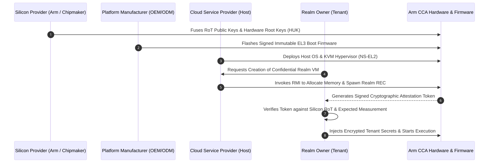

1. **Silicon Provider (Arm & Silicon Partners)**:
   - Implements the Armv9.1-A (and later) architecture featuring the Realm Management Extension (RME).
   - Injects the Hardware Unique Key (HUK) and Platform RoT Public Keys into on-chip non-volatile One-Time Programmable (OTP) fuses during chip manufacturing.
   - Publishes public endorsement certificates that link the chip's unique identity to verified silicon authenticity.
2. **Platform Manufacturer (OEM / ODM)**:
   - Integrates the SoC into server boards, incorporating power management, BMC, DRAM controllers, and PCIe root complexes.
   - Provisions platform initial boot code (BL1, BL2) adhering to Arm Base System Architecture (BSA) and Server Base System Architecture (SBSA).
3. **Cloud Service Provider (CSP / Host)**:
   - Manages physical compute, storage, and networking hardware.
   - Deploys the host operating system and hypervisor (e.g., Linux KVM).
   - Controls physical resource scheduling, CPU pin assignments, dynamic memory overcommit, and hardware teardown.
   - *Crucially, the CSP does NOT need to be trusted by the tenant for data confidentiality or execution integrity.*
4. **Realm Owner (Tenant)**:
   - Builds and owns the confidential workload, operating system image, and sensitive data.
   - Defines security policies, evaluates attestation evidence, and releases decryption keys directly to the Realm across an encrypted, authenticated channel.

---

---

# Module 2: Armv9-A Security States & Physical Address Spaces (PAS)

## 2.1 The Four Security States in Armv9-A

Prior to Armv9-A RME, the Arm architecture supported only two security states: **Non-Secure State** and **Secure State**. The current security state was determined by the `SCR_EL3.NS` bit. 

With the introduction of the **Realm Management Extension (FEAT_RME)** in Armv9.1-A, the architectural execution model is expanded to **four mutually isolated Security States**:
1. **Non-Secure State**: The standard operating environment hosting traditional hypervisors (KVM, Xen), guest operating systems, and client applications.
2. **Secure State**: The environment hosting platform firmware services, TrustZone Trusted OSs (e.g., OP-TEE, Trusted Services), and vendor-specific Trusted Applications.
3. **Realm State**: The execution environment dedicated strictly to Confidential Virtual Machines (Realms) and their privileged supervisor code.
4. **Root State**: The most privileged architectural state, reserved exclusively for the Exception Level 3 (`EL3`) firmware monitor (such as Trusted Firmware-A). Root state replaces the legacy concept of "Secure EL3".


### Architectural Controls of Current Security State
The active security state of the Processing Element (PE) is determined by two control bits located in the Secure Configuration Register at EL3 (`SCR_EL3`):
- `SCR_EL3.NS` (Non-Secure bit)
- `SCR_EL3.NSE` (Non-Secure Extension bit)

The decoding of these bits governs which security state the PE executes in when transitioning to lower exception levels (`EL2`, `EL1`, `EL0`):

| `SCR_EL3.NSE` | `SCR_EL3.NS` | Exception Level | Architectural Security State | Description |
| :---: | :---: | :---: | :---: | :--- |
| `X` | `X` | **EL3** | **Root State** | Root state is active whenever executing at `EL3`, regardless of `NS`/`NSE` bit values. |
| `0` | `0` | **EL2, EL1, EL0** | **Secure State** | Traditional TrustZone Secure World. |
| `0` | `1` | **EL2, EL1, EL0** | **Non-Secure State** | Standard Normal World. |
| `1` | `1` | **EL2, EL1, EL0** | **Realm State** | Confidential Computing Realm World. |
| `1` | `0` | **EL2, EL1, EL0** | *Reserved* | Architecturally reserved (causes an illegal exception return if attempted). |

Transitions between different security states can **only** occur by taking an exception to Root EL3 (e.g., via an `SMC` instruction or an interrupt configured to route to EL3), executing the EL3 monitor context-save routine, reprogramming `SCR_EL3`, and executing an `ERET` instruction into the target security state. Direct horizontal transitions between Non-Secure, Secure, and Realm states are strictly impossible in hardware.

---

## 2.2 Physical Address Spaces (PAS)

A foundational innovation of RME is the complete decoupling between **Virtual Addresses (VA)**, **Intermediate Physical Addresses (IPA)**, and physical memory classification.

In legacy architectures, an address transaction emitted onto the system bus had an associated single-bit tag: `NS = 0` (Secure) or `NS = 1` (Non-Secure). Under RME, physical memory is partitioned into **four distinct Physical Address Spaces (PAS)**:
1. **Root PAS**: Houses sensitive `EL3` monitor code, private stacks, cryptographic keys, and the Granule Protection Tables (GPT) themselves.
2. **Realm PAS**: Houses Realm code, Realm private data, Realm Execution Context (REC) metadata, and Realm Stage-2 translation tables (RTT).
3. **Secure PAS**: Houses TrustZone Trusted OS images, Secure partitions, and Trusted Application memory.
4. **Non-Secure PAS**: Houses host hypervisor code, guest operating systems of traditional VMs, DMA buffers, and shared communication pools.


Every physical bus transaction emitted by a PE, System MMU (SMMU), or DMA controller is qualified with an architectural 2-bit PAS tag:
- `0b00`: Non-Secure PAS
- `0b01`: Secure PAS
- `0b10`: Root PAS
- `0b11`: Realm PAS

---

## 2.3 Legal PAS Access Matrix

Hardware enforces strict, unbypassable boundary rules governing which Physical Address Spaces can be accessed by software executing in each Security State. 

Software executing in a given security state can only target physical memory belonging to a permissible subset of PASs. Any attempt by software to emit an access to an unauthorized PAS is blocked immediately by the core MMU or interconnect, triggering a synchronous exception:


### Comprehensive Access Enforcement Table

| Executing Security State | Target: Non-Secure PAS | Target: Secure PAS | Target: Realm PAS | Target: Root PAS | Architectural Result / Notes |
| :---: | :---: | :---: | :---: | :---: | :--- |
| **Root (EL3)** | **ALLOWED** | **ALLOWED** | **ALLOWED** | **ALLOWED** | Root state has architectural supremacy. It can access all four physical address spaces. Essential for initializing GPTs, dispatching contexts, and managing system boot. |
| **Realm (R-EL2, R-EL1, R-EL0)** | **ALLOWED** | **BLOCKED** *(GPF)* | **ALLOWED** | **BLOCKED** *(GPF)* | Realm software can access Realm PAS (private data) and Non-Secure PAS (shared I/O communication buffers). Access to Secure PAS or Root PAS is blocked. |
| **Secure (S-EL2, S-EL1, S-EL0)** | **ALLOWED** | **ALLOWED** | **BLOCKED** *(GPF)* | **BLOCKED** *(GPF)* | Secure software can access Secure PAS and Non-Secure PAS. It has **zero visibility** into Realm PAS or Root PAS. |
| **Non-Secure (NS-EL2, NS-EL1, NS-EL0)** | **ALLOWED** | **BLOCKED** *(GPF)* | **BLOCKED** *(GPF)* | **BLOCKED** *(GPF)* | Host Hypervisor and normal OS can **only** access Non-Secure PAS. Any access to Root, Secure, or Realm PAS triggers an immediate Granule Protection Fault. |

---

## 2.4 Translation Regimes & Controlling Output PAS

Translation tables (Stage-1 and Stage-2) are configured to control which PAS a translated address targets.

### Translation Regimes Overview
1. **Non-Secure Translation Regimes**:
   - `NS-EL1&0`: Stage-1 translates VA to IPA/PA. If Stage-2 is enabled (`NS-EL2`), Stage-2 translates IPA to PA.
   - Non-Secure translation regimes **cannot generate physical addresses targeting Root, Secure, or Realm PAS**. Even if a malicious hypervisor configures its Stage-2 translation descriptors to point to a physical address owned by a Realm, the hardware MMU verifies the requested PAS against the current security state and blocks the access.
2. **Realm Translation Regimes**:
   - `Realm EL1&0`: Stage-1 translates Realm VA to Realm IPA.
   - `Realm EL2`: Stage-2 translates Realm IPA to target PA.
   - The Stage-2 translation descriptors managed by the RMM encode whether the output target is **Realm PAS** (for private Realm memory) or **Non-Secure PAS** (for shared I/O buffers).
   - In Realm translation table descriptors, the top bit of the address or specific attribute bits (such as bit 55 or bit 63 depending on formatting) select between Realm and Non-Secure PAS.
3. **Root & Secure Translation Regimes**:
   - Root EL3 uses `TTBR0_EL3` and translation table descriptors that can explicitly encode any of the four target PASs using descriptor attribute bits `NSE` and `NS`.

```
Descriptor Bit Encoding for Output PAS (Armv9-A Page Table Descriptors):
+--------------------------------------------------------------+
| Bit [56] (NSE) | Bit [5] (NS) | Output Physical Address Space|
+----------------+--------------+------------------------------+
|       0        |      0       | Secure PAS                   |
|       0        |      1       | Non-Secure PAS               |
|       1        |      0       | Root PAS                     |
|       1        |      1       | Realm PAS                    |
+--------------------------------------------------------------+
```

---

## 2.5 Bus and Interconnect Extensions: Tagging Transactions

Software-level enforcement at the core MMU is insufficient to guarantee complete platform confidentiality; peripheral devices, memory controllers, and multi-socket interconnects must also honor PAS boundaries.

To propagate PAS isolation across the SoC, Arm enhanced its AMBA bus specifications:
- **AMBA ACE5 / ACE5-Lite**: Extended with sideband signals carrying the PAS classification for every read, write, and snoop transaction:
  - `AWPAS[1:0]` (Write Address Physical Address Space)
  - `ARPAS[1:0]` (Read Address Physical Address Space)
- **AMBA CHI (Coherent Hub Interface) Issue E**: Extended with explicit PAS packet header fields that accompany transactions across the on-chip mesh fabric and coherent interconnect (e.g., CoreLink CMN-700).

```
AMBA Interconnect Signals:
  Core / PE ----[ ARADDR + ARPAS[1:0] ]----> Interconnect (CMN-700)
            <---[ RDATA  + RRESP      ]----
            ----[ AWADDR + AWPAS[1:0] ]----> Granule Protection Checker (GPC)
                                                      |
                                            Pass?     | Fail?
                                           +----------+----------+
                                           |                     |
                                      [ DRAM Controller ]   [ System Error / GPF ]
```

When an address packet arrives at a memory controller or coherent cache slice, the hardware ensures that the cached data lines are tagged with their corresponding PAS. This prevents **cache aliasing attacks**, where a non-secure process might attempt to read a cached physical line that was populated by a Realm.

---

---

# Module 3: Granule Protection Checks (GPC) & Granule Protection Tables (GPT)

## 3.1 Hardware Granule Protection Checks (GPC) Architecture

The centerpiece of hardware isolation in the Realm Management Extension is the **Granule Protection Check (GPC)** engine. 

While Stage-1 and Stage-2 MMUs translate Virtual Addresses to Physical Addresses and enforce read/write/execute permissions, the GPC serves as an independent, hardware-enforced **validator of physical address ownership**. The GPC evaluates physical addresses *after* all MMU translations are complete, immediately prior to dispatching transactions to L1/L2/L3 caches, system interconnects, or external memory controllers.


### The Granule Concept
Under RME, all physical memory in the system is discretized into uniform atomic units called **granules**. 
- The architectural granule size is configurable by platform firmware at system boot:
  - **4 KB** (standard granule, matching standard 4KB MMU pages)
  - **16 KB**
  - **64 KB** (frequently utilized in high-performance enterprise server configurations)
- At any given point in time, every physical granule in the system has a single, unambiguously assigned **Granule Protection Information (GPI)** attribute defining which of the four Physical Address Spaces it belongs to.

---

## 3.2 Granule Protection Tables (GPT) Structure

The ownership of every physical granule across the entire physical address range is tracked in a globally authoritative, hierarchical table structure called the **Granule Protection Table (GPT)**.

The GPT structure is located strictly in the **Root Physical Address Space**. It can only be mapped, modified, and written by firmware executing in **Root EL3**. Even the hypervisor at `NS-EL2` or the Realm Management Monitor at `R-EL2` cannot directly alter a GPT entry.

### System Control Registers
Granule Protection Checks are governed by two primary EL3 control registers:
1. **`GPCCR_EL3` (Granule Protection Check Configuration Register, EL3)**:
   - `GPC`: Global enable bit for Granule Protection Checks.
   - `PGS` (Physical Granule Size): Configures the system granule size (`0b00` = 4KB, `0b01` = 64KB, `0b10` = 16KB).
   - `L0GPTSZ` (Level 0 GPT Size): Encodes the physical address range covered by each Level 0 entry (e.g., 1GB, 512MB).
   - `PPS` (Protected Physical Address Size): Introduced in Armv9.1-A / `FEAT_RME_GPC3` to define the maximum physical address range covered by the GPT (up to 52 bits). Any physical address beyond `PPS` defaults strictly to Non-Secure PAS, avoiding unnecessary page table memory consumption.
2. **`GPTBR_EL3` (Granule Protection Table Base Register, EL3)**:
   - Holds the 64-bit base physical address (in Root PAS) of the root Level 0 Granule Protection Table.


---

## 3.3 Two-Level GPT Lookup Walk & Descriptors

The architecture implements a flexible two-level lookup scheme:

### Level 0 Descriptors (L0GPTE)
Each entry in the Level 0 GPT covers a large, contiguous chunk of physical address space (typically **1 GB** per entry). A Level 0 entry is a 64-bit value that can take one of two distinct formats:
1. **Block Descriptor**:
   - Assigns the entire 1 GB physical memory block uniformly to a single PAS (or flags it as "Any", delegating checks to peripheral completer-side filters).
   - Highly efficient: eliminates the need to allocate Level 1 tables for large swaths of contiguous non-secure DRAM or memory-mapped I/O (MMIO) spaces.
2. **Table Descriptor**:
   - Indicates that the 1 GB region is finely subdivided into individual granules with varying PAS assignments.
   - Contains the 64-bit base physical address of the corresponding **Level 1 GPT** in Root PAS.

### Level 1 Descriptors (L1GPTE)
Each Level 1 table descriptor covers a portion of memory broken down to the system granule size. A Level 1 entry is a 64-bit descriptor that can be formatted as:
1. **Granule Descriptor**:
   - Encodes ownership for **16 contiguous granules**.
   - The 64-bit entry is divided into **16 separate 4-bit Granule Protection Information (GPI)** fields:
     $$\text{L1GPTE}[4i+3 : 4i] = \text{GPI for Granule } i \quad (i \in [0, 15])$$
2. **Contiguous Descriptor**:
   - Encodes that a block larger than a single granule (e.g., 2MB or 32MB) shares identical GPI properties.
   - Facilitates aggregated caching in the GPC TLBs, minimizing translation table walk penalties.

### GPI Value Encodings (4-bit field)

| GPI Encoding `[3:0]` | Assigned Physical Address Space | Architectural Behavior & Usage |
| :---: | :---: | :--- |
| `0b0000` | **Non-Secure (NS)** | Memory assigned to the host OS, standard VMs, or normal device buffers. |
| `0b0001` | **Root** | Memory holding EL3 monitor firmware, secure configuration, or GPT nodes. |
| `0b0010` | **Realm** | Memory holding Realm private data, REC execution states, or RTT page tables. |
| `0b0011` | **Secure** | Memory holding TrustZone firmware, Trusted OS stacks, or Secure storage. |
| `0b1000` | **Any** | Bypasses core GPC filtering; checks delegated to external programmable completer filters (used for legacy peripherals or shared MMIO fabrics). |
| *Others* | *Reserved* | Unassigned / Reserved. Triggers a Granule Protection Fault on any access. |

---

## 3.4 Granule Protection Faults (GPF)

When a processing element or bus initiator attempts a memory access where the output PAS generated by the translation regime does **not** match the GPI programmed in the Granule Protection Tables, hardware immediately aborts the transaction with a **Granule Protection Fault (GPF)**.

### Architectural Fault Classification
GPFs are classified into two broad categories:
1. **Synchronous Granule Protection Faults**:
   - Occur when a core PE instruction fetch or load/store instruction violates GPC rules.
   - Manifests as a **Synchronous Data Abort** or **Instruction Abort** taken to the current or higher Exception Level.
   - **Fault Syndrome Registers**:
     - `ESR_ELx.EC`: Contains Exception Class `0b100100` (Data Abort) or `0b100000` (Instruction Abort).
     - `ESR_ELx.DFSC` / `IFSC`: Contains specific Data/Instruction Fault Status Codes indicating:
       - `0b011100`: Granule Protection Fault on translation table walk (Level 0).
       - `0b011101`: Granule Protection Fault on translation table walk (Level 1).
       - `0b011110`: Granule Protection Fault on primary access.
     - `FAR_ELx` (Fault Address Register): Captures the precise Virtual Address that triggered the fault.
     - `HPFAR_EL2` / `HPFAR_EL3`: Captures the Intermediate Physical Address (IPA).
2. **Asynchronous / External Granule Protection Faults**:
   - Occur when background write-backs, prefetch operations, or external DMA controllers (via SMMU) violate GPC rules.
   - Signaled as an **SError Interrupt** (System Error) or routed directly to EL3 via an asynchronous fault interrupt line.

```
Synchronous Fault Dispatch Hierarchy:
  Illegal Access by NS-EL1 ---> Trapped to NS-EL2 (Host Hypervisor)
  Illegal Access by R-EL1  ---> Trapped to R-EL2 (TF-RMM)
  Illegal Access by R-EL2  ---> Trapped to Root EL3 (TF-A)
```

---

## 3.5 Dynamic Granule Transitions & Memory Scrubbing

A fundamental capability of Arm CCA is **dynamic physical memory reassignment**. Unlike traditional TrustZone, where memory carveouts for Secure World are fixed statically at boot time in the TrustZone Address Space Controller (TZASC), Arm CCA allows physical memory granules to be dynamically transitioned between Non-Secure and Realm states during runtime.

However, dynamically transitioning memory introduces a severe security hazard: **Information Remanence & Cross-World Data Leakage**.
- If a Non-Secure granule is transitioned to Realm PAS, stale hypervisor data might be read by the Realm (integrity risk).
- More critically, when a Realm is destroyed or releases memory back to Non-Secure PAS, private Realm data (passwords, encryption keys, decrypted customer data) would be exposed to the host if physical DRAM lines or cache lines are not scrubbed.

### The Granule Transition Protocol
To transition a granule safely, the architecture mandates an atomic, multi-stage protocol executed across the Host Hypervisor, RMM, and Root EL3 Monitor:

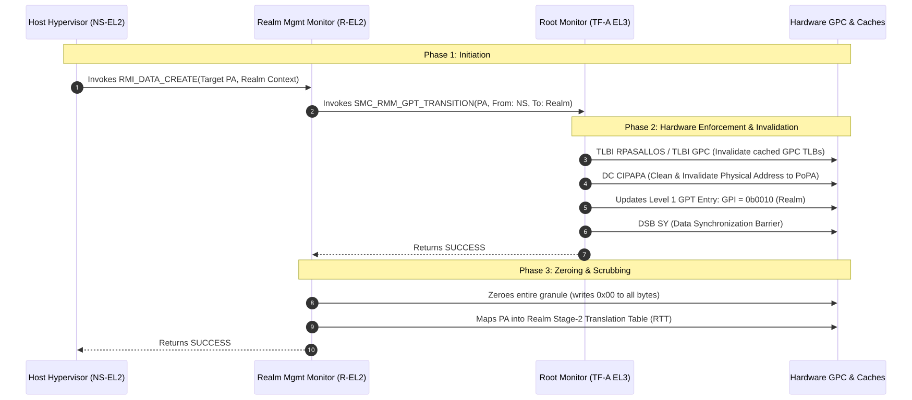

### Architectural Scrubbing & Invalidation Requirements
1. **Cache Clean and Invalidate to Point of Physical Authenticity (PoPA)**:
   - Before a granule changes PAS ownership, the processor must execute the dedicated cache maintenance instruction:
     ```assembly
     DC CIPAPA, Xt   /* Clean and Invalidate cache by Physical Address to PoPA */
     ```
   - This ensures that any dirty cache lines belonging to the old owner are flushed to DRAM and tagged lines are evicted, preventing stale cache hits under the new PAS.
2. **GPC TLB Invalidation**:
   - Processor GPC TLBs cache recent GPT entries. Firmware must execute:
     ```assembly
     TLBI RPASALLOS  /* TLB Invalidate all Physical Address Spaces, Outer Shareable */
     ```
   - This prevents stale GPC lookup entries from permitting illegal accesses.
3. **Mandatory Hardware Zeroing (Scrubbing)**:
   - When transitioning from Realm PAS back to Non-Secure PAS (via `RMI_DATA_DESTROY`), the RMM zeroizes the memory granule *before* EL3 updates the GPT to Non-Secure. 
   - Even if the host hypervisor attempts to read the physical address immediately upon transition, it reads only zeros.

---

## 3.6 GPC Bypass Windows: Mechanics and Security Bounds

In specific platform configurations, certain physical address ranges must bypass core GPC checking:
- **GPC Bypass Windows**: Architecturally defined physical memory windows configured in `GPCCR_EL3` where incoming transactions are automatically forwarded with `GPI = Any` or directly assigned to Non-Secure PAS without traversing the GPT walk.
- **Legitimate Use Cases**:
  - Legacy platform initialization before GPT structures are allocated in Root RAM.
  - High-bandwidth, fixed memory-mapped I/O (MMIO) fabrics where a hardware-programmable completer filter (such as an external firewall or peripheral filter) already enforces security boundaries.
- **Architectural Security Constraints**:
  - A GPC Bypass Window can **never** be configured over DRAM regions hosting Root PAS or Realm PAS memory.
  - Configuration of bypass windows is locked to Root EL3 and cannot be altered once the system transitions from initial boot to the runtime security lifecycle.

---

---

# Module 4: System Hardware Infrastructure & Memory Protection

## 4.1 Processing Element (PE) Architecture & Granule Data Isolation (GDI)

The Armv9-A architecture with Realm Management Extension (RME) introduces critical microarchitectural enhancements to the Processing Element (PE) pipeline to guarantee strict temporal and spatial isolation across security states.

### Microarchitectural Flushes & State Sanitization
Whenever a physical PE transitions between security states (e.g., executing a world switch at Root EL3), hardware and firmware cooperate to enforce complete state isolation:
- **General-Purpose and Vector Registers**: Saved and restored by the EL3 monitor or RMM. Vector registers (Neon, SVE2, SME) and FPCR/FPSR are zeroized or context-switched to eliminate microarchitectural data remanence.
- **Translation Lookaside Buffers (TLBs)**: Every TLB entry is tagged with its originating Translation Regime and PAS. A Non-Secure translation lookup can never match a TLB entry tagged with Realm PAS.
- **Branch Target Buffers (BTBs) & Speculative Execution Barriers**: RME requires hardware protection against speculative cross-world side-channel attacks (e.g., Spectre-v2, Branch Target Injection). Architectural barrier instructions (`CSDB`, `ESB`, `SB`) and hardware speculation barriers (`FEAT_CSV2`, `FEAT_CSV3`) prevent malicious hypervisors from training branch predictors to steer speculative execution in Realms.

### Granule Data Isolation (GDI)
As defined in the *RME System Architecture* (ARM-DEN-0129), **Granule Data Isolation (GDI)** is a system-level property ensuring that data belonging to a physical granule assigned to one PAS is never exposed to another PAS through transient storage:
1. **Cache Tagging**: Internal L1, L2, and system-level caches (SLC) track the PAS attribute alongside physical cache line address tags. Even if two processes in different security states issue an access to identical physical address offsets, the cache tag comparison checks:
   $$\text{Cache Hit} \iff (\text{PA} == \text{Tag.PA}) \land (\text{Transaction.PAS} == \text{Tag.PAS})$$
2. **Eviction and Line-Fill Scrubbing**: When a cache line is evicted or invalidated, its data cannot be speculatively snooped across security boundaries.

```
L1 / L2 / L3 Cache Line Tag Format in RME:
+---------------------------------------------------------------------------------+
| Physical Tag [PA_WIDTH-1 : 6] | PAS Tag [1:0] | MECID [15:0] | State / Dirty Bit|
+---------------------------------------------------------------------------------+
|                                Cache Data (64 Bytes)                            |
+---------------------------------------------------------------------------------+
```

---

## 4.2 Main Memory Protection Engine (MPE) & DRAM Encryption

While Granule Protection Checks prevent unauthorized on-chip access, external DRAM chips and inter-die memory buses remain vulnerable to physical tampering, cold-boot attacks, and passive bus interposers.

To eliminate physical attacks, RME platforms integrate a hardware **Memory Protection Engine (MPE)** into the DRAM memory controller pipeline.


### Cryptographic Primitives & Modes
The MPE operates at memory line speed (typically 64-byte bursts corresponding to cache lines):
1. **Confidentiality (Encryption)**:
   - Utilizes standard block ciphers such as **AES-XTS-128**, **AES-XTS-256**, or low-latency tweakable ciphers (e.g., Prince or QARMA-based ciphers).
   - The encryption key is dynamically combined with a physical address tweak, ensuring that identical 64-byte plaintext patterns written to different physical memory locations produce completely distinct ciphertexts (defeating pattern-recognition attacks).
2. **Integrity & Replay Protection**:
   - To defeat active physical tampering (e.g., bit-flipping or splicing attacks), the MPE generates a Message Authentication Code (MAC) for each 64-byte line.
   - To mitigate replay attacks (where an attacker records a valid ciphertext block and writes it back at a later time), the MPE maintains an on-chip **integrity tree (Merkle Tree)** with monotonic version counters rooted in on-chip SRAM.

---

## 4.3 Memory Encryption Contexts (MEC) & MECIDs

In cloud multi-tenant systems, thousands of confidential virtual machines may execute concurrently. If all Realms share a single global encryption key, a physical bus attack or microarchitectural bug in the memory controller could theoretically compromise multi-tenant isolation.

The **Memory Encryption Contexts (MEC)** extension introduces fine-grained, per-Realm cryptographic keys for main memory.


### MEC Mechanics & Allocation
- **MECID (Memory Encryption Context Identifier)**: A 16-bit identifier allocated by the RMM to each active Realm.
- **PAS and MECID Interaction**: While the GPC verifies that the transaction targets Realm PAS, the MPE checks the MECID:
  - If a transaction arrives at the memory controller with `PAS = Realm` and `MECID = 0x0002`, the MPE retrieves Key $K_{\text{R2}}$ from its internal secure key store to decrypt the cache line.
  - If an attacker or hypervisor attempts to read Realm 2's memory using Realm 1's context or a Non-Secure context, the MPE uses the incorrect key, resulting in cryptographically scrambled garbage and an immediate integrity check failure.
- **MECID Mismatch Faults**: Any discrepancy between the MECID encoded in the transaction and the assigned granule configuration triggers a synchronous abort or system error report.

---

## 4.4 System Control Processor (SCP) & Trusted Subsystems

Enterprise SoCs incorporate autonomous microcontrollers for power, thermal, clock, and system lifecycle management:
- **System Control Processor (SCP)** / Manageability Subsystem.
- **Baseboard Management Controller (BMC)**.

### Architectural Threat
Because these microcontrollers often have direct bus master access to the system fabric to orchestrate dynamic frequency scaling (DVFS) and power states, a compromised SCP could potentially issue DMA reads into Realm or Root memory.

### RME Requirements for Subsystems (ARM-DEN-0129)
1. **Isolated & Shielded Locations**:
   - Firmware for the SCP must execute from dedicated ROM or private on-chip SRAM that is physically inaccessible to the main Application PEs.
2. **SCP Transaction Filtering**:
   - The interconnect must subject all SCP-initiated bus transactions to Granule Protection Checks. 
   - Under standard runtime states, the SCP is treated as an untrusted or strictly non-secure bus master: it is prohibited from initiating transactions targeting Root, Secure, or Realm PAS.
3. **Power Transitions & State Zeroization**:
   - When a core or cluster is placed into a low-power retention or power-down state (e.g., via PSCI), any hardware state registers saving Realm or Root context must be wiped before power rails collapse, or saved into Root-shielded SRAM.

---

## 4.5 Multi-Chip Interconnects & Link Protection

High-end server platforms deploy multi-socket configurations where multiple physical SoCs communicate over high-speed coherent inter-chip links (e.g., Arm CCIX or CXL across PCIe physical layers).


### Multi-Chip RME Requirements
1. **Link Encryption & Integrity**:
   - Inter-chip links carry cache coherency snoop requests, data transfers, and memory read/writes across physical printed circuit board (PCB) traces.
   - As mandated by ARM-DEN-0129 Chapter B8, multi-chip links must implement hardware-level authenticated encryption (e.g., MACsec or PCIe IDE) to protect transactions traversing external board traces against physical interposers.
2. **PAS Preservation Across Sockets**:
   - The coherent interconnect protocol must serialize the 2-bit PAS tag and the MECID into the packet headers across the physical link.
   - Sockets must establish a mutually verified cryptographic trust domain at system boot before permitting coherent Realm transactions to traverse the inter-chip fabric.

---

## 4.6 CXL.mem Integration & CXL-TSP

The advent of **Compute Express Link (CXL)** allows servers to expand physical memory via memory devices connected over PCIe physical layers (CXL.mem protocol).

### Challenges with External CXL Memory
Unlike on-package DRAM controllers, CXL memory modules reside across external PCIe slots and may contain independent controllers, making them vulnerable to device substitution and bus snooping.

### CXL-TSP (Trusted Security Protocol)
To support CXL memory in an RME architecture:
- The host memory controller and the CXL endpoint negotiate **CXL-TSP** session keys during platform boot.
- The SoC memory controller treats the CXL link as a secure cryptographically encapsulated tunnel.
- Transactions emitted to CXL memory maintain explicit PAS classification and per-granule integrity tags, ensuring that Realm memory hosted on CXL expanders retains identical security guarantees to local DRAM.

---

---

# Module 5: System MMU (SMMUv3.2/3.3) & Device Assignment (RME-DA & RME-CDA)

## 5.1 System MMU Role in an RME-Enabled Platform

In complex computing systems, peripheral devices (e.g., Network Interface Cards, NVMe SSD controllers, GPUs, and hardware accelerators) utilize Direct Memory Access (DMA) to read and write system memory directly. 

Without hardware protection, a malicious peripheral or a compromised hypervisor configuring DMA descriptors could issue memory transactions targeting Realm private memory, bypassing core CPU MMUs entirely.

To prevent DMA-based compromise and to enable direct, confidential hardware acceleration, the **Arm System Memory Management Unit (SMMUv3.2 and SMMUv3.3)** incorporates architectural extensions for RME:
1. **PAS-Aware Stream Translation**: Every DMA transaction emitted by an endpoint device is assigned a **StreamID**. The SMMU maps the StreamID to a security domain and translation context.
2. **Granule Protection Check (GPC) Integration**: The SMMU incorporates an internal GPC pipeline and GPC TLB, validating that physical addresses generated by DMA translation do not violate Granule Protection Tables before emitting transactions to the system interconnect.


---

## 5.2 StreamWorld Configurations & Stream Security

The SMMU configuration structure is rooted in the **Stream Table**, indexed by the peripheral's `StreamID`. Each Stream Table Entry (STE) contains the **`STRW` (StreamWorld)** configuration:

| `STRW` Field | Associated Security Domain | Output Permitted PAS | Description |
| :---: | :---: | :---: | :--- |
| `0b00` | **Non-Secure (NS)** | Non-Secure PAS Only | Standard PCIe devices (legacy NICs, NVMe disks). Cannot target Realm memory. |
| `0b01` | **Secure** | Secure & Non-Secure PAS | Secure World peripherals (e.g., Hardware Security Modules, TPMs). |
| `0b10` | **Realm** | Realm & Non-Secure PAS | Devices assigned directly to a Realm (Confidential Accelerators, Realm vNICs). |
| `0b11` | **Root** | All PAS (Root, Realm, Secure, NS) | Highly privileged platform controllers. |

---

## 5.3 The Address Translation Services (ATS) Security Dilemma & DPT

High-performance PCIe devices utilize **Address Translation Services (ATS)**. Under ATS, rather than the SMMU translating every single DMA read/write transaction:
1. The device issues an ATS translation request to the SMMU.
2. The SMMU translates the address and returns the translated physical address to the device.
3. The device caches the translation in its internal **Address Translation Cache (ATC)** and subsequently issues DMA requests using physical addresses directly.

### The ATS Vulnerability in Confidential Computing
In a confidential compute environment, ATS creates an unacceptable security flaw:
> *A physical PCIe endpoint is outside the processor chip package. An attacker can compromise the device firmware or tap the PCIe bus, manipulating the device's internal ATC to emit arbitrary physical addresses into Realm memory, bypassing the SMMU.*


### The Solution: Device Protection Table (DPT)
To allow the performance benefits of ATS without compromising Realm security, Arm SMMUv3.3 introduces the **Device Protection Table (DPT)**:
- Even when full ATS is enabled, all memory transactions emitted by the device must pass through an ultra-fast hardware **DPT check** at the PCIe Root Port or SMMU.
- The DPT acts as an independent hardware firewall recording which specific physical address ranges have been legally mapped to each peripheral device.
- If a device attempts a DMA transaction using an address that does not match an active entry in the DPT for its StreamID, the transaction is dropped immediately and logged as a DPT violation.

---

## 5.4 RME Device Assignment (RME-DA) & PCIe IDE

To enable confidential cloud workloads to utilize specialized accelerators (such as GPUs for private AI inference, tensor processing units, or high-speed SmartNICs) without exposing data to the hypervisor, Arm defines **RME Device Assignment (RME-DA)** and **RME Coherent Device Assignment (RME-CDA)**.

### The Three-Layer Device Assignment Stack
Securing an external PCIe peripheral in Arm CCA requires three coordinated protocols:


1. **SPDM (Security Protocol and Data Model - DMTF standard)**:
   - Before an accelerator is assigned to a Realm, the platform Root of Trust and the RMM communicate with the device's embedded micro-controller.
   - The device presents its X.509 certificate chain rooted in the device manufacturer's CA.
   - The RMM requests cryptographic measurements of the device's internal firmware.
2. **PCIe IDE (Integrity and Data Encryption - PCI-SIG standard)**:
   - Establishes point-to-point cryptographic encryption between the host PCIe Root Complex and the endpoint device controller.
   - Every Transaction Layer Packet (TLP) is encrypted with AES-GCM and stamped with a 96-bit cryptographic MAC, protecting all PCIe traffic against physical interposers.
3. **TDISP (Trusted Device Interface Security Protocol)**:
   - Standardizes the interface states: `CONFIG_LOCKED`, `UNLOCKED`, `LOCKED`, and `RUN`.
   - The Host Hypervisor coordinates device setup, but cannot enter the `RUN` state or manipulate device DMA registers without cryptographic authorization from the RMM.

### Arm Vendor-Defined Messages (VDMs) for TDISP
As specified in **ARM-DEN-0129 Appendix 2**, Arm CCA extends standard TDISP messaging using PCIe Vendor-Defined Messages (VDMs) with Arm's Vendor ID:
- `GET_VERSION_REQ` / `GET_VERSION_RESP`: Negotiates Arm RME-DA protocol capabilities.
- `SET_INTERFACE_REQ` / `SET_INTERFACE_RESP`: Binds a specific physical or virtual function (SR-IOV VF) to a target Realm.
- `GET_DEV_PROP_REQ` / `GET_DEV_PROP_RESP`: Retrieves device hardware properties, memory limits, and GPC compliance flags.

---

---

# Module 6: Arm CCA Software Architecture & Firmware Stack

## 6.1 Complete Software Topology & Trust Hierarchy

The Arm Confidential Compute Architecture software stack coordinates firmware, hypervisor, and guest environments across all four security states.


---

## 6.2 EL3 Firmware: Monitor & RMM Dispatcher (RMMD)

Exception Level 3 (`EL3`) is the architectural bedrock of the platform. Executing in **Root State**, the EL3 firmware (implemented in open-source **Trusted Firmware-A / TF-A**) has complete physical access to the machine.

### Core Responsibilities of TF-A in Arm CCA
1. **Cold Boot & Platform Initialization**:
   - Executes the early boot stages (`BL1`, `BL2`, `BL31`).
   - Configures `GPCCR_EL3` and `GPTBR_EL3`, building the initial Level 0 and Level 1 Granule Protection Tables in Root PAS memory.
   - Disables all invasive debug interfaces for Realm and Root spaces unless hardware cryptographic debug authentication is satisfied.
2. **RMM Dispatcher (RMMD)**:
   - Resides inside TF-A as a privileged dispatch service.
   - When the Host Hypervisor issues a Secure Monitor Call (`SMC`) containing an **RMI function ID**, the processor traps to EL3.
   - The RMMD validates the SMC parameters, performs a context switch from Non-Secure state to Realm state, and executes an `ERET` to enter the Realm Management Monitor at `R-EL2`.
   - Conversely, when the RMM completes an operation or needs to return control to the host, the RMMD switches context back and returns execution to `NS-EL2`.
3. **GPT Dynamic Transition Service**:
   - Serves privileged SMC calls from the RMM to transition granules between `Non-Secure` and `Realm` PAS.
   - Executes the required hardware cache clean/invalidation (`DC CIPAPA`) and TLB invalidation (`TLBI RPASALLOS`) before committing GPT entry changes.

---

## 6.3 Realm Management Monitor (TF-RMM) at R-EL2

The **Realm Management Monitor (RMM)** is a purpose-built, highly optimized, trusted firmware layer executing at **Realm EL2 (`R-EL2`)**. 

The reference implementation, **TF-RMM**, is developed under the open governance of TrustedFirmware.org.

### Architectural Mandates of the RMM
1. **Zero Policy, Pure Mechanism**:
   - The RMM does **not** contain an operating system scheduler, virtual disk driver, or complex device emulator.
   - It acts purely as a deterministic hardware-isolation gatekeeper. Scheduling decisions remain strictly with the host hypervisor.
2. **Deterministic Memory Footprint**:
   - The RMM uses a static, pre-allocated memory model. It does not use dynamic runtime heap allocations (`malloc`), eliminating a massive class of memory corruption and heap fragmentation vulnerabilities.
3. **Execution Context Management**:
   - Allocates and maintains **Realm Execution Contexts (RECs)**.
   - When the host hypervisor decides to run a Realm vCPU, it invokes `RMI_REC_ENTER`. The RMM sanitizes the CPU registers, loads the Realm vCPU state, configures Realm Stage-2 translation, and enters Realm EL1/EL0.
4. **Attestation Token Generation**:
   - Manages the cryptographic measurement engine for Realms.
   - Serves requests from the Realm guest via the Realm Services Interface (RSI) to produce cryptographically signed attestation tokens.

---

## 6.4 Host Hypervisor (KVM / kvmtool / QEMU) at NS-EL2

In traditional virtualization, Linux KVM owns both resource allocation and execution privileges. In Arm CCA, KVM is adapted to operate as an **Untrusted Resource Manager**.

### KVM Architectural Adaptations for CCA
1. **Realm VM Lifecycle Management**:
   - KVM exposes standard `/dev/kvm` ioctl interfaces to userspace VMMs (such as `kvmtool` or QEMU):
     - `KVM_CREATE_VM` (flagged with `KVM_VM_TYPE_ARM_REALM`)
     - `KVM_ARM_REALM_CREATE_RD` (allocates Realm Descriptor)
     - `KVM_ARM_REALM_INIT_IPA_REALM` (populates initial guest image)
     - `KVM_ARM_REALM_ACTIVATE` (locks initial measurements and transitions Realm to Active)
2. **Unshared Memory Management**:
   - Standard KVM virtual machines have their guest physical memory mapped directly into the host process's virtual address space, allowing QEMU to inspect guest memory.
   - For Realms, KVM allocates normal host memory pages, but then issues `RMI_DATA_CREATE` SMCs to hand the pages over to the RMM. The hardware GPC immediately converts the granules to Realm PAS, revoking KVM's read and write permissions.
3. **Fault & Exit Handling**:
   - When a Realm triggers an exit (e.g., an MMIO access to an emulated virtio device, a timer interrupt, or a PSCI power call), the hardware exits to R-EL2.
   - The RMM sanitizes the exit state: general-purpose register contents are scrubbed, and only a minimal exit reason structure is returned to KVM at `NS-EL2`.

---

## 6.5 Realm Guest Environment: Linux & EDK2

Software running inside a Realm executes at **Realm EL1** (Operating System Kernel) and **Realm EL0** (User Applications).

### Realm Enlightenment
An operating system executing inside a Realm does not require radical architectural redesign, but it does require **CCA Enlightenment**:
1. **Shared vs. Private Memory Classification**:
   - Real-world virtual machines must communicate with host-emulated devices (e.g., virtio-net, virtio-blk). Because the host hypervisor cannot read Realm PAS memory, DMA buffers used for virtio communication must reside in **Non-Secure PAS**.
   - The enlightened Linux kernel implements a bouncing buffer mechanism (such as the Linux `swiotlb` / Software I/O TLB framework). When the guest driver prepares a network packet for transmission, it copies the data from private Realm memory to an explicit shared Non-Secure memory pool.
   - The guest dynamically requests the RMM to mark specific address ranges as Non-Secure using the **Realm Services Interface (`RSI_IPA_STATE_SET`)**.
2. **EDK2 / OVMF UEFI Firmware for Realms**:
   - Open-source EDK2 provides the standard UEFI boot environment inside the Realm.
   - EDK2 initializes the virtual platform, discovers virtual ACPI tables populated by the host, measures the UEFI boot environment into the Realm's runtime attestation registers, and boots the guest Linux kernel.

---

---

# Module 7: Realm Lifecycle, Execution Contexts (REC) & Stage-2 Translation (RTT)

## 7.1 Realm Lifecycle State Machine

A Realm undergoes a deterministic, cryptographically tracked lifecycle enforced by the Realm Management Monitor (RMM). The RMM maintains a state variable within the Realm Descriptor (`RD`), governing permissible operations at each stage of execution.


### Architectural States
1. **`NEW` State**:
   - The Realm is instantiated via `RMI_REALM_CREATE`.
   - The Host Hypervisor builds the initial Realm Translation Table (RTT) hierarchy and populates the Realm's initial firmware and boot parameters via `RMI_DATA_CREATE`.
   - Every byte of code and data loaded during the `NEW` state is measured by the RMM using a cryptographic hash function (SHA-256 or SHA-512) and accumulated into the **Realm Initial Measurement (RIM)** register.
   - Virtual CPUs are instantiated by creating **Realm Execution Contexts (RECs)** via `RMI_REC_CREATE`.
2. **`ACTIVE` State**:
   - The host issues `RMI_REALM_ACTIVATE`.
   - **The RIM register is permanently locked**. No further code or data can be added to the Realm without altering runtime measurements.
   - The Realm enters the execution phase. RECs can now be scheduled and entered using `RMI_REC_ENTER`.
3. **`SYSTEM_OFF` / `DESTROYING` State**:
   - Triggered when the Realm executes a power-off call (`PSCI_SYSTEM_OFF`) or when the host terminates the Realm.
   - The host tears down the Realm by destroying RECs, dismantling the RTT tree, and returning memory granules to Non-Secure PAS via `RMI_DATA_DESTROY`.
   - **Hardware Invariant**: The RMM refuses to deallocate the Realm Descriptor (`RD`) until every single memory granule, RTT node, and REC assigned to the Realm has been zeroed, scrubbed, and transitioned back to Non-Secure PAS.

---

## 7.2 Realm Execution Context (REC) & Scheduling

A **Realm Execution Context (REC)** represents the architectural state of a virtual CPU allocated to a Realm. 

Because the Host Hypervisor is outside the TCB, it cannot directly inspect or modify the virtual CPU registers. Instead, CPU state is bifurcated across two structures:
1. **Host-Visible REC Buffer**: Contains only operational scheduling metadata (exit reason, interrupt injection flags, timer values).
2. **Private REC Context (Inside Realm PAS)**: Contains general-purpose registers (`X0`–`X30`), stack pointers (`SP_EL0`, `SP_EL1`), program counter (`PC`), Process State (`PSTATE`), Floating-Point/Neon/SVE vector registers, and Realm-private system registers.

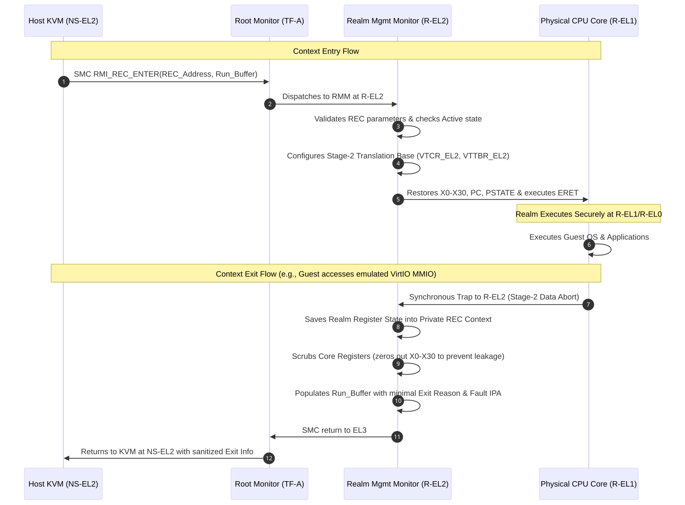

### Context Entry & Exit Lifecycle
- **Context Entry (`RMI_REC_ENTER`)**:
  - The host issues an `RMI_REC_ENTER` SMC call, passing the physical address of the REC and a shared communication page (`rec_run`).
  - The RMM configures hardware virtualization controls: the Virtualization Translation Control Register (`VTCR_EL2`) and Virtualization Translation Table Base Register (`VTTBR_EL2`) are loaded with the Realm's Stage-2 page table base.
  - The RMM restores the guest's registers and issues an `ERET` instruction into Realm EL1.
- **Context Exit (`RMI_REC_EXIT`)**:
  - Exits occur on:
    - **Physical Interrupts**: A physical host timer or network interrupt asserts while executing in Realm mode.
    - **Hypercalls / Traps**: The guest issues an `HVC` instruction or performs an access to an unmapped IPA (e.g., MMIO space of an emulated device).
    - **PSCI Calls**: The guest requests a vCPU power transition.
  - The core traps to R-EL2. The RMM securely preserves the guest state, thoroughly zeroes all scratch and general-purpose registers on the physical core, and populates the `rec_run` buffer with sanitized exit metadata before relinquishing control back to `NS-EL2`.

---

## 7.3 Realm Translation Tables (RTT) & RIPAS States

Memory mapping inside a Realm is governed by a dedicated Stage-2 translation tree managed exclusively by the RMM: the **Realm Translation Table (RTT)**.


### Realm Intermediate Physical Address State (RIPAS)
Every Intermediate Physical Address (IPA) within a Realm's virtual address space is tagged with a **RIPAS** value:
1. **`RIPAS_EMPTY`**:
   - The address space has been defined by the hypervisor, but no physical memory granule has been assigned yet.
   - If the Realm attempts to access an address marked `RIPAS_EMPTY`, a Stage-2 translation fault is trapped to the RMM.
2. **`RIPAS_RAM`**:
   - The IPA is backed by a valid physical memory granule residing in **Realm PAS**.
   - The Realm has full read/write permissions. The Host Hypervisor cannot read or write this memory.
3. **`RIPAS_DESTROYED`**:
   - The backing physical granule has been reclaimed or torn down by the host. Any subsequent read/write by the guest will fault until the page is explicitly re-provisioned and zeroed.

### Dynamic RIPAS Transition Workflow
When an enlightened guest OS boots, it may dynamically request additional private memory or donate memory to a shared pool:
1. Guest issues an SMC call: `RSI_IPA_STATE_SET(Start_IPA, Size, Desired_RIPAS)`.
2. The RMM intercepts the call, marks the translation range as pending transition, and returns a status code signaling the host hypervisor.
3. The host hypervisor invokes `RMI_DATA_CREATE` to allocate physical memory and bind it to the IPA.
4. The RMM verifies that the backing physical granule is scrubbed and updates the RTT entry to `RIPAS_RAM`.

---

## 7.4 Interrupt Virtualization & Exception Dispatch

Confidential virtual machines must process interrupts (e.g., virtual timers, virtual network notifications) without permitting the host hypervisor to inject malicious interrupt vectors or snoop execution timing.

Arm CCA leverages the **Generic Interrupt Controller (GICv3 / GICv4)** with virtualization extensions:


### Interrupt Flow Mechanics
1. **Physical Interrupt Arrival**:
   - While a Realm is executing, a physical interrupt (e.g., physical NIC interrupt) fires.
   - The hardware configuration in `SCR_EL3` and `HCR_EL2` ensures the physical interrupt causes an immediate exit from Realm state to `R-EL2`.
   - The RMM sanitizes core registers and completes the context exit to `NS-EL2`. The Host Hypervisor services the physical interrupt.
2. **Virtual Interrupt Injection**:
   - When the host needs to deliver a virtual interrupt to a Realm vCPU, it cannot directly write to the GIC CPU interface registers of the Realm.
   - The host populates the `rec_run` shared structure with the target Virtual Interrupt ID (vINTID).
   - Upon the next `RMI_REC_ENTER`, the RMM parses the `rec_run` buffer, validates that the requested virtual interrupt is permissible, and writes the virtual interrupt into the hardware **GIC List Registers (`ICH_LR<n>_EL2`)**.
   - When the Realm resumes execution at R-EL1, the GIC hardware virtual CPU interface signals the interrupt directly to the guest kernel.

---

---

# Module 8: Arm CCA Communication Interfaces: RMI, RSI, RHI, PSCI

## 8.1 The Realm Management Interface (RMI)

The **Realm Management Interface (RMI)** is the standard boundary interface between the **Host Hypervisor (`NS-EL2`)** and the **Realm Management Monitor (`R-EL2`)**, mediated by the Root EL3 Monitor.

All RMI operations are dispatched using the standard Arm Fast Call calling convention via `SMC` instructions, utilizing dedicated RMI Function IDs (encapsulated under the standard Arm Architecture SMC calling convention).


### Comprehensive RMI Command Suite

| RMI Command Name | Key Input Parameters | Key Outputs / Effects | Architectural Purpose |
| :--- | :--- | :--- | :--- |
| **`RMI_VERSION`** | `req_version` | `ret_version` | Queries supported RMI specification version and negotiates interface level. |
| **`RMI_REALM_CREATE`** | `rd_pa`, `params_pa` | Status (`RMI_SUCCESS` / Error) | Allocates the Realm Descriptor (`RD`) granule in Realm PAS and initializes metadata. |
| **`RMI_REALM_ACTIVATE`**| `rd_pa` | Status | Finalizes the Realm Initial Measurement (RIM), permanently locking initial configuration. |
| **`RMI_REALM_DESTROY`** | `rd_pa` | Status | Tears down the Realm Descriptor once all subordinate granules have been purged. |
| **`RMI_REC_CREATE`** | `rd_pa`, `rec_pa`, `params_pa` | Status | Instantiates a virtual CPU (REC) within the Realm, binding it to the Realm Descriptor. |
| **`RMI_REC_DESTROY`** | `rec_pa` | Status | Deallocates and wipes a Realm Execution Context granule. |
| **`RMI_REC_ENTER`** | `rec_pa`, `run_pa` | Sanitized Exit Reason in `run_pa` | Context-switches physical core into Realm mode, running the target vCPU. |
| **`RMI_RTT_CREATE`** | `rd_pa`, `rtt_pa`, `ipa`, `level` | Status | Allocates a physical granule in Realm PAS to host a new Stage-2 RTT page table node. |
| **`RMI_RTT_DESTROY`** | `rd_pa`, `rtt_pa`, `ipa`, `level` | Status | Reclaims an empty RTT page table node and transitions the granule back to NS-PAS. |
| **`RMI_DATA_CREATE`** | `rd_pa`, `data_pa`, `ipa`, `src_pa`, `flags` | Status | Copies contents from `src_pa` (NS), transitions `data_pa` to Realm PAS, and updates RIM. |
| **`RMI_DATA_CREATE_UNKNOWN`** | `rd_pa`, `data_pa`, `ipa` | Status | Allocates a blank (uninitialized) page to Realm PAS without measuring content. |
| **`RMI_DATA_DESTROY`** | `rd_pa`, `data_pa` | Status | Zeroes the Realm memory granule completely and transitions its GPI back to Non-Secure. |
| **`RMI_RTT_MAP_UNPROTECTED`** | `rd_pa`, `ipa` | Status | Maps a Non-Secure physical page into the Realm's Stage-2 tables (for shared I/O). |
| **`RMI_RTT_READ_ENTRY`** | `rd_pa`, `ipa`, `level` | Entry attributes, RIPAS | Allows host to inspect translation state and RIPAS status of an IPA range. |
| **`RMI_PSCI_COMPLETE`** | `calling_rec_pa`, `target_rec_pa` | Status | Signals completion of a host-handled PSCI CPU_ON or CPU_OFF request. |

---

## 8.2 The Realm Services Interface (RSI)

The **Realm Services Interface (RSI)** is the privileged communication channel established between the **Realm Guest OS (`R-EL1`)** and the **Realm Management Monitor (`R-EL2`)**.

RSI calls are issued using `SMC` instructions executed at `R-EL1`. Unlike RMI calls (which involve EL3 world switching), RSI calls execute directly between `R-EL1` and `R-EL2` within Realm State, minimizing instruction latency.


### Comprehensive RSI Command Suite
1. **`RSI_ABI_VERSION`**:
   - Discovers and validates the supported RSI specification version.
2. **`RSI_REALM_CONFIG`**:
   - Returns a structured configuration descriptor containing the Realm's intermediate physical address size (`IPA_WIDTH`), hash algorithm used for attestation, and number of vCPUs.
3. **`RSI_IPA_STATE_SET` / `RSI_IPA_STATE_GET`**:
   - Used by the guest kernel memory manager to change an IPA range from `RIPAS_EMPTY` to `RIPAS_RAM` (requesting private RAM) or declaring an address range as **unprotected** (shared memory for VirtIO DMA).
4. **`RSI_ATTESTATION_TOKEN_INIT` & `RSI_ATTESTATION_TOKEN_CONTINUE`**:
   - Initiates attestation token generation. Because a signed cryptographic token can be several kilobytes in size (exceeding register space), the token is streamed into guest-provided buffer granules across multiple non-blocking calls.
5. **`RSI_MEASUREMENT_READ` & `RSI_MEASUREMENT_EXTEND`**:
   - Enables the guest to read the current RIM and write runtime measurements into the **Realm Extensible Measurements (REM[0..3])** registers (similar to extending a TPM PCR).
6. **`RSI_HOST_CALL`**:
   - Dispatches a structured hypercall request directly to the untrusted host hypervisor, carrying an address pointer to a shared Non-Secure parameter block.

---

## 8.3 The Realm Host Interface (RHI)

While the RMM provides strict isolation, real-world systems require complex communication between the Realm and the Host:
- Querying dynamic platform events.
- Attesting complex physical peripheral devices.
- Reading large platform firmware event logs.

Implementing complex parsing logic inside the RMM would bloat its TCB. Therefore, Arm defines the **Realm Host Interface (RHI)**:
- RHI defines standard protocol sets implemented by the **Host Hypervisor**, delivered to the Realm as an untrusted paravirtualized service.
- RHI traffic is tunneled through the RMM using `RSI_HOST_CALL`.

### Primary RHI Protocol Suites
1. **Host Session Protocol**:
   - Creates a generic, bidirectional communication channel between the Realm and host user-space agents (e.g., `kvmtool` or QEMU guest agent).
   - Operates in either blocking or non-blocking mode.
   - *Security Note*: Because data traversing the Host Session is provided by the untrusted host, the guest kernel must treat all incoming buffers as untrusted and authenticate payloads using end-to-end encryption (e.g., TLS or Diffie-Hellman session keys).
2. **Firmware Activity Log (FAL) Protocol**:
   - On platforms supporting live firmware activation, the platform RoT logs firmware updates in the FAL.
   - The Realm uses RHI to retrieve the FAL from the host, and subsequently validates the log against the cryptographically signed Platform Attestation Token.
3. **Device Assignment Protocol**:
   - Transfers peripheral device certificates, SPDM measurement transcripts, and PCIe IDE configuration blocks between the host orchestration stack and the Realm.

---

## 8.4 Power State Coordination Interface (PSCI) in Realms

The **Power State Coordination Interface (PSCI)** is the universal Arm standard for managing power states (CPU suspend, secondary core booting, core shutdown, and system reset).

In traditional environments, PSCI SMC calls are trapped and serviced directly by EL3 firmware. In Arm CCA, PSCI interactions are handled through a collaborative mediation flow:

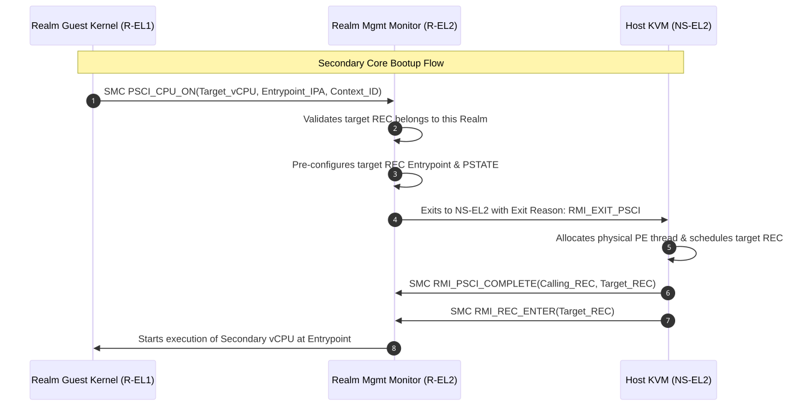

1. **`PSCI_CPU_ON`**:
   - The primary Realm vCPU issues `PSCI_CPU_ON` to boot a secondary virtual CPU.
   - The RMM intercepts the call, sets the secondary REC's program counter to the requested entrypoint, and triggers an exit to `NS-EL2`.
   - The host hypervisor spawns a host thread for the secondary vCPU and executes `RMI_PSCI_COMPLETE`.
2. **`PSCI_SYSTEM_OFF` & `PSCI_SYSTEM_RESET`**:
   - Signals the hypervisor that the Realm has halted, transitioning the Realm state machine to `SYSTEM_OFF`.

---

---

# Module 9: Attestation Framework & Cryptographic Trust Chains

## 9.1 The Arm CCA Dual-Token Attestation Architecture

Cryptographic attestation is the cornerstone of confidential computing. Before a tenant provisions sensitive application code, proprietary neural network weights, or decryption keys into a Realm, the tenant must verify that the workload is executing on genuine Arm hardware in a verified security state.

Arm CCA defines an encapsulated **Dual-Token Attestation Model** rooted in the **PSA Certified Entity Attestation Token (EAT)** architecture (RFC 8392 / CBOR / COSE standards).


---

## 9.2 Token Formats & Cryptographic Claims

The CCA token is structured as a nested or tagged CBOR (Concise Binary Object Representation) document containing two distinct cryptographic scopes:

### 1. The Platform Attestation Token
Generated by the **Platform Hardware Root of Trust** (or Root EL3 Monitor) and signed with the **Platform Attestation Key (PAK)**:
- **`IMPLEMENTATION_ID`**: Identifies the silicon manufacturer, model, and silicon stepping.
- **`HARDWARE_VERSION`**: Hardware design revision and chip serial identifier.
- **`SECURITY_LIFECYCLE`**: Current lifecycle phase (e.g., `PSA_LIFECYCLE_SECURED`).
- **`BOOT_SEED`**: A cryptographically random value generated at system cold reset, uniquely identifying the current boot session.
- **`SOFTWARE_MEASUREMENTS`**: Array of cryptographic hashes measuring the platform firmware stages:
  - BL1 / BL2 Immutable Boot code.
  - BL31 Trusted Firmware-A (Monitor).
  - RMM image hash and version.

### 2. The Realm Attestation Token
Generated by the **Realm Management Monitor (TF-RMM)** and signed with an ephemeral **Realm Attestation Key (RAK)**:
- **`CHALLENGE`**: A 64-byte cryptographic nonce provided by the remote relying party to prevent replay attacks.
- **`RIM` (Realm Initial Measurement)**: SHA-256 or SHA-512 digest of all code, data, and Stage-2 page tables populated prior to `RMI_REALM_ACTIVATE`.
- **`REM` (Realm Extensible Measurements)**: Four 64-byte measurement registers (`REM[0]`, `REM[1]`, `REM[2]`, `REM[3]`) that record runtime software stages:
  - `REM[0]`: Hash of the EDK2 UEFI firmware image.
  - `REM[1]`: Hash of the Linux kernel image, command line parameters, and initramfs.
  - `REM[2]`: Hash of runtime application containers or workload configuration.
  - `REM[3]`: Reserved for dynamic tenant runtime measurements.
- **`RPV` (Realm Personalization Value)**: A 64-byte arbitrary value injected by the tenant during creation to bind the Realm to a specific tenant account or policy.
- **`HASH_ALGO_ID`**: Identifier for cryptographic hashing algorithm (`SHA-256` or `SHA-512`).

---

## 9.3 Cryptographic Key Hierarchy & Derivation

The security of the attestation model depends on an unbroken cryptographic key derivation tree anchored in immutable hardware silicon fuses:


### Key Derivation Flow
1. **Hardware Unique Key (HUK)**: Burned into write-locked OTP fuses during chip fabrication. Inaccessible to software; only readable by the on-chip crypto engine.
2. **Platform Attestation Key (PAK)**: Derived by the hardware crypto engine from the HUK and platform configuration parameters. The public counterpart (`PAK_Pub`) is certified by the silicon manufacturer's CA.
3. **Realm Attestation Key (RAK)**: Generated by the RMM when a Realm is created. The RMM derives the RAK using an ephemeral entropy pool, ensuring each Realm has a unique cryptographic identity.
4. **Binding Platform & Realm Scopes**: The Platform RoT signs the public key of the RAK or embeds a cryptographic digest of the RMM and RAK into the Platform Token, establishing an unbroken mathematical chain from the silicon manufacturer to the specific tenant Realm instance.

---

## 9.4 Complete Remote Attestation Protocol Flow

The end-to-end protocol workflow between the remote tenant verifier and the running Realm:

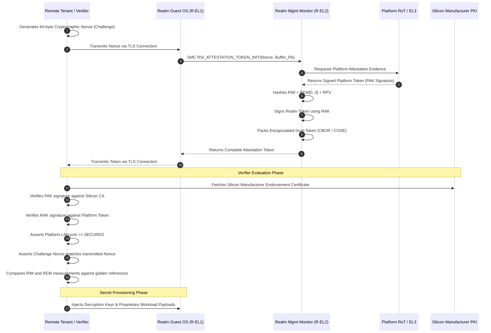

---

---

# Module 10: Security Lifecycle, Debug, RAS & Microarchitectural Side-Channel Hardening

## 10.1 System Security Lifecycle Management

The security posture of an Arm CCA platform evolves across distinct lifecycle states governed by hardware non-volatile OTP fuses (as defined in **ARM-DEN-0096** and **ARM-DEN-0129**). 

The platform hardware root of trust enforces strict monotonic transitions between these lifecycle states, preventing regression to less secure factory modes.


### Lifecycle State Specifications
1. **`CHIP_MANUFACTURING`**:
   - Initial state during semiconductor fabrication.
   - JTAG interfaces are open. Test patterns verify logic integrity.
   - The Hardware Unique Key (HUK) is injected into OTP fuses and write-locked.
2. **`DEVICE_MANUFACTURING`**:
   - OEM / ODM board assembly phase.
   - OEM Root of Trust Public Keys (ROTPK) and anti-rollback monotonic counters are burned into platform fuses.
3. **`NORMAL_SECURED` (Production Deployment)**:
   - Standard operational state in cloud data centers.
   - External hardware debug (JTAG/Trace) into Root, Secure, and Realm domains is **permanently disabled in hardware**.
   - Attestation services report `PSA_LIFECYCLE_SECURED`.
   - Firmware anti-rollback checks are strictly enforced on every boot.
4. **`SECURE_DEBUG`**:
   - Authorized maintenance state for field failure analysis.
   - Requires presenting a cryptographically signed debug certificate signed by the platform RoT private key.
   - **Critical Security Invariant**: When transitioning to `SECURE_DEBUG`, the hardware automatically initiates a full system cold reset, purging all DRAM contents, clearing MPE key tables, and scrubbing on-chip caches before debug probes are enabled.
5. **`RETURN_TO_FACTORY` (RMA) & `DECOMMISSIONED`**:
   - For defective silicon return or end-of-life destruction.
   - Monotonic kill fuses are blown, permanently destroying on-chip key derivation ladders and disabling the PE.

---

## 10.2 Debug, Trace & Profiling Controls in RME

Traditional hardware debugging facilities (such as JTAG debuggers, trace buffers, and performance monitors) represent potent threat vectors in multi-tenant environments. A rogue cloud administrator with physical access could attach a hardware probe to capture live processor registers.

Arm RME introduces fine-grained, hardware-enforced **Debug Isolation Boundaries**:


### Architectural Controls
1. **External Hardware Debug Authentication**:
   - Debug registers in the core PE are gated by authentication signals (`DBGEN`, `NIDEN`, `SPIDEN`, `SPNIDEN`, and RME-specific `RLMDEN` / Realm Debug Enable).
   - In production lifecycle states, `RLMDEN` is tied low, preventing external hardware debug probes from halting, inspecting, or stepping Realm execution.
2. **Statistical Profiling Extension (SPE - `FEAT_SPE`)**:
   - SPE periodically samples instruction execution profiles (recording PCs, branch behaviors, and data addresses).
   - In RME, whenever the PE executes in Realm or Root state, SPE sampling is automatically muted by hardware. No trace packets containing Realm virtual or physical addresses are written to memory buffers.
3. **Branch Record Buffer Extension (BRBE - `FEAT_BRBE`)**:
   - BRBE records recent branch execution paths.
   - To prevent hypervisors from inspecting branch histories to infer secret cryptographic branches in Realms, BRBE automatically clears the branch history buffer upon taking an exception from Realm state to `R-EL2` or `NS-EL2`.

---

## 10.3 Reliability, Availability & Serviceability (RAS) Architecture

In enterprise server architectures, the **Reliability, Availability, and Serviceability (RAS)** framework detects, records, and reports hardware memory faults (e.g., ECC single-bit errors, multi-bit uncorrectable faults, and interconnect parity errors).

### The Confidential Data Leakage Risk in RAS
When a hardware fault occurs, the processor or memory controller captures fault details into **RAS Error Records** (`ERR<n>STATUS`, `ERR<n>ADDR`, `ERR<n>MISC`):
- `ERR<n>ADDR` captures the physical address where the memory failure occurred.
- `ERR<n>MISC` often captures raw data bits or syndrome signatures from the failing memory burst.
- If an uncorrectable DRAM error occurs inside a Realm memory granule, and the hardware records the fault into a standard Non-Secure RAS record, the host hypervisor could inspect `ERR<n>MISC` to read private tenant plaintext!

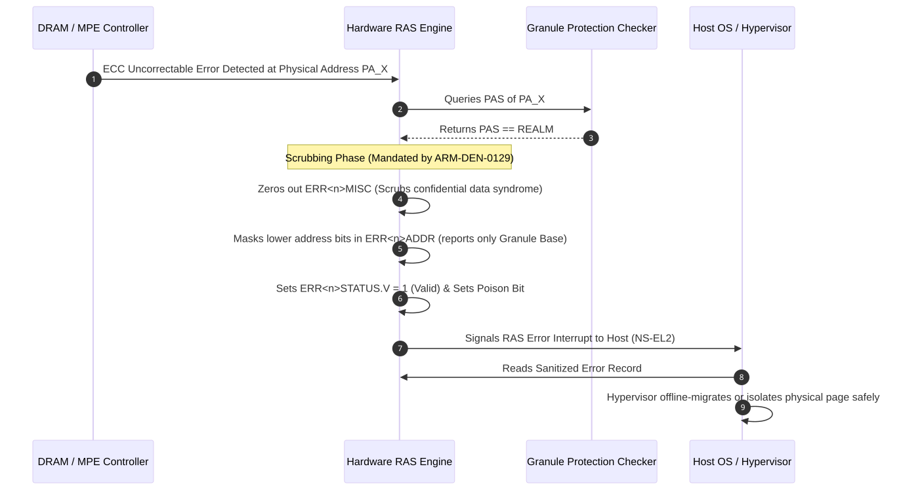

### RME Architectural RAS Invariants (ARM-DEN-0129 Chapter B4)
1. **Confidential Data Scrubbing**:
   - Whenever an error record is associated with a physical address whose GPI is `Realm` or `Root`, the hardware **must purge any potentially confidential data** from `ERR<n>MISC` before asserting error syndrome registers.
2. **Address Range Masking**:
   - `ERR<n>ADDR` is masked to report only the base granule address, preventing microarchitectural timing introspection of specific cache line offsets.
3. **Error Poisoning**:
   - Rather than returning uncorrectable stale data, the memory controller marks the cache line as **Poisoned**. Any subsequent read by the Realm triggers a synchronous Data Abort with poison syndrome, allowing the Realm kernel to terminate the affected process without compromising system integrity.

---

## 10.4 Microarchitectural Side-Channel & Fault Injection Mitigations

Modern processors are susceptible to microarchitectural timing side channels (such as cache eviction timing, branch predictor poisoning, and transient execution) as well as physical fault injection attacks (clock/voltage glitching).

Arm CCA integrates defense-in-depth mitigations:

| Attack Vector | Vulnerability Mechanism | Arm CCA Hardware Mitigation |
| :--- | :--- | :--- |
| **Spectre-v2 / BTI** | Malicious hypervisor trains branch target predictors at `NS-EL2` to steer speculative execution in Realm guest at `R-EL1`. | **Branch Target Identification (`FEAT_BTI`)** & hardware branch predictor context invalidation upon world switch (`FEAT_CSV2`). |
| **Meltdown / Rogue Load**| Speculative read of unauthorized physical memory before permission checks retire. | **Granule Protection Check (GPC)** is wired directly into load/store speculative replay units, terminating speculative execution of cross-PAS loads immediately. |
| **Microarchitectural Timing** | Hypervisor reads high-resolution Performance Monitor Unit (`PMU`) cycle counters before and after Realm execution to infer cache hit/miss behavior. | **PMU Counter Filtering**: System PMU registers can be configured by RMM to inhibit cycle and event counting during Realm execution slices. |
| **Cryptographic Timing** | Secret-dependent execution time in cryptographic loops (e.g., modular exponentiation, AES S-boxes). | **Data Independent Timing (`FEAT_DIT`)**: When `PSTATE.DIT` is set, instruction execution time on PEs is guaranteed to be completely independent of input data values. |
| **Clock / Voltage Glitching** | Physical attacker manipulates SoC power supply rails to induce bit flips in GPC logic or bypass address checking. | **Dual-Rail Verification & Redundant Comparators**: The RME specification mandates fault-tolerant redundant logic for GPT walkers and PAS comparison pipelines. |

---

---

# Module 11: Comparative Analysis, System Register & Command Quick Reference

## 11.1 Industry Comparative Analysis: Arm CCA vs. x86 Technologies

Arm Confidential Compute Architecture represents a modern, clean-slate design that resolves many structural compromises present in earlier confidential computing architectures.

| Architectural Dimension | Arm CCA (Armv9-A / RME) | Intel TDX (Trust Domain Extensions) | AMD SEV-SNP (Secure Encrypted Virtualization) | Arm TrustZone (Legacy) |
| :--- | :--- | :--- | :--- | :--- |
| **Security Domains** | **4 Distinct States**:<br/>Root, Realm, Secure, Non-Secure | **2 Major Domains**:<br/>Legacy VMX Root/Non-Root & SEAM | **2 Domains**:<br/>Hypervisor vs Encrypted Guest Contexts | **2 Worlds**:<br/>Secure vs Non-Secure |
| **Root Supervisor** | **TF-RMM** at `R-EL2` (Open Source, standard C, minimal footprint) | **Intel TDX Module** in SEAM (Signed by Intel, closed microcode/firmware) | **AMD Secure Processor (ASP)** firmware (Off-core ARM Cortex-A5 core) | **Secure Monitor** at `EL3` (TF-A) |
| **Memory Isolation Mechanism** | **Granule Protection Checks (GPC)** via two-level hardware GPT walker | **Secure EPT** & Physical Address P-bit filtering | **Reverse Map Table (RMP)** checked by hardware nested page walker | **TZASC / TZC-400** (Coarse static memory carveouts) |
| **Granularity** | **4KB, 16KB, or 64KB** dynamic per-granule assignment | **4KB, 2MB, 1GB** page table assignment | **4KB, 2MB** dynamic page assignment | Coarse memory regions (Megabytes/Gigabytes) |
| **Attestation Architecture** | **Dual-Token Model**:<br/>Platform Token (PAK) + Realm Token (RAK) | **Quote Generation** via Intel SGX Quoting Enclave | **SNP Attestation Report** signed by VCEK / ASP | Single Platform Attestation via PSA / TEE |
| **Standard Peripheral I/O** | **RME-DA** via PCIe IDE + TDISP + SMMU DPT | **TDISP / IDE** via Intel VT-d | **TDISP / IDE** via AMD IOMMU | Direct MMIO or static TrustZone peripheral assignment |
| **Ecosystem Governance** | **Open Industry Standard** (Linaro, TrustedFirmware.org, Arm Architecture Specs) | **Proprietary Intel Specification** | **Proprietary AMD Specification** | **Proprietary Arm / GlobalPlatform** |

---

## 11.2 Master System Register Reference

The following table summarizes the primary architectural system registers introduced or expanded for Arm CCA and RME:

```
+----------------------------------------------------------------------------------------------------+
|                                    MASTER SYSTEM REGISTER REFERENCE                                |
+------------------+-------+--------+----------------------------------------------------------------+
| Register Name    | Level | Access | Architectural Purpose & Key Bitfields                          |
+------------------+-------+--------+----------------------------------------------------------------+
| GPCCR_EL3        | EL3   | RW     | Granule Protection Check Configuration Register                |
|                  |       |        | • Bit [0] GPC: Global Granule Protection Check Enable          |
|                  |       |        | • Bits [3:2] PGS: Physical Granule Size (4KB, 16KB, 64KB)      |
|                  |       |        | • Bits [7:4] L0GPTSZ: Level 0 GPT coverage block size          |
|                  |       |        | • Bits [11:8] PPS: Protected Physical address Size             |
+------------------+-------+--------+----------------------------------------------------------------+
| GPTBR_EL3        | EL3   | RW     | Granule Protection Table Base Register                         |
|                  |       |        | • Bits [51:12] BADDR: Base Physical Address of Level 0 GPT in  |
|                  |       |        |   Root Physical Address Space                                  |
+------------------+-------+--------+----------------------------------------------------------------+
| SCR_EL3          | EL3   | RW     | Secure Configuration Register                                  |
|                  |       |        | • Bit [0] NS: Non-Secure Execution State bit                   |
|                  |       |        | • Bit [42] NSE: Non-Secure Extension (Selects Realm State)    |
|                  |       |        | • Bit [43] TRND: Trap Random Number Generator                  |
+------------------+-------+--------+----------------------------------------------------------------+
| MFAR_EL3         | EL3   | RW     | Physical Fault Address Register                                |
|                  |       |        | • Captures target Physical Address on Granule Protection Fault |
+------------------+-------+--------+----------------------------------------------------------------+
| ESR_ELx          | EL1-3 | RO     | Exception Syndrome Register                                    |
|                  |       |        | • Bits [31:26] EC: Exception Class                             |
|                  |       |        | • Bits [5:0] IFSC/DFSC: Data/Instruction Fault Status Codes    |
|                  |       |        |   0b011100: GPF on L0 GPT walk                                 |
|                  |       |        |   0b011101: GPF on L1 GPT walk                                 |
|                  |       |        |   0b011110: GPF on primary physical access                     |
+------------------+-------+--------+----------------------------------------------------------------+
| VTCR_EL2         | EL2   | RW     | Virtualization Translation Control Register (Realm EL2)        |
|                  |       |        | • Bits [5:0] T0SZ: Realm Stage-2 IPA address space size        |
|                  |       |        | • Bits [30:28] PS: Physical Address Size                       |
+------------------+-------+--------+----------------------------------------------------------------+
| VTTBR_EL2        | EL2   | RW     | Virtualization Translation Table Base Register                 |
|                  |       |        | • Bits [47:1] BADDR: Base PA of Level 0/1 RTT in Realm PAS     |
|                  |       |        | • Bits [63:48] VMID: Virtual Machine Identifier                |
+------------------+-------+--------+----------------------------------------------------------------+
| ICH_LR<n>_EL2    | EL2   | RW     | Interrupt Controller Hyp Active Priorities / List Registers    |
|                  |       |        | • Used by RMM to inject Virtual Interrupts into Realm vCPUs    |
+------------------+-------+--------+----------------------------------------------------------------+
```

---

## 11.3 Complete RMI & RSI Command Cheat-Sheet

### Realm Management Interface (RMI) Commands (Dispatched from Host `NS-EL2` to RMM via EL3)

| Command Function ID | Invocable State | Critical Arguments | Return Values |
| :--- | :--- | :--- | :--- |
| `RMI_VERSION` | Any | `req_version` | `ret_version`, `status` |
| `RMI_REALM_CREATE` | Pre-Boot | `rd_pa`, `params_pa` | `status` (`RMI_SUCCESS`, `RMI_ERROR_INPUT`) |
| `RMI_REALM_ACTIVATE` | Pre-Boot | `rd_pa` | `status` |
| `RMI_REALM_DESTROY` | Halting | `rd_pa` | `status` |
| `RMI_REC_CREATE` | Pre-Boot | `rd_pa`, `rec_pa`, `params_pa` | `status` |
| `RMI_REC_DESTROY` | Teardown | `rec_pa` | `status` |
| `RMI_REC_ENTER` | Runtime | `rec_pa`, `run_pa` | `status`, populated `rec_run` buffer |
| `RMI_DATA_CREATE` | Pre-Boot | `rd_pa`, `data_pa`, `ipa`, `src_pa` | `status` |
| `RMI_DATA_DESTROY` | Teardown | `rd_pa`, `data_pa` | `status` |
| `RMI_RTT_CREATE` | Runtime | `rd_pa`, `rtt_pa`, `ipa`, `level` | `status` |
| `RMI_RTT_DESTROY` | Runtime | `rd_pa`, `rtt_pa`, `ipa`, `level` | `status` |
| `RMI_RTT_MAP_UNPROTECTED` | Runtime | `rd_pa`, `ipa` | `status` |
| `RMI_PSCI_COMPLETE` | Runtime | `calling_rec`, `target_rec` | `status` |

### Realm Services Interface (RSI) Commands (Dispatched from Realm `R-EL1` to RMM `R-EL2`)

| Command Function ID | Invocable State | Critical Arguments | Return Values |
| :--- | :--- | :--- | :--- |
| `RSI_ABI_VERSION` | Runtime | `req_version` | `ret_version` |
| `RSI_REALM_CONFIG` | Boot/Runtime | `config_pa` | `status`, populated config block |
| `RSI_IPA_STATE_SET` | Runtime | `start_ipa`, `size`, `ripas`, `flags` | `status`, `top_ipa` |
| `RSI_IPA_STATE_GET` | Runtime | `ipa` | `status`, `current_ripas` |
| `RSI_ATTESTATION_TOKEN_INIT` | Runtime | `challenge[64]`, `buf_pa` | `status`, `token_len` |
| `RSI_ATTESTATION_TOKEN_CONTINUE` | Runtime | `buf_pa`, `offset` | `status`, `written_len` |
| `RSI_MEASUREMENT_READ` | Runtime | `index`, `buf_pa` | `status`, measurement hash |
| `RSI_MEASUREMENT_EXTEND` | Runtime | `index`, `buf_pa`, `size` | `status` |
| `RSI_HOST_CALL` | Runtime | `params_pa` | `status` |

---

## 11.4 Architectural Implementation Checklist & Golden Invariants

For system architects, firmware developers, and hypervisor engineers implementing Arm CCA, the following **Seven Golden Invariants** must be preserved at all times:

1. **The Inviolability of Root PAS**:
   - The Root Physical Address Space (containing GPTs, EL3 stacks, and RoT keys) must never be mapped as writable by any translation regime other than Root EL3.
2. **Atomic Transition Scrubbing**:
   - No memory granule may transition from Realm PAS to Non-Secure PAS without being completely zeroized and cleaned/invalidated from all CPU and system caches (`DC CIPAPA`).
3. **No Speculative Leakage Across Security Boundaries**:
   - Microarchitectural speculation mechanisms (branch predictors, data caches, speculative load queues) must strictly honor GPC checks before committing results or updating microarchitectural state observable by lower-privilege states.
4. **Permanent Measurement Locking**:
   - Upon execution of `RMI_REALM_ACTIVATE`, the Realm Initial Measurement (RIM) register is irrevocably locked in hardware/firmware. No subsequent memory page can be inserted into the Realm's initial identity.
5. **Untrusted Host Principle**:
   - Every input parameter, memory pointer, interrupt injection request, and exit structure received from the Host Hypervisor at `NS-EL2` must be treated as potentially malicious and strictly bounds-checked by the RMM.
6. **Encrypted Inter-Socket Coherency**:
   - Coherent inter-chip mesh transactions carrying Realm PAS or Root PAS memory accesses across board traces must implement authenticated link encryption (e.g., PCIe IDE / MACsec) with replay prevention.
7. **Complete Teardown Invariant**:
   - A Realm Descriptor (`RD`) can never be destroyed or released while any subordinate memory granule, RTT node, or REC remains mapped to that Realm.

---

---

# Module 12: Architectural Glossary & Master Acronym Index

## 12.1 Comprehensive Technical Glossary

- **Arm CCA (Arm Confidential Compute Architecture)**: The overarching system architecture extending Armv9-A to provide hardware-enforced execution environments (Realms) that isolate confidential workloads from privileged software.
- **RME (Realm Management Extension)**: The hardware architectural feature set in Armv9.1-A (and later) defining the four security states, Granule Protection Checks (GPC), Granule Protection Tables (GPT), and new physical address spaces.
- **Root State**: The highest architectural security domain in Armv9-A RME, active at Exception Level 3 (`EL3`), hosting platform root firmware (TF-A). Replaces legacy Secure EL3.
- **Realm State**: The execution state in Armv9-A dedicated to confidential virtual machines and their supervisor monitor, executing at `R-EL0`, `R-EL1`, and `R-EL2`.
- **PAS (Physical Address Space)**: One of four architecturally separated physical memory domains: Root PAS, Realm PAS, Secure PAS, and Non-Secure PAS.
- **Granule**: The minimum atomic unit of physical memory tracking in RME (4KB, 16KB, or 64KB).
- **GPC (Granule Protection Check)**: The hardware comparison logic inside the MMU and SMMU that validates the physical address and output PAS of every memory transaction against the Granule Protection Table.
- **GPT (Granule Protection Table)**: The two-level architectural table structure in Root PAS defining the ownership (GPI) of every physical memory granule in the system.
- **GPI (Granule Protection Information)**: The 4-bit attribute associated with each physical granule indicating its assigned PAS (Root, Realm, Secure, Non-Secure, or Any).
- **GPF (Granule Protection Fault)**: A hardware exception generated when a memory transaction's target PAS does not match the GPI recorded in the GPT.
- **RMM (Realm Management Monitor)**: The trusted privileged firmware layer executing at Realm EL2 (`R-EL2`) responsible for managing Realm contexts, Realm stage-2 translation tables, and Realm attestation.
- **REC (Realm Execution Context)**: The architectural state structure representing a virtual CPU within a Realm.
- **RD (Realm Descriptor)**: The primary metadata structure allocated in Realm PAS tracking configuration, lifecycle state, and measurement hashes for a Realm instance.
- **RTT (Realm Translation Table)**: The Stage-2 translation table hierarchy that maps Intermediate Physical Addresses (IPAs) used by the Realm to Physical Addresses (PAs) in the Realm PAS or Non-Secure PAS.
- **RIPAS (Realm IPA State)**: The architectural state of an IPA within a Realm's stage-2 translation map (`RIPAS_EMPTY`, `RIPAS_RAM`, `RIPAS_DESTROYED`).
- **RMI (Realm Management Interface)**: The SMC-based boundary interface between the Host Hypervisor (`NS-EL2`) and the RMM (`R-EL2`), mediated by the Root EL3 Monitor.
- **RSI (Realm Services Interface)**: The SMC-based boundary interface between the Realm Guest OS (`R-EL1`) and the RMM (`R-EL2`).
- **RHI (Realm Host Interface)**: The paravirtualized communication protocol enabling a Realm to request services, firmware logs, or device certificates from the untrusted host.
- **MPE (Memory Protection Engine)**: The inline cryptographic hardware engine residing in the DRAM memory controller performing line-rate encryption and MAC integrity checks.
- **MEC (Memory Encryption Contexts)**: The architectural extension enabling unique, per-Realm cryptographic keys (MECIDs) for main memory encryption.
- **MECID (Memory Encryption Context Identifier)**: A multi-bit tag (up to 16 bits) identifying the cryptographic key domain associated with a memory transaction.
- **DPT (Device Protection Table)**: An architectural validation structure inside the SMMU ensuring that peripheral devices utilizing Address Translation Services (ATS) do not emit unauthorized DMA transactions.
- **RME-DA (RME Device Assignment)**: The system architecture enabling PCIe peripheral devices and accelerators to be directly and securely assigned to a Realm.
- **PCIe IDE (Integrity and Data Encryption)**: The PCI-SIG standard for line-rate AES-GCM encryption and MAC verification across physical PCIe lanes.
- **TDISP (Trusted Device Interface Security Protocol)**: The standardized protocol governing the configuration, state machine, and binding of virtual device interfaces to confidential VMs.
- **RIM (Realm Initial Measurement)**: The cryptographic hash reflecting all code, initial data, and Stage-2 structures loaded into a Realm prior to activation.
- **REM (Realm Extensible Measurement)**: Monotonically extended cryptographic measurement registers (`REM[0..3]`) capturing runtime software stages within a Realm.
- **RPV (Realm Personalization Value)**: A 64-byte tenant-provided value embedded into the Realm's cryptographic identity at creation.
- **PAK (Platform Attestation Key)**: The asymmetric private signing key derived from the Hardware Unique Key (HUK) used to sign Platform Attestation Tokens.
- **RAK (Realm Attestation Key)**: The ephemeral asymmetric signing key generated by the RMM used to sign Realm Attestation Tokens.

---

## 12.2 Master Acronym Index

| Acronym | Expansion | Architectural Domain |
| :--- | :--- | :--- |
| **ABI** | Application Binary Interface | Software Interfaces |
| **ACE** | AXI Coherency Extensions | AMBA Interconnect |
| **AES-XTS** | Advanced Encryption Standard - XEX Tweakable Block Cipher with Ciphertext Stealing | Memory Cryptography |
| **ATC** | Address Translation Cache | PCIe Peripheral Hardware |
| **ATS** | Address Translation Services | PCIe / SMMU Subsystem |
| **BTI** | Branch Target Identification (`FEAT_BTI`) | Hardware Exploit Mitigation |
| **BRBE** | Branch Record Buffer Extension (`FEAT_BRBE`) | Processor Profiling |
| **CCA** | Confidential Compute Architecture | Arm Platform Architecture |
| **CDA** | Coherent Device Assignment | RME System Architecture |
| **CHI** | Coherent Hub Interface | AMBA Mesh Fabric |
| **CXL** | Compute Express Link | High-Speed Interconnect |
| **DIT** | Data Independent Timing (`FEAT_DIT`) | Cryptographic Hardening |
| **DPT** | Device Protection Table | System MMU Architecture |
| **EAT** | Entity Attestation Token | Cryptographic Attestation |
| **EL** | Exception Level (`EL0`, `EL1`, `EL2`, `EL3`) | Processor Architecture |
| **GDI** | Granule Data Isolation | RME System Properties |
| **GIC** | Generic Interrupt Controller (GICv3, GICv4) | Processor Architecture |
| **GPC** | Granule Protection Check | RME Core Hardware |
| **GPF** | Granule Protection Fault | Exception Architecture |
| **GPT** | Granule Protection Table | Memory Architecture |
| **HES** | Hardware Enforced Security | System Security Model |
| **HUK** | Hardware Unique Key | Root of Trust |
| **IDE** | Integrity and Data Encryption | PCI-SIG Standard |
| **IPA** | Intermediate Physical Address | Two-Stage MMU Virtualization |
| **KVM** | Kernel-based Virtual Machine | Host Virtualization |
| **MEC** | Memory Encryption Contexts | RME Hardware Extension |
| **MECID** | Memory Encryption Context Identifier | Memory Architecture |
| **MMU** | Memory Management Unit | Processor Architecture |
| **MPE** | Memory Protection Engine | DRAM Controller Hardware |
| **MPAM** | Memory System Resource Partitioning and Monitoring | System Quality of Service |
| **OTP** | One-Time Programmable (eFuses) | Silicon Hardware Security |
| **PAK** | Platform Attestation Key | Cryptographic Attestation |
| **PAS** | Physical Address Space | Memory Architecture |
| **PE** | Processing Element (Core) | Armv9-A Core Architecture |
| **PSCI** | Power State Coordination Interface | Arm Firmware Standards |
| **RAK** | Realm Attestation Key | Cryptographic Attestation |
| **RAS** | Reliability, Availability, and Serviceability | System Fault Architecture |
| **RCiEP** | Root Complex Integrated Endpoint | PCIe Architecture |
| **REC** | Realm Execution Context | Arm CCA Virtualization |
| **RHI** | Realm Host Interface | Paravirtualized Software |
| **RIM** | Realm Initial Measurement | Attestation Architecture |
| **RMI** | Realm Management Interface | CCA Software Stack |
| **RMM** | Realm Management Monitor | CCA Privileged Firmware |
| **RMMD** | RMM Dispatcher (in TF-A EL3) | EL3 Monitor Firmware |
| **RME** | Realm Management Extension | Arm Architecture Extension |
| **RoT** | Root of Trust | System Hardware Security |
| **ROTPK** | Root of Trust Public Key | Platform PKI |
| **RPV** | Realm Personalization Value | Attestation Architecture |
| **RSI** | Realm Services Interface | Realm Guest Software Stack |
| **RTT** | Realm Translation Table | Stage-2 Memory Management |
| **SCP** | System Control Processor | Platform Management Subsystem |
| **SMC** | Secure Monitor Call | Arm Calling Conventions |
| **SMMU** | System Memory Management Unit | System I/O Virtualization |
| **SPDM** | Security Protocol and Data Model | DMTF Peripheral Security |
| **SPE** | Statistical Profiling Extension (`FEAT_SPE`) | Processor Profiling |
| **TCB** | Trusted Computing Base | Platform Security Architecture |
| **TDISP** | Trusted Device Interface Security Protocol | PCI-SIG Security Protocol |
| **TF-A** | Trusted Firmware-A | Arm Open-Source Firmware |
| **TF-RMM**| Trusted Firmware Realm Management Monitor | Arm Open-Source Firmware |
| **TLB** | Translation Lookaside Buffer | Core Memory Management |
| **VDM** | Vendor-Defined Message | PCIe Messaging Protocol |
| **VMM** | Virtual Machine Monitor (Hypervisor) | Virtualization Stack |

---
