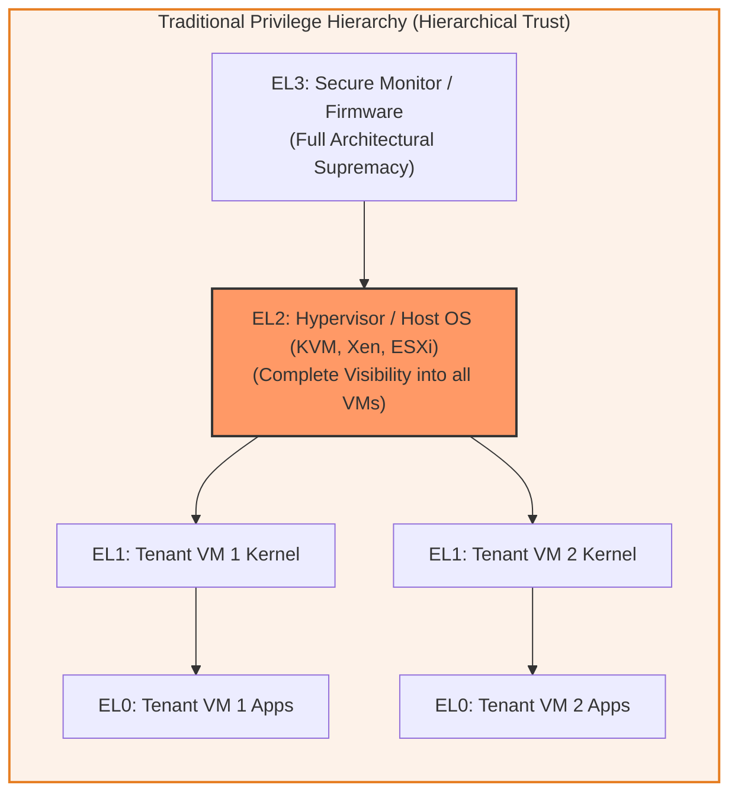
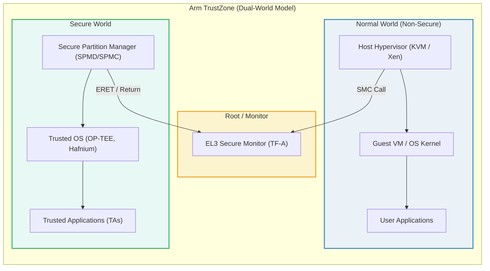
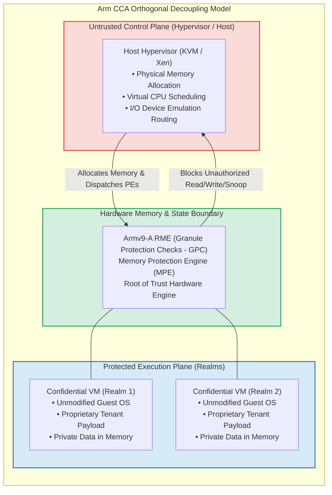
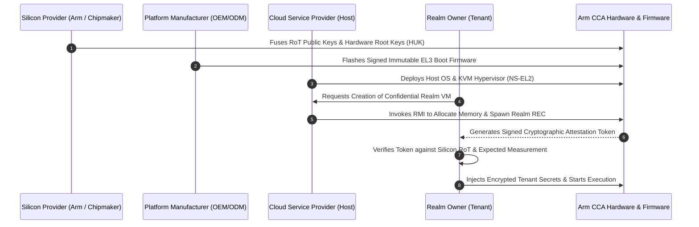

# Module 1: Introduction & The Confidential Computing Paradigm Shift

## 1.1 The Evolution of Compute Isolation & Security Dilemma

Modern computing platforms have historically relied on a hierarchical privilege ring model. In standard multi-tenant computing environments—such as infrastructure-as-a-service (IaaS) public clouds, software-as-a-service (SaaS) hosting, and enterprise multi-workload virtualization—security enforcement is predicated on privilege asymmetry:
- Applications at Exception Level 0 (`EL0`) are governed and constrained by the operating system kernel at Exception Level 1 (`EL1`).
- Operating system kernels are managed, scheduled, and multiplexed by the hypervisor / Virtual Machine Monitor (VMM) running at Exception Level 2 (`EL2`).
- The entire platform initialization, power orchestration, and root-of-trust runtime dispatch are governed by Secure Monitor firmware executing at Exception Level 3 (`EL3`).

While this hierarchical model ensures that higher exception levels can enforce security policies over lower exception levels, it introduces a fundamental architectural liability known as the **Hypervisor Privilege Paradox**:
> *Whoever possesses the privilege to allocate, manage, and schedule resources for a workload inherently possesses the architectural privilege to inspect, manipulate, tamper with, and exfiltrate that workload's code and execution state.*



In this classical design, the hypervisor's Trusted Computing Base (TCB) encompasses millions of lines of code across device emulators (e.g., QEMU), network device virtualization stacks (vhost-net, DPDK), complex physical memory allocators, virtual interrupt routing engines, and storage stacks. A security breach at any point within this vast hypervisor footprint compromises all hosted guest operating systems and their workloads simultaneously.

Furthermore, cloud tenants face threats beyond malicious software exploits:
1. **Rogue Administrative Access**: Cloud infrastructure administrators and service engineers with root privileges on bare-metal host systems can introspect guest physical memory via `/dev/mem`, read CPU register dumps, or attach debug monitors to virtual machines.
2. **Cold Boot & Physical Memory Probing**: Attackers with physical access to data center server hardware can attach interposers to DRAM memory buses, tap memory traces, perform rowhammer attacks, or conduct liquid nitrogen cold-boot memory dumps to extract plaintext cryptographic keys.
3. **Firmware & Management Engine Compromise**: Malicious Baseboard Management Controllers (BMCs), compromised Peripheral Component Interconnect Express (PCIe) peripheral firmware, or direct memory access (DMA) devices can bypass software-based OS memory mappings.

---

## 1.2 Limitations of Arm TrustZone for Cloud Multi-Tenancy

Prior to Armv9-A, Arm architecture provided the **Arm TrustZone** technology (introduced in Armv6KZ and expanded in Armv7-A and Armv8-A). TrustZone divides the processor execution environment into two strictly isolated hardware-enforced domains:
- **Normal World (Non-Secure State)**: Hosts the traditional operating system (Linux, Android, Windows) and applications, running across `EL0`, `EL1`, and `EL2`.
- **Secure World (Secure State)**: Hosts a Trusted OS (such as OP-TEE or proprietary vendor TEEs) and Trusted Applications (TAs), executing across `S-EL0`, `S-EL1`, and optionally `S-EL2`.



While TrustZone is exceptionally successful for mobile devices, embedded systems, and automotive security (for services such as DRM keystores, fingerprint biometric authentication, Apple Pay/Google Wallet enclave tokens, and secure payment processing), it possesses architectural characteristics that make it fundamentally unsuitable for general-purpose multi-tenant cloud virtualization:

| Architectural Property | Arm TrustZone (Secure World) | Multi-Tenant Cloud Virtualization Requirement |
| :--- | :--- | :--- |
| **Trust Model** | Monolithic OEM/Silicon Provider Trust. The silicon vendor and OEM control the Secure World root keys and sign all Trusted Applications. | Mutually distrusting third-party tenants who must trust neither the silicon vendor, the cloud host, nor each other. |
| **Concurrency & Scalability** | Designed for a small number of static, cooperative Trusted Services with limited memory footprints. | Highly dynamic creation, execution, and destruction of hundreds of arbitrary virtual machines with gigabytes or terabytes of RAM. |
| **Programming Paradigm** | Specialized microkernel APIs (GlobalPlatform TEE specifications) requiring refactoring applications into client-server TA models. | Unmodified, off-the-shelf standard operating systems (Ubuntu, Debian, Red Hat, Windows Server) and standard VM orchestration tooling. |
| **Resource Scheduling** | Normal world hypervisor cannot dynamically reclaim, swap, or allocate memory to Secure World on demand without complex static partitions. | Cloud hypervisor must retain control over physical resource scheduling, overcommit, and hardware dispatch without seeing tenant data. |
| **Attestation** | Verifies platform manufacturing state, but does not offer fine-grained tenant-controlled cryptographic attestation for dynamic VMs. | Standardized, verifiable remote attestation measuring dynamic guest VM boot state, initial memory, and runtime firmware. |

---

## 1.3 The Arm Confidential Compute Architecture (Arm CCA) Paradigm

To address the limitations of both hypervisor virtualization and TrustZone, Arm introduced the **Arm Confidential Compute Architecture (Arm CCA)** as part of the Armv9-A architecture extension. 

Arm CCA fundamentally transforms the computing trust model by establishing a complete operational separation between:
1. **Resource Management (Scheduling & Allocation)**: Remains under the control of the untrusted Host Hypervisor (e.g., Linux KVM, VMware ESXi).
2. **Access Permission & Confidentiality (Data Access & Protection)**: Strictly enforced at hardware line speed by processor hardware extensions, memory protection units, and a dedicated, minimal, open-source firmware component called the **Realm Management Monitor (RMM)**.



### Core Terminology
- **Realm**: An isolated execution environment running a complete, unmodified virtual machine (including guest operating system kernel and applications). A Realm's memory contents, general-purpose register state, system registers, vector registers, and translation tables are completely shielded from the host hypervisor, other Realms, and the Secure World.
- **Host**: The hypervisor and host operating system running in the Non-Secure world responsible for allocating physical memory granules to Realms, assigning virtual CPU time slices, and routing interrupts.
- **Realm Execution Context (REC)**: The architectural structure representing a virtual CPU within a Realm, analogous to a vCPU thread in standard virtualization, but containing cryptographic protections and hardware-enforced isolation.
- **Realm Translation Table (RTT)**: The Stage-2 translation table hierarchy that maps Intermediate Physical Addresses (IPAs) used by the Realm to Physical Addresses (PAs) in the Realm Physical Address Space.
- **Granule Protection Check (GPC)**: The hardware circuit residing inside the processor Memory Management Unit (MMU) that intercepts physical memory accesses after Stage-1 and Stage-2 translations to verify whether the physical address access conforms to the assigned Physical Address Space.

---

## 1.4 Trust Boundaries and TCB Minimization

The overarching design objective of Arm CCA is the radical reduction of the **Trusted Computing Base (TCB)** for tenant workloads.

In a traditional cloud deployment, the TCB of an application comprises:
$$\text{TCB}_{\text{Traditional}} = \text{Hardware} + \text{Firmware/UEFI} + \text{Host OS/Hypervisor} + \text{Device Emulators} + \text{Host Admin Stack} + \text{Guest OS}$$

Under the Arm CCA security model (as formally specified in **ARM-DEN-0096**), the Host Hypervisor, cloud administrative tooling, and peripheral device emulation layers are **completely eliminated from the tenant's TCB**:
$$\text{TCB}_{\text{Arm CCA}} = \text{Silicon RoT Hardware} + \text{EL3 Monitor Firmware (TF-A)} + \text{Realm Management Monitor (TF-RMM)} + \text{Guest OS}$$

```
+---------------------------------------------------------------------------------+
|                                 TENANT TCB COMPARISON                            |
+---------------------------------------------------------------------------------+
| TRADITIONAL VIRTUALIZATION                      | ARM CCA CONFIDENTIAL VM        |
+-------------------------------------------------+--------------------------------+
| [X] Cloud Admin / Host Operator (Inside TCB)    | [ ] Cloud Admin (OUTSIDE TCB)  |
| [X] Host Hypervisor / KVM / QEMU (Inside TCB)   | [ ] Host Hypervisor (OUTSIDE)  |
| [X] Device Emulation Stacks (Inside TCB)        | [ ] Device Emulation (OUTSIDE) |
| [X] BMC / Out-of-band Mgmt (Inside TCB)         | [ ] BMC / Out-of-band (OUTSIDE)|
| [X] Secure World Firmware (Inside TCB)          | [ ] Secure World (OUTSIDE TCB) |
| [X] Physical DRAM Interposers (Threat Vector)   | [ ] DRAM Interposers (Mitigated)|
|-------------------------------------------------+--------------------------------|
| [✓] Guest OS & Applications                     | [✓] Guest OS & Applications    |
| [✓] Physical Processor Hardware                 | [✓] Processor Hardware (Armv9) |
|                                                 | [✓] EL3 Monitor (Minimal TF-A) |
|                                                 | [✓] Realm Mgmt Monitor (TF-RMM)|
+---------------------------------------------------------------------------------+
```

### The Three Fundamental Security Guarantees
As defined in the *Arm CCA Security Model* (ARM-DEN-0096):
1. **Confidentiality & Integrity to Realm Owner**:
   - The platform guarantees that no software executing outside the Realm (including the hypervisor at `NS-EL2`, any Secure World code at `S-EL0`–`S-EL2`, or other Realms) can observe or alter the code, data, registers, or execution flow of the Realm.
   - Physical memory bus attacks (snooping, bus modification, DRAM extraction) are mitigated via inline hardware memory encryption and cryptographic integrity tagging.
2. **Isolation Guarantee to Hosting Environment**:
   - The platform guarantees that a compromised, malicious, or malfunctioning Realm cannot compromise the stability, confidentiality, or integrity of the Host Hypervisor, other virtual machines, the Secure World, or the hardware platform.
   - A Realm cannot perform unauthorized physical address accesses, launch denial-of-service attacks on memory buses, or hijack exception handlers of the host.
3. **Cryptographic Attestation & Verifiability**:
   - Before provisioning confidential data (such as proprietary AI weights, healthcare records, or financial transaction keys) into a Realm, the Realm owner can cryptographically verify:
     - The authentic hardware identity of the silicon.
     - The patch version and integrity of the platform firmware (`EL3` Monitor and RMM).
     - The initial measurement and launch state of the Realm payload.

---

## 1.5 Ecosystem Roles & Responsibilities

The Arm CCA architecture establishes distinct ecosystem roles with formal boundaries, ensuring clear division of cryptographic keys, privileges, and operational duties:



1. **Silicon Provider (Arm & Silicon Partners)**:
   - Implements the Armv9.1-A (and later) architecture featuring the Realm Management Extension (RME).
   - Injects the Hardware Unique Key (HUK) and Platform RoT Public Keys into on-chip non-volatile One-Time Programmable (OTP) fuses during chip manufacturing.
   - Publishes public endorsement certificates that link the chip's unique identity to verified silicon authenticity.
2. **Platform Manufacturer (OEM / ODM)**:
   - Integrates the SoC into server boards, incorporating power management, BMC, DRAM controllers, and PCIe root complexes.
   - Provisions platform initial boot code (BL1, BL2) adhering to Arm Base System Architecture (BSA) and Server Base System Architecture (SBSA).
3. **Cloud Service Provider (CSP / Host)**:
   - Manages physical compute, storage, and networking hardware.
   - Deploys the host operating system and hypervisor (e.g., Linux KVM).
   - Controls physical resource scheduling, CPU pin assignments, dynamic memory overcommit, and hardware teardown.
   - *Crucially, the CSP does NOT need to be trusted by the tenant for data confidentiality or execution integrity.*
4. **Realm Owner (Tenant)**:
   - Builds and owns the confidential workload, operating system image, and sensitive data.
   - Defines security policies, evaluates attestation evidence, and releases decryption keys directly to the Realm across an encrypted, authenticated channel.

---
