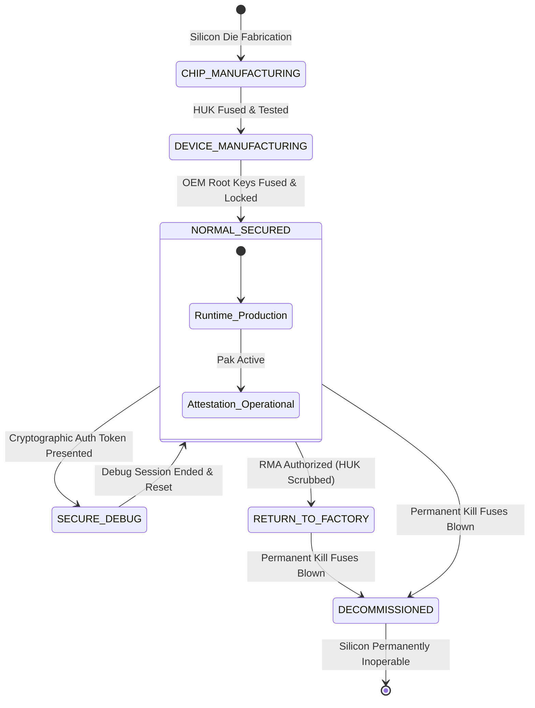
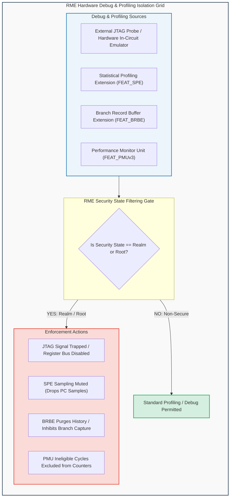
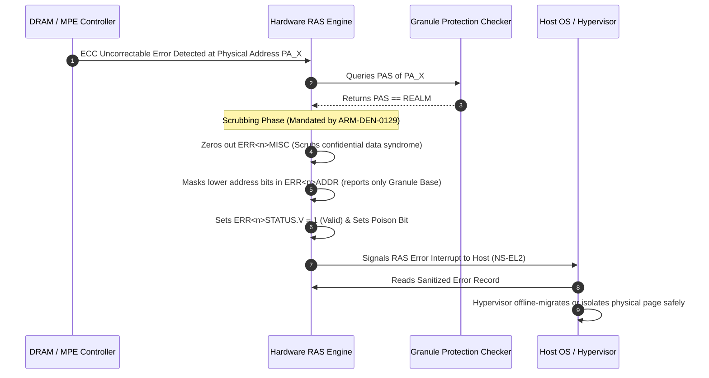

# Module 10: Security Lifecycle, Debug, RAS & Microarchitectural Side-Channel Hardening

## 10.1 System Security Lifecycle Management

The security posture of an Arm CCA platform evolves across distinct lifecycle states governed by hardware non-volatile OTP fuses (as defined in **ARM-DEN-0096** and **ARM-DEN-0129**). 

The platform hardware root of trust enforces strict monotonic transitions between these lifecycle states, preventing regression to less secure factory modes.

### Lifecycle State Specifications
1. **`CHIP_MANUFACTURING`**:
   - Initial state during semiconductor fabrication.
   - JTAG interfaces are open. Test patterns verify logic integrity.
   - The Hardware Unique Key (HUK) is injected into OTP fuses and write-locked.
2. **`DEVICE_MANUFACTURING`**:
   - OEM / ODM board assembly phase.
   - OEM Root of Trust Public Keys (ROTPK) and anti-rollback monotonic counters are burned into platform fuses.
3. **`NORMAL_SECURED` (Production Deployment)**:
   - Standard operational state in cloud data centers.
   - External hardware debug (JTAG/Trace) into Root, Secure, and Realm domains is **permanently disabled in hardware**.
   - Attestation services report `PSA_LIFECYCLE_SECURED`.
   - Firmware anti-rollback checks are strictly enforced on every boot.
4. **`SECURE_DEBUG`**:
   - Authorized maintenance state for field failure analysis.
   - Requires presenting a cryptographically signed debug certificate signed by the platform RoT private key.
   - **Critical Security Invariant**: When transitioning to `SECURE_DEBUG`, the hardware automatically initiates a full system cold reset, purging all DRAM contents, clearing MPE key tables, and scrubbing on-chip caches before debug probes are enabled.
5. **`RETURN_TO_FACTORY` (RMA) & `DECOMMISSIONED`**:
   - For defective silicon return or end-of-life destruction.
   - Monotonic kill fuses are blown, permanently destroying on-chip key derivation ladders and disabling the PE.

---

## 10.2 Debug, Trace & Profiling Controls in RME

Traditional hardware debugging facilities (such as JTAG debuggers, trace buffers, and performance monitors) represent potent threat vectors in multi-tenant environments. A rogue cloud administrator with physical access could attach a hardware probe to capture live processor registers.

Arm RME introduces fine-grained, hardware-enforced **Debug Isolation Boundaries**:

### Architectural Controls
1. **External Hardware Debug Authentication**:
   - Debug registers in the core PE are gated by authentication signals (`DBGEN`, `NIDEN`, `SPIDEN`, `SPNIDEN`, and RME-specific `RLMDEN` / Realm Debug Enable).
   - In production lifecycle states, `RLMDEN` is tied low, preventing external hardware debug probes from halting, inspecting, or stepping Realm execution.
2. **Statistical Profiling Extension (SPE - `FEAT_SPE`)**:
   - SPE periodically samples instruction execution profiles (recording PCs, branch behaviors, and data addresses).
   - In RME, whenever the PE executes in Realm or Root state, SPE sampling is automatically muted by hardware. No trace packets containing Realm virtual or physical addresses are written to memory buffers.
3. **Branch Record Buffer Extension (BRBE - `FEAT_BRBE`)**:
   - BRBE records recent branch execution paths.
   - To prevent hypervisors from inspecting branch histories to infer secret cryptographic branches in Realms, BRBE automatically clears the branch history buffer upon taking an exception from Realm state to `R-EL2` or `NS-EL2`.

---

## 10.3 Reliability, Availability & Serviceability (RAS) Architecture

In enterprise server architectures, the **Reliability, Availability, and Serviceability (RAS)** framework detects, records, and reports hardware memory faults (e.g., ECC single-bit errors, multi-bit uncorrectable faults, and interconnect parity errors).

### The Confidential Data Leakage Risk in RAS
When a hardware fault occurs, the processor or memory controller captures fault details into **RAS Error Records** (`ERR<n>STATUS`, `ERR<n>ADDR`, `ERR<n>MISC`):
- `ERR<n>ADDR` captures the physical address where the memory failure occurred.
- `ERR<n>MISC` often captures raw data bits or syndrome signatures from the failing memory burst.
- If an uncorrectable DRAM error occurs inside a Realm memory granule, and the hardware records the fault into a standard Non-Secure RAS record, the host hypervisor could inspect `ERR<n>MISC` to read private tenant plaintext!

### RME Architectural RAS Invariants (ARM-DEN-0129 Chapter B4)
1. **Confidential Data Scrubbing**:
   - Whenever an error record is associated with a physical address whose GPI is `Realm` or `Root`, the hardware **must purge any potentially confidential data** from `ERR<n>MISC` before asserting error syndrome registers.
2. **Address Range Masking**:
   - `ERR<n>ADDR` is masked to report only the base granule address, preventing microarchitectural timing introspection of specific cache line offsets.
3. **Error Poisoning**:
   - Rather than returning uncorrectable stale data, the memory controller marks the cache line as **Poisoned**. Any subsequent read by the Realm triggers a synchronous Data Abort with poison syndrome, allowing the Realm kernel to terminate the affected process without compromising system integrity.

---

## 10.4 Microarchitectural Side-Channel & Fault Injection Mitigations

Modern processors are susceptible to microarchitectural timing side channels (such as cache eviction timing, branch predictor poisoning, and transient execution) as well as physical fault injection attacks (clock/voltage glitching).

Arm CCA integrates defense-in-depth mitigations:

| Attack Vector | Vulnerability Mechanism | Arm CCA Hardware Mitigation |
| :--- | :--- | :--- |
| **Spectre-v2 / BTI** | Malicious hypervisor trains branch target predictors at `NS-EL2` to steer speculative execution in Realm guest at `R-EL1`. | **Branch Target Identification (`FEAT_BTI`)** & hardware branch predictor context invalidation upon world switch (`FEAT_CSV2`). |
| **Meltdown / Rogue Load**| Speculative read of unauthorized physical memory before permission checks retire. | **Granule Protection Check (GPC)** is wired directly into load/store speculative replay units, terminating speculative execution of cross-PAS loads immediately. |
| **Microarchitectural Timing** | Hypervisor reads high-resolution Performance Monitor Unit (`PMU`) cycle counters before and after Realm execution to infer cache hit/miss behavior. | **PMU Counter Filtering**: System PMU registers can be configured by RMM to inhibit cycle and event counting during Realm execution slices. |
| **Cryptographic Timing** | Secret-dependent execution time in cryptographic loops (e.g., modular exponentiation, AES S-boxes). | **Data Independent Timing (`FEAT_DIT`)**: When `PSTATE.DIT` is set, instruction execution time on PEs is guaranteed to be completely independent of input data values. |
| **Clock / Voltage Glitching** | Physical attacker manipulates SoC power supply rails to induce bit flips in GPC logic or bypass address checking. | **Dual-Rail Verification & Redundant Comparators**: The RME specification mandates fault-tolerant redundant logic for GPT walkers and PAS comparison pipelines. |

---
