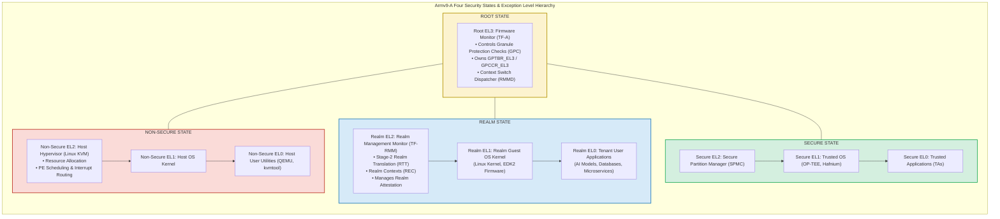
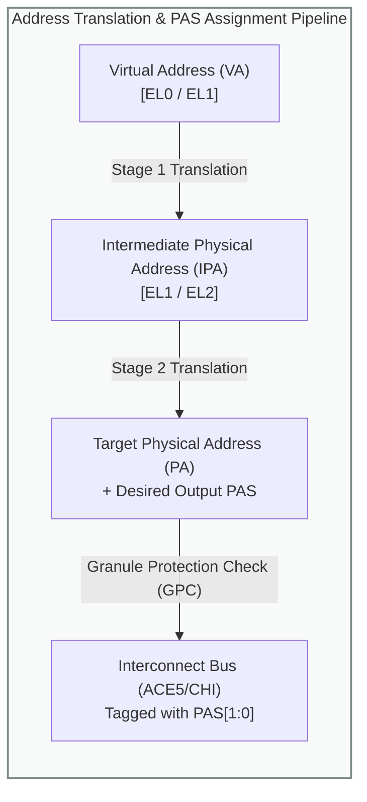
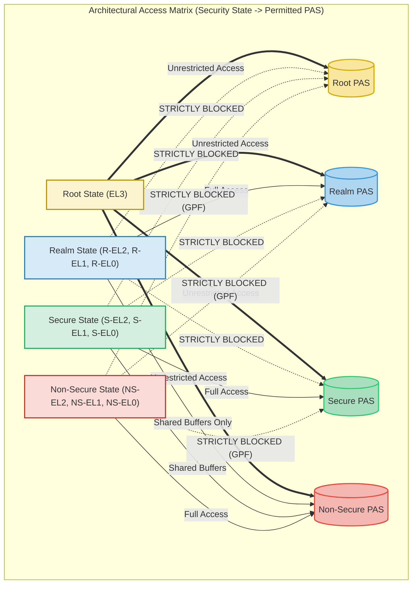

# Module 2: Armv9-A Security States & Physical Address Spaces (PAS)

## 2.1 The Four Security States in Armv9-A

Prior to Armv9-A RME, the Arm architecture supported only two security states: **Non-Secure State** and **Secure State**. The current security state was determined by the `SCR_EL3.NS` bit. 

With the introduction of the **Realm Management Extension (FEAT_RME)** in Armv9.1-A, the architectural execution model is expanded to **four mutually isolated Security States**:
1. **Non-Secure State**: The standard operating environment hosting traditional hypervisors (KVM, Xen), guest operating systems, and client applications.
2. **Secure State**: The environment hosting platform firmware services, TrustZone Trusted OSs (e.g., OP-TEE, Trusted Services), and vendor-specific Trusted Applications.
3. **Realm State**: The execution environment dedicated strictly to Confidential Virtual Machines (Realms) and their privileged supervisor code.
4. **Root State**: The most privileged architectural state, reserved exclusively for the Exception Level 3 (`EL3`) firmware monitor (such as Trusted Firmware-A). Root state replaces the legacy concept of "Secure EL3".



### Architectural Controls of Current Security State
The active security state of the Processing Element (PE) is determined by two control bits located in the Secure Configuration Register at EL3 (`SCR_EL3`):
- `SCR_EL3.NS` (Non-Secure bit)
- `SCR_EL3.NSE` (Non-Secure Extension bit)

The decoding of these bits governs which security state the PE executes in when transitioning to lower exception levels (`EL2`, `EL1`, `EL0`):

| `SCR_EL3.NSE` | `SCR_EL3.NS` | Exception Level | Architectural Security State | Description |
| :---: | :---: | :---: | :---: | :--- |
| `X` | `X` | **EL3** | **Root State** | Root state is active whenever executing at `EL3`, regardless of `NS`/`NSE` bit values. |
| `0` | `0` | **EL2, EL1, EL0** | **Secure State** | Traditional TrustZone Secure World. |
| `0` | `1` | **EL2, EL1, EL0** | **Non-Secure State** | Standard Normal World. |
| `1` | `1` | **EL2, EL1, EL0** | **Realm State** | Confidential Computing Realm World. |
| `1` | `0` | **EL2, EL1, EL0** | *Reserved* | Architecturally reserved (causes an illegal exception return if attempted). |

Transitions between different security states can **only** occur by taking an exception to Root EL3 (e.g., via an `SMC` instruction or an interrupt configured to route to EL3), executing the EL3 monitor context-save routine, reprogramming `SCR_EL3`, and executing an `ERET` instruction into the target security state. Direct horizontal transitions between Non-Secure, Secure, and Realm states are strictly impossible in hardware.

---

## 2.2 Physical Address Spaces (PAS)

A foundational innovation of RME is the complete decoupling between **Virtual Addresses (VA)**, **Intermediate Physical Addresses (IPA)**, and physical memory classification.

In legacy architectures, an address transaction emitted onto the system bus had an associated single-bit tag: `NS = 0` (Secure) or `NS = 1` (Non-Secure). Under RME, physical memory is partitioned into **four distinct Physical Address Spaces (PAS)**:
1. **Root PAS**: Houses sensitive `EL3` monitor code, private stacks, cryptographic keys, and the Granule Protection Tables (GPT) themselves.
2. **Realm PAS**: Houses Realm code, Realm private data, Realm Execution Context (REC) metadata, and Realm Stage-2 translation tables (RTT).
3. **Secure PAS**: Houses TrustZone Trusted OS images, Secure partitions, and Trusted Application memory.
4. **Non-Secure PAS**: Houses host hypervisor code, guest operating systems of traditional VMs, DMA buffers, and shared communication pools.



Every physical bus transaction emitted by a PE, System MMU (SMMU), or DMA controller is qualified with an architectural 2-bit PAS tag:
- `0b00`: Non-Secure PAS
- `0b01`: Secure PAS
- `0b10`: Root PAS
- `0b11`: Realm PAS

---

## 2.3 Legal PAS Access Matrix

Hardware enforces strict, unbypassable boundary rules governing which Physical Address Spaces can be accessed by software executing in each Security State. 

Software executing in a given security state can only target physical memory belonging to a permissible subset of PASs. Any attempt by software to emit an access to an unauthorized PAS is blocked immediately by the core MMU or interconnect, triggering a synchronous exception:



### Comprehensive Access Enforcement Table

| Executing Security State | Target: Non-Secure PAS | Target: Secure PAS | Target: Realm PAS | Target: Root PAS | Architectural Result / Notes |
| :---: | :---: | :---: | :---: | :---: | :--- |
| **Root (EL3)** | **ALLOWED** | **ALLOWED** | **ALLOWED** | **ALLOWED** | Root state has architectural supremacy. It can access all four physical address spaces. Essential for initializing GPTs, dispatching contexts, and managing system boot. |
| **Realm (R-EL2, R-EL1, R-EL0)** | **ALLOWED** | **BLOCKED** *(GPF)* | **ALLOWED** | **BLOCKED** *(GPF)* | Realm software can access Realm PAS (private data) and Non-Secure PAS (shared I/O communication buffers). Access to Secure PAS or Root PAS is blocked. |
| **Secure (S-EL2, S-EL1, S-EL0)** | **ALLOWED** | **ALLOWED** | **BLOCKED** *(GPF)* | **BLOCKED** *(GPF)* | Secure software can access Secure PAS and Non-Secure PAS. It has **zero visibility** into Realm PAS or Root PAS. |
| **Non-Secure (NS-EL2, NS-EL1, NS-EL0)** | **ALLOWED** | **BLOCKED** *(GPF)* | **BLOCKED** *(GPF)* | **BLOCKED** *(GPF)* | Host Hypervisor and normal OS can **only** access Non-Secure PAS. Any access to Root, Secure, or Realm PAS triggers an immediate Granule Protection Fault. |

---

## 2.4 Translation Regimes & Controlling Output PAS

Translation tables (Stage-1 and Stage-2) are configured to control which PAS a translated address targets.

### Translation Regimes Overview
1. **Non-Secure Translation Regimes**:
   - `NS-EL1&0`: Stage-1 translates VA to IPA/PA. If Stage-2 is enabled (`NS-EL2`), Stage-2 translates IPA to PA.
   - Non-Secure translation regimes **cannot generate physical addresses targeting Root, Secure, or Realm PAS**. Even if a malicious hypervisor configures its Stage-2 translation descriptors to point to a physical address owned by a Realm, the hardware MMU verifies the requested PAS against the current security state and blocks the access.
2. **Realm Translation Regimes**:
   - `Realm EL1&0`: Stage-1 translates Realm VA to Realm IPA.
   - `Realm EL2`: Stage-2 translates Realm IPA to target PA.
   - The Stage-2 translation descriptors managed by the RMM encode whether the output target is **Realm PAS** (for private Realm memory) or **Non-Secure PAS** (for shared I/O buffers).
   - In Realm translation table descriptors, the top bit of the address or specific attribute bits (such as bit 55 or bit 63 depending on formatting) select between Realm and Non-Secure PAS.
3. **Root & Secure Translation Regimes**:
   - Root EL3 uses `TTBR0_EL3` and translation table descriptors that can explicitly encode any of the four target PASs using descriptor attribute bits `NSE` and `NS`.

```
Descriptor Bit Encoding for Output PAS (Armv9-A Page Table Descriptors):
+--------------------------------------------------------------+
| Bit [56] (NSE) | Bit [5] (NS) | Output Physical Address Space|
+----------------+--------------+------------------------------+
|       0        |      0       | Secure PAS                   |
|       0        |      1       | Non-Secure PAS               |
|       1        |      0       | Root PAS                     |
|       1        |      1       | Realm PAS                    |
+--------------------------------------------------------------+
```

---

## 2.5 Bus and Interconnect Extensions: Tagging Transactions

Software-level enforcement at the core MMU is insufficient to guarantee complete platform confidentiality; peripheral devices, memory controllers, and multi-socket interconnects must also honor PAS boundaries.

To propagate PAS isolation across the SoC, Arm enhanced its AMBA bus specifications:
- **AMBA ACE5 / ACE5-Lite**: Extended with sideband signals carrying the PAS classification for every read, write, and snoop transaction:
  - `AWPAS[1:0]` (Write Address Physical Address Space)
  - `ARPAS[1:0]` (Read Address Physical Address Space)
- **AMBA CHI (Coherent Hub Interface) Issue E**: Extended with explicit PAS packet header fields that accompany transactions across the on-chip mesh fabric and coherent interconnect (e.g., CoreLink CMN-700).

```
AMBA Interconnect Signals:
  Core / PE ----[ ARADDR + ARPAS[1:0] ]----> Interconnect (CMN-700)
            <---[ RDATA  + RRESP      ]----
            ----[ AWADDR + AWPAS[1:0] ]----> Granule Protection Checker (GPC)
                                                      |
                                            Pass?     | Fail?
                                           +----------+----------+
                                           |                     |
                                      [ DRAM Controller ]   [ System Error / GPF ]
```

When an address packet arrives at a memory controller or coherent cache slice, the hardware ensures that the cached data lines are tagged with their corresponding PAS. This prevents **cache aliasing attacks**, where a non-secure process might attempt to read a cached physical line that was populated by a Realm.

---
