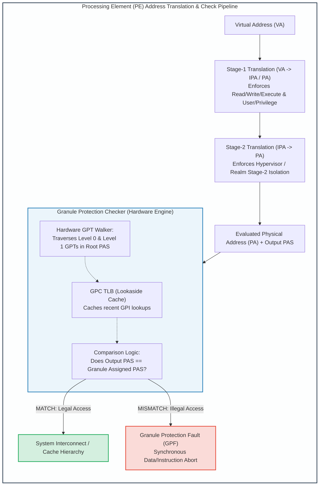
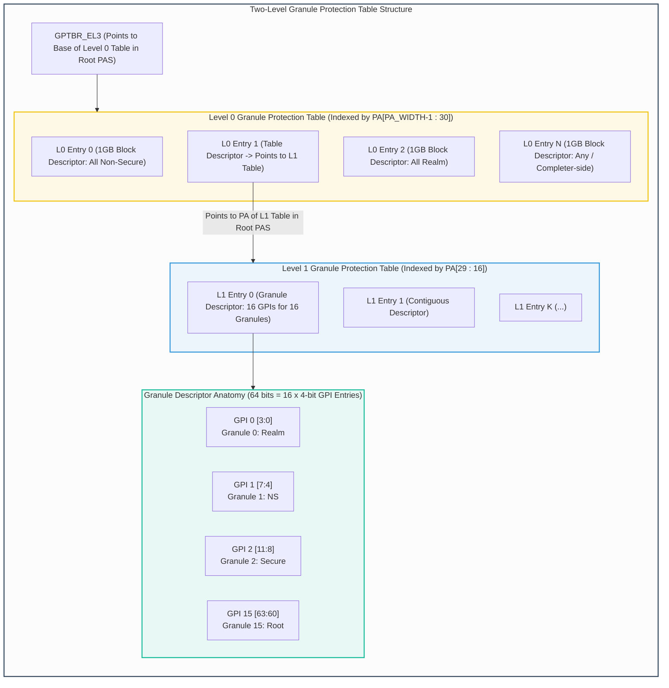
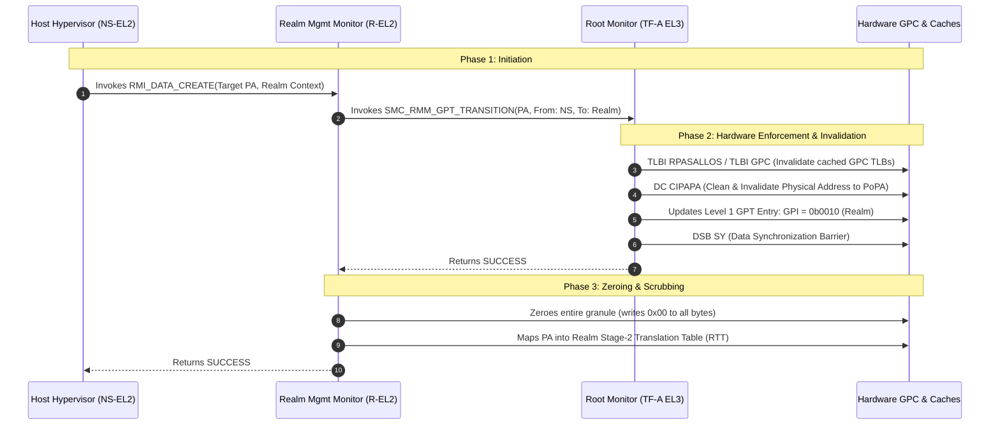

# Module 3: Granule Protection Checks (GPC) & Granule Protection Tables (GPT)

## 3.1 Hardware Granule Protection Checks (GPC) Architecture

The centerpiece of hardware isolation in the Realm Management Extension is the **Granule Protection Check (GPC)** engine. 

While Stage-1 and Stage-2 MMUs translate Virtual Addresses to Physical Addresses and enforce read/write/execute permissions, the GPC serves as an independent, hardware-enforced **validator of physical address ownership**. The GPC evaluates physical addresses *after* all MMU translations are complete, immediately prior to dispatching transactions to L1/L2/L3 caches, system interconnects, or external memory controllers.



### The Granule Concept
Under RME, all physical memory in the system is discretized into uniform atomic units called **granules**. 
- The architectural granule size is configurable by platform firmware at system boot:
  - **4 KB** (standard granule, matching standard 4KB MMU pages)
  - **16 KB**
  - **64 KB** (frequently utilized in high-performance enterprise server configurations)
- At any given point in time, every physical granule in the system has a single, unambiguously assigned **Granule Protection Information (GPI)** attribute defining which of the four Physical Address Spaces it belongs to.

---

## 3.2 Granule Protection Tables (GPT) Structure

The ownership of every physical granule across the entire physical address range is tracked in a globally authoritative, hierarchical table structure called the **Granule Protection Table (GPT)**.

The GPT structure is located strictly in the **Root Physical Address Space**. It can only be mapped, modified, and written by firmware executing in **Root EL3**. Even the hypervisor at `NS-EL2` or the Realm Management Monitor at `R-EL2` cannot directly alter a GPT entry.

### System Control Registers
Granule Protection Checks are governed by two primary EL3 control registers:
1. **`GPCCR_EL3` (Granule Protection Check Configuration Register, EL3)**:
   - `GPC`: Global enable bit for Granule Protection Checks.
   - `PGS` (Physical Granule Size): Configures the system granule size (`0b00` = 4KB, `0b01` = 64KB, `0b10` = 16KB).
   - `L0GPTSZ` (Level 0 GPT Size): Encodes the physical address range covered by each Level 0 entry (e.g., 1GB, 512MB).
   - `PPS` (Protected Physical Address Size): Introduced in Armv9.1-A / `FEAT_RME_GPC3` to define the maximum physical address range covered by the GPT (up to 52 bits). Any physical address beyond `PPS` defaults strictly to Non-Secure PAS, avoiding unnecessary page table memory consumption.
2. **`GPTBR_EL3` (Granule Protection Table Base Register, EL3)**:
   - Holds the 64-bit base physical address (in Root PAS) of the root Level 0 Granule Protection Table.



---

## 3.3 Two-Level GPT Lookup Walk & Descriptors

The architecture implements a flexible two-level lookup scheme:

### Level 0 Descriptors (L0GPTE)
Each entry in the Level 0 GPT covers a large, contiguous chunk of physical address space (typically **1 GB** per entry). A Level 0 entry is a 64-bit value that can take one of two distinct formats:
1. **Block Descriptor**:
   - Assigns the entire 1 GB physical memory block uniformly to a single PAS (or flags it as "Any", delegating checks to peripheral completer-side filters).
   - Highly efficient: eliminates the need to allocate Level 1 tables for large swaths of contiguous non-secure DRAM or memory-mapped I/O (MMIO) spaces.
2. **Table Descriptor**:
   - Indicates that the 1 GB region is finely subdivided into individual granules with varying PAS assignments.
   - Contains the 64-bit base physical address of the corresponding **Level 1 GPT** in Root PAS.

### Level 1 Descriptors (L1GPTE)
Each Level 1 table descriptor covers a portion of memory broken down to the system granule size. A Level 1 entry is a 64-bit descriptor that can be formatted as:
1. **Granule Descriptor**:
   - Encodes ownership for **16 contiguous granules**.
   - The 64-bit entry is divided into **16 separate 4-bit Granule Protection Information (GPI)** fields:
     $$\text{L1GPTE}[4i+3 : 4i] = \text{GPI for Granule } i \quad (i \in [0, 15])$$
2. **Contiguous Descriptor**:
   - Encodes that a block larger than a single granule (e.g., 2MB or 32MB) shares identical GPI properties.
   - Facilitates aggregated caching in the GPC TLBs, minimizing translation table walk penalties.

### GPI Value Encodings (4-bit field)

| GPI Encoding `[3:0]` | Assigned Physical Address Space | Architectural Behavior & Usage |
| :---: | :---: | :--- |
| `0b0000` | **Non-Secure (NS)** | Memory assigned to the host OS, standard VMs, or normal device buffers. |
| `0b0001` | **Root** | Memory holding EL3 monitor firmware, secure configuration, or GPT nodes. |
| `0b0010` | **Realm** | Memory holding Realm private data, REC execution states, or RTT page tables. |
| `0b0011` | **Secure** | Memory holding TrustZone firmware, Trusted OS stacks, or Secure storage. |
| `0b1000` | **Any** | Bypasses core GPC filtering; checks delegated to external programmable completer filters (used for legacy peripherals or shared MMIO fabrics). |
| *Others* | *Reserved* | Unassigned / Reserved. Triggers a Granule Protection Fault on any access. |

---

## 3.4 Granule Protection Faults (GPF)

When a processing element or bus initiator attempts a memory access where the output PAS generated by the translation regime does **not** match the GPI programmed in the Granule Protection Tables, hardware immediately aborts the transaction with a **Granule Protection Fault (GPF)**.

### Architectural Fault Classification
GPFs are classified into two broad categories:
1. **Synchronous Granule Protection Faults**:
   - Occur when a core PE instruction fetch or load/store instruction violates GPC rules.
   - Manifests as a **Synchronous Data Abort** or **Instruction Abort** taken to the current or higher Exception Level.
   - **Fault Syndrome Registers**:
     - `ESR_ELx.EC`: Contains Exception Class `0b100100` (Data Abort) or `0b100000` (Instruction Abort).
     - `ESR_ELx.DFSC` / `IFSC`: Contains specific Data/Instruction Fault Status Codes indicating:
       - `0b011100`: Granule Protection Fault on translation table walk (Level 0).
       - `0b011101`: Granule Protection Fault on translation table walk (Level 1).
       - `0b011110`: Granule Protection Fault on primary access.
     - `FAR_ELx` (Fault Address Register): Captures the precise Virtual Address that triggered the fault.
     - `HPFAR_EL2` / `HPFAR_EL3`: Captures the Intermediate Physical Address (IPA).
2. **Asynchronous / External Granule Protection Faults**:
   - Occur when background write-backs, prefetch operations, or external DMA controllers (via SMMU) violate GPC rules.
   - Signaled as an **SError Interrupt** (System Error) or routed directly to EL3 via an asynchronous fault interrupt line.

```
Synchronous Fault Dispatch Hierarchy:
  Illegal Access by NS-EL1 ---> Trapped to NS-EL2 (Host Hypervisor)
  Illegal Access by R-EL1  ---> Trapped to R-EL2 (TF-RMM)
  Illegal Access by R-EL2  ---> Trapped to Root EL3 (TF-A)
```

---

## 3.5 Dynamic Granule Transitions & Memory Scrubbing

A fundamental capability of Arm CCA is **dynamic physical memory reassignment**. Unlike traditional TrustZone, where memory carveouts for Secure World are fixed statically at boot time in the TrustZone Address Space Controller (TZASC), Arm CCA allows physical memory granules to be dynamically transitioned between Non-Secure and Realm states during runtime.

However, dynamically transitioning memory introduces a severe security hazard: **Information Remanence & Cross-World Data Leakage**.
- If a Non-Secure granule is transitioned to Realm PAS, stale hypervisor data might be read by the Realm (integrity risk).
- More critically, when a Realm is destroyed or releases memory back to Non-Secure PAS, private Realm data (passwords, encryption keys, decrypted customer data) would be exposed to the host if physical DRAM lines or cache lines are not scrubbed.

### The Granule Transition Protocol
To transition a granule safely, the architecture mandates an atomic, multi-stage protocol executed across the Host Hypervisor, RMM, and Root EL3 Monitor:



### Architectural Scrubbing & Invalidation Requirements
1. **Cache Clean and Invalidate to Point of Physical Authenticity (PoPA)**:
   - Before a granule changes PAS ownership, the processor must execute the dedicated cache maintenance instruction:
     ```assembly
     DC CIPAPA, Xt   /* Clean and Invalidate cache by Physical Address to PoPA */
     ```
   - This ensures that any dirty cache lines belonging to the old owner are flushed to DRAM and tagged lines are evicted, preventing stale cache hits under the new PAS.
2. **GPC TLB Invalidation**:
   - Processor GPC TLBs cache recent GPT entries. Firmware must execute:
     ```assembly
     TLBI RPASALLOS  /* TLB Invalidate all Physical Address Spaces, Outer Shareable */
     ```
   - This prevents stale GPC lookup entries from permitting illegal accesses.
3. **Mandatory Hardware Zeroing (Scrubbing)**:
   - When transitioning from Realm PAS back to Non-Secure PAS (via `RMI_DATA_DESTROY`), the RMM zeroizes the memory granule *before* EL3 updates the GPT to Non-Secure. 
   - Even if the host hypervisor attempts to read the physical address immediately upon transition, it reads only zeros.

---

## 3.6 GPC Bypass Windows: Mechanics and Security Bounds

In specific platform configurations, certain physical address ranges must bypass core GPC checking:
- **GPC Bypass Windows**: Architecturally defined physical memory windows configured in `GPCCR_EL3` where incoming transactions are automatically forwarded with `GPI = Any` or directly assigned to Non-Secure PAS without traversing the GPT walk.
- **Legitimate Use Cases**:
  - Legacy platform initialization before GPT structures are allocated in Root RAM.
  - High-bandwidth, fixed memory-mapped I/O (MMIO) fabrics where a hardware-programmable completer filter (such as an external firewall or peripheral filter) already enforces security boundaries.
- **Architectural Security Constraints**:
  - A GPC Bypass Window can **never** be configured over DRAM regions hosting Root PAS or Realm PAS memory.
  - Configuration of bypass windows is locked to Root EL3 and cannot be altered once the system transitions from initial boot to the runtime security lifecycle.

---
