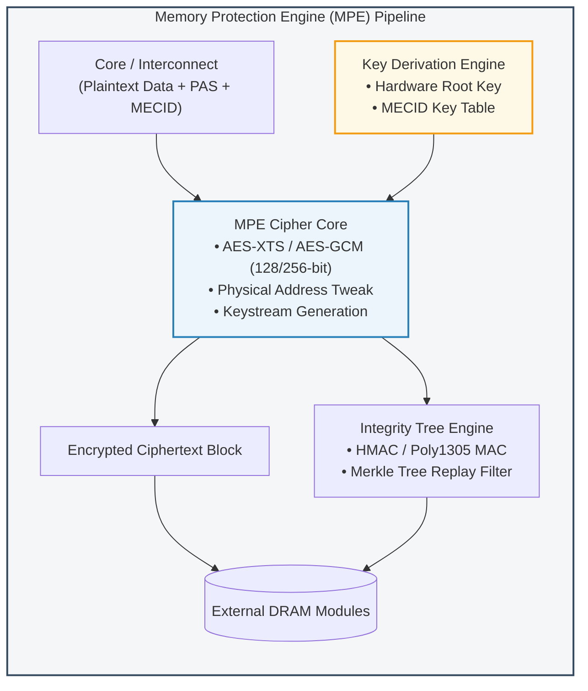
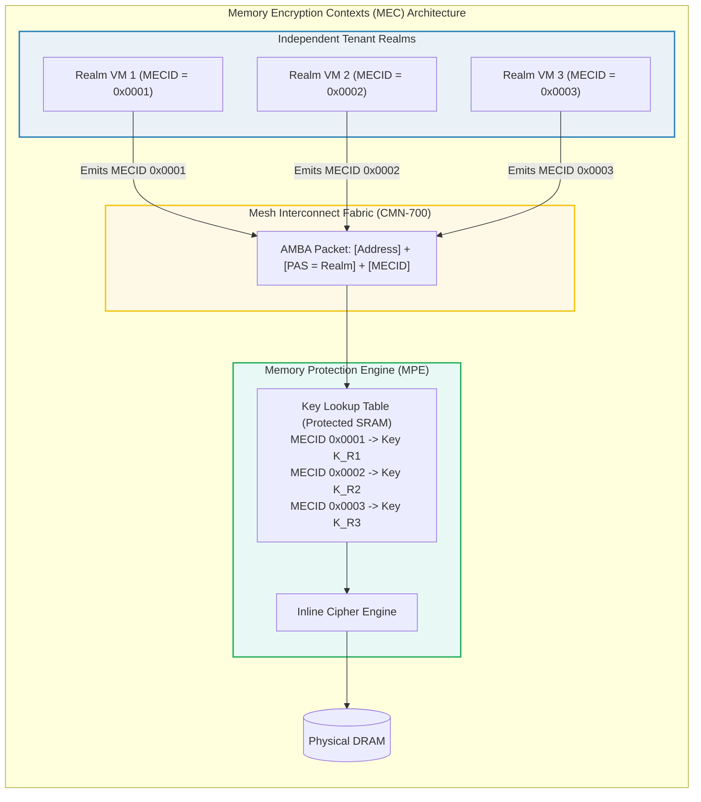
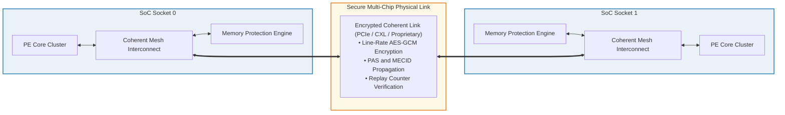

# Module 4: System Hardware Infrastructure & Memory Protection

## 4.1 Processing Element (PE) Architecture & Granule Data Isolation (GDI)

The Armv9-A architecture with Realm Management Extension (RME) introduces critical microarchitectural enhancements to the Processing Element (PE) pipeline to guarantee strict temporal and spatial isolation across security states.

### Microarchitectural Flushes & State Sanitization
Whenever a physical PE transitions between security states (e.g., executing a world switch at Root EL3), hardware and firmware cooperate to enforce complete state isolation:
- **General-Purpose and Vector Registers**: Saved and restored by the EL3 monitor or RMM. Vector registers (Neon, SVE2, SME) and FPCR/FPSR are zeroized or context-switched to eliminate microarchitectural data remanence.
- **Translation Lookaside Buffers (TLBs)**: Every TLB entry is tagged with its originating Translation Regime and PAS. A Non-Secure translation lookup can never match a TLB entry tagged with Realm PAS.
- **Branch Target Buffers (BTBs) & Speculative Execution Barriers**: RME requires hardware protection against speculative cross-world side-channel attacks (e.g., Spectre-v2, Branch Target Injection). Architectural barrier instructions (`CSDB`, `ESB`, `SB`) and hardware speculation barriers (`FEAT_CSV2`, `FEAT_CSV3`) prevent malicious hypervisors from training branch predictors to steer speculative execution in Realms.

### Granule Data Isolation (GDI)
As defined in the *RME System Architecture* (ARM-DEN-0129), **Granule Data Isolation (GDI)** is a system-level property ensuring that data belonging to a physical granule assigned to one PAS is never exposed to another PAS through transient storage:
1. **Cache Tagging**: Internal L1, L2, and system-level caches (SLC) track the PAS attribute alongside physical cache line address tags. Even if two processes in different security states issue an access to identical physical address offsets, the cache tag comparison checks:
   $$\text{Cache Hit} \iff (\text{PA} == \text{Tag.PA}) \land (\text{Transaction.PAS} == \text{Tag.PAS})$$
2. **Eviction and Line-Fill Scrubbing**: When a cache line is evicted or invalidated, its data cannot be speculatively snooped across security boundaries.

```
L1 / L2 / L3 Cache Line Tag Format in RME:
+---------------------------------------------------------------------------------+
| Physical Tag [PA_WIDTH-1 : 6] | PAS Tag [1:0] | MECID [15:0] | State / Dirty Bit|
+---------------------------------------------------------------------------------+
|                                Cache Data (64 Bytes)                            |
+---------------------------------------------------------------------------------+
```

---

## 4.2 Main Memory Protection Engine (MPE) & DRAM Encryption

While Granule Protection Checks prevent unauthorized on-chip access, external DRAM chips and inter-die memory buses remain vulnerable to physical tampering, cold-boot attacks, and passive bus interposers.

To eliminate physical attacks, RME platforms integrate a hardware **Memory Protection Engine (MPE)** into the DRAM memory controller pipeline.



### Cryptographic Primitives & Modes
The MPE operates at memory line speed (typically 64-byte bursts corresponding to cache lines):
1. **Confidentiality (Encryption)**:
   - Utilizes standard block ciphers such as **AES-XTS-128**, **AES-XTS-256**, or low-latency tweakable ciphers (e.g., Prince or QARMA-based ciphers).
   - The encryption key is dynamically combined with a physical address tweak, ensuring that identical 64-byte plaintext patterns written to different physical memory locations produce completely distinct ciphertexts (defeating pattern-recognition attacks).
2. **Integrity & Replay Protection**:
   - To defeat active physical tampering (e.g., bit-flipping or splicing attacks), the MPE generates a Message Authentication Code (MAC) for each 64-byte line.
   - To mitigate replay attacks (where an attacker records a valid ciphertext block and writes it back at a later time), the MPE maintains an on-chip **integrity tree (Merkle Tree)** with monotonic version counters rooted in on-chip SRAM.

---

## 4.3 Memory Encryption Contexts (MEC) & MECIDs

In cloud multi-tenant systems, thousands of confidential virtual machines may execute concurrently. If all Realms share a single global encryption key, a physical bus attack or microarchitectural bug in the memory controller could theoretically compromise multi-tenant isolation.

The **Memory Encryption Contexts (MEC)** extension introduces fine-grained, per-Realm cryptographic keys for main memory.



### MEC Mechanics & Allocation
- **MECID (Memory Encryption Context Identifier)**: A 16-bit identifier allocated by the RMM to each active Realm.
- **PAS and MECID Interaction**: While the GPC verifies that the transaction targets Realm PAS, the MPE checks the MECID:
  - If a transaction arrives at the memory controller with `PAS = Realm` and `MECID = 0x0002`, the MPE retrieves Key $K_{\text{R2}}$ from its internal secure key store to decrypt the cache line.
  - If an attacker or hypervisor attempts to read Realm 2's memory using Realm 1's context or a Non-Secure context, the MPE uses the incorrect key, resulting in cryptographically scrambled garbage and an immediate integrity check failure.
- **MECID Mismatch Faults**: Any discrepancy between the MECID encoded in the transaction and the assigned granule configuration triggers a synchronous abort or system error report.

---

## 4.4 System Control Processor (SCP) & Trusted Subsystems

Enterprise SoCs incorporate autonomous microcontrollers for power, thermal, clock, and system lifecycle management:
- **System Control Processor (SCP)** / Manageability Subsystem.
- **Baseboard Management Controller (BMC)**.

### Architectural Threat
Because these microcontrollers often have direct bus master access to the system fabric to orchestrate dynamic frequency scaling (DVFS) and power states, a compromised SCP could potentially issue DMA reads into Realm or Root memory.

### RME Requirements for Subsystems (ARM-DEN-0129)
1. **Isolated & Shielded Locations**:
   - Firmware for the SCP must execute from dedicated ROM or private on-chip SRAM that is physically inaccessible to the main Application PEs.
2. **SCP Transaction Filtering**:
   - The interconnect must subject all SCP-initiated bus transactions to Granule Protection Checks. 
   - Under standard runtime states, the SCP is treated as an untrusted or strictly non-secure bus master: it is prohibited from initiating transactions targeting Root, Secure, or Realm PAS.
3. **Power Transitions & State Zeroization**:
   - When a core or cluster is placed into a low-power retention or power-down state (e.g., via PSCI), any hardware state registers saving Realm or Root context must be wiped before power rails collapse, or saved into Root-shielded SRAM.

---

## 4.5 Multi-Chip Interconnects & Link Protection

High-end server platforms deploy multi-socket configurations where multiple physical SoCs communicate over high-speed coherent inter-chip links (e.g., Arm CCIX or CXL across PCIe physical layers).



### Multi-Chip RME Requirements
1. **Link Encryption & Integrity**:
   - Inter-chip links carry cache coherency snoop requests, data transfers, and memory read/writes across physical printed circuit board (PCB) traces.
   - As mandated by ARM-DEN-0129 Chapter B8, multi-chip links must implement hardware-level authenticated encryption (e.g., MACsec or PCIe IDE) to protect transactions traversing external board traces against physical interposers.
2. **PAS Preservation Across Sockets**:
   - The coherent interconnect protocol must serialize the 2-bit PAS tag and the MECID into the packet headers across the physical link.
   - Sockets must establish a mutually verified cryptographic trust domain at system boot before permitting coherent Realm transactions to traverse the inter-chip fabric.

---

## 4.6 CXL.mem Integration & CXL-TSP

The advent of **Compute Express Link (CXL)** allows servers to expand physical memory via memory devices connected over PCIe physical layers (CXL.mem protocol).

### Challenges with External CXL Memory
Unlike on-package DRAM controllers, CXL memory modules reside across external PCIe slots and may contain independent controllers, making them vulnerable to device substitution and bus snooping.

### CXL-TSP (Trusted Security Protocol)
To support CXL memory in an RME architecture:
- The host memory controller and the CXL endpoint negotiate **CXL-TSP** session keys during platform boot.
- The SoC memory controller treats the CXL link as a secure cryptographically encapsulated tunnel.
- Transactions emitted to CXL memory maintain explicit PAS classification and per-granule integrity tags, ensuring that Realm memory hosted on CXL expanders retains identical security guarantees to local DRAM.

---
