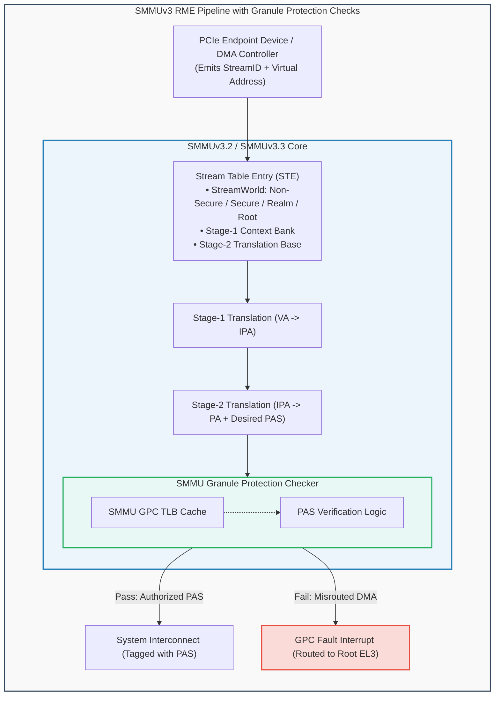
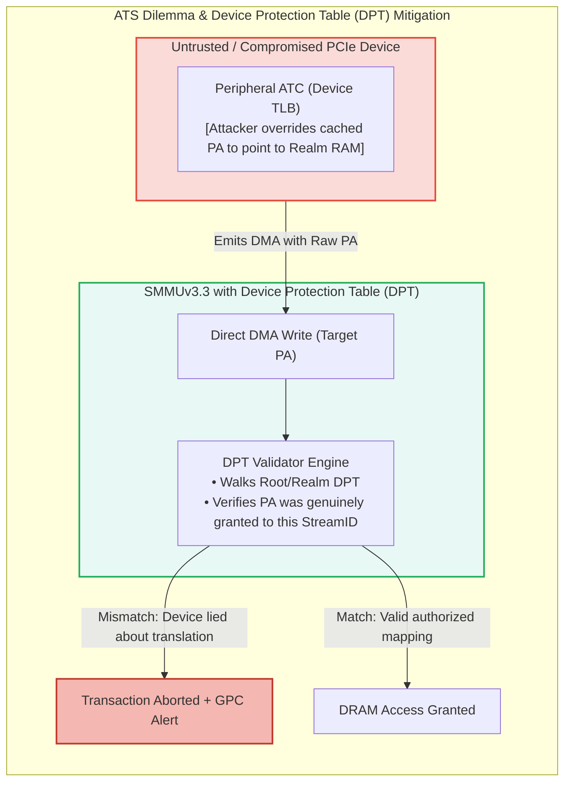
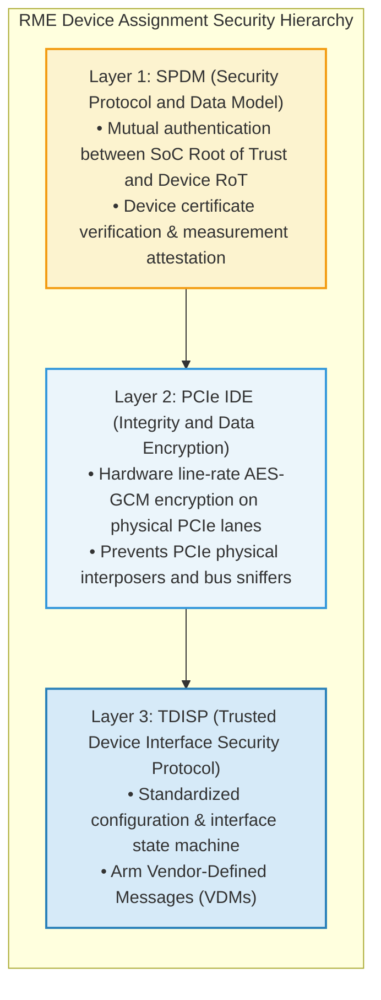

# Module 5: System MMU (SMMUv3.2/3.3) & Device Assignment (RME-DA & RME-CDA)

## 5.1 System MMU Role in an RME-Enabled Platform

In complex computing systems, peripheral devices (e.g., Network Interface Cards, NVMe SSD controllers, GPUs, and hardware accelerators) utilize Direct Memory Access (DMA) to read and write system memory directly. 

Without hardware protection, a malicious peripheral or a compromised hypervisor configuring DMA descriptors could issue memory transactions targeting Realm private memory, bypassing core CPU MMUs entirely.

To prevent DMA-based compromise and to enable direct, confidential hardware acceleration, the **Arm System Memory Management Unit (SMMUv3.2 and SMMUv3.3)** incorporates architectural extensions for RME:
1. **PAS-Aware Stream Translation**: Every DMA transaction emitted by an endpoint device is assigned a **StreamID**. The SMMU maps the StreamID to a security domain and translation context.
2. **Granule Protection Check (GPC) Integration**: The SMMU incorporates an internal GPC pipeline and GPC TLB, validating that physical addresses generated by DMA translation do not violate Granule Protection Tables before emitting transactions to the system interconnect.

---

## 5.2 StreamWorld Configurations & Stream Security

The SMMU configuration structure is rooted in the **Stream Table**, indexed by the peripheral's `StreamID`. Each Stream Table Entry (STE) contains the **`STRW` (StreamWorld)** configuration:

| `STRW` Field | Associated Security Domain | Output Permitted PAS | Description |
| :---: | :---: | :---: | :--- |
| `0b00` | **Non-Secure (NS)** | Non-Secure PAS Only | Standard PCIe devices (legacy NICs, NVMe disks). Cannot target Realm memory. |
| `0b01` | **Secure** | Secure & Non-Secure PAS | Secure World peripherals (e.g., Hardware Security Modules, TPMs). |
| `0b10` | **Realm** | Realm & Non-Secure PAS | Devices assigned directly to a Realm (Confidential Accelerators, Realm vNICs). |
| `0b11` | **Root** | All PAS (Root, Realm, Secure, NS) | Highly privileged platform controllers. |

---

## 5.3 The Address Translation Services (ATS) Security Dilemma & DPT

High-performance PCIe devices utilize **Address Translation Services (ATS)**. Under ATS, rather than the SMMU translating every single DMA read/write transaction:
1. The device issues an ATS translation request to the SMMU.
2. The SMMU translates the address and returns the translated physical address to the device.
3. The device caches the translation in its internal **Address Translation Cache (ATC)** and subsequently issues DMA requests using physical addresses directly.

### The ATS Vulnerability in Confidential Computing
In a confidential compute environment, ATS creates an unacceptable security flaw:
> *A physical PCIe endpoint is outside the processor chip package. An attacker can compromise the device firmware or tap the PCIe bus, manipulating the device's internal ATC to emit arbitrary physical addresses into Realm memory, bypassing the SMMU.*

### The Solution: Device Protection Table (DPT)
To allow the performance benefits of ATS without compromising Realm security, Arm SMMUv3.3 introduces the **Device Protection Table (DPT)**:
- Even when full ATS is enabled, all memory transactions emitted by the device must pass through an ultra-fast hardware **DPT check** at the PCIe Root Port or SMMU.
- The DPT acts as an independent hardware firewall recording which specific physical address ranges have been legally mapped to each peripheral device.
- If a device attempts a DMA transaction using an address that does not match an active entry in the DPT for its StreamID, the transaction is dropped immediately and logged as a DPT violation.

---

## 5.4 RME Device Assignment (RME-DA) & PCIe IDE

To enable confidential cloud workloads to utilize specialized accelerators (such as GPUs for private AI inference, tensor processing units, or high-speed SmartNICs) without exposing data to the hypervisor, Arm defines **RME Device Assignment (RME-DA)** and **RME Coherent Device Assignment (RME-CDA)**.

### The Three-Layer Device Assignment Stack
Securing an external PCIe peripheral in Arm CCA requires three coordinated protocols:

1. **SPDM (Security Protocol and Data Model - DMTF standard)**:
   - Before an accelerator is assigned to a Realm, the platform Root of Trust and the RMM communicate with the device's embedded micro-controller.
   - The device presents its X.509 certificate chain rooted in the device manufacturer's CA.
   - The RMM requests cryptographic measurements of the device's internal firmware.
2. **PCIe IDE (Integrity and Data Encryption - PCI-SIG standard)**:
   - Establishes point-to-point cryptographic encryption between the host PCIe Root Complex and the endpoint device controller.
   - Every Transaction Layer Packet (TLP) is encrypted with AES-GCM and stamped with a 96-bit cryptographic MAC, protecting all PCIe traffic against physical interposers.
3. **TDISP (Trusted Device Interface Security Protocol)**:
   - Standardizes the interface states: `CONFIG_LOCKED`, `UNLOCKED`, `LOCKED`, and `RUN`.
   - The Host Hypervisor coordinates device setup, but cannot enter the `RUN` state or manipulate device DMA registers without cryptographic authorization from the RMM.

### Arm Vendor-Defined Messages (VDMs) for TDISP
As specified in **ARM-DEN-0129 Appendix 2**, Arm CCA extends standard TDISP messaging using PCIe Vendor-Defined Messages (VDMs) with Arm's Vendor ID:
- `GET_VERSION_REQ` / `GET_VERSION_RESP`: Negotiates Arm RME-DA protocol capabilities.
- `SET_INTERFACE_REQ` / `SET_INTERFACE_RESP`: Binds a specific physical or virtual function (SR-IOV VF) to a target Realm.
- `GET_DEV_PROP_REQ` / `GET_DEV_PROP_RESP`: Retrieves device hardware properties, memory limits, and GPC compliance flags.

---
