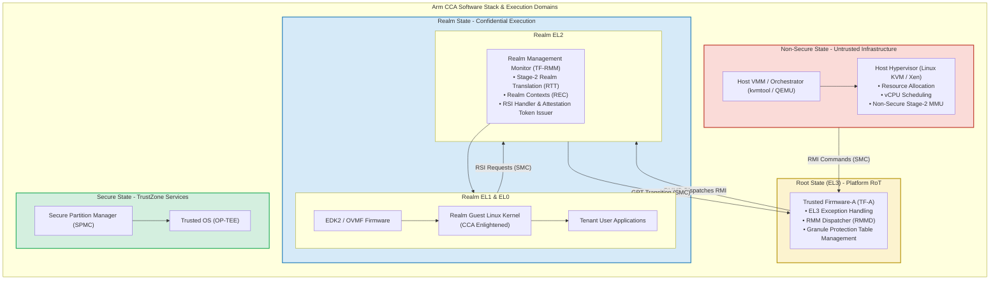

# Module 6: Arm CCA Software Architecture & Firmware Stack

## 6.1 Complete Software Topology & Trust Hierarchy

The Arm Confidential Compute Architecture software stack coordinates firmware, hypervisor, and guest environments across all four security states.

---

## 6.2 EL3 Firmware: Monitor & RMM Dispatcher (RMMD)

Exception Level 3 (`EL3`) is the architectural bedrock of the platform. Executing in **Root State**, the EL3 firmware (implemented in open-source **Trusted Firmware-A / TF-A**) has complete physical access to the machine.

### Core Responsibilities of TF-A in Arm CCA
1. **Cold Boot & Platform Initialization**:
   - Executes the early boot stages (`BL1`, `BL2`, `BL31`).
   - Configures `GPCCR_EL3` and `GPTBR_EL3`, building the initial Level 0 and Level 1 Granule Protection Tables in Root PAS memory.
   - Disables all invasive debug interfaces for Realm and Root spaces unless hardware cryptographic debug authentication is satisfied.
2. **RMM Dispatcher (RMMD)**:
   - Resides inside TF-A as a privileged dispatch service.
   - When the Host Hypervisor issues a Secure Monitor Call (`SMC`) containing an **RMI function ID**, the processor traps to EL3.
   - The RMMD validates the SMC parameters, performs a context switch from Non-Secure state to Realm state, and executes an `ERET` to enter the Realm Management Monitor at `R-EL2`.
   - Conversely, when the RMM completes an operation or needs to return control to the host, the RMMD switches context back and returns execution to `NS-EL2`.
3. **GPT Dynamic Transition Service**:
   - Serves privileged SMC calls from the RMM to transition granules between `Non-Secure` and `Realm` PAS.
   - Executes the required hardware cache clean/invalidation (`DC CIPAPA`) and TLB invalidation (`TLBI RPASALLOS`) before committing GPT entry changes.

---

## 6.3 Realm Management Monitor (TF-RMM) at R-EL2

The **Realm Management Monitor (RMM)** is a purpose-built, highly optimized, trusted firmware layer executing at **Realm EL2 (`R-EL2`)**. 

The reference implementation, **TF-RMM**, is developed under the open governance of TrustedFirmware.org.

### Architectural Mandates of the RMM
1. **Zero Policy, Pure Mechanism**:
   - The RMM does **not** contain an operating system scheduler, virtual disk driver, or complex device emulator.
   - It acts purely as a deterministic hardware-isolation gatekeeper. Scheduling decisions remain strictly with the host hypervisor.
2. **Deterministic Memory Footprint**:
   - The RMM uses a static, pre-allocated memory model. It does not use dynamic runtime heap allocations (`malloc`), eliminating a massive class of memory corruption and heap fragmentation vulnerabilities.
3. **Execution Context Management**:
   - Allocates and maintains **Realm Execution Contexts (RECs)**.
   - When the host hypervisor decides to run a Realm vCPU, it invokes `RMI_REC_ENTER`. The RMM sanitizes the CPU registers, loads the Realm vCPU state, configures Realm Stage-2 translation, and enters Realm EL1/EL0.
4. **Attestation Token Generation**:
   - Manages the cryptographic measurement engine for Realms.
   - Serves requests from the Realm guest via the Realm Services Interface (RSI) to produce cryptographically signed attestation tokens.

---

## 6.4 Host Hypervisor (KVM / kvmtool / QEMU) at NS-EL2

In traditional virtualization, Linux KVM owns both resource allocation and execution privileges. In Arm CCA, KVM is adapted to operate as an **Untrusted Resource Manager**.

### KVM Architectural Adaptations for CCA
1. **Realm VM Lifecycle Management**:
   - KVM exposes standard `/dev/kvm` ioctl interfaces to userspace VMMs (such as `kvmtool` or QEMU):
     - `KVM_CREATE_VM` (flagged with `KVM_VM_TYPE_ARM_REALM`)
     - `KVM_ARM_REALM_CREATE_RD` (allocates Realm Descriptor)
     - `KVM_ARM_REALM_INIT_IPA_REALM` (populates initial guest image)
     - `KVM_ARM_REALM_ACTIVATE` (locks initial measurements and transitions Realm to Active)
2. **Unshared Memory Management**:
   - Standard KVM virtual machines have their guest physical memory mapped directly into the host process's virtual address space, allowing QEMU to inspect guest memory.
   - For Realms, KVM allocates normal host memory pages, but then issues `RMI_DATA_CREATE` SMCs to hand the pages over to the RMM. The hardware GPC immediately converts the granules to Realm PAS, revoking KVM's read and write permissions.
3. **Fault & Exit Handling**:
   - When a Realm triggers an exit (e.g., an MMIO access to an emulated virtio device, a timer interrupt, or a PSCI power call), the hardware exits to R-EL2.
   - The RMM sanitizes the exit state: general-purpose register contents are scrubbed, and only a minimal exit reason structure is returned to KVM at `NS-EL2`.

---

## 6.5 Realm Guest Environment: Linux & EDK2

Software running inside a Realm executes at **Realm EL1** (Operating System Kernel) and **Realm EL0** (User Applications).

### Realm Enlightenment
An operating system executing inside a Realm does not require radical architectural redesign, but it does require **CCA Enlightenment**:
1. **Shared vs. Private Memory Classification**:
   - Real-world virtual machines must communicate with host-emulated devices (e.g., virtio-net, virtio-blk). Because the host hypervisor cannot read Realm PAS memory, DMA buffers used for virtio communication must reside in **Non-Secure PAS**.
   - The enlightened Linux kernel implements a bouncing buffer mechanism (such as the Linux `swiotlb` / Software I/O TLB framework). When the guest driver prepares a network packet for transmission, it copies the data from private Realm memory to an explicit shared Non-Secure memory pool.
   - The guest dynamically requests the RMM to mark specific address ranges as Non-Secure using the **Realm Services Interface (`RSI_IPA_STATE_SET`)**.
2. **EDK2 / OVMF UEFI Firmware for Realms**:
   - Open-source EDK2 provides the standard UEFI boot environment inside the Realm.
   - EDK2 initializes the virtual platform, discovers virtual ACPI tables populated by the host, measures the UEFI boot environment into the Realm's runtime attestation registers, and boots the guest Linux kernel.

---
