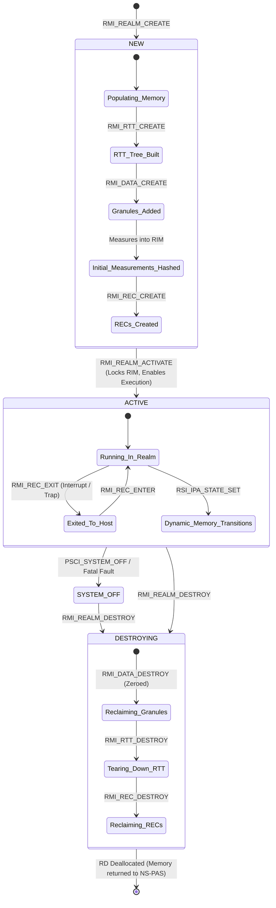
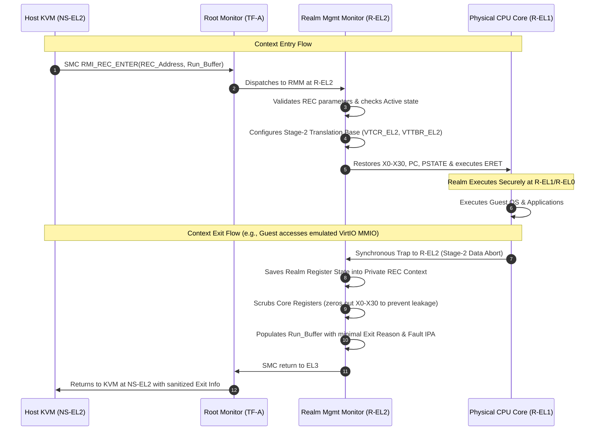
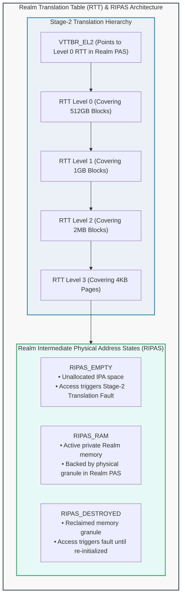
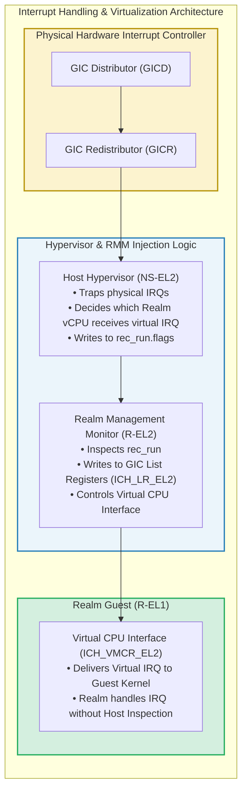

# Module 7: Realm Lifecycle, Execution Contexts (REC) & Stage-2 Translation (RTT)

## 7.1 Realm Lifecycle State Machine

A Realm undergoes a deterministic, cryptographically tracked lifecycle enforced by the Realm Management Monitor (RMM). The RMM maintains a state variable within the Realm Descriptor (`RD`), governing permissible operations at each stage of execution.

### Architectural States
1. **`NEW` State**:
   - The Realm is instantiated via `RMI_REALM_CREATE`.
   - The Host Hypervisor builds the initial Realm Translation Table (RTT) hierarchy and populates the Realm's initial firmware and boot parameters via `RMI_DATA_CREATE`.
   - Every byte of code and data loaded during the `NEW` state is measured by the RMM using a cryptographic hash function (SHA-256 or SHA-512) and accumulated into the **Realm Initial Measurement (RIM)** register.
   - Virtual CPUs are instantiated by creating **Realm Execution Contexts (RECs)** via `RMI_REC_CREATE`.
2. **`ACTIVE` State**:
   - The host issues `RMI_REALM_ACTIVATE`.
   - **The RIM register is permanently locked**. No further code or data can be added to the Realm without altering runtime measurements.
   - The Realm enters the execution phase. RECs can now be scheduled and entered using `RMI_REC_ENTER`.
3. **`SYSTEM_OFF` / `DESTROYING` State**:
   - Triggered when the Realm executes a power-off call (`PSCI_SYSTEM_OFF`) or when the host terminates the Realm.
   - The host tears down the Realm by destroying RECs, dismantling the RTT tree, and returning memory granules to Non-Secure PAS via `RMI_DATA_DESTROY`.
   - **Hardware Invariant**: The RMM refuses to deallocate the Realm Descriptor (`RD`) until every single memory granule, RTT node, and REC assigned to the Realm has been zeroed, scrubbed, and transitioned back to Non-Secure PAS.

---

## 7.2 Realm Execution Context (REC) & Scheduling

A **Realm Execution Context (REC)** represents the architectural state of a virtual CPU allocated to a Realm. 

Because the Host Hypervisor is outside the TCB, it cannot directly inspect or modify the virtual CPU registers. Instead, CPU state is bifurcated across two structures:
1. **Host-Visible REC Buffer**: Contains only operational scheduling metadata (exit reason, interrupt injection flags, timer values).
2. **Private REC Context (Inside Realm PAS)**: Contains general-purpose registers (`X0`–`X30`), stack pointers (`SP_EL0`, `SP_EL1`), program counter (`PC`), Process State (`PSTATE`), Floating-Point/Neon/SVE vector registers, and Realm-private system registers.

### Context Entry & Exit Lifecycle
- **Context Entry (`RMI_REC_ENTER`)**:
  - The host issues an `RMI_REC_ENTER` SMC call, passing the physical address of the REC and a shared communication page (`rec_run`).
  - The RMM configures hardware virtualization controls: the Virtualization Translation Control Register (`VTCR_EL2`) and Virtualization Translation Table Base Register (`VTTBR_EL2`) are loaded with the Realm's Stage-2 page table base.
  - The RMM restores the guest's registers and issues an `ERET` instruction into Realm EL1.
- **Context Exit (`RMI_REC_EXIT`)**:
  - Exits occur on:
    - **Physical Interrupts**: A physical host timer or network interrupt asserts while executing in Realm mode.
    - **Hypercalls / Traps**: The guest issues an `HVC` instruction or performs an access to an unmapped IPA (e.g., MMIO space of an emulated device).
    - **PSCI Calls**: The guest requests a vCPU power transition.
  - The core traps to R-EL2. The RMM securely preserves the guest state, thoroughly zeroes all scratch and general-purpose registers on the physical core, and populates the `rec_run` buffer with sanitized exit metadata before relinquishing control back to `NS-EL2`.

---

## 7.3 Realm Translation Tables (RTT) & RIPAS States

Memory mapping inside a Realm is governed by a dedicated Stage-2 translation tree managed exclusively by the RMM: the **Realm Translation Table (RTT)**.

### Realm Intermediate Physical Address State (RIPAS)
Every Intermediate Physical Address (IPA) within a Realm's virtual address space is tagged with a **RIPAS** value:
1. **`RIPAS_EMPTY`**:
   - The address space has been defined by the hypervisor, but no physical memory granule has been assigned yet.
   - If the Realm attempts to access an address marked `RIPAS_EMPTY`, a Stage-2 translation fault is trapped to the RMM.
2. **`RIPAS_RAM`**:
   - The IPA is backed by a valid physical memory granule residing in **Realm PAS**.
   - The Realm has full read/write permissions. The Host Hypervisor cannot read or write this memory.
3. **`RIPAS_DESTROYED`**:
   - The backing physical granule has been reclaimed or torn down by the host. Any subsequent read/write by the guest will fault until the page is explicitly re-provisioned and zeroed.

### Dynamic RIPAS Transition Workflow
When an enlightened guest OS boots, it may dynamically request additional private memory or donate memory to a shared pool:
1. Guest issues an SMC call: `RSI_IPA_STATE_SET(Start_IPA, Size, Desired_RIPAS)`.
2. The RMM intercepts the call, marks the translation range as pending transition, and returns a status code signaling the host hypervisor.
3. The host hypervisor invokes `RMI_DATA_CREATE` to allocate physical memory and bind it to the IPA.
4. The RMM verifies that the backing physical granule is scrubbed and updates the RTT entry to `RIPAS_RAM`.

---

## 7.4 Interrupt Virtualization & Exception Dispatch

Confidential virtual machines must process interrupts (e.g., virtual timers, virtual network notifications) without permitting the host hypervisor to inject malicious interrupt vectors or snoop execution timing.

Arm CCA leverages the **Generic Interrupt Controller (GICv3 / GICv4)** with virtualization extensions:

### Interrupt Flow Mechanics
1. **Physical Interrupt Arrival**:
   - While a Realm is executing, a physical interrupt (e.g., physical NIC interrupt) fires.
   - The hardware configuration in `SCR_EL3` and `HCR_EL2` ensures the physical interrupt causes an immediate exit from Realm state to `R-EL2`.
   - The RMM sanitizes core registers and completes the context exit to `NS-EL2`. The Host Hypervisor services the physical interrupt.
2. **Virtual Interrupt Injection**:
   - When the host needs to deliver a virtual interrupt to a Realm vCPU, it cannot directly write to the GIC CPU interface registers of the Realm.
   - The host populates the `rec_run` shared structure with the target Virtual Interrupt ID (vINTID).
   - Upon the next `RMI_REC_ENTER`, the RMM parses the `rec_run` buffer, validates that the requested virtual interrupt is permissible, and writes the virtual interrupt into the hardware **GIC List Registers (`ICH_LR<n>_EL2`)**.
   - When the Realm resumes execution at R-EL1, the GIC hardware virtual CPU interface signals the interrupt directly to the guest kernel.

---
