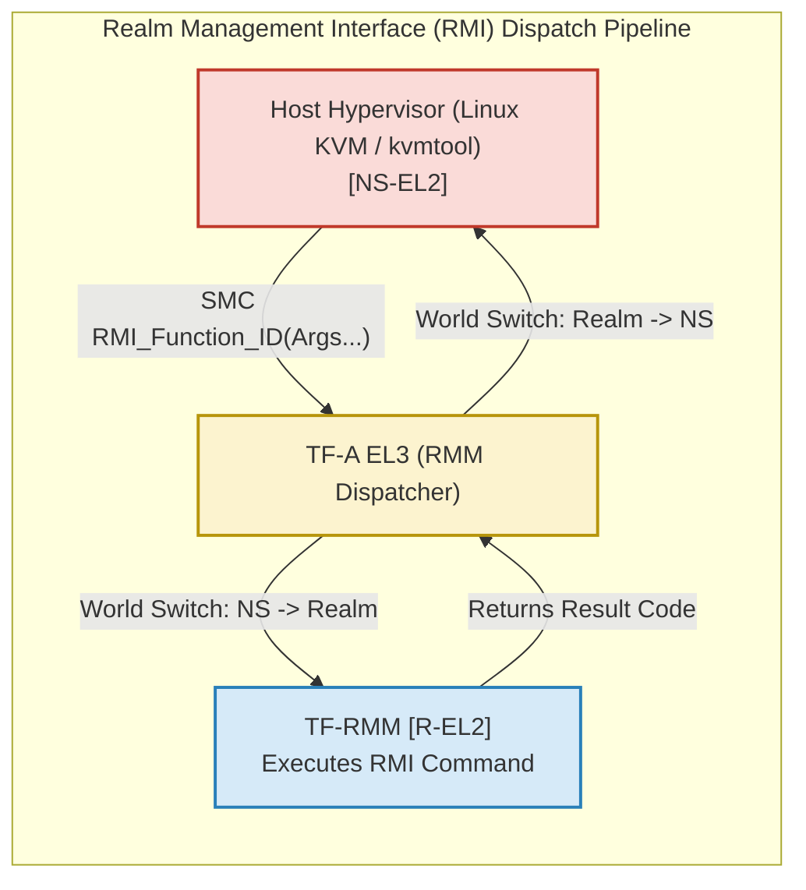
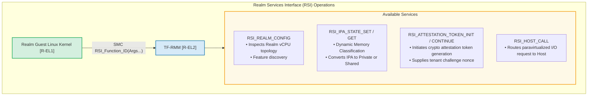
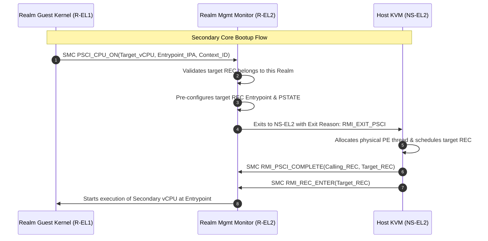

# Module 8: Arm CCA Communication Interfaces: RMI, RSI, RHI, PSCI

## 8.1 The Realm Management Interface (RMI)

The **Realm Management Interface (RMI)** is the standard boundary interface between the **Host Hypervisor (`NS-EL2`)** and the **Realm Management Monitor (`R-EL2`)**, mediated by the Root EL3 Monitor.

All RMI operations are dispatched using the standard Arm Fast Call calling convention via `SMC` instructions, utilizing dedicated RMI Function IDs (encapsulated under the standard Arm Architecture SMC calling convention).

### Comprehensive RMI Command Suite

| RMI Command Name | Key Input Parameters | Key Outputs / Effects | Architectural Purpose |
| :--- | :--- | :--- | :--- |
| **`RMI_VERSION`** | `req_version` | `ret_version` | Queries supported RMI specification version and negotiates interface level. |
| **`RMI_REALM_CREATE`** | `rd_pa`, `params_pa` | Status (`RMI_SUCCESS` / Error) | Allocates the Realm Descriptor (`RD`) granule in Realm PAS and initializes metadata. |
| **`RMI_REALM_ACTIVATE`**| `rd_pa` | Status | Finalizes the Realm Initial Measurement (RIM), permanently locking initial configuration. |
| **`RMI_REALM_DESTROY`** | `rd_pa` | Status | Tears down the Realm Descriptor once all subordinate granules have been purged. |
| **`RMI_REC_CREATE`** | `rd_pa`, `rec_pa`, `params_pa` | Status | Instantiates a virtual CPU (REC) within the Realm, binding it to the Realm Descriptor. |
| **`RMI_REC_DESTROY`** | `rec_pa` | Status | Deallocates and wipes a Realm Execution Context granule. |
| **`RMI_REC_ENTER`** | `rec_pa`, `run_pa` | Sanitized Exit Reason in `run_pa` | Context-switches physical core into Realm mode, running the target vCPU. |
| **`RMI_RTT_CREATE`** | `rd_pa`, `rtt_pa`, `ipa`, `level` | Status | Allocates a physical granule in Realm PAS to host a new Stage-2 RTT page table node. |
| **`RMI_RTT_DESTROY`** | `rd_pa`, `rtt_pa`, `ipa`, `level` | Status | Reclaims an empty RTT page table node and transitions the granule back to NS-PAS. |
| **`RMI_DATA_CREATE`** | `rd_pa`, `data_pa`, `ipa`, `src_pa`, `flags` | Status | Copies contents from `src_pa` (NS), transitions `data_pa` to Realm PAS, and updates RIM. |
| **`RMI_DATA_CREATE_UNKNOWN`** | `rd_pa`, `data_pa`, `ipa` | Status | Allocates a blank (uninitialized) page to Realm PAS without measuring content. |
| **`RMI_DATA_DESTROY`** | `rd_pa`, `data_pa` | Status | Zeroes the Realm memory granule completely and transitions its GPI back to Non-Secure. |
| **`RMI_RTT_MAP_UNPROTECTED`** | `rd_pa`, `ipa` | Status | Maps a Non-Secure physical page into the Realm's Stage-2 tables (for shared I/O). |
| **`RMI_RTT_READ_ENTRY`** | `rd_pa`, `ipa`, `level` | Entry attributes, RIPAS | Allows host to inspect translation state and RIPAS status of an IPA range. |
| **`RMI_PSCI_COMPLETE`** | `calling_rec_pa`, `target_rec_pa` | Status | Signals completion of a host-handled PSCI CPU_ON or CPU_OFF request. |

---

## 8.2 The Realm Services Interface (RSI)

The **Realm Services Interface (RSI)** is the privileged communication channel established between the **Realm Guest OS (`R-EL1`)** and the **Realm Management Monitor (`R-EL2`)**.

RSI calls are issued using `SMC` instructions executed at `R-EL1`. Unlike RMI calls (which involve EL3 world switching), RSI calls execute directly between `R-EL1` and `R-EL2` within Realm State, minimizing instruction latency.

### Comprehensive RSI Command Suite
1. **`RSI_ABI_VERSION`**:
   - Discovers and validates the supported RSI specification version.
2. **`RSI_REALM_CONFIG`**:
   - Returns a structured configuration descriptor containing the Realm's intermediate physical address size (`IPA_WIDTH`), hash algorithm used for attestation, and number of vCPUs.
3. **`RSI_IPA_STATE_SET` / `RSI_IPA_STATE_GET`**:
   - Used by the guest kernel memory manager to change an IPA range from `RIPAS_EMPTY` to `RIPAS_RAM` (requesting private RAM) or declaring an address range as **unprotected** (shared memory for VirtIO DMA).
4. **`RSI_ATTESTATION_TOKEN_INIT` & `RSI_ATTESTATION_TOKEN_CONTINUE`**:
   - Initiates attestation token generation. Because a signed cryptographic token can be several kilobytes in size (exceeding register space), the token is streamed into guest-provided buffer granules across multiple non-blocking calls.
5. **`RSI_MEASUREMENT_READ` & `RSI_MEASUREMENT_EXTEND`**:
   - Enables the guest to read the current RIM and write runtime measurements into the **Realm Extensible Measurements (REM[0..3])** registers (similar to extending a TPM PCR).
6. **`RSI_HOST_CALL`**:
   - Dispatches a structured hypercall request directly to the untrusted host hypervisor, carrying an address pointer to a shared Non-Secure parameter block.

---

## 8.3 The Realm Host Interface (RHI)

While the RMM provides strict isolation, real-world systems require complex communication between the Realm and the Host:
- Querying dynamic platform events.
- Attesting complex physical peripheral devices.
- Reading large platform firmware event logs.

Implementing complex parsing logic inside the RMM would bloat its TCB. Therefore, Arm defines the **Realm Host Interface (RHI)**:
- RHI defines standard protocol sets implemented by the **Host Hypervisor**, delivered to the Realm as an untrusted paravirtualized service.
- RHI traffic is tunneled through the RMM using `RSI_HOST_CALL`.

### Primary RHI Protocol Suites
1. **Host Session Protocol**:
   - Creates a generic, bidirectional communication channel between the Realm and host user-space agents (e.g., `kvmtool` or QEMU guest agent).
   - Operates in either blocking or non-blocking mode.
   - *Security Note*: Because data traversing the Host Session is provided by the untrusted host, the guest kernel must treat all incoming buffers as untrusted and authenticate payloads using end-to-end encryption (e.g., TLS or Diffie-Hellman session keys).
2. **Firmware Activity Log (FAL) Protocol**:
   - On platforms supporting live firmware activation, the platform RoT logs firmware updates in the FAL.
   - The Realm uses RHI to retrieve the FAL from the host, and subsequently validates the log against the cryptographically signed Platform Attestation Token.
3. **Device Assignment Protocol**:
   - Transfers peripheral device certificates, SPDM measurement transcripts, and PCIe IDE configuration blocks between the host orchestration stack and the Realm.

---

## 8.4 Power State Coordination Interface (PSCI) in Realms

The **Power State Coordination Interface (PSCI)** is the universal Arm standard for managing power states (CPU suspend, secondary core booting, core shutdown, and system reset).

In traditional environments, PSCI SMC calls are trapped and serviced directly by EL3 firmware. In Arm CCA, PSCI interactions are handled through a collaborative mediation flow:

1. **`PSCI_CPU_ON`**:
   - The primary Realm vCPU issues `PSCI_CPU_ON` to boot a secondary virtual CPU.
   - The RMM intercepts the call, sets the secondary REC's program counter to the requested entrypoint, and triggers an exit to `NS-EL2`.
   - The host hypervisor spawns a host thread for the secondary vCPU and executes `RMI_PSCI_COMPLETE`.
2. **`PSCI_SYSTEM_OFF` & `PSCI_SYSTEM_RESET`**:
   - Signals the hypervisor that the Realm has halted, transitioning the Realm state machine to `SYSTEM_OFF`.

---
