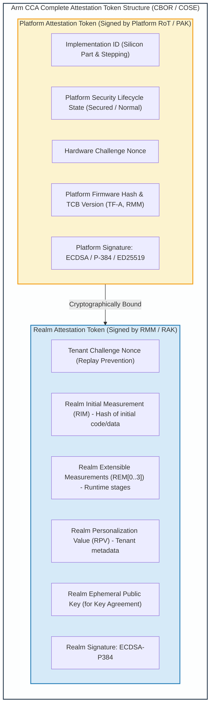
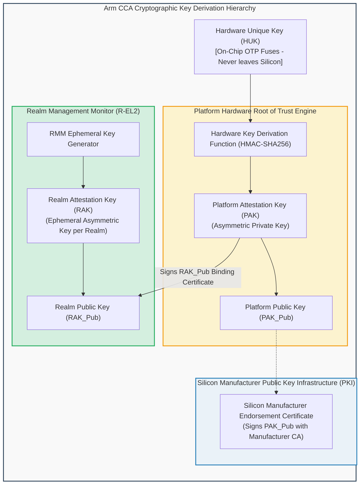
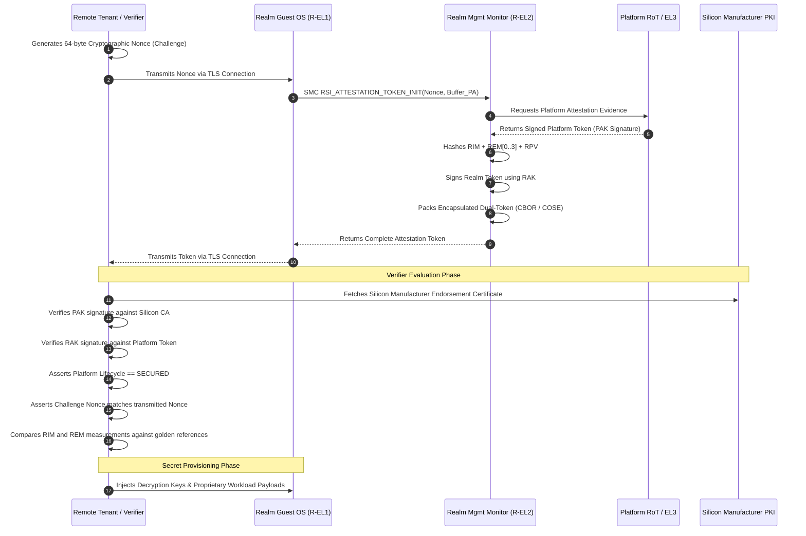

# Module 9: Attestation Framework & Cryptographic Trust Chains

## 9.1 The Arm CCA Dual-Token Attestation Architecture

Cryptographic attestation is the cornerstone of confidential computing. Before a tenant provisions sensitive application code, proprietary neural network weights, or decryption keys into a Realm, the tenant must verify that the workload is executing on genuine Arm hardware in a verified security state.

Arm CCA defines an encapsulated **Dual-Token Attestation Model** rooted in the **PSA Certified Entity Attestation Token (EAT)** architecture (RFC 8392 / CBOR / COSE standards).

---

## 9.2 Token Formats & Cryptographic Claims

The CCA token is structured as a nested or tagged CBOR (Concise Binary Object Representation) document containing two distinct cryptographic scopes:

### 1. The Platform Attestation Token
Generated by the **Platform Hardware Root of Trust** (or Root EL3 Monitor) and signed with the **Platform Attestation Key (PAK)**:
- **`IMPLEMENTATION_ID`**: Identifies the silicon manufacturer, model, and silicon stepping.
- **`HARDWARE_VERSION`**: Hardware design revision and chip serial identifier.
- **`SECURITY_LIFECYCLE`**: Current lifecycle phase (e.g., `PSA_LIFECYCLE_SECURED`).
- **`BOOT_SEED`**: A cryptographically random value generated at system cold reset, uniquely identifying the current boot session.
- **`SOFTWARE_MEASUREMENTS`**: Array of cryptographic hashes measuring the platform firmware stages:
  - BL1 / BL2 Immutable Boot code.
  - BL31 Trusted Firmware-A (Monitor).
  - RMM image hash and version.

### 2. The Realm Attestation Token
Generated by the **Realm Management Monitor (TF-RMM)** and signed with an ephemeral **Realm Attestation Key (RAK)**:
- **`CHALLENGE`**: A 64-byte cryptographic nonce provided by the remote relying party to prevent replay attacks.
- **`RIM` (Realm Initial Measurement)**: SHA-256 or SHA-512 digest of all code, data, and Stage-2 page tables populated prior to `RMI_REALM_ACTIVATE`.
- **`REM` (Realm Extensible Measurements)**: Four 64-byte measurement registers (`REM[0]`, `REM[1]`, `REM[2]`, `REM[3]`) that record runtime software stages:
  - `REM[0]`: Hash of the EDK2 UEFI firmware image.
  - `REM[1]`: Hash of the Linux kernel image, command line parameters, and initramfs.
  - `REM[2]`: Hash of runtime application containers or workload configuration.
  - `REM[3]`: Reserved for dynamic tenant runtime measurements.
- **`RPV` (Realm Personalization Value)**: A 64-byte arbitrary value injected by the tenant during creation to bind the Realm to a specific tenant account or policy.
- **`HASH_ALGO_ID`**: Identifier for cryptographic hashing algorithm (`SHA-256` or `SHA-512`).

---

## 9.3 Cryptographic Key Hierarchy & Derivation

The security of the attestation model depends on an unbroken cryptographic key derivation tree anchored in immutable hardware silicon fuses:

### Key Derivation Flow
1. **Hardware Unique Key (HUK)**: Burned into write-locked OTP fuses during chip fabrication. Inaccessible to software; only readable by the on-chip crypto engine.
2. **Platform Attestation Key (PAK)**: Derived by the hardware crypto engine from the HUK and platform configuration parameters. The public counterpart (`PAK_Pub`) is certified by the silicon manufacturer's CA.
3. **Realm Attestation Key (RAK)**: Generated by the RMM when a Realm is created. The RMM derives the RAK using an ephemeral entropy pool, ensuring each Realm has a unique cryptographic identity.
4. **Binding Platform & Realm Scopes**: The Platform RoT signs the public key of the RAK or embeds a cryptographic digest of the RMM and RAK into the Platform Token, establishing an unbroken mathematical chain from the silicon manufacturer to the specific tenant Realm instance.

---

## 9.4 Complete Remote Attestation Protocol Flow

The end-to-end protocol workflow between the remote tenant verifier and the running Realm:

---
