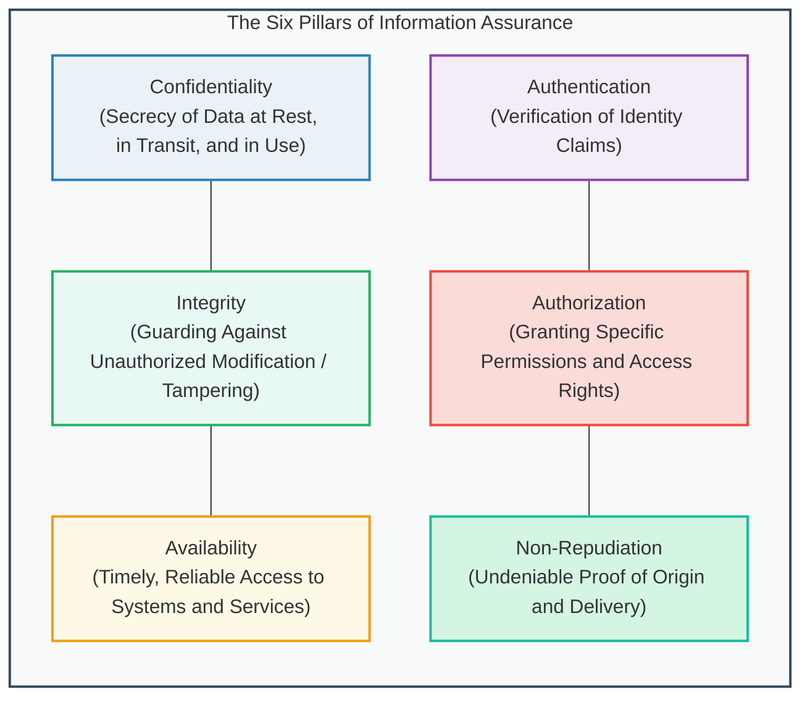
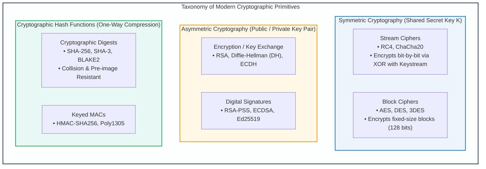
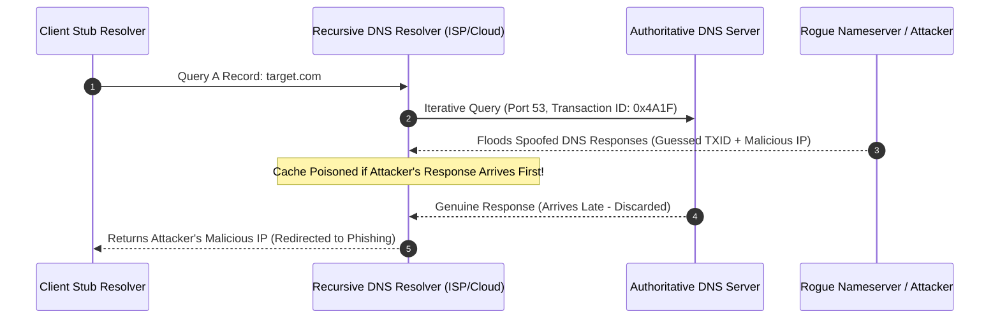
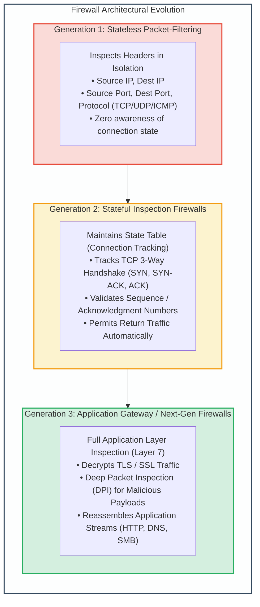
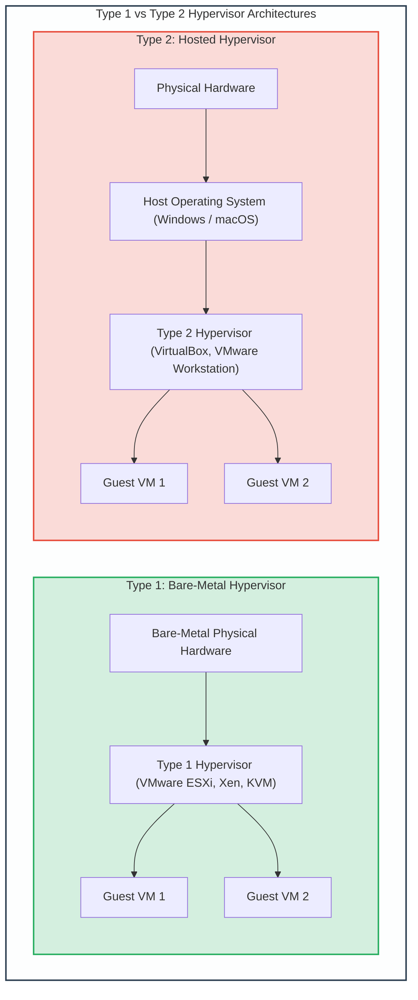

# Module 1: Information Assurance Fundamentals, Cryptography & Network Infrastructure

## 1.1 The Information Assurance Foundation: Beyond the CIA Triad

Information security in modern enterprise, defense, and cloud systems is anchored in the principles of **Information Assurance (IA)**. While traditional computer security historically prioritized data confidentiality, comprehensive operational assurance requires a holistic multidimensional model encompassing six core pillars:



### Detailed Pillar Breakdown
1. **Confidentiality**: Assures that sensitive information is shielded from interception, snooping, or unauthorized disclosure. Enforced via symmetric/asymmetric encryption, access control mechanisms, and physical isolation.
2. **Integrity**: Assures that data and software remain uncorrupted by unauthorized modification, deletion, injection, or hardware failure. Enforced via cryptographic hash digests (SHA-256, SHA-3), Message Authentication Codes (HMAC), and digital signatures.
3. **Availability**: Assures that computing resources, network fabrics, and data storage are readily accessible to authorized users whenever required. Threat models include Distributed Denial of Service (DDoS), ransomware locking, hardware faults, and power grid failures. Enforced through redundant clustering, load balancing, fault tolerance, and Disaster Recovery (DR) architectures.
4. **Authentication**: The mathematical or procedural verification of an asserted identity (user, host, service, or API). Mechanisms include single-factor (passwords), multi-factor authentication (MFA: possession, knowledge, inherence), cryptographic certificates (X.509), and hardware tokens (FIDO2/WebAuthn).
5. **Authorization**: The enforcement mechanism determining whether an authenticated subject possesses the legal entitlement to execute a requested action upon an object. Enforced via Discretionary Access Control (DAC), Mandatory Access Control (MAC), Role-Based Access Control (RBAC), and Attribute-Based Access Control (ABAC).
6. **Non-Repudiation**: The cryptographic guarantee that an entity cannot refute having initiated an action, transmitted a message, or approved a transaction. Enforced via asymmetric digital signatures and immutable audit trails anchored in trusted timestamping authorities.

---

## 1.2 Cryptographic Foundations: Symmetric, Asymmetric & Hashing

Cryptography constitutes the primary mathematical toolkit for enforcing confidentiality, integrity, and authentication.



### 1. Symmetric Cryptography
Symmetric ciphers rely on a single shared secret key ($K$) known to both the communicating parties. The key space must be sufficiently large to preclude brute-force exploration (minimum 128 bits; modern enterprise standard is AES-256).

- **Stream Ciphers**:
  - Encrypt plaintext byte-by-byte or bit-by-bit by performing an exclusive OR (XOR, $\oplus$) operation between plaintext bits ($P_i$) and a pseudorandom keystream ($K_i$) generated by a cryptographic seed:
    $$C_i = P_i \oplus K_i, \quad P_i = C_i \oplus K_i$$
  - *Vulnerability of Keystream Reuse (Two-Time Pad)*: If the same keystream $K$ is ever used to encrypt two different plaintexts $P_1$ and $P_2$:
    $$C_1 \oplus C_2 = (P_1 \oplus K) \oplus (P_2 \oplus K) = P_1 \oplus P_2$$
    An attacker cancels out the key entirely, enabling trivial linguistic plaintext recovery.
- **Block Ciphers & Modes of Operation**:
  - Transform fixed-size blocks of plaintext (e.g., 128 bits for AES) into identical-sized ciphertext blocks.
  - *Electronic Codebook (ECB)*: Encrypts each 128-bit block independently with the same key. **Insecure**: Identical plaintext blocks produce identical ciphertext blocks, preserving structural data patterns (the famous "ECB Penguin" leak).
  - *Cipher Block Chaining (CBC)*: Each plaintext block is XORed with the preceding ciphertext block before encryption, initialized with an unpredictable Initialization Vector (IV).
  - *Galois/Counter Mode (GCM)*: An Authenticated Encryption with Associated Data (AEAD) mode providing line-speed confidentiality and integrity verification via universal hashing.

### 2. Asymmetric Cryptography (Public-Key Cryptography)
Asymmetric systems utilize mathematically related key pairs: a **Public Key** ($K_{\text{pub}}$) openly distributed to the world, and a **Private Key** ($K_{\text{priv}}$) strictly guarded by the owner.
- **Diffie-Hellman Key Exchange (DH / ECDH)**: Enables two mutually untrusted parties to establish a shared symmetric secret across an insecure, sniffed communications channel without transmitting the key itself.
- **RSA**: Rooted in the integer factorization problem of large composite numbers $n = p \cdot q$.
- **Elliptic Curve Cryptography (ECC)**: Rooted in the discrete logarithm problem over elliptic curves (e.g., Curve25519, NIST P-384). Achieves equivalent cryptographic security to RSA with drastically smaller key sizes (e.g., 256-bit ECC $\approx$ 3072-bit RSA), saving CPU cycles and network bandwidth.

---

## 1.3 The Domain Name System (DNS) Architecture & Security Exploits

The **Domain Name System (DNS)** serves as the fundamental directory service of the Internet, translating human-readable Fully Qualified Domain Names (FQDNs like `api.corporate.internal`) into machine-routable IPv4/IPv6 addresses.



### Major DNS Attack Vectors
1. **DNS Cache Poisoning (Kaminsky Attack)**:
   - Attackers flood recursive resolvers with forged DNS responses containing spoofed Authoritative Name Server records.
   - If the attacker successfully guesses the 16-bit **DNS Transaction ID (TXID)** and UDP source port before the legitimate authoritative server responds, the recursive cache stores the malicious IP mapping for the duration of the Time-To-Live (TTL).
2. **DNS Amplification & Reflection DDoS**:
   - Attackers emit spoofed UDP queries targeting open recursive resolvers with the `ANY` record request, forging the victim's source IP address.
   - The resolvers respond to the victim with enormous multi-kilobyte responses, achieving amplification factors of $50\times$ to $100\times$.
3. **DNS Tunneling**:
   - Encapsulates non-DNS protocols (SSH, HTTP, command-and-control beacons, exfiltrated files) within standard DNS query labels (`base64data.c2.attacker.com`). Bypasses perimeter firewalls because port 53 UDP traffic is almost universally permitted egress.
4. **Defensive Standard: DNSSEC**:
   - Cryptographically signs DNS resource records using asymmetric signatures (`RRSIG`, `DNSKEY`, `DS` records).
   - Establishes a hierarchical chain of trust from the ICANN DNS Root zone down to domain records, eliminating spoofing and cache poisoning.

---

## 1.4 Perimeter Defense: Firewall Architectures & Evolution

Firewalls enforce boundary security policies by inspecting, filtering, and governing traffic traversing network segments.



### Comparative Firewall Engine Mechanics

| Feature / Capability | Stateless Packet Filter | Stateful Inspection Firewall | Application Layer Gateway (Proxy / NGFW) |
| :--- | :--- | :--- | :--- |
| **OSI Layer** | Layer 3 & Layer 4 | Layer 3 & Layer 4 (State-aware) | Layer 7 (Application Layer) |
| **Performance / Throughput** | Maximum (Line rate, ASIC accelerated) | High (State table lookup) | Moderate to Low (CPU intensive stream reassembly) |
| **Connection State Awareness** | None. Treats every packet as an isolated event. | Yes. Tracks TCP states (`NEW`, `ESTABLISHED`, `RELATED`). | Full protocol state machine modeling. |
| **Egress Inspection** | Must open static high ports ($>1023$) for replies. | Automatically allows valid response packets. | Proxies connection; client never talks directly to server. |
| **Payload / Exploit Inspection** | Zero payload inspection. | Zero payload inspection. | Inspects application payloads, detects SQLi, XSS, malware. |
| **Vulnerability to Spoofing** | Highly vulnerable to forged TCP flag combinations. | Resilient: Drops packets with invalid state transitions. | Immune to transport spoofing. |

---

## 1.5 Virtualization Security & Hypervisor Architectures

Modern cloud platforms run entirely on virtualized abstractions. Virtualization separates physical hardware from running operating systems via the **Hypervisor** (or Virtual Machine Monitor - VMM).



### Virtualization Attack Vectors
1. **VM Escape**: An exploit where code executing within a guest virtual machine breaks through isolation boundaries to execute arbitrary code within the host hypervisor context (e.g., VENOM vulnerability in virtual floppy disk controllers).
2. **Cross-VM Side-Channel Attacks**: Exploiting shared physical hardware resources (shared CPU L3 caches, memory controllers, branch prediction units) to infer cryptographic keys or keystroke timings from a co-located tenant VM (e.g., Flush+Reload, Prime+Probe).
3. **Hyperjacking**: The covert installation of a malicious hypervisor beneath a running host operating system, granting the attacker stealth persistence beneath all OS-level antivirus and monitoring tooling.

---
---

## 1.6 Cryptographic Deep Dive: Mathematics, Ciphers & Algorithms

### 1. Advanced Encryption Standard (AES) Internal Transformations
AES (FIPS PUB 197) is a symmetric substitution-permutation network operating on a $4 \times 4$ column-major matrix of bytes known as the **State**:
- **Key Sizes & Rounds**:
  - AES-128: 10 Rounds (Key schedule expands 16 bytes to 176 round key bytes).
  - AES-192: 12 Rounds (Key schedule expands 24 bytes to 208 round key bytes).
  - AES-256: 14 Rounds (Key schedule expands 32 bytes to 240 round key bytes).
- **The Four Round Transformations**:
  1. `SubBytes`: Non-linear byte substitution using a Rijndael S-Box derived from the multiplicative inverse over Galois Field $GF(2^8)$ combined with an affine transformation (provides non-linearity and defeats linear/differential cryptanalysis).
  2. `ShiftRows`: Cyclically shifts the rows of the state by varying offsets (Row 0: 0 bytes, Row 1: 1 byte, Row 2: 2 bytes, Row 3: 3 bytes) to provide diffusion across columns.
  3. `MixColumns`: Matrix multiplication in $GF(2^8)$ modulo polynomial $x^4 + 1$ operating on State columns, ensuring that changing one bit in plaintext influences all 16 State bytes within two rounds (the Avalanche Effect).
  4. `AddRoundKey`: Bitwise XOR between the 128-bit State and the round subkey.

```
AES Round Processing Sequence:
  Plaintext (16 Bytes) ---> AddRoundKey(Round 0)
                                |
                   +------------+------------+
                   | Standard Round Loop     |
                   | (9 / 11 / 13 Rounds)    |
                   | 1. SubBytes             |
                   | 2. ShiftRows            |
                   | 3. MixColumns           |
                   | 4. AddRoundKey(Round i) |
                   +------------+------------+
                                |
                   +------------+------------+
                   | Final Round             |
                   | 1. SubBytes             |
                   | 2. ShiftRows            |
                   | (MixColumns Omitted!)   |
                   | 3. AddRoundKey(Final)   |
                   +------------+------------+
                                |
                                v
                   Ciphertext (16 Bytes)
```

### 2. RSA Cryptographic Mathematics & Asymmetric Key Generation
The RSA cryptosystem relies on Euler's Totient Theorem:
1. Select two distinct large prime numbers, $p$ and $q$ (typically 1024 to 2048 bits each).
2. Compute the modulus:
   $$n = p \cdot q$$
3. Compute Euler's totient function:
   $$\phi(n) = (p - 1)(q - 1)$$
4. Select a public exponent $e$ such that $1 < e < \phi(n)$ and $\gcd(e, \phi(n)) = 1$ (the industry universal standard is $e = 65537 = 2^{16} + 1$).
5. Compute the private exponent $d$ using the Extended Euclidean Algorithm:
   $$d \equiv e^{-1} \pmod{\phi(n)} \iff d \cdot e \equiv 1 \pmod{\phi(n)}$$
6. **Key Pairs**: Public Key is $(e, n)$; Private Key is $(d, n)$.
   - Encryption of plaintext message $M < n$:
     $$C = M^e \pmod{n}$$
   - Decryption of ciphertext $C$:
     $$M = C^d \pmod{n}$$
   - *Security Requirement*: Plaintext must always be padded with Optimal Asymmetric Encryption Padding (OAEP) to prevent chosen-ciphertext attacks and Coppersmith lattice attacks.

### 3. SHA-256 Compression Function Internals
SHA-256 processes 512-bit message blocks through an 8-word internal working state ($A, B, C, D, E, F, G, H$):
- **Message Schedule Expansion**: The 512-bit block is expanded into 64 32-bit words ($W_0$ to $W_{63}$):
  $$W_t = \sigma_1(W_{t-2}) + W_{t-7} + \sigma_0(W_{t-15}) + W_{t-16}$$
- **The Compression Loop (64 Rounds)**:
  $$T_1 = H + \Sigma_1(E) + \text{Ch}(E, F, G) + K_t + W_t$$
  $$T_2 = \Sigma_0(A) + \text{Maj}(A, B, C)$$
  $$H = G, \quad G = F, \quad F = E, \quad E = D + T_1$$
  $$D = C, \quad C = B, \quad B = A, \quad A = T_1 + T_2$$
  - $\text{Ch}(X, Y, Z) = (X \land Y) \oplus (\neg X \land Z)$
  - $\text{Maj}(X, Y, Z) = (X \land Y) \oplus (X \land Z) \oplus (Y \land Z)$

---

## 1.7 Radio-Frequency Identification (RFID) Security Architecture

RFID systems communicate wirelessly via electromagnetic and radio frequency fields to identify tagged assets:
- **Frequency Bands**:
  - Low Frequency (LF: 125–134 kHz): Short read range ($<10$ cm). Animal tracking, legacy building access cards.
  - High Frequency (HF: 13.56 MHz): Standard Near-Field Communication (NFC), smart passports, payment cards (EMV).
  - Ultra-High Frequency (UHF: 860–960 MHz): Long read range (up to 12 meters). Supply chain logistics, toll collection.
- **Security Vulnerabilities in RFID**:
  - *Cloning Attacks*: Legacy RFID cards (e.g., HID ProxCard II, MIFARE Classic) transmit static, unencrypted identifiers. Handheld transceivers (e.g., Proxmark3, Flipper Zero) sniff and clone badges in seconds.
  - *Crypto-1 Cipher Compromise*: MIFARE Classic cards rely on a proprietary 48-bit stream cipher (Crypto-1). Inherent algebraic weaknesses enable offline cryptographic key recovery within minutes from eavesdropped authentication handshakes.
  - *Relay Attacks*: An attacker with two networked transceivers relays the radio signal between an authentic smart key in the victim's pocket and a vehicle parked outside, unlocking and starting the car without physical possession of the key.
