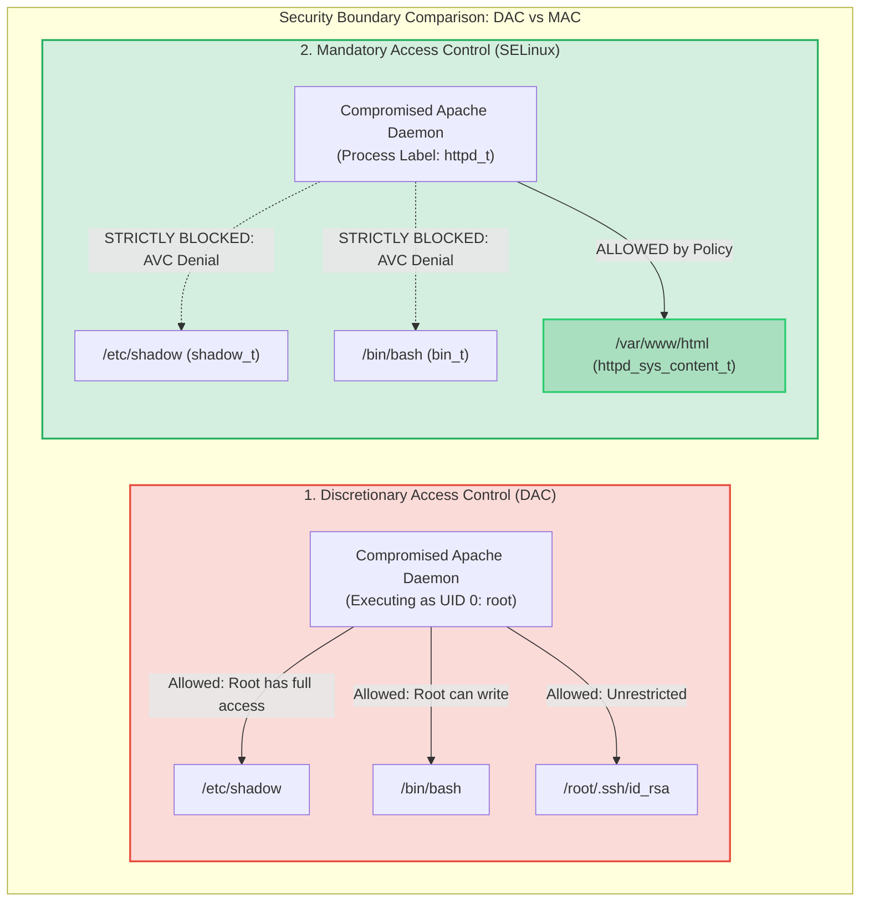
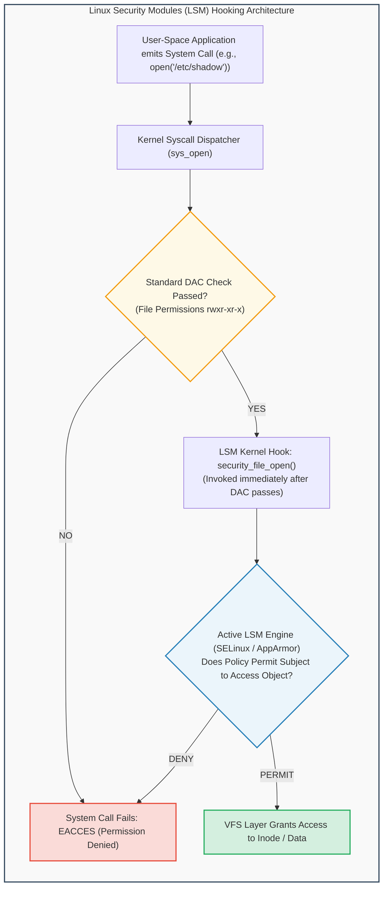
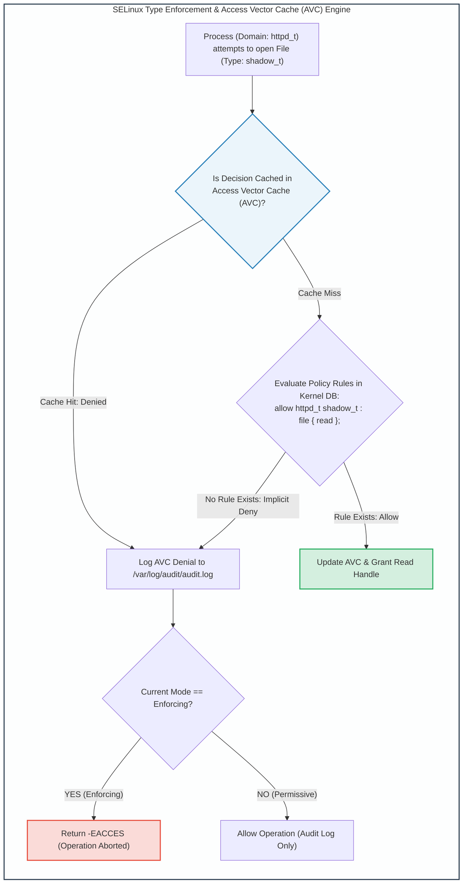

# Module 11: Linux Mandatory Access Control: SELinux & AppArmor

## 11.1 The Limitation of DAC & The Need for Mandatory Access Control (MAC)

Standard Linux Discretionary Access Control (DAC) suffers from a catastrophic architectural flaw: **The Omnipotent Root Flaw**.
- In DAC, if an attacker compromises a daemon executing as `root` (or exploits a web server vulnerability where the process owner has write permissions to files), the attacker inherits the full permissions of the resource owner.
- The resource owner possesses the complete "discretion" to modify file permissions, grant public access, or execute destructive commands.
- Under DAC, a vulnerability in a single network service (e.g., Apache HTTP server or BIND DNS) executing as root gives the attacker full control over the entire operating system, enabling them to wipe disks, read `/etc/shadow`, install kernel rootkits, or disable firewall rules.

**Mandatory Access Control (MAC)** solves this vulnerability by enforcing a system-wide security policy defined strictly by the security administrator and hardcoded into the kernel:
- **Even the `root` superuser is bound by MAC policy!**
- If a root-owned web server process is compromised, MAC rules prevent it from reading user home directories, accessing `/etc/shadow`, or binding to unauthorized ports.



---

## 11.2 The Linux Security Modules (LSM) Kernel Framework

Rather than hardcoding a single security paradigm, the Linux kernel incorporates the **Linux Security Modules (LSM)** framework.



### LSM Hook Mechanics
- LSM inserts security hooks at critical decision points across the Linux virtual filesystem (VFS), process lifecycle management, socket communications, and IPC.
- Whenever a user process invokes a system call, the kernel first executes standard DAC checks.
- If DAC passes, the kernel invokes the registered **LSM hook** (e.g., `security_file_open()`, `security_socket_create()`).
- The active MAC security engine (SELinux, AppArmor, or Smack) evaluates its internal security policy and returns either `0` (allow) or `-EACCES` (deny).

---

## 11.3 SELinux (Security-Enhanced Linux) Architecture & Policy

Originally designed by the United States National Security Agency (NSA) and Red Hat, **SELinux** is a comprehensive, Type Enforcement-based Mandatory Access Control implementation.

### 1. SELinux Security Context Syntax
In SELinux, every process (subject) and every file, directory, socket, or device node (object) is stamped with an immutable cryptographic label called a **Security Context**:
$$\text{Security Context} = \text{user} : \text{role} : \text{type} : \text{level}$$

```
Example SELinux Contexts:
  Apache Web Server Process:   system_u:system_r:httpd_t:s0
  Web Content HTML File:       system_u:object_r:httpd_sys_content_t:s0
  User Shadow Password File:   system_u:object_r:shadow_t:s0
```

- **`user`**: The SELinux user identity (e.g., `system_u`, `unconfined_u`).
- **`role`**: The operational role (in Role-Based Access Control, e.g., `system_r`, `object_r`).
- **`type` (Domain / Type Enforcement)**: The primary mechanism of isolation. For processes, it is termed the **Domain** (e.g., `httpd_t`, `sshd_t`); for files, it is the **Type** (e.g., `httpd_sys_content_t`, `shadow_t`).
- **`level`**: Multi-Level Security / Multi-Category Security (MLS/MCS) sensitivity rating (e.g., `s0`, `s0:c0,c100`).



### 2. SELinux Operating Modes
- **Enforcing**: The default production mode. The security policy is actively enforced; unauthorized actions are blocked and logged.
- **Permissive**: The system operates without blocking unauthorized actions. Violations are allowed to proceed, but detailed audit denial messages are logged. (Essential for debugging and authoring new policies).
- **Disabled**: SELinux is completely unloaded from the kernel; zero labeling or protection is active.

### 3. Essential Administrative Commands

```bash
# Querying and switching active SELinux mode:
getenforce                  # Displays current status (Enforcing / Permissive)
setenforce 0                # Temporarily sets Permissive mode (runtime only)
setenforce 1                # Sets Enforcing mode

# Inspecting security labels:
ls -lZ /var/www/html/index.html   # Displays file security context
ps -eZ | grep nginx               # Displays process domain

# Relabeling and restoring context:
restorecon -vR /var/www/html      # Resets files to default policy labels
chcon -t httpd_sys_content_t file.txt # Temporarily modifies type label

# Managing SELinux Booleans (Policy toggles):
getsebool httpd_can_network_connect  # Checks if Apache can make outbound connections
setsebool -P httpd_can_network_connect on # Permanently enables boolean in policy

# Diagnosing and fixing AVC Denials:
ausearch -m avc -ts recent | audit2why   # Translates raw audit logs into human explanations
ausearch -m avc -ts recent | audit2allow -M my_custom_policy # Auto-generates policy module
```

---

## 11.4 AppArmor: Path-Based Mandatory Access Control

While SELinux relies on explicit inode labels stored in filesystem extended attributes (`xattr`), **AppArmor** (standard on Ubuntu, Debian, and openSUSE) implements a **path-based** Mandatory Access Control architecture.

### AppArmor Architecture & Profile Modes
- **Profiles**: Plaintext configuration files residing in `/etc/apparmor.d/` defining the file access paths, network sockets, and capabilities allowed for a specific binary executable (e.g., `/usr/sbin/tcpdump`).
- **Modes**:
  - **Enforce**: Violations are blocked and logged to `/var/log/syslog` or `audit.log`.
  - **Complain**: Violations are permitted, but logged as warnings.

```
Example AppArmor Profile Snippet (/etc/apparmor.d/usr.bin.ping):
  /usr/bin/ping {
    # Include base abstractions
    #include <abstractions/base>
    #include <abstractions/nameservice>

    # Granular capability grants
    capability net_raw,
    capability setuid,

    # File access rules
    /usr/bin/ping mr,
    /etc/modules.conf r,
    /dev/null rw,
  }
```

### Administrative Tools:
```bash
aa-status                   # Shows current status of loaded profiles
aa-enforce /etc/apparmor.d/* # Puts all profiles into Enforce mode
aa-complain /usr/sbin/nginx  # Puts Nginx into Complain mode
aa-logprof                  # Interactive CLI tool to update profiles from audit logs
```

---
---

## 11.5 Writing Custom SELinux Type Enforcement Policies

When deploying custom internal microservices or commercial applications that fail under SELinux Enforcing mode, administrators must not disable SELinux. Instead, they author custom Type Enforcement policy modules (`.te`).

### Structure of a Type Enforcement File (`mydaemon.te`)
```
policy_module(mydaemon, 1.0.0)

# Type declarations
type mydaemon_t;
type mydaemon_exec_t;
init_daemon_domain(mydaemon_t, mydaemon_exec_t)

# Define private data file type
type mydaemon_data_t;
files_type(mydaemon_data_t)

# Allow rules (Subject Domain -> Object Type : Class { Permissions })
allow mydaemon_t mydaemon_data_t : file { read write create getattr open };
allow mydaemon_t mydaemon_data_t : dir { search write add_name };

# Allow network binding to non-standard HTTP port (e.g., 8080)
allow mydaemon_t http_port_t : tcp_socket { name_bind };

# Explicitly prohibit access to sensitive system shadow file
dontaudit mydaemon_t shadow_t : file { read getattr };
```

### Compiling and Installing SELinux Modules
```bash
# 1. Compile policy into an intermediate module (.mod)
checkmodule -M -m -o mydaemon.mod mydaemon.te

# 2. Package module into a policy package (.pp)
semodule_package -o mydaemon.pp -m mydaemon.mod

# 3. Insert policy package into running Linux kernel
semodule -i mydaemon.pp

# 4. Verify loaded policy
semodule -l | grep mydaemon
```
