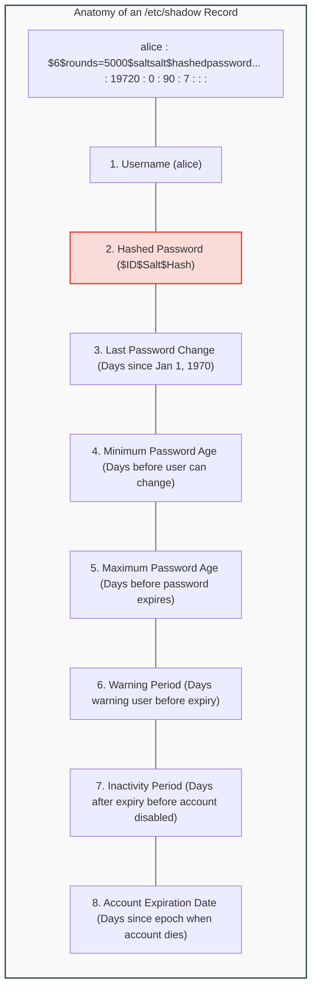
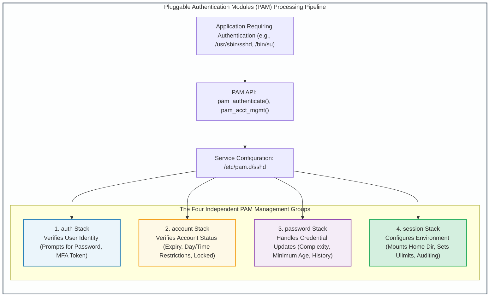

# Module 12: Linux User Authentication, Credentials & PAM

## 12.1 Linux Credential Storage: `/etc/passwd` vs. `/etc/shadow`

User account management and credential verification in Linux are decoupled between public user identification and private cryptographic credential storage.

```
/etc/passwd Entry Format (World-Readable: 0644):
  username:password_placeholder:UID:GID:GECOS:home_directory:login_shell
  root:x:0:0:root:/root:/bin/bash
  www-data:x:33:33:www-data:/var/www:/usr/sbin/nologin
```

Because `/etc/passwd` must be globally world-readable for system utilities to map numeric UIDs to usernames (e.g., `ls -l`), storing password hashes in `/etc/passwd` permitted unprivileged users to read hashes and conduct offline dictionary cracking.

To resolve this vulnerability, modern Linux systems deploy the **Shadow Password Suite** (`/etc/shadow`), which is restricted to read-only access by `root` (permissions `0640` or `0000`, owned by `root:shadow`).



### Cryptographic Hash Identifier Prefixes (`$ID$`)
The second field of `/etc/shadow` encodes the hashing algorithm, the random cryptographic salt (preventing Rainbow table attacks), and the resulting one-way hash:

| Prefix ID | Hashing Algorithm | Security Assessment | Key Derivation Iterations |
| :---: | :--- | :--- | :--- |
| **`$1$`** | **MD5-crypt** | **BROKEN / INSECURE**. Vulnerable to collision attacks and ultra-fast GPU cracking. | 1,000 iterations (Fixed) |
| **`$2a$` / `$2b$`** | **Bcrypt** | **SECURE**. Memory-hard Blowfish-based key derivation. | Configurable cost factor |
| **`$5$`** | **SHA-256-crypt** | **SECURE**. Standard NIST algorithm. | 5,000 iterations (Configurable) |
| **`$6$`** | **SHA-512-crypt** | **HIGHLY SECURE**. Linux default standard for over a decade. | 5,000 iterations (Configurable) |
| **`$y$`** | **Yescrypt** | **MODERN STATE-OF-THE-ART**. Native memory-hard function resistant to FPGA/ASIC password cracking rigs. | Modern default in Debian 11+ and RHEL 9+ |

---

## 12.2 Pluggable Authentication Modules (PAM) Architecture

Historically, every program requiring user authentication (e.g., `login`, `su`, `sshd`, `ftp`) hardcoded its own authentication routines. Altering authentication schemes (such as integrating LDAP, smart cards, or biometric tokens) required re-compiling every application from source code.

**Pluggable Authentication Modules (PAM)** decouples user-facing applications from underlying authentication technologies via a modular, dynamic framework configured in `/etc/pam.d/`.



### The Four PAM Management Groups
1. **`auth`**: Authenticates the user and establishes credentials (e.g., querying password, validating hardware security key).
2. **`account`**: Determines whether the authenticated user is allowed to access the system right now (checks whether the account is disabled, expired, or prohibited by time-of-day policies).
3. **`password`**: Enforces password changing policies and password strength rules.
4. **`session`**: Tasks executed before and after user access is granted (e.g., mounting encrypted directories, setting resource limits in `/etc/security/limits.conf`, logging login records in `wtmp`).

### The Four Control Flags

| Control Flag | Behavior on Module Success | Behavior on Module Failure |
| :--- | :--- | :--- |
| **`required`** | Success recorded. Pipeline continues executing subsequent modules. | Failure recorded. Pipeline **must continue** executing subsequent modules (to prevent attackers from timing which specific check failed), but overall authentication will ultimately fail. |
| **`requisite`** | Success recorded. Pipeline continues executing subsequent modules. | Immediate failure! Pipeline **aborts immediately**, rejecting user without executing remaining modules. |
| **`sufficient`** | If no earlier `required` modules failed, pipeline **terminates immediately with SUCCESS**! | Failure recorded, but ignored; pipeline continues executing. |
| **`optional`** | Success recorded. Only determines outcome if it is the only module in the stack. | Ignored unless it is the only module in the stack. |

---

## 12.3 Hardening Authentication: Account Lockout & Password Complexity

Modern enterprise Linux configurations mandate strict brute-force mitigations and entropy enforcement via specialized PAM modules.

### 1. Brute-Force Defense via `pam_faillock`
Protects against offline and online credential stuffing by locking user accounts after a defined threshold of consecutive failed authentication attempts:
```
# /etc/pam.d/password-auth or system-auth configuration:
auth     required  pam_faillock.so preauth silent audit deny=5 unlock_time=900
auth     sufficient pam_unix.so try_first_pass
auth     [default=die] pam_faillock.so authfail audit deny=5 unlock_time=900
account  required  pam_faillock.so
```
- `deny=5`: Locks the account after 5 consecutive failures.
- `unlock_time=900`: Account remains locked for 15 minutes (900 seconds).

### 2. Password Quality Enforcement via `pam_pwquality`
Rejects weak or dictionary passwords during password changes:
```ini
# /etc/security/pwquality.conf
minlen = 14          # Minimum password length: 14 characters
dcredit = -1         # At least 1 digit required
ucredit = -1         # At least 1 uppercase letter required
lcredit = -1         # At least 1 lowercase letter required
ocredit = -1         # At least 1 special character required
difok = 5            # At least 5 characters must differ from old password
maxrepeat = 2        # No character repeated more than twice consecutively
```

---
---

## 12.4 Enterprise MFA Integration: PAM Google Authenticator Hardening

To enforce Multi-Factor Authentication (MFA) across SSH and local logins, Linux integrates Time-Based One-Time Password (TOTP, RFC 6238) engines:

```bash
# 1. Install Google Authenticator PAM engine
apt-get install libpam-google-authenticator -y

# 2. User initialization (generates QR code and emergency scratch codes)
google-authenticator -t -d -f -r 3 -R 30 -W

# 3. Configure /etc/pam.d/sshd:
# Prepend TOTP module to authentication stack:
auth required pam_google_authenticator.so nullok

# 4. Configure /etc/ssh/sshd_config:
KbdInteractiveAuthentication yes
AuthenticationMethods publickey,keyboard-interactive
```
When authenticating, the user must present BOTH a valid cryptographic SSH private key AND a 6-digit TOTP code generated on their hardware token or smartphone app.
