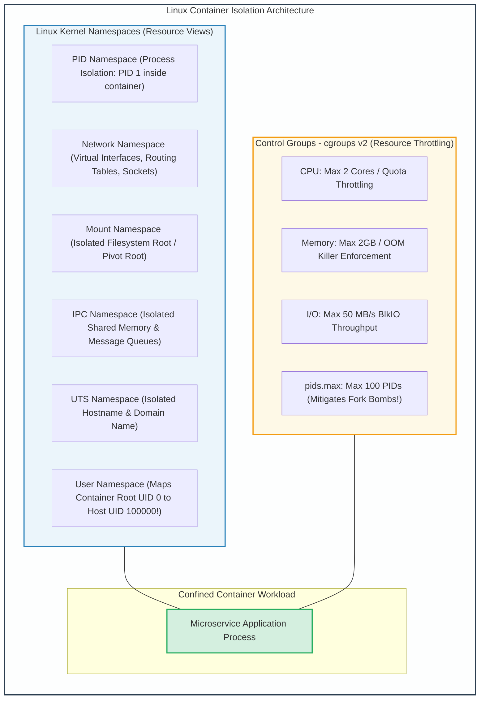
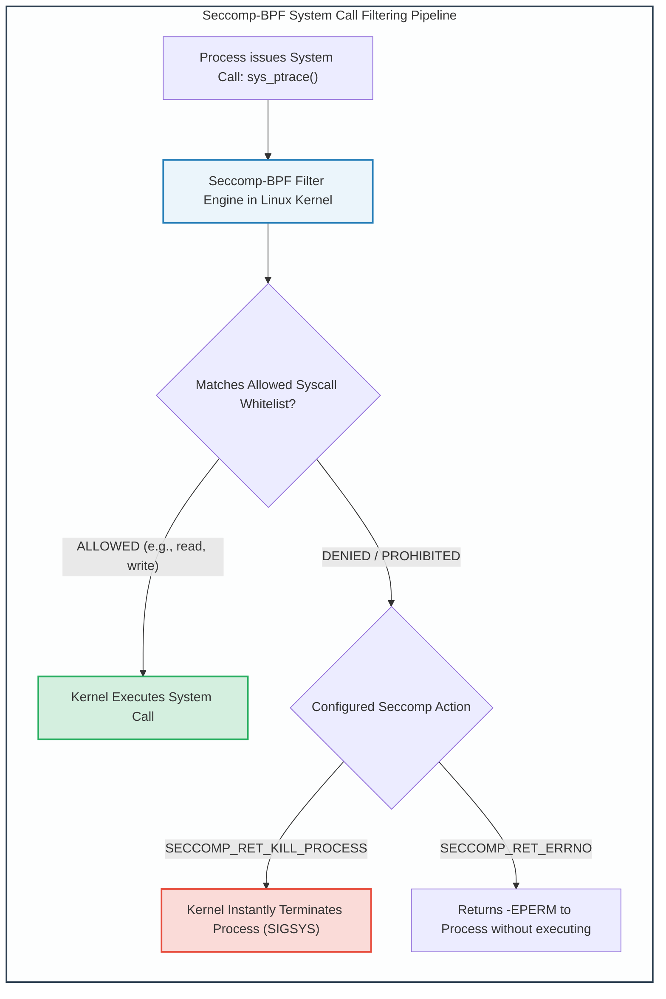

# Module 13: Linux Process Isolation: Namespaces, Cgroups, Seccomp & Capabilities

## 13.1 Container Isolation Building Blocks: Namespaces & Cgroups

In modern cloud-native architectures (Docker, Kubernetes, Podman), **containers are not virtual machines**. Containers are simply standard Linux user-space processes isolated at the kernel level using two foundational technologies:
1. **Linux Kernel Namespaces**: Governs **what a process can SEE** (Virtualization of system resources).
2. **Control Groups (cgroups)**: Governs **how much a process can USE** (Resource metering and throttling).



---

## 13.2 The Seven Core Linux Namespaces

| Namespace Flag | Virtualized Resource | Security Impact & Isolation Boundary |
| :---: | :--- | :--- |
| **`CLONE_NEWPID`** | Process IDs | Processes inside the container only see themselves. The containerized entry point executes as PID 1, unable to inspect or send signals (`kill`) to host processes. |
| **`CLONE_NEWNET`** | Network Stacks | Provides a private loopback interface, virtual Ethernet pair (`veth`), independent routing tables, and private port namespaces. |
| **`CLONE_NEWNS`** | Mount Points | Provides a private filesystem hierarchy. Changes to mount tables inside do not reflect on the host. |
| **`CLONE_NEWIPC`** | Inter-Process Comm | Isolates System V IPC and POSIX message queues, preventing cross-container shared memory tapping. |
| **`CLONE_NEWUTS`** | Hostname / Domain | Allows container to define its own hostname without modifying host system identity. |
| **`CLONE_NEWUSER`** | User & Group IDs | **Crucial for rootless containers**. Maps container UID 0 (root inside) to an unprivileged UID (e.g., UID 100000) on the host. Even if container escapes, it holds zero host root privileges! |
| **`CLONE_NEWCGROUP`**| Cgroup Hierarchy | Masks the root cgroup directory structure, preventing container introspection of host system resource allocations. |

---

## 13.3 Linux Capabilities: Decomposing the Omnipotent Root

Traditionally, Linux enforced a binary permission model: a process was either an unprivileged standard user (`UID != 0`) or the omnipotent superuser (`UID == 0`). If an application needed to bind to privileged port 80 (e.g., web server) or set system time, it had to run with full root privileges.

**Linux Capabilities** (introduced in kernel 2.2) decompose the monolithic powers of `root` into distinct, granular privileges:

```
Common Critical Linux Capabilities:
  CAP_NET_BIND_SERVICE:  Bind a socket to Internet domain privileged ports (< 1024).
  CAP_NET_RAW:           Permits using RAW and PACKET sockets (ping, tcpdump).
  CAP_SYS_ADMIN:         Overpowered "catch-all" capability (mount filesystems, load BPF).
  CAP_SYS_PTRACE:        Trace arbitrary processes using ptrace (can read memory of other apps).
  CAP_DAC_OVERRIDE:      Bypass all file read, write, and execute permission checks.
  CAP_CHOWN:             Make arbitrary changes to file UIDs and GIDs.
```

### Restricting Capabilities on Binaries
Rather than setting the dangerous `SUID root` bit on a binary, administrators grant only the specific capability required:
```bash
# Removing SUID from ping and granting only CAP_NET_RAW:
chmod u-s /usr/bin/ping
setcap cap_net_raw+ep /usr/bin/ping

# Inspecting capabilities:
getcap /usr/bin/ping
# Output: /usr/bin/ping = cap_net_raw+ep
```

---

## 13.4 Seccomp & Seccomp-BPF (Secure Computing Mode)

The Linux kernel exposes over 400 distinct **system calls** (syscalls). The vast majority of user applications require only a tiny fraction (e.g., 30 to 40 syscalls like `read`, `write`, `epoll_wait`). Unused system calls (such as `ptrace`, `bpf`, `mount`, `kexec_load`) represent latent attack surface for kernel exploitation.

**Seccomp-BPF** allows a user process to define a stateful Berkeley Packet Filter (BPF) program that inspects system call numbers and arguments *before* the kernel dispatches them.



---
---

## 13.5 Building a Container from Scratch using Linux Primitives

To demystify containerization, one can instantiate a fully isolated container using core Linux kernel system commands without Docker:

```bash
#!/usr/bin/env bash
# Building a minimal isolated Linux container from scratch

ROOTFS="/tmp/my_container_rootfs"
CGROUP_DIR="/sys/fs/cgroup/demo_container"

# 1. Create Control Group (cgroups v2) and enforce limits
mkdir -p "$CGROUP_DIR"
echo "50000 100000" > "$CGROUP_DIR/cpu.max"       # Limit to 0.5 CPU core
echo "104857600"      > "$CGROUP_DIR/memory.max"    # Limit to 100 MB RAM
echo "20"             > "$CGROUP_DIR/pids.max"      # Max 20 processes

# 2. Execute workload in private PID, Network, Mount, UTS, and IPC Namespaces
# unshare isolates namespaces, pivot_root isolates filesystem
unshare --mount --uts --ipc --net --pid --fork bash -c "
    # Assign process to cgroup
    echo \$\$ > $CGROUP_DIR/cgroup.procs

    # Set private hostname
    hostname containerized-secure-host

    # Mount private /proc inside container mount namespace
    mount -t proc proc /proc

    # Execute isolated container shell
    exec /bin/sh
"
```
