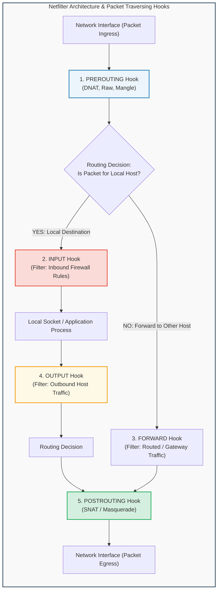
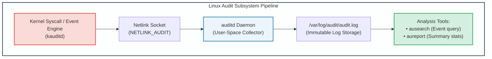
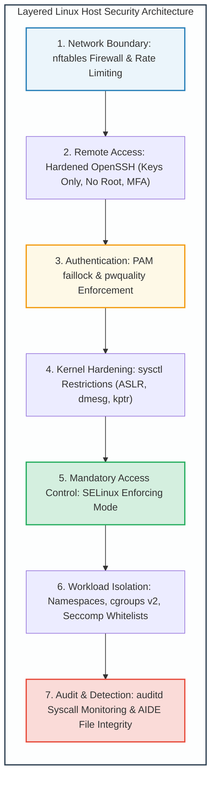

# Module 14: Linux Network Defense, Auditing & Exploit Hardening

## 14.1 The Netfilter Packet Filtering Architecture: iptables vs. nftables

At the heart of Linux network defense resides **Netfilter**, a framework inside the Linux kernel providing callback hooks across the network stack for packet filtering, Network Address Translation (NAT), and connection tracking.



### 1. iptables Architecture
- **Tables**:
  - `filter`: Default table for packet filtering (Chains: `INPUT`, `OUTPUT`, `FORWARD`).
  - `nat`: Network address translation (Chains: `PREROUTING`, `POSTROUTING`, `OUTPUT`).
  - `mangle`: Packet header alteration (TTL, TOS).
  - `raw`: Bypasses connection tracking (`conntrack`).
- **Connection Tracking (`conntrack`)**:
  - Enables stateful inspection. Packets are tagged as:
    - `NEW`: Initiating a connection.
    - `ESTABLISHED`: Part of an existing verified connection.
    - `RELATED`: Auxiliary connection (e.g., FTP data channel).
    - `INVALID`: Packets with illegal flag combinations.

### 2. nftables: The Modern Linux Standard
Replaces legacy `iptables`, `ip6tables`, `arptables`, and `ebtables` with a single unified packet filtering engine executing an in-kernel bytecode virtual machine:
- Eliminates duplicated rules across IPv4 and IPv6 via the unified `inet` address family.
- Atomic rule replacement: Multiple rules commit simultaneously without connection interruption.

```bash
# Example Modern nftables Production Firewall Configuration:
table inet firewall {
    chain inbound {
        type filter hook input priority filter; policy drop;

        # Allow established and related traffic
        ct state { established, related } accept

        # Drop invalid packets immediately
        ct state invalid drop

        # Allow local loopback traffic
        iif "lo" accept

        # Allow incoming ICMP (ping) rate-limited
        ip protocol icmp limit rate 5/second accept

        # Allow SSH (Port 22)
        tcp dport 22 accept
    }
}
```

---

## 14.2 Secure Shell (SSH) Host Hardening

SSH is the primary remote administrative interface for Linux infrastructure, making it an unceasing target for brute-force dictionary attacks and credential spraying.

```ini
# Production Hardened /etc/ssh/sshd_config Configuration:
Port 22
Protocol 2

# Authentication Hardening
PermitRootLogin no                   # Prohibit direct root login (force su/sudo)
MaxAuthTries 3                       # Disconnect client after 3 failed attempts
PubkeyAuthentication yes             # Enforce Public Key Authentication
PasswordAuthentication no            # DISABLE all password authentication!
PermitEmptyPasswords no              # Reject empty passwords
AuthenticationMethods publickey      # Require asymmetric key

# Cryptographic Suite Hardening (Prohibit broken legacy ciphers)
KexAlgorithms curve25519-sha256,diffie-hellman-group16-sha512
Ciphers chacha20-poly1305@openssh.com,aes256-gcm@openssh.com
MACs hmac-sha2-512-etm@openssh.com

# Channel & Forwarding Restrictions
X11Forwarding no                     # Disable X11 GUI forwarding
AllowTcpForwarding no                # Prevent SSH from acting as a network proxy
ClientAliveInterval 300              # Terminate idle sessions after 15 minutes
ClientAliveCountMax 2
```

---

## 14.3 The Linux Auditing Framework (`auditd`)

While log files in `/var/log/` record application-level messages, attackers with local privileges can modify or truncate logs. The **Linux Audit Framework (`auditd`)** is deeply integrated into kernel system call entrypoints, recording tamper-resistant audit records directly to disk.



### Essential Audit Rules (`/etc/audit/rules.d/audit.rules`)
```bash
# Monitor changes to critical user/group identity files:
-w /etc/passwd -p wa -k identity_changes
-w /etc/shadow -p wa -k identity_changes
-w /etc/sudoers -p wa -k privilege_changes

# Monitor execution of the execve system call by non-root users (UID >= 1000):
-a always,exit -F arch=b64 -S execve -F auid>=1000 -F auid!=4294967295 -k user_commands

# Make audit rules immutable until next system reboot:
-e 2
```

---

## 14.4 Linux Kernel Exploit Mitigations & Sysctl Hardening

Modern Linux kernels incorporate defense-in-depth compile-time and runtime exploit mitigations that eliminate whole classes of memory corruption vulnerabilities:

```
Linux Kernel Memory Exploit Mitigations:
+---------------------------------------------------------------------------------+
| Mitigation Mechanism | Architectural Purpose & Implementation                   |
+----------------------+----------------------------------------------------------+
| KASLR                | Kernel Address Space Layout Randomization                |
|                      | Randomizes base physical/virtual location of kernel text |
| Stack Canaries (SSP) | Inserts random guard value before Saved EBP/RIP.         |
|                      | Compiler emits __stack_chk_fail on mismatch.            |
| DEP / NX             | Data Execution Prevention / No-Execute bit in page tables|
|                      | Marks Stack and Heap as Non-Executable (PAGE_NOEXEC)    |
| KPTI                 | Kernel Page Table Isolation                              |
|                      | Unmaps kernel address space while running in user mode   |
|                      | (Mitigates Meltdown speculative execution side-channels) |
| Yama ptrace_scope    | Restricts ptrace system call to parent processes only    |
+---------------------------------------------------------------------------------+
```

### Essential Production Sysctl Hardening (`/etc/sysctl.d/99-security.conf`)
```ini
# Restrict dmesg kernel log buffer access to root only (prevents KASLR address leaks)
kernel.dmesg_restrict = 1

# Restrict ptrace memory inspection to parent processes only
kernel.yama.ptrace_scope = 2

# Hide exposed kernel pointers in /proc/kallsyms
kernel.kptr_restrict = 2

# Enable TCP SYN Cookies (DoS Defense)
net.ipv4.tcp_syncookies = 1

# Disable ICMP Echo redirects (Mitigates MITM routing attacks)
net.ipv4.conf.all.accept_redirects = 0
net.ipv4.conf.default.accept_redirects = 0

# Enable Reverse Path Filtering (Mitigates IP address spoofing)
net.ipv4.conf.all.rp_filter = 1
net.ipv4.conf.default.rp_filter = 1
```

---
---

## 14.5 Complete Production Linux Hardening Blueprint (CIS Benchmark)

To achieve enterprise compliance (CIS Linux Benchmark, PCI-DSS, DoD STIG), production Linux hosts must apply a layered defense blueprint:



### Complete Production `nftables.conf` Script (`/etc/nftables.conf`)
```
#!/usr/sbin/nft -f

flush ruleset

table inet filter {
    # Rate limit table for brute-force SSH mitigation
    set ssh_flood {
        type ipv4_addr
        flags dynamic
        timeout 1m
    }

    chain input {
        type filter hook input priority filter; policy drop;

        # Accept loopback traffic
        iif "lo" accept

        # Accept established and related connection states
        ct state established,related accept

        # Drop invalid connection states immediately
        ct state invalid drop

        # Defend against ICMP floods: accept ping rate-limited to 5/sec
        ip protocol icmp icmp type echo-request limit rate 5/second accept
        ip6 nexthdr icmpv6 icmpv6 type echo-request limit rate 5/second accept

        # Defend against TCP SYN flood: rate-limit TCP SYN flags
        tcp flags & (fin|syn|rst|ack) == syn limit rate 25/second burst 50 packets accept

        # Secure SSH access with automated brute-force rate-limiting
        tcp dport 22 ct state new update @ssh_flood { ip saddr limit rate over 4/minute } drop
        tcp dport 22 ct state new accept

        # Allow Web HTTPS traffic
        tcp dport { 80, 443 } accept

        # Log all dropped traffic to syslog with rate limiting
        limit rate 5/minute log prefix "NFT_IN_DROP: " drop
    }

    chain forward {
        type filter hook forward priority filter; policy drop;
    }

    chain output {
        type filter hook output priority filter; policy accept;
    }
}
```

### Complete Hardened `audit.rules` (`/etc/audit/rules.d/audit.rules`)
```
# Delete all existing rules
-D

# Set buffer size
-b 8192

# Failure mode: 1 = printk alert, 2 = kernel panic (for ultra-high security)
-f 1

# Monitor system reboot and power transitions
-a always,exit -F arch=b64 -S reboot,shutdown,poweroff -k system_power

# Monitor unauthorized access attempts to files (EACCES / EPERM)
-a always,exit -F arch=b64 -S open,openat,creat -F exit=-EACCES -k file_access_denied
-a always,exit -F arch=b64 -S open,openat,creat -F exit=-EPERM -k file_access_denied

# Monitor modification of system administrator identity & authentication
-w /etc/group -p wa -k identity_changes
-w /etc/passwd -p wa -k identity_changes
-w /etc/gshadow -p wa -k identity_changes
-w /etc/shadow -p wa -k identity_changes
-w /etc/security/opasswd -p wa -k identity_changes
-w /etc/sudoers -p wa -k sudoers_changes
-w /etc/sudoers.d/ -p wa -k sudoers_changes

# Monitor modification of network environment and firewall rules
-w /etc/issue -p wa -k network_config
-w /etc/issue.net -p wa -k network_config
-w /etc/hosts -p wa -k network_config
-w /etc/network/ -p wa -k network_config
-w /etc/nftables.conf -p wa -k firewall_changes

# Lock audit configuration permanently until system reboot
-e 2
```
