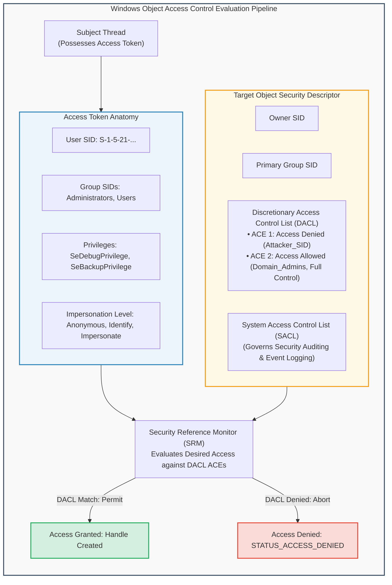
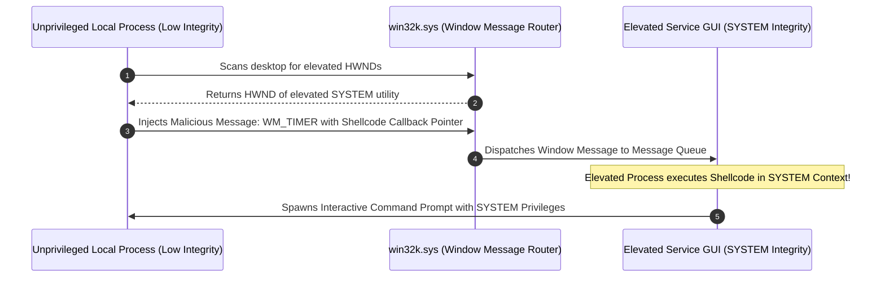
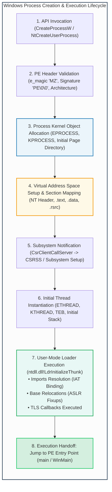

# Module 2: Windows Operating System Security Architecture & Process Execution

## 2.1 The Windows Security Model: SIDs, Tokens & Descriptors

The Microsoft Windows NT operating system architecture enforces access control via the **Security Reference Monitor (SRM)**, an executive component residing within the Windows kernel (`ntoskrnl.exe`).

Whenever a thread attempts to access an object (such as a file, registry key, process, or semaphore), the SRM evaluates the thread's **Access Token** against the target object's **Security Descriptor**.



### Components of the Access Evaluation Engine
1. **Security Identifier (SID)**:
   - A variable-length binary string uniquely identifying a security principal (user, security group, or computer).
   - Formatted as `S-R-I-S-S...` (e.g., `S-1-5-32-544` represents the well-known local Administrators group; `S-1-5-18` represents `NT AUTHORITY\SYSTEM`).
2. **Access Token**:
   - Represents the security context of a process or thread. Created by the Local Security Authority Subsystem Service (`LSASS.exe`) upon successful logon.
   - Contains: User SID, Group SIDs, Restricted SIDs, Authentication ID, Privileges, and Token Type (Primary vs. Impersonation).
3. **Security Descriptor (SD)**:
   - Accompanies every securable Windows kernel object.
   - Contains:
     - **DACL (Discretionary Access Control List)**: Contains Access Control Entries (ACEs) specifying who can perform what operations (`GENERIC_READ`, `GENERIC_WRITE`, `DELETE`).
     - **SACL (System Access Control List)**: Contains ACEs dictating which access attempts generate audit event records in the Windows Security Event Log.
4. **DACL Evaluation Rules**:
   - Evaluated sequentially from top to bottom.
   - **Explicit Access Denied ACEs take precedence over Access Allowed ACEs**.
   - If a requested permission is not explicitly permitted by the time the end of the DACL is reached, access is **implicitly denied**.
   - A NULL DACL grants full access to everyone; an empty DACL (zero ACEs) denies access to all subjects.

---

## 2.2 Windows Messaging Subsystem & Shatter Attacks

Windows GUI applications are event-driven, operating via the **Windows Messaging Subsystem** implemented in `win32k.sys` (kernel space) and `user32.dll` (user space).

Processes communicate with windows and UI elements using the `SendMessage` and `PostMessage` Win32 APIs, targeting specific **Window Handles (`HWND`)**.



### The Shatter Attack Mechanism
In legacy Windows architectures (Windows 2000, XP, Server 2003):
1. Services running as `NT AUTHORITY\SYSTEM` could be configured with the "Interact with Desktop" flag, allowing them to render status dialogs on the interactive user desktop (`WinSta0`).
2. Because all processes within the same desktop shared a unified window message space, a low-privileged local user could discover the `HWND` of the elevated window.
3. By issuing `SendMessage` with message IDs such as `WM_TIMER` or `EM_SETWORDBREAKPROC`, the unprivileged process passed a function pointer pointing to injected shellcode.
4. The elevated process dispatched the message and executed the attacker's shellcode with full `SYSTEM` privileges.
5. **Modern Mitigations**: Microsoft introduced **User Interface Privilege Isolation (UIPI)** and mandatory integrity levels in Windows Vista, completely blocking lower-integrity processes from sending window messages to higher-integrity windows.

---

## 2.3 The Windows PE Program Execution Lifecycle

When an executable binary (Portable Executable - PE format) is launched, the Windows kernel and user-mode subsystems execute an elaborate, multi-stage initialization workflow:



### Detailed Execution Stages
1. **Validation & Image Conversion**:
   - The kernel validates DOS header `IMAGE_DOS_HEADER.e_magic` (`0x5A4D` / `MZ`).
   - Validates `IMAGE_NT_HEADERS.Signature` (`0x00004550` / `PE\0\0`).
   - Checks PE architecture (x86 32-bit vs. x64 64-bit) and subsystem (`IMAGE_SUBSYSTEM_WINDOWS_GUI` vs. `CUI`).
2. **Process Object Creation**:
   - The kernel allocates the executive process block (`EPROCESS`) in non-paged kernel pool memory.
   - Allocates the root page table directory (CR3 register context) establishing a private virtual address space.
3. **Section Mapping**:
   - Maps the executable image sections into the address space:
     - `.text` (Executable code, marked `PAGE_EXECUTE_READ`).
     - `.rdata` (Read-only data, strings, import descriptors).
     - `.data` (Global initialized variables, marked `PAGE_READWRITE`).
     - `.reloc` (Relocation tables for Address Space Layout Randomization).
4. **User-Mode Loader Initialization (`LdrInitializeThunk`)**:
   - The thread begins execution in user mode at `ntdll!LdrInitializeThunk`.
   - Resolves all dependent Dynamic Link Libraries (DLLs) specified in the Import Directory Table.
   - Populates the **Import Address Table (IAT)** with runtime memory addresses of imported Win32 APIs.
   - Executes **Thread Local Storage (TLS) Callbacks** (frequently abused by malware to execute malicious code *before* the application entry point is reached).
5. **Entry Point Dispatch**:
   - Control is handed over to the entry point address recorded in `IMAGE_OPTIONAL_HEADER.AddressOfEntryPoint`.

---
---

## 2.4 Deep Windows Internals: Integrity Levels & Token Impersonation

### 1. Mandatory Integrity Control (MIC)
Introduced in Windows Vista to supplement standard DACLs, **Mandatory Integrity Control** assigns an Integrity Level (IL) to processes and objects:

| Integrity Level | Security SID | Typical Subjects & Objects | Security Constraints |
| :--- | :--- | :--- | :--- |
| **Untrusted** | `S-1-16-0` | Anonymous sessions, restricted sandboxes | Cannot write to any filesystem or registry locations. |
| **Low** | `S-1-16-4096` | Sandboxed browser tabs (Edge, Chrome), protected mode apps | Can only write to Low-Integrity folders (e.g., `%TEMP%\Low`). |
| **Medium** | `S-1-16-8192` | Standard interactive user processes | Standard user files and user registry hives. |
| **High** | `S-1-16-12288` | Elevated Administrator processes (UAC approved) | Full write access to `C:\Windows`, `C:\Program Files`, `HKLM`. |
| **System** | `S-1-16-16384` | Windows OS core services, `NT AUTHORITY\SYSTEM` | Operating system kernel, drivers, system services. |

- **No-Write-Up (NWU) Invariant**: A process executing at a lower integrity level can never write to, inject into, or modify an object with a higher integrity level, even if the user's DACL would otherwise permit it!
- **No-Read-Up (NRU) Invariant**: By default, Windows permits reading objects with higher integrity levels, unless explicitly flagged with `SYSTEM_MANDATORY_LABEL_NO_READ_UP`.

### 2. Token Impersonation Levels
When a client connects to a server process via RPC, named pipes, or DCOM, the server thread can impersonate the client context according to the **Impersonation Level** granted by the token:
- `SecurityAnonymous`: Server cannot identify the client and cannot impersonate.
- `SecurityIdentification`: Server can query the client's identity (SID, groups) for access logging, but cannot impersonate the client to access resources.
- `SecurityImpersonation`: Server can impersonate the client's security context to access local resources on the same machine.
- `SecurityDelegation`: Server can impersonate the client across remote network hops (requires Active Directory Kerberos Unconstrained/Constrained Delegation).

---

## 2.5 Detailed Portable Executable (PE) File Header Structure

The PE file format (derived from Common Object File Format - COFF) structures all 32-bit and 64-bit Windows executables (`.exe`, `.dll`, `.sys`):

```
+---------------------------------------------------------------------------------+
| DOS MZ Header (e_magic = 'MZ' = 0x5A4D)                                         |
| e_lfanew (Offset to NT Header, typically at 0x3C)                               |
+---------------------------------------------------------------------------------+
| DOS Stub ("This program cannot be run in DOS mode")                             |
+---------------------------------------------------------------------------------+
| PE NT Headers (Signature = 'PE' = 0x00004550)                               |
| +-----------------------------------------------------------------------------+ |
| | File Header (COFF): Machine, NumberOfSections, TimeDateStamp                | |
| +-----------------------------------------------------------------------------+ |
| | Optional Header:                                                            | |
| |   Magic (0x10B = 32-bit PE32, 0x20B = 64-bit PE32+)                         | |
| |   AddressOfEntryPoint (RVA of execution start)                              | |
| |   ImageBase (Preferred base address in memory: 0x00400000 or 0x140000000)   | |
| |   SectionAlignment, FileAlignment                                           | |
| |   DllCharacteristics:                                                       | |
| |     IMAGE_DLLCHARACTERISTICS_DYNAMIC_BASE (ASLR Enabled)                    | |
| |     IMAGE_DLLCHARACTERISTICS_NX_COMPAT   (DEP/NX Enabled)                   | |
| |     IMAGE_DLLCHARACTERISTICS_GUARD_CF    (Control Flow Guard)               | |
| |   DataDirectory[16]:                                                        | |
| |     [0] Export Directory                                                    | |
| |     [1] Import Directory (Import Directory Table -> IAT)                    | |
| |     [2] Resource Directory                                                  | |
| |     [5] Base Relocation Table (.reloc)                                      | |
| +-----------------------------------------------------------------------------+ |
+---------------------------------------------------------------------------------+
| Section Table (Section Headers: .text, .data, .rdata, .pdata, .rsrc)            |
+---------------------------------------------------------------------------------+
| Raw Section Data (.text instructions, .rdata constants, .data globals)          |
+---------------------------------------------------------------------------------+
```
