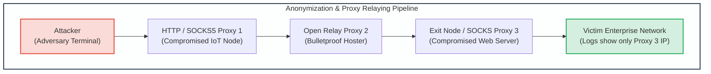
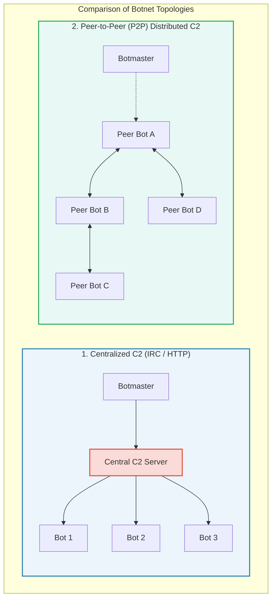
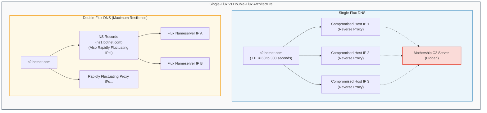

# Module 3: Attacker Infrastructure, Anonymization & Tunneling Techniques

## 3.1 Proxies, Relays & Anonymization Networks

Sophisticated cyber adversaries decouple their physical identity and location from target victim networks by routing attacks through complex layers of intermediate proxies and anonymization circuits.



### Proxy Protocols & Characteristics
1. **HTTP / HTTPS Proxies**:
   - Designed for application-level forwarding of web traffic.
   - *HTTP CONNECT Method*: Enables transparent tunneling of encrypted TLS connections through the proxy without terminating the SSL session.
   - *Header Leakage*: Misconfigured proxies often insert headers exposing the real source IP address:
     - `X-Forwarded-For: <Client_IP>`
     - `Via: <Proxy_Identifier>`
     - `Client-IP: <Original_IP>`
2. **SOCKS Proxies (SOCKS4 / SOCKS5)**:
   - Operates at the transport layer (Layer 5), protocol-agnostic.
   - *SOCKS4*: Supports only IPv4 TCP connections; cannot resolve hostnames on the proxy side (leading to DNS leakage at the client).
   - *SOCKS5*: Supports IPv4, IPv6, UDP relaying, authentication schemes, and proxy-side DNS resolution (preventing client DNS leaks).
3. **The Onion Router (TOR)**:
   - Routes traffic through volunteer-operated distributed overlay networks.
   - Employs **multi-layered onion routing**:
     - Client negotiates a 3-hop circuit: Guard Node $\rightarrow$ Middle Relay $\rightarrow$ Exit Node.
     - Payload is encrypted with 3 layers of AES keys. Each node peels off exactly one layer of encryption, learning only the immediate preceding and succeeding nodes.
     - The Exit Node connects to the target destination. Destination logs record only the IP address of the TOR Exit Node.

---

## 3.2 Covert Tunneling & Protocol Smuggling

Security perimeters frequently enforce strict egress filtering, permitting outbound traffic only over standard ports (such as HTTP port 80, HTTPS port 443, and DNS port 53). Adversaries bypass egress controls by **tunneling** unauthorized protocols (e.g., interactive command shells, file transfers, malware C2) inside legitimate carrier protocols.

```mermaid
graph TD
    subgraph DNS_Tunneling_Architecture["Covert DNS Tunneling & Data Exfiltration Mechanism"]
        direction TB
        
        Victim["Compromised Internal Host<br/>(Firewall blocks direct outbound TCP/UDP)"]
        Resolver["Enterprise Internal Recursive DNS<br/>(Permitted Outbound Port 53 UDP)"]
        Authoritative["Attacker Authoritative Name Server<br/>(Controlled by Threat Actor)"]
        C2_App["Attacker C2 Controller<br/>(Reassembles Decoded Shell/Files)"]
        
        Victim -->|"1. Query: b64enc_chunk1.malicious.net"| Resolver
        Resolver -->|"2. Recursive Lookup via Root/TLD"| Authoritative
        Authoritative -->|"3. Reassembles Exfiltrated Base64 Data"| C2_App
        Authoritative -->>|"4. Returns TXT Record with Staged Command"| Resolver
        Resolver -->>|"5. Delivers Command Payload"| Victim
    end
    
    style DNS_Tunneling_Architecture fill:#f9f9f9,stroke:#34495e,stroke-width:2px;
    style Victim fill:#fadbd8,stroke:#e74c3c,stroke-width:2px;
    style Resolver fill:#fef9e7,stroke:#f39c12,stroke-width:2px;
    style Authoritative fill:#ebf5fb,stroke:#2980b9,stroke-width:2px;
    style C2_App fill:#d4efdf,stroke:#27ae60,stroke-width:2px;
```

### Tunneling Modalities
1. **HTTP/HTTPS Tunneling**:
   - Encapsulates raw TCP connections inside standard HTTP `POST` requests or WebSocket channels. Data payloads are base64-encoded or XOR-scrambled inside innocent-looking HTTP request bodies (e.g., mimicking JSON analytics beacons or JPEG image uploads).
2. **DNS Tunneling**:
   - Encapsulates bidirectional communication inside DNS query and response records.
   - *Exfiltration (Outbound)*: Data is segmented, encoded into subdomain labels, and prepended to the attacker's domain (e.g., `cmVnaXN0cnlfZHVtcA==.c2.attacker.com`).
   - *Infiltration (Inbound C2)*: The attacker's authoritative nameserver responds with base64-encoded commands packed into `TXT`, `CNAME`, or `NULL` records.
   - *Detection Indicators*: Unusually high query volume to single apex domains, abnormally long domain labels ($>50$ characters), high Shannon entropy in subdomains, and an abnormal ratio of `TXT` record queries.
3. **ICMP Tunneling**:
   - Exploits the optional data payload field of ICMP Echo Request (`ping` type 8) and Echo Reply (type 0) packets.
   - Utilities like `ptunnel` insert arbitrary TCP streams into the ICMP data payload, evading firewalls that permit ICMP echo without inspecting payload bytes.

---

## 3.3 Botnet Command & Control (C2) Architectures

A **botnet** is a distributed network of compromised computing nodes (bots/zombies) controlled remotely by a threat actor (botmaster) to conduct distributed denial-of-service (DDoS) campaigns, click fraud, credential stuffing, and mass spam distribution.



### Architectural Evolutions
1. **Centralized C2 (IRC / HTTP / HTTPS)**:
   - Early botnets utilized Internet Relay Chat (IRC) channels. Bots connected to a hidden chatroom, executing commands issued by the botmaster.
   - Modern centralized botnets utilize HTTPS web servers, periodic polling beacons, and Domain Generation Algorithms (DGA).
   - *Vulnerability*: Single point of failure. Law enforcement and security teams can seize the C2 server IP or sinkhole the domain name, instantly severing the entire botnet.
2. **Peer-to-Peer (P2P) Botnets (e.g., Storm, Zeus Gameover)**:
   - Bots communicate with each other using distributed hash tables (DHT) and custom overlay protocols.
   - No single central server exists. Commands are cryptographically signed with the botmaster's asymmetric private key and gossiped through the peer network.
   - Defeats simple IP-blocking and domain takedown actions; dismantling requires poisoning peer routing tables or sybil attacks.

---

## 3.4 Fast-Flux DNS & Resilient Hosting Networks

To prevent defenders from taking down command-and-control servers via IP blocking, botmasters deploy **Fast-Flux DNS** networks.



### Fast-Flux Implementations
1. **Single-Flux DNS**:
   - The FQDN's `A` records are constantly rotated, returning a different pool of IP addresses on every query.
   - DNS TTL values are set to extremely short durations (e.g., 60 to 300 seconds).
   - The IP addresses returned belong to a swarm of compromised volunteer or consumer hosts executing lightweight reverse-proxy software (e.g., Nginx or custom redirector daemons) that transparently forward traffic back to a hidden backend "mothership" C2 server.
2. **Double-Flux DNS**:
   - Both the **A records** of the domain AND the **NS records** (the authoritative nameservers for the domain) rapidly fluctuate across hundreds of compromised IP addresses.
   - Eliminates the vulnerability of relying on static nameservers. Takedown requires direct intervention at the parent Top-Level Domain (TLD) registrar registry level to revoke the domain delegation.

---
---

## 3.5 Network Protocol Dissection: SOCKS5 Handshake & Tor Cells

### 1. SOCKS5 Protocol Specification (RFC 1928)
Unlike HTTP proxies that operate at Layer 7, SOCKS5 operates at Layer 5, facilitating arbitrary TCP/UDP streaming without protocol inspection.

```
1. Client Version Identification & Method Selection Request:
+----+----------+----------+
|VER | NMETHODS | METHODS  |
+----+----------+----------+
| 1  |    1     | 1 to 255 |
+----+----------+----------+
• VER: 0x05 (SOCKS5)
• NMETHODS: Number of authentication methods supported
• METHODS: 0x00 (No Authentication), 0x02 (Username/Password)

2. Server Method Selection Response:
+----+--------+
|VER | METHOD |
+----+--------+
| 1  |   1    |
+----+--------+
• Returns selected method (e.g., 0x00 or 0xFF if no acceptable methods)

3. Client Connection Request (e.g., CONNECT to target C2):
+----+-----+-------+------+----------+----------+
|VER | CMD |  RSV  | ATYP | DST.ADDR | DST.PORT |
+----+-----+-------+------+----------+----------+
| 1  |  1  | X'00' |  1   | Variable |    2     |
+----+-----+-------+------+----------+----------+
• CMD: 0x01 (CONNECT), 0x02 (BIND), 0x03 (UDP ASSOCIATE)
• ATYP: 0x01 (IPv4 - 4 bytes), 0x03 (Domain name), 0x04 (IPv6 - 16 bytes)
• DST.ADDR & DST.PORT: Final target address and port
```

### 2. Tor Fixed-Size 512-Byte Cell Structure
Tor mitigates packet-size statistical traffic analysis by packing all network commands into uniform 512-byte **Cells**:
```
+---------------------------------------------------------------------------------+
| Circuit ID (CircID: 2 or 4 Bytes) | Command (1 Byte) | Payload (509 or 507 Bytes)|
+---------------------------------------------------------------------------------+
```
- **Control Cells**: Handled directly by the receiving node (`CREATE`, `CREATED`, `DESTROY`, `PADDING`).
- **Relay Cells**: Encapsulated end-to-end data streams (`RELAY_BEGIN`, `RELAY_DATA`, `RELAY_END`, `RELAY_EXTEND`).
