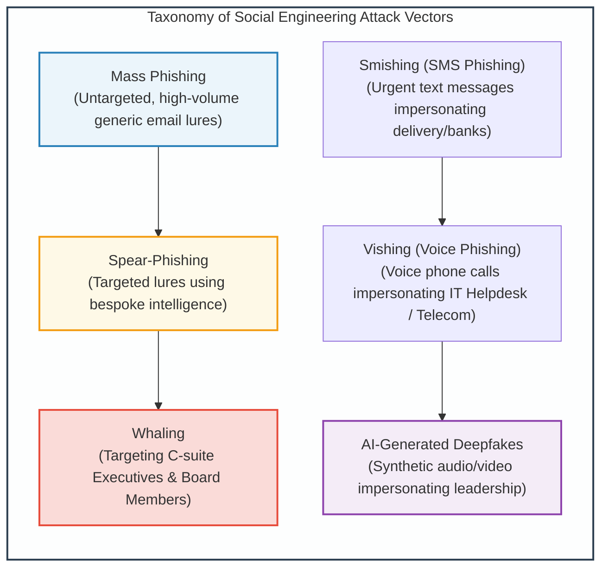
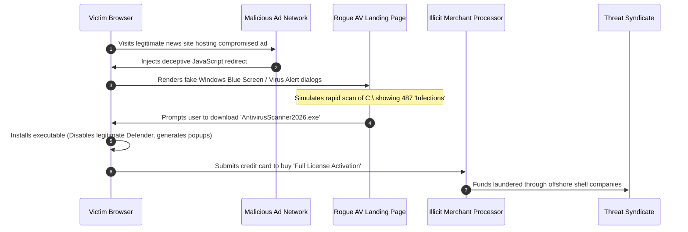
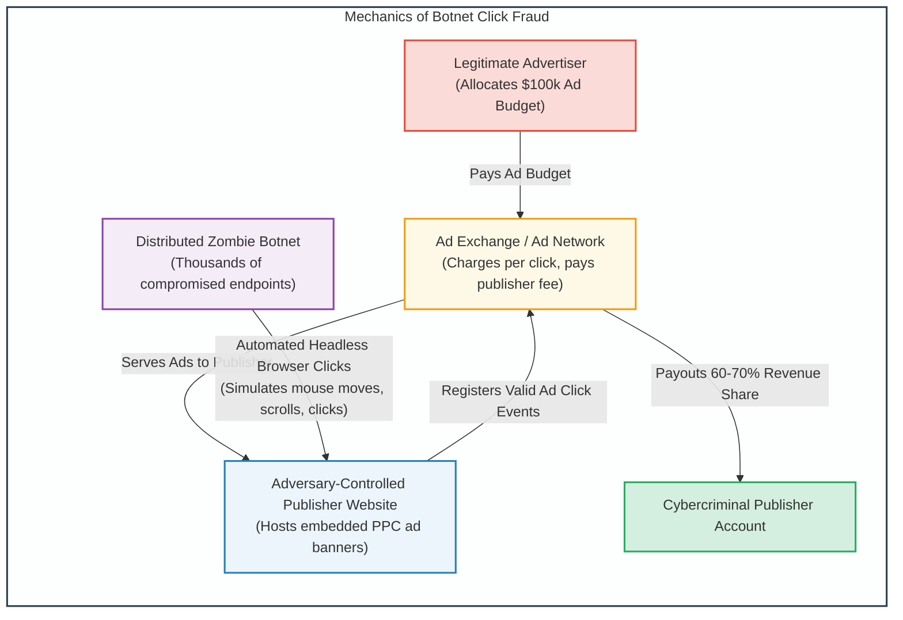

# Module 4: Social Engineering, Fraud & Deception Campaigns

## 4.1 Social Engineering Vectors: Phishing, Smishing & Vishing

While technical exploits target vulnerabilities in software and hardware architectures, **social engineering** exploits psychological vulnerabilities in human cognition (authority, urgency, fear, greed, curiosity, and reciprocity).

### Exploitation Mechanics
1. **Spear-Phishing & Business Email Compromise (BEC)**:
   - Adversaries conduct extensive Open-Source Intelligence (OSINT) gathering across LinkedIn, corporate press releases, and vendor associations.
   - Construct contextual lures mimicking internal workflows (e.g., urgent invoice approval, shared OneDrive documentation, travel reimbursement).
   - Exploits email spoofing vulnerabilities (lack of strict SPF, DKIM, and DMARC enforcement).
2. **Smishing & Vishing**:
   - Bypasses enterprise email security gateways entirely by targeting mobile devices directly.
   - Exploits caller-ID spoofing to impersonate internal corporate IT support desks, tricking users into revealing MFA session codes or authenticating push notifications (MFA Fatigue / Prompt Bombing).

---

## 4.2 Rogue Antivirus & Scareware Monetization Pipelines

**Rogue Antivirus** (commonly referred to as **Scareware**) represents a highly lucrative cybercriminal monetization ecosystem that combines social engineering, web drive-by manipulation, and deceptive software engineering.

### Architectural Characteristics of Rogue Antivirus
1. **Drive-By Social Engineering**:
   - Uses browser locking techniques (infinite JavaScript loops, full-screen canvas rendering mimicking OS error dialogs) to induce panic.
2. **System Subversion**:
   - Once executed, the binary adds itself to registry startup keys (`HKCU\Software\Microsoft\Windows\CurrentVersion\Run`).
   - Terminates genuine antivirus processes (`taskkill /f /im msmpeng.exe`), modifies the Windows `hosts` file to block access to security vendors, and continuously displays fake alert notifications.
3. **Monetization Pipeline**:
   - The software insists that removal of the "critical trojans" requires purchasing a lifetime software license for $49.99 to $99.99.
   - Credit card transactions are funneled through shadowy merchant accounts, resulting in direct financial fraud and credit card data harvesting.

---

## 4.3 Click Fraud Architecture & Pay-Per-Click Exploitation

Digital advertising is dominated by the **Pay-Per-Click (PPC)** model, where advertisers pay ad networks (such as Google AdSense, Bing Ads) every time an Internet user clicks an advertisement.

**Click Fraud** occurs when an automated software program, script, or human click-farm intentionally generates fraudulent clicks on online advertisements without genuine user interest, siphoning billions of dollars from advertisers.

### Click Fraud Tactics
1. **Hidden Iframes & Ad Stacking**:
   - The fraudulent website loads ad banners inside invisible $1\times 1$ pixel iframes or stacks dozens of ad banners directly on top of each other. A single user click registers dozens of simultaneous ad impressions and clicks.
2. **Automated Headless Browsers**:
   - Botnets embed headless browser engines (e.g., Puppeteer, Playwright, or modified WebKit runtimes) within infected zombie machines.
   - To defeat heuristic fraud detection, bots simulate realistic human behaviors: randomized mouse movements, natural page scrolling, random dwell times, and visiting secondary landing pages before exiting.

---
