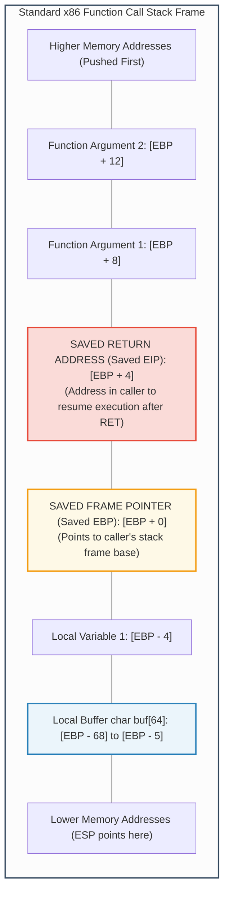
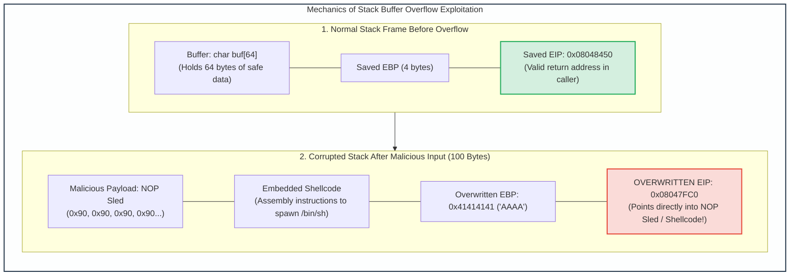
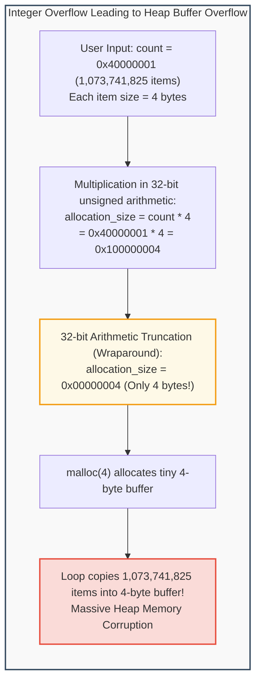
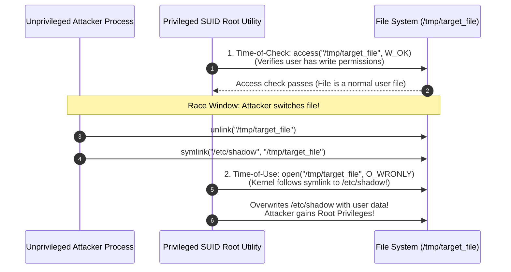
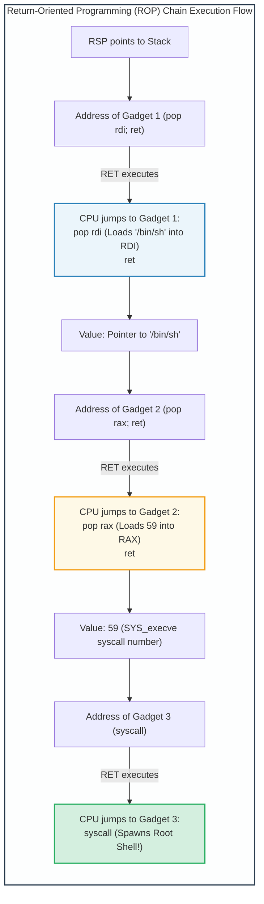

# Module 5: Software Vulnerabilities & Memory Corruption Exploitation

## 5.1 The x86 / x86_64 Process Memory Architecture & Stack Mechanics

To understand binary exploitation, one must first master the memory organization of an executing process. Under modern virtual memory architectures, each 32-bit or 64-bit process operates within its own flat virtual address space partitioned into distinct functional segments:

```
Low Memory Addresses:  0x00000000 (32-bit) / 0x0000000000000000 (64-bit)
+---------------------------------------------------------------------------------+
| .text Segment    | Read-Only, Executable instructions (Machine code)           |
+------------------+--------------------------------------------------------------+
| .data Segment    | Read-Write, Initialized global & static variables            |
+------------------+--------------------------------------------------------------+
| .bss Segment     | Read-Write, Uninitialized global & static variables (Zeroed) |
+------------------+--------------------------------------------------------------+
| Heap Segment     | Dynamically allocated memory (malloc/free, new/delete)       |
|                  | Grows upwards toward higher memory addresses                 |
|                  |                       |                                      |
|                  |                       v                                      |
+------------------+--------------------------------------------------------------+
|                  |                   Unallocated Space                          |
+------------------+--------------------------------------------------------------+
|                  |                       ^                                      |
|                  |                       |                                      |
| Stack Segment    | Local variables, function parameters, saved frame pointers   |
|                  | Grows downwards toward lower memory addresses                |
+---------------------------------------------------------------------------------+
High Memory Addresses: 0xFFFFFFFF (32-bit) / 0x7FFFFFFFFFFFFFFF (64-bit User Space)
```

### The Call Stack & Function Activation Records (Stack Frames)
When a thread invokes a function, a dedicated **Stack Frame** is allocated on the stack to maintain local state. The stack's growth and contraction are governed by CPU registers:
- **Stack Pointer (`ESP` / `RSP`)**: Points to the top (lowest memory address) of the active stack frame.
- **Base / Frame Pointer (`EBP` / `RBP`)**: Points to the base of the current stack frame, serving as a stable reference anchor from which local variables and incoming parameters are accessed via fixed offsets.
- **Instruction Pointer (`EIP` / `RIP`)**: Points to the memory address of the next machine instruction to be executed by the processor.



---

## 5.2 Stack-Based Buffer Overflows

A **Stack-Based Buffer Overflow** occurs when a program writes more data into a stack-allocated buffer than the buffer was dimensioned to hold, without conducting bounds checking (frequently via unsafe C functions such as `strcpy()`, `gets()`, `sprintf()`, or `scanf("%s")`).

Because the stack grows downward (toward lower addresses) while string write operations advance upward (toward higher addresses), writing beyond the buffer bounds overwrites adjacent memory sequentially:
1. First, local variables are corrupted.
2. Next, the **Saved Frame Pointer (`Saved EBP`)** is overwritten.
3. Finally, the **Saved Return Address (`Saved EIP`)** is overwritten!



### Exploit Anatomy: NOP Sleds & Shellcode
1. **The NOP Sled (`0x90`)**:
   - Because virtual memory addresses can fluctuate slightly due to environment variables or compiler differences, hitting the exact starting byte of the shellcode can be difficult.
   - Attackers prepend a sequence of hundreds of `NOP` (No Operation, `0x90` opcode) instructions before the shellcode. If the hijacked `EIP` lands anywhere within the NOP sled, the processor simply slides down the instructions until it hits the shellcode.
2. **Shellcode Execution**:
   - A compact sequence of raw machine instructions designed to execute a specific objective—typically invoking the `execve("/bin/sh")` system call on Linux or downloading and executing a payload on Windows.
   - *Constraint*: Must avoid "bad characters" such as null bytes (`0x00`), which terminate C strings prematurely.

---

## 5.3 Integer Overflows, Underflows & Signedness Flaws

Integer bugs arise when arithmetic operations produce numerical results that exceed the storage capacity of the assigned integer data type.



### Numerical Edge Cases
1. **Unsigned Integer Overflow (Wraparound)**:
   - For a 32-bit unsigned integer, the maximum value is $2^{32} - 1 = 4,294,967,295$ (`0xFFFFFFFF`). Adding 1 wraps around to `0`.
2. **Signed Integer Overflow & Sign Extension**:
   - In two's complement representation, a 32-bit signed integer interprets `0x7FFFFFFF` as $+2,147,483,647$. Adding 1 yields `0x80000000`, which represents $-2,147,483,648$.
   - If an application performs a bounds check `if (size < MAX_BUF)` where `size` is negative, the check passes, but a subsequent memory copy function expecting an unsigned size interprets the value as an enormous positive integer, corrupting memory.

---

## 5.4 Format String Vulnerabilities

Format string vulnerabilities occur when user-controlled input is passed directly as the format argument to variadic C output functions (such as `printf(user_input)` instead of `printf("%s", user_input)`).

```c
/* Vulnerable Code Example */
char user_input[100];
fgets(user_input, sizeof(user_input), stdin);
printf(user_input); // DANGEROUS: user controls format string!
```

### Exploit Capabilities of Format Specifiers
- **Information Disclosure / Memory Reading (`%x`, `%p`, `%s`)**:
  - The format string parser expects arguments corresponding to each format specifier. If specifiers are provided without corresponding arguments, the parser traverses upward through the stack, printing the contents of stack memory.
  - Passing `%08x.%08x.%08x...` dumps consecutive 32-bit values from the stack, leaking ASLR base addresses, canary values, and sensitive passwords.
  - Passing `%s` treats the value on the stack as a memory pointer, printing the ASCII string located at that arbitrary memory address.
- **Arbitrary Memory Overwrite (`%n`)**:
  - The `%n` format specifier writes the number of characters printed so far into the integer pointer supplied as an argument.
  - By manipulating the field width parameter (e.g., `%1000u%n`), an attacker can write arbitrary numerical values into target memory addresses (such as Global Offset Table - GOT entries), redirecting program execution flow.

---

## 5.5 Race Conditions & Time-of-Check to Time-of-Use (TOCTOU)

A **Race Condition** occurs in multi-threaded or multi-process systems when the correct execution of a program depends on the timing, sequence, or synchronization of uncontrollable events.

A critical subcategory is the **Time-of-Check to Time-of-Use (TOCTOU)** vulnerability:



### TOCTOU Mechanics
- There is an unavoidable temporal latency (the "race window") between the moment a program **checks** the security state of a resource (e.g., verifying file permissions) and the moment it **uses** the resource (e.g., opening, reading, or writing).
- If an unprivileged concurrent process alters the resource state during this microsecond interval, the privileged program operates on the altered resource under the mistaken assumption that the checked conditions still hold.
- **Defenses**: Using file descriptors and atomic system calls (`open()` with `O_CREAT | O_EXCL`, `fstat()` instead of `stat()`, `openat()` with `O_NOFOLLOW`).

---
---

## 5.6 Hands-On Binary Exploitation Laboratory: From Buffer Overflow to ROP

### 1. Dissecting Vulnerable C Code
Consider the classic vulnerable utility `vuln.c`:
```c
#include <stdio.h>
#include <string.h>

void secret_function() {
    printf("[+] Hijacked execution! Spawning shell...\n");
    // System shell spawning code
}

void process_input(char *str) {
    char buffer[64];
    // VULNERABLE: strcpy performs zero bounds checking!
    strcpy(buffer, str);
}

int main(int argc, char *argv[]) {
    if (argc > 1) {
        process_input(argv[1]);
    }
    return 0;
}
```

### 2. Stack Layout Calculation & Offset Discovery
When `process_input` is called:
- `buffer` occupies 64 bytes (`[EBP - 64]` to `[EBP - 1]`).
- Compiler padding / alignment may add 4 to 8 bytes.
- Next 4 bytes: `Saved EBP` (Frame pointer).
- Next 4 bytes: `Saved EIP` (Target return address).
- **Exact Offset to EIP**: $64 + 4 \text{ (padding)} + 4 \text{ (Saved EBP)} = 72 \text{ bytes}$.
- Inputting 72 junk characters followed by an address (`0x08048456`) directly overwrites `EIP` with that target address!

### 3. Return-Oriented Programming (ROP) Mechanics
When hardware **DEP/NX** (Data Execution Prevention) is enabled, executing shellcode placed on the stack triggers an immediate hardware segmentation fault (`SIGSEGV`).
- **Defeating DEP/NX via ROP**:
  - The attacker does not execute code on the stack. Instead, the attacker chains together small snippets of existing executable instructions already present in the binary's `.text` segment or `libc.so`, known as **ROP Gadgets**.
  - A gadget consists of one or two machine instructions terminated by a `ret` (`0xC3`) instruction:
    ```assembly
    pop rdi ; ret       # Pops top of stack into RDI (1st argument in x86-64 ABI)
    pop rsi ; ret       # Pops top of stack into RSI (2nd argument)
    pop rdx ; ret       # Pops top of stack into RDX (3rd argument)
    syscall ; ret       # Issues kernel system call
    ```
  - By carefully arranging memory addresses on the stack, the `ret` instruction at the end of each gadget automatically pops the next gadget address into `RIP`, stringing together an entire computational program to invoke `execve("/bin/sh", 0, 0)`!


