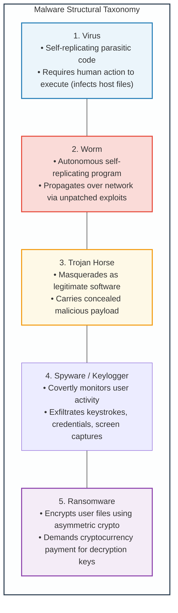
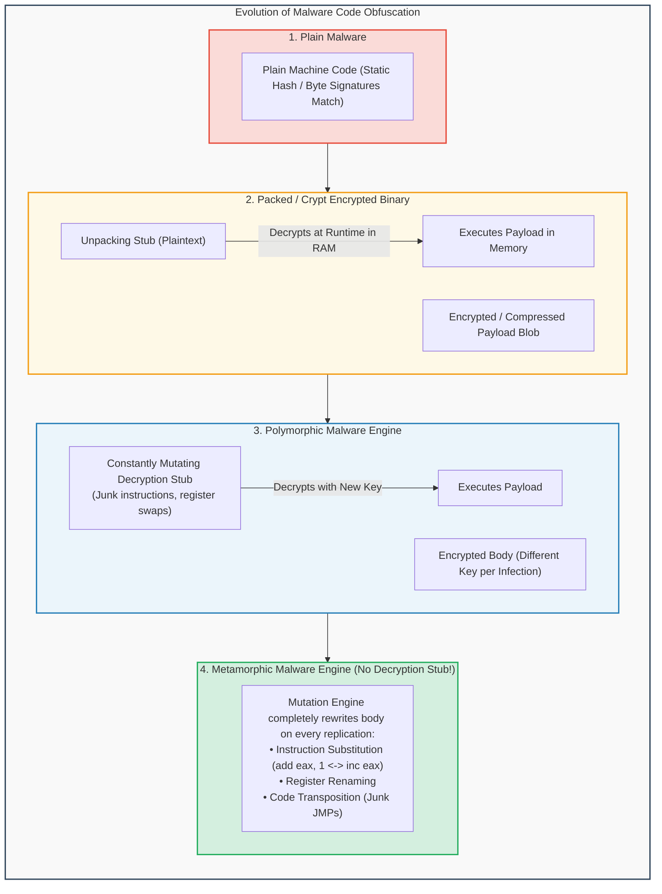
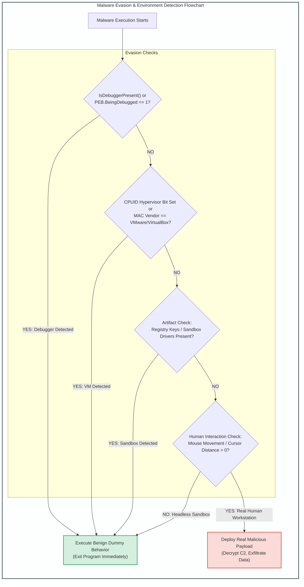

# Module 7: Malware Taxonomy, Evasion & Persistence Techniques

## 7.1 Malware Taxonomy: Structural Classifications

Malicious software (malware) encompasses any binary program, script, or firmware payload designed to compromise the confidentiality, integrity, or availability of a computing system without the owner's informed consent.



### Detailed Structural Profiles
1. **Viruses**:
   - Parasitic code that inserts itself into legitimate executable files (`.exe`, `.dll`) or document macros.
   - *File Infectors*: Overwrite code sections or append code to the end of PE files, modifying the entry point in the PE header to jump to the virus code first before returning to legitimate code.
2. **Worms (e.g., Morris, Code Red, WannaCry)**:
   - Self-contained, autonomous malware that replicates across networks without human intervention.
   - Scans subnets for vulnerable exposed services (e.g., SMB vulnerability MS17-010 in WannaCry), executes remote shellcode, transfers its payload, and spawns new scanning threads.
3. **Trojans**:
   - Disguised as helpful utilities (PDF converters, game cracks, system optimizers). Contains a hidden payload, often a Remote Access Trojan (RAT) providing reverse command shells, webcam access, and file exfiltration.

---

## 7.2 Evasion & Code Obfuscation: Packers, Crypters & Polymorphism

To evade static signature-based detection deployed by Antivirus (AV) and Intrusion Detection Systems (IDS), malware authors employ sophisticated cryptographic and structural transformations.



### Obfuscation Architectures
1. **Packers & Crypters (e.g., UPX, custom packers)**:
   - The original PE executable is compressed or encrypted and embedded as raw data inside a new PE binary.
   - At runtime, a lightweight **unpacking stub** allocates memory (`VirtualAlloc`), decrypts the original binary into memory, resolves import tables, and transfers execution to the unpacked entry point.
2. **Polymorphic Malware**:
   - The body of the malware is encrypted with a unique symmetric key for every infected file.
   - The decryption stub itself is mutated using a **polymorphic engine**: swapping registers, inserting dead code (`NOP`, `sub eax, 0`), and substituting equivalent instructions, altering the byte signature on every iteration.
3. **Metamorphic Malware**:
   - The most complex obfuscation form. Metamorphic malware completely disassembles, rewrites, and reassembles its own machine code without utilizing encryption stubs.
   - Every generation looks entirely different at the assembly level while remaining semantically identical in behavior.

---

## 7.3 Anti-Analysis, Anti-Debugging & Virtual Machine Detection

Modern security defenses analyze suspicious files inside automated sandbox environments (e.g., Cuckoo Sandbox, Any.Run) running inside virtual machines. Malware incorporates defensive checks to detect analysis environments and terminate execution or alter behavior.



### Detection Methodologies
1. **Anti-Debugging Techniques**:
   - *PEB BeingDebugged Flag*: Inspects the Process Environment Block (`fs:[0x30]` on x86). If `BeingDebugged == 1`, a debugger is attached.
   - *`CheckRemoteDebuggerPresent()`*: Win32 API invoking kernel debug queries.
   - *Hardware Breakpoint Detection*: Inspects debug registers (`DR0`–`DR3`) using `GetThreadContext()`.
   - *RDTSC Timing Checks*: Executes the `RDTSC` (Read Time-Stamp Counter) instruction before and after a code block. If execution takes millions of cycles (due to an analyst single-stepping through instructions), the malware halts.
2. **Virtual Machine & Sandbox Detection**:
   - *Hypervisor Artifacts*: Scans the file system for sandbox drivers (`vmmouse.sys`, `vboxguest.sys`) and registry keys (`HARDWARE\DEVICEMAP\Scsi\Scsi Port 0\Scsi Bus 0\Target Id 0\Logical Unit Id 0\Identifier` containing "VBOX" or "VMware").
   - *CPUID Hypervisor Signature*: Emits the `CPUID` instruction with `EAX=1`. If bit 31 of `ECX` is set, a hypervisor is present. Emitting `CPUID` with `EAX=0x40000000` returns vendor strings like "VMwareVMware", "Microsoft Hv", or "KVMKVMKVM".
   - *Human Interaction Verification*: Automated analysis sandboxes typically execute samples for 2 to 5 minutes with zero mouse movement. Malware sleeps for 20 minutes (`Sleep()`) or verifies that the mouse cursor moves at least 200 pixels before detonating.

---

## 7.4 System Persistence Mechanisms

To ensure survival across operating system reboots and user logoffs, malware anchors itself into persistent operating system structures:

```
Persistence Mechanisms across the Operating System Spectrum:
+---------------------------------------------------------------------------------+
| Persistence Layer   | Implementation & Location                                 |
+---------------------+-----------------------------------------------------------+
| Firmware / Hardware | UEFI / BIOS Flash Infection (SPI flash bootkits)          |
| Hypervisor Layer    | Rogue Hypervisor beneath host OS (Type 0 persistence)     |
| Windows Registry    | HKLM\Software\Microsoft\Windows\CurrentVersion\Run   |
|                     | HKCU\Software\Microsoft\Windows\CurrentVersion\Run   |
|                     | HKLM\System\CurrentControlSet\Services (Driver setup)  |
| Windows Services    | Service Control Manager (SCM) background system service   |
| Scheduled Tasks     | schtasks /create /tn "SecurityUpdate" /tr "malware.exe"   |
| Startup Folders     | %APPDATA%\Microsoft\Windows\Start Menu\Programs\Startup|
| WMI Event Filters   | WMI permanent event subscription (__EventFilter)          |
| DLL Hijacking       | Replacing legitimate DLL in application loading search path|
+---------------------------------------------------------------------------------+
```

---
---

## 7.5 Deep Low-Level Anti-Debugging: PEB & Kernel Flags

### 1. The Process Environment Block (PEB) Inspection
Adversaries query the PEB without invoking Win32 APIs (which might be hooked by EDR solutions):
```assembly
; Reading PEB BeingDebugged on 32-bit Windows
mov eax, fs:[0x30]        ; FS register points to TEB; offset 0x30 is pointer to PEB
movzx eax, byte [eax + 2] ; Offset 0x02 is BeingDebugged byte
test eax, eax
jnz debugger_detected

; Reading PEB BeingDebugged on 64-bit Windows
mov rax, gs:[0x60]        ; GS register points to TEB; offset 0x60 is pointer to PEB
movzx eax, byte [rax + 2]
test eax, eax
jnz debugger_detected
```

### 2. The `NtGlobalFlag` Signature
When a process is launched under a debugger, the Windows heap manager sets specific flags in the `NtGlobalFlag` field (`PEB + 0x68` in 32-bit, `PEB + 0xBC` in 64-bit):
- `FLG_HEAP_ENABLE_TAIL_CHECK` (`0x10`): Appends canary patterns to heap allocations.
- `FLG_HEAP_ENABLE_FREE_CHECK` (`0x20`): Verifies memory blocks upon deallocation.
- `FLG_HEAP_VALIDATE_PARAMETERS` (`0x40`): Validates parameters passed to heap functions.
- If `NtGlobalFlag == (0x10 | 0x20 | 0x40) == 0x70`, an attached debugger is flagged.
