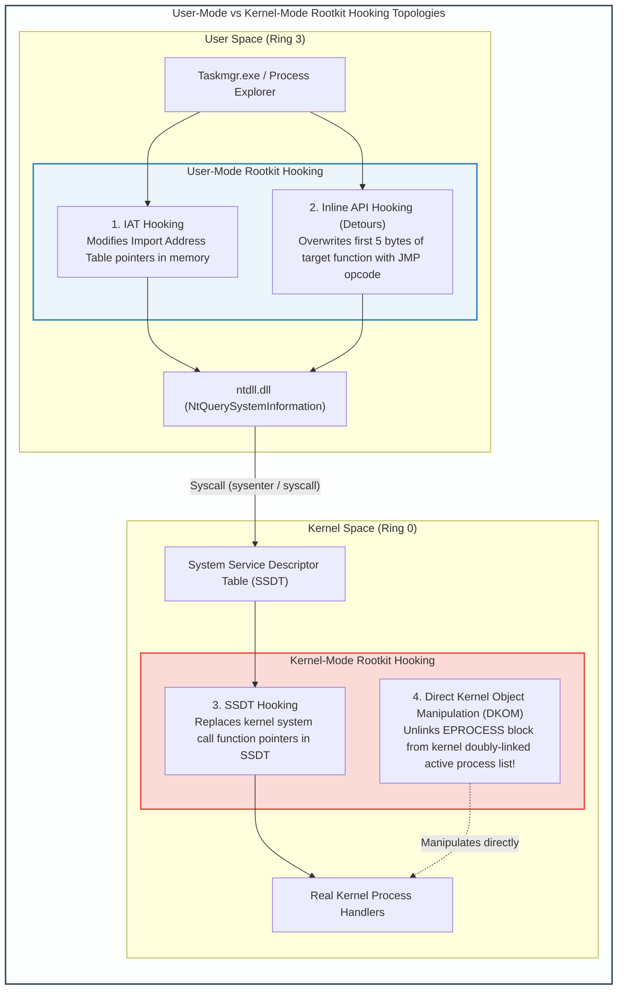
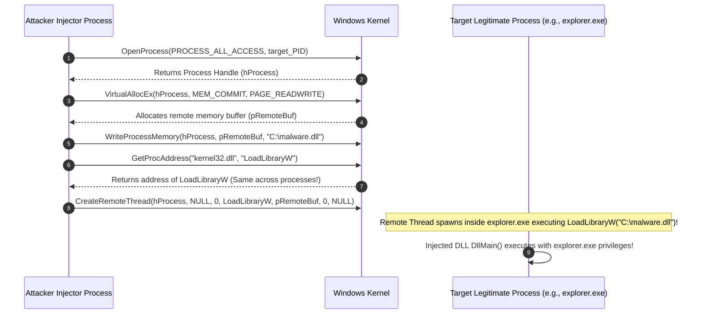
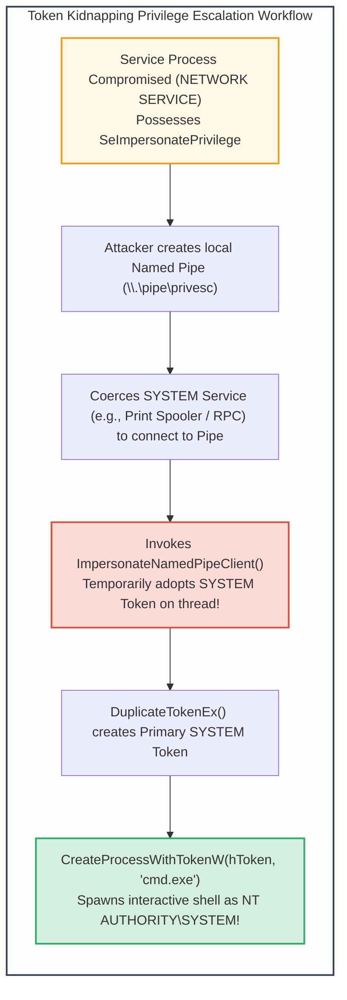

# Module 8: Advanced Malware Capabilities & Privilege Escalation

## 8.1 Rootkit Architectures: User-Mode vs. Kernel-Mode

A **Rootkit** is a specialized stealth cloaking technology designed to conceal the presence of unauthorized running processes, network sockets, files, and registry keys from the operating system, antivirus tools, and system administrators.

### Hooking & Cloaking Mechanisms
1. **User-Mode Rootkits (Ring 3)**:
   - Operate inside the virtual address space of user processes.
   - *Import Address Table (IAT) Hooking*: When an executable links to an external DLL, it resolves function pointers through the IAT. A user-mode rootkit replaces the function pointer of `NtQuerySystemInformation` in the IAT with a pointer to its malicious filter function. When Task Manager queries running processes, the rootkit intercepts the returned array, deletes its own process record, and returns the scrubbed list.
   - *Inline Hooking (Detours / Trampolines)*: Replaces the first 5 bytes (the function prologue, e.g., `mov edi, edi; push ebp; mov ebp, esp`) of the target API function in memory with an unconditional `JMP` instruction directing execution to the rootkit's hook.
2. **Kernel-Mode Rootkits (Ring 0)**:
   - Execute with supreme architectural privilege in the Windows or Linux kernel.
   - *SSDT Hooking (System Service Descriptor Table)*: The SSDT contains kernel dispatch function pointers. Hooking the SSDT allows the rootkit to filter all system calls system-wide before user mode ever receives data. (Mitigated in 64-bit Windows via Kernel Patch Protection / PatchGuard).
   - *Direct Kernel Object Manipulation (DKOM)*: Every active process in the Windows kernel is represented by an `EPROCESS` structure. All `EPROCESS` blocks are linked in a circular, doubly-linked list (`ActiveProcessLinks.Flink` and `Blink`). A DKOM rootkit modifies the pointers of the adjacent processes to point to each other, unlinking the rootkit's `EPROCESS` from the list. The process remains fully scheduled by the CPU dispatcher, but disappears completely from all enumeration APIs.

---

## 8.2 DLL Injection Techniques

**DLL Injection** is an exploitation technique that forces a running remote process to load an arbitrary Dynamic Link Library (DLL) into its own virtual address space, executing malicious code under the legitimate process's security context.

### Injection Variants
1. **Classic DLL Injection (`CreateRemoteThread`)**:
   - Outlined in the diagram above. Requires `PROCESS_ALL_ACCESS` permissions.
2. **AppInit_DLLs Registry Injection**:
   - The registry key `HKLM\Software\Microsoft\Windows NT\CurrentVersion\Windows\AppInit_DLLs` allows specifying custom DLLs that are automatically loaded into *every* user-mode GUI process that links with `user32.dll`.
3. **Reflective DLL Injection (Stephen Fewer Technique)**:
   - Traditional DLL injection leaves artifacts on the hard disk and registers the DLL in the target process's `InLoadOrderModuleList` (visible to PEB inspection).
   - *Reflective Injection* writes the raw PE binary of the DLL directly into remote process memory from a memory buffer. The DLL contains an exported bootstrapping function (`ReflectiveLoader`) that manually maps its own sections, resolves imports, executes base relocations, and invokes `DllMain` entirely in memory without ever calling `LoadLibrary` or touching disk.

---

## 8.3 Token Kidnapping & Windows Privilege Escalation

Windows services frequently execute under service accounts (such as `NT AUTHORITY\NETWORK SERVICE` or `LOCAL SERVICE`). While these accounts lack administrative powers, they frequently hold the sensitive **`SeImpersonatePrivilege`** or **`SeAssignPrimaryTokenPrivilege`**.

### Exploitation Mechanics
- **Token Impersonation**: A thread executing in a service process can call `ImpersonateNamedPipeClient()` or `ImpersonateLoggedOnUser()` to adopt the security identity of an incoming client connection.
- Tools like **RottenPotato**, **JuicyPotato**, and **PrintSpoofer** coerce high-privilege system services (such as the DCOM activator or Print Spooler) into authenticating against a local named pipe or RPC endpoint controlled by the low-privileged process, instantly capturing a token for `NT AUTHORITY\SYSTEM`.

---
