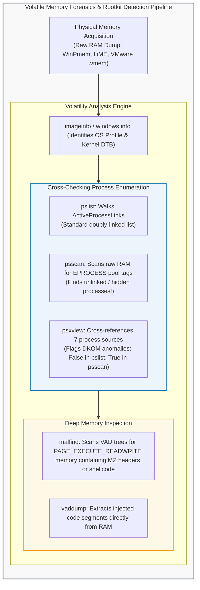
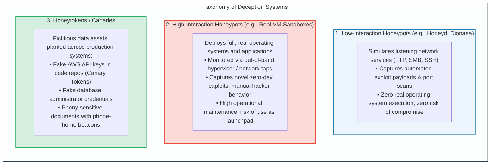

# Module 9: Memory Forensics, Threat Detection & Honeypots

## 9.1 Memory Forensics: The Volatility Framework & VAD Analysis

When investigating advanced persistent threats (APTs) deploying fileless malware, reflective DLL injection, or unlinked DKOM processes, disk forensics reveals zero evidence. The ground truth of system state resides in **volatile physical memory (RAM)**.

### Core Volatility Analysis Modules
1. **Process Discovery Cross-Validation (`psxview`)**:
   - DKOM rootkits unlink processes from `ActiveProcessLinks` (making them invisible to `pslist` and Task Manager).
   - `psscan` ignores the linked list, conducting heuristic signature scanning across raw memory bytes searching for `_EPROCESS` pool tag headers (`Proc`).
   - If `psxview` reveals a process marked `False` in `pslist` but `True` in `psscan`, a DKOM rootkit is actively hiding a malicious process.
2. **Virtual Address Descriptor (VAD) Tree Analysis (`malfind`)**:
   - Every Windows process maintains a self-balancing binary search tree (the **VAD Tree**) tracking allocated virtual memory ranges.
   - Legitimate Windows binaries map executable code (`.text`) with `PAGE_EXECUTE_READ` attributes backed by a file on disk.
   - Attackers injecting shellcode allocate private memory marked `PAGE_EXECUTE_READWRITE` (RWX) without backing disk files. The `malfind` plugin traverses the VAD tree searching for RWX allocations containing executable opcodes or PE headers (`MZ`).

---

## 9.2 Deception Technologies: Honeypots, Honeynets & Honeytokens

**Deception technology** shifts the asymmetrical advantage of cyber warfare from the attacker to the defender. While defenders traditionally had to secure every vulnerability, deception creates an environment where an attacker touching a single false asset trips an alarm.

---
---

## 9.3 Practical Memory Forensics Command Reference (Volatility 3)

The following master table provides the essential forensic triage commands for volatile RAM analysis:

| Forensic Objective | Volatility 3 Command | Analytical Target & Anomaly Detection |
| :--- | :--- | :--- |
| **Kernel & OS Identification** | `vol -f mem.raw windows.info` | Discovers architecture, build number, and Kernel Directory Table Base (CR3). |
| **Process Tree Enumeration** | `vol -f mem.raw windows.pstree` | Displays parent-child process relationships (detects abnormal parent processes). |
| **DKOM Rootkit Detection** | `vol -f mem.raw windows.psscan` | Scans raw memory pool tags to find unlinked / hidden processes. |
| **Cross-Validation** | `vol -f mem.raw windows.psxview` | Flags discrepancies across 7 internal kernel process structures. |
| **Injected Code Detection** | `vol -f mem.raw windows.malfind` | Scans VAD trees for unbacked `PAGE_EXECUTE_READWRITE` memory containing code. |
| **Network Sockets** | `vol -f mem.raw windows.netscan` | Enumerates active and terminated TCP/UDP endpoints, foreign IPs, and PIDs. |
| **Command Line Arguments** | `vol -f mem.raw windows.cmdline` | Extracts process launch arguments (detects obfuscated PowerShell commands). |
| **Dump Injected PE Executable**| `vol -f mem.raw windows.vaddump --pid <PID>` | Dumps injected memory segments to disk for reverse engineering. |
